# 3DCraft Jigs

Parametric generators for [3DCraft](https://github.com/johancoppens/3dcraft) that run without AI.

A **Jig** is a 3DCraft design whose driving variables are published as **parameters**: your latitude, a mirror's
diameter, the size of a drawer. Someone who opens a Jig sets those parameters in a form and gets a new model and its
manufacturing files, regenerated deterministically by 3DCraft's own kernel; no AI and no code run. A published Jig is a
`.3dcraftjig` file: the same format as a `.3dcraft` document, with its info (title, description, author, licence) and
a thumbnail.

Jigs are not part of 3DCraft. 3DCraft provides the mechanism (public parameters, the form, `.3dcraftjig` files, the
range check); this repository holds Jigs. How they are made and held to one quality bar is in [`AGENTS.md`](AGENTS.md);
what each must be is in [`CATALOGUE.md`](CATALOGUE.md).

<!-- jigs:start -->
| | Jig | Workshop | Difficulty | Licence |
|---|---|---|---|---|
| 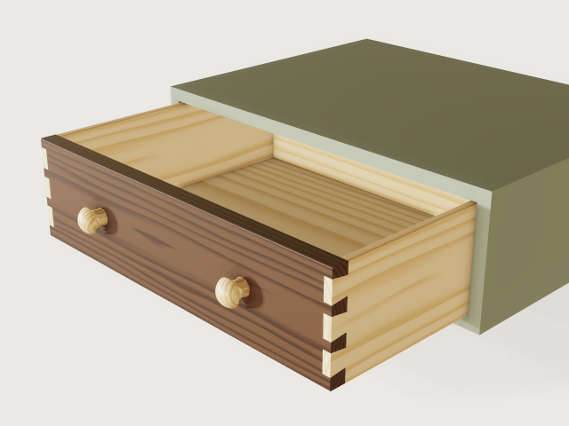 | **[Dovetail drawer](jigs/joint-drawer/)**<br>A dovetailed drawer sized from the hole it must fill: give the opening and running clearance, the board thickness, the joint and the timber, and the Jig lays out the tails by the old rules and refuses a gap a wet season would close. | Woodwork, joinery | 5/10 | CC-BY-4.0 |
|  | **[Sandwich keyboard plate](jigs/keyboard-plate/)**<br>A laser-cut sandwich keyboard for MX-style mechanical switches: a switch plate, a bottom plate and M2 standoffs, column-staggered, split or in one piece, with room for a controller. Choose rows, columns, stagger, thumb keys and plate material. | Laser cutting, electronics | 5/10 | CC-BY-4.0 |
| 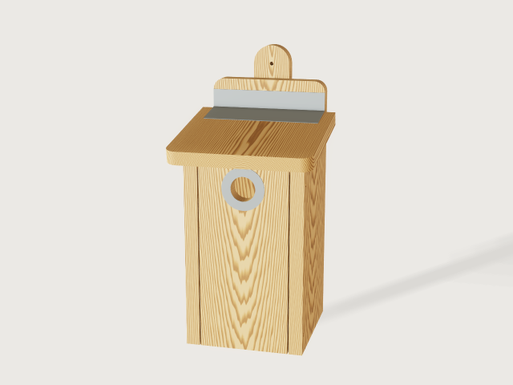 | **[Nest box from one plank](jigs/nest-box/)**<br>A nest box for a garden bird of the Low Countries, sawn from one plank and screwed: pick the species and the entrance, floor, height and even the shape of the box follow Vogelbescherming Nederland's table. | Woodwork, garden birds | 5/10 | CC-BY-4.0 |
|  | **[Platonic net to fold and glue](jigs/polyhedron-net/)**<br>The five Platonic solids from one sheet of paper: pick a solid, set its size to your sheet, drag the slider to watch the classic net fold shut, and export the pattern with glue tabs to print, cut and glue. | Paper, education | 5/10 | CC-BY-4.0 |
| 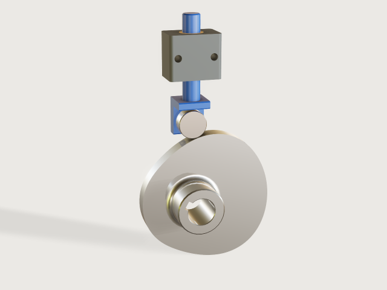 | **[Disc cam with roller follower](jigs/cam-disc/)**<br>A disc cam with a translating roller follower laid out from a motion law: give the lift, the rise, dwell and return angles and the speed, and the form refuses a cam whose pressure angle or curvature cannot work and says which base circle would. | Machine building, mechanisms | 6/10 | CC-BY-4.0 |
| 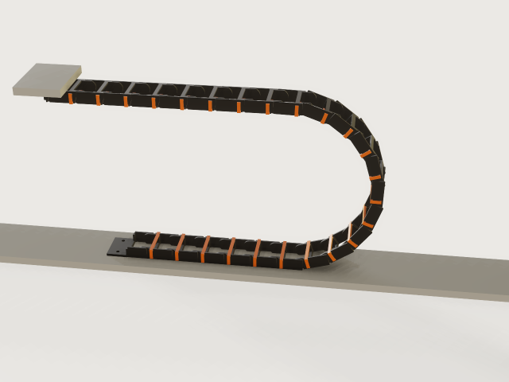 | **[Cable drag chain](jigs/drag-chain/)**<br>A printable cable drag chain designed from what you know: the cable bundle, the machine's travel, the height of the moving end and the smallest bend the cable allows give the link size, pitch, link count and fixed point, by igus' published rules. | 3D printing, CNC | 6/10 | CC-BY-4.0 |
| 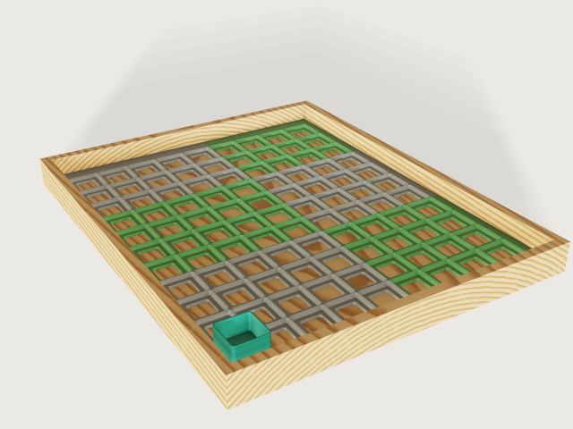 | **[Gridfinity baseplate](jigs/gridfinity-baseplate/)**<br>A Gridfinity baseplate that fills your drawer: as many 42 mm cells as fit, centred, with filler strips to the walls, split into pieces that fit your print bed and joined by printed bowtie clips. | 3D printing, storage | 6/10 | CC-BY-4.0 |
| 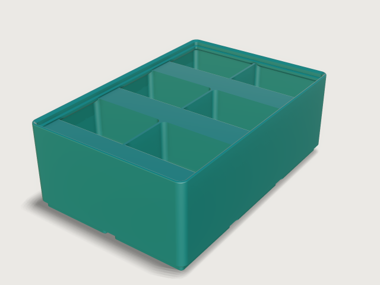 | **[Gridfinity bin](jigs/gridfinity-bin/)**<br>A storage bin for the Gridfinity system: choose the grid size, the compartments, label tabs, scoops and base holes; it prints without supports and proves, with its fit gauges on, that it seats in a baseplate and stacks. | 3D printing, workshop storage | 6/10 | CC-BY-4.0 |
| 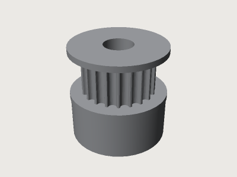 | **[GT2 pulley](jigs/gt2-pulley/)**<br>A GT2 2 mm timing pulley from the belt you bought and the shaft you have: flanges and face width after the Gates design manual, a hub with grub screws in one choice, machined and black anodised or 3D printed in its print orientation. | 3D printing, machining | 6/10 | CC-BY-SA-4.0 |
| 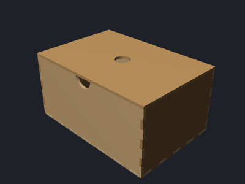 | **[Laser-cut box](jigs/laser-box/)**<br>A finger-jointed plywood box sized from what goes in it or where it must fit, with compartments tabbed through the floor and a lid held by a frame, ready to laser cut with your sheet's real thickness and your laser's kerf. | Laser cutting | 6/10 | CC-BY-4.0 |
|  | **[Miura-ori fold panel](jigs/miura-ori/)**<br>A Miura-ori sheet that folds and unfolds with one slider: pick the sheet, rows, columns and angle, watch it fold, and export the crease pattern with mountains and valleys on separate layers to print, score or cut. | Origami, paper and laser cutting | 6/10 | CC-BY-4.0 |
| 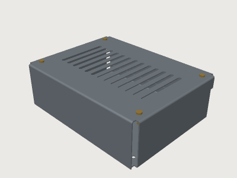 | **[Sheet-metal enclosure](jigs/sheet-metal-enclosure/)**<br>A sheet-metal electronics case sized from what goes in it: a board, a power supply or a stack of them. Laser cut and bent from two sheets, a chassis and a cover, with the bend order proven at every change of the form. | Sheet metal, electronics | 6/10 | CC-BY-4.0 |
| 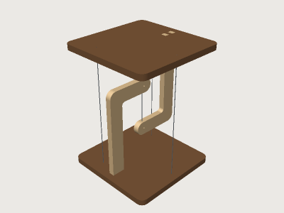 | **[Tensegrity table](jigs/tensegrity-table/)**<br>The floating table: a top hanging from a hook on the base by one short rope and held level by three to six tensioned outer cables. Set the size, the cables and the load; the Jig sizes every tension and refuses a load the fittings cannot carry. | Woodwork, statics | 6/10 | CC-BY-4.0 |
|  | **[Wooden stair](jigs/wooden-stair/)**<br>A straight closed-string wooden stair for your stairwell: floor to floor, the run you have, the width and the opening. The form chooses the steps, rise and going by the step rule, keeps them within the dimensions of the rule you pick (Bbl, Flemish code or a comfort stair), and exports the housed stringers and treads for a CNC. Dimensions only: strength figures are an orientation for a structural engineer to verify. | Joinery, building | 6/10 | CC-BY-4.0 |
|  | **[Cycloidal drive](jigs/cycloidal-drive/)**<br>A printable single-stage cycloidal reducer for a NEMA stepper: the true lobe profile from the pin count and eccentricity, steel pins, bearings from a table, and a slider that runs it. | 3D printing, robotics | 7/10 | CC-BY-4.0 |
| 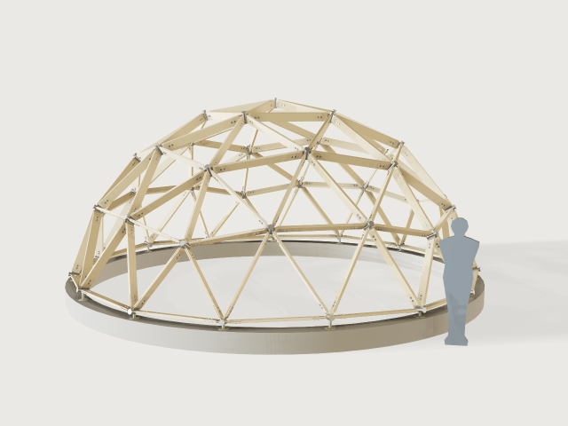 | **[Geodesic timber dome](jigs/geodesic-dome/)**<br>A timber-strut geodesic dome (1V, 2V or 3V) with laser-cut steel hubs: give a radius or a floor area and get the strut schedule, the timber to buy, the hub count and the plates to send to the laser. | Building, laser cutting | 7/10 | CC-BY-4.0 |
| 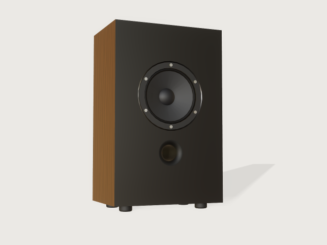 | **[Loudspeaker box](jigs/loudspeaker-box/)**<br>A cabinet for one loudspeaker driver from its data sheet: the volume from Thiele and Small's alignments, measured on the model, a flared port tuned by Helmholtz, and finger-jointed or rebated panels for the router or the saw. | Woodwork, acoustics | 7/10 | CC-BY-4.0 |
| 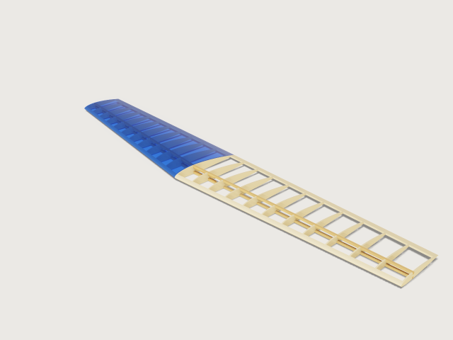 | **[Built-up RC wing](jigs/rc-wing/)**<br>A built-up balsa wing for a radio-controlled model from its span, chords, NACA digits, sweep, washout and flying weight: every rib cut from a lofted wing with its spar slots, leading and trailing edge stock, a ply joiner and film, and the numbers an aeromodeller wants. | Aeromodelling, laser cutting | 7/10 | CC-BY-4.0 |
| 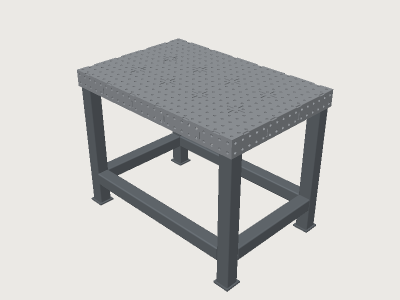 | **[Welding table](jigs/welding-table/)**<br>A fixture welding table you laser cut and MIG weld yourself: 16 mm or 28 mm holes on a 50 or 100 mm grid, a perforated top on half-lapped ribs, perforated side plates, and a base of square tube. The plates meet in plain contact with one short recessed tab per pitch, so the welds lie below the datum faces and nothing stands proud. The form limits the load to what keeps the sag within the flatness limit; the mass, the weld share and the sway are measured or worked out from the model. | Welding, laser cutting | 7/10 | CC-BY-4.0 |
|  | **[Dobsonian telescope](jigs/dobsonian-telescope/)**<br>A Newtonian on a plywood rocker box, from your mirror: the secondary for the field you choose, the spider, the focuser position, the altitude bearings on the real balance point (computed from the masses, then measured on the model), the rocker box and a cut sheet for the plywood. | Woodwork, optics | 8/10 | CC-BY-4.0 |
<!-- jigs:end -->

## Using a Jig

**Desktop.** Open a `.3dcraftjig` file (File › Open, or double-click it once 3DCraft is installed). It opens on its
**Parameters** tab: drag or type the values; the model follows. A value outside a parameter's range is clamped and the
form says so. Then **File › Export…** (STL, 3MF or STEP for a part; DXF or SVG for a cut sheet). **Save** saves the
result as an ordinary `.3dcraft` model; the Jig file itself is never changed. **Open for editing** makes an editable
copy if you want to change the design itself.

**Web.** The 3DCraft web build opens a Jig served from the same site:
`https://example.org/3dcraft/?open=/jigs/<id>.3dcraftjig`. The gallery page (`dist/index.html`) links every Jig
that way, and offers the file for download. In the browser the model follows a parameter when you let go of it.

**Agents and scripts.** `param.list` lists the parameters, `param.set {"values": {...}}` sets several at once
(out-of-range values are refused with the range), for instance:

```sh
craft3d-cli run dist/laser-box.3dcraftjig \
  --cmd param.set --params '{"values": {"width": "220 mm", "height": "60 mm"}}' \
  --cmd file.export --params '{"path": "box.svg", "set": "Cut sheet"}'
```

## Building and checking

You need `craft3d-cli` from 3DCraft, the commit named in [`tools/pin.json`](tools/pin.json), on `PATH` or in
`CRAFT3D_CLI`.

```sh
tools/jigs.py build [id ...]     # jigs/<id>/build.json to dist/<id>.3dcraftjig, with its stats
tools/jigs.py render [id ...]    # jigs/<id>/preview.png and dist/thumbs/<id>.png
tools/jigs.py check [id ...]     # rebuild, lint, exports, check-range and the bend sequence
tools/jigs.py gallery            # dist/index.html
```

`check` runs `craft3d-cli check-range` with a fixed seed: the defaults, the corners of the parameter ranges, every
choice and random points, each regenerated from nothing and checked as `document.check` checks it. A Jig is only
published when every point passes.

`dist/` is committed so the Jigs can be used without building them.

## Hosting

The Jigs are served next to the 3DCraft web build on the same host, so the web build can open them (it only opens
same-origin files):

```text
https://example.org/3dcraft/                 the 3DCraft web build
https://example.org/jigs/                    the contents of dist/
https://example.org/jigs/index.html          the gallery
https://example.org/jigs/<id>.3dcraftjig     a Jig; the gallery opens it with ../3dcraft/?open=/jigs/<id>.3dcraftjig
https://example.org/jigs/thumbs/<id>.png     its picture
```

Serve `.3dcraftjig` as `application/x-craft3d-jig` (or `application/zip`).

## Licences

- The tools: MIT ([LICENSE](LICENSE)).
- Each Jig carries its own licence in its document info (an SPDX id), shown in the gallery and in its README. The
  default is **CC-BY-4.0**, unless a source requires otherwise.
- `gt2-pulley` uses the GT2 tooth outline of droftarts' *Parametric Pulley - lots of tooth profiles*
  ([thingiverse.com/thing:16627](https://www.thingiverse.com/thing:16627)), licensed
  [CC BY-SA 4.0](https://creativecommons.org/licenses/by-sa/4.0/); that Jig is therefore shared under
  **CC-BY-SA-4.0**, with attribution to droftarts. Other sources are in [ATTRIBUTION.md](ATTRIBUTION.md).
