# 3DCraft Jigs

Parametric generators for [3DCraft](https://github.com/johancoppens/3dcraft) that run without AI.

A **Jig** is a 3DCraft design whose driving variables are published as **parameters**: your latitude, a mirror's
diameter, the size of a drawer. Someone who opens a Jig sets those parameters in a form and gets a new model and its
manufacturing files, regenerated deterministically by 3DCraft's own kernel; no AI and no code run. A published Jig is a
`.3dcraftjig` file: the same format as a `.3dcraft` document, with its info (title, description, author, licence) and
a thumbnail.

Jigs are not part of 3DCraft. 3DCraft provides the mechanism (public parameters, the form, `.3dcraftjig` files, the
range check); this repository holds Jigs. How they are made and held to one quality bar is in [`AGENTS.md`](AGENTS.md);
what each must be is in [`CATALOGUE.md`](CATALOGUE.md).

Each Jig has one folder, `jigs/NN-<id>/`, numbered from the least to the most demanding: its source (`build.json`), its
page (`README.md`), the published `<id>.3dcraftjig`, its pictures (`preview.png`, `thumb.png`), `meta.json` and the
form test (`formtest.md`). The number is only the folder's; the id, the file's name and its web address never carry it.

<!-- jigs:start -->
| | Jig | Workshop | Difficulty | Licence |
|---|---|---|---|---|
|  | **[01. Nest box from one plank](jigs/01-nest-box/)**<br>A nest box for a garden bird of the Low Countries, sawn from one plank and screwed: pick the species and the entrance, floor, height and even the shape of the box follow Vogelbescherming Nederland's table. | Woodwork, garden birds | 5/10 | CC-BY-4.0 |
|  | **[02. Dovetail drawer](jigs/02-joint-drawer/)**<br>A dovetailed drawer sized from the hole it must fill: give the opening and running clearance, the board thickness, the joint and the timber, and the Jig lays out the tails by the old rules and refuses a gap a wet season would close. | Woodwork, joinery | 5/10 | CC-BY-4.0 |
|  | **[03. Platonic net to fold and glue](jigs/03-polyhedron-net/)**<br>The five Platonic solids from one sheet of paper: pick a solid, set its size to your sheet, drag the slider to watch the classic net fold shut, and export the pattern with glue tabs to print, cut and glue. | Paper, education | 5/10 | CC-BY-4.0 |
| 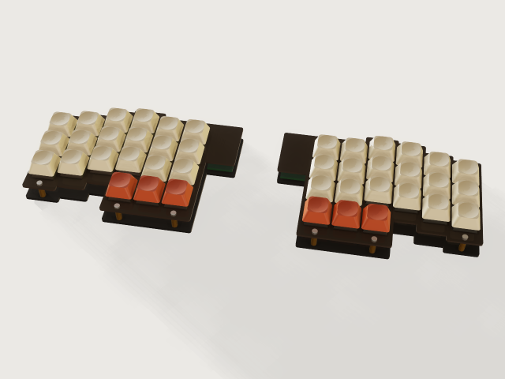 | **[04. Sandwich keyboard plate](jigs/04-keyboard-plate/)**<br>A laser-cut sandwich keyboard for MX-style mechanical switches: a switch plate, a bottom plate and M2 standoffs, column-staggered, split or in one piece, with room for a controller. Choose rows, columns, stagger, thumb keys and plate material. | Laser cutting, electronics | 5/10 | CC-BY-4.0 |
| 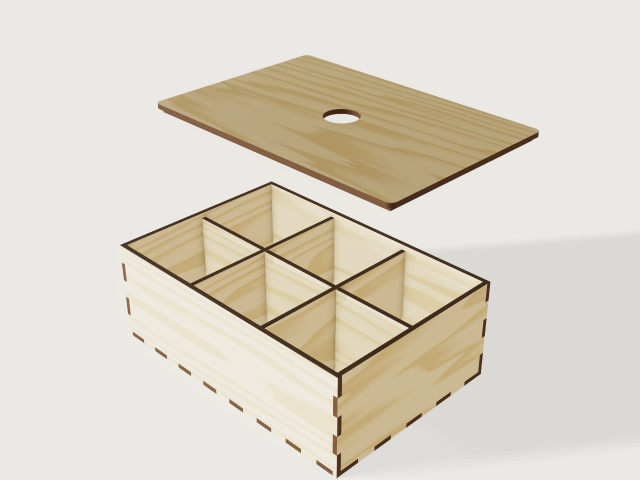 | **[05. Laser-cut box](jigs/05-laser-box/)**<br>A finger-jointed plywood box sized from what goes in it or where it must fit, with compartments tabbed through the floor and a lid held by a frame, ready to laser cut with your sheet's real thickness and your laser's kerf. | Laser cutting | 6/10 | CC-BY-4.0 |
| 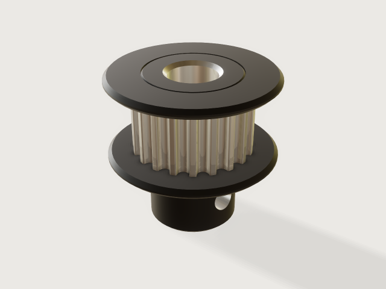 | **[06. GT2 pulley](jigs/06-gt2-pulley/)**<br>A GT2 2 mm timing pulley from the belt you bought and the shaft you have: flanges and face width after the Gates design manual, a hub with grub screws in one choice, machined and black anodised or 3D printed in its print orientation. | 3D printing, machining | 6/10 | CC-BY-SA-4.0 |
|  | **[07. Gridfinity bin](jigs/07-gridfinity-bin/)**<br>A storage bin for the Gridfinity system: choose the grid size, the compartments, label tabs, scoops and base holes; it prints without supports and proves, with its fit gauges on, that it seats in a baseplate and stacks. | 3D printing, workshop storage | 6/10 | CC-BY-4.0 |
|  | **[08. Gridfinity baseplate](jigs/08-gridfinity-baseplate/)**<br>A Gridfinity baseplate that fills your drawer: as many 42 mm cells as fit, centred, with filler strips to the walls, split into pieces that fit your print bed and joined by printed bowtie clips. | 3D printing, storage | 6/10 | CC-BY-4.0 |
|  | **[09. Cable drag chain](jigs/09-drag-chain/)**<br>A printable cable drag chain designed from what you know: the cable bundle, the machine's travel, the height of the moving end and the smallest bend the cable allows give the link size, pitch, link count and fixed point, by igus' published rules. | 3D printing, CNC | 6/10 | CC-BY-4.0 |
| 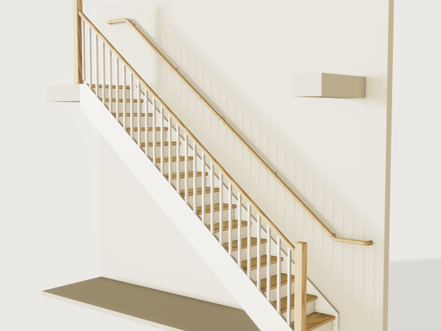 | **[10. Wooden stair](jigs/10-wooden-stair/)**<br>A straight closed-string wooden stair for your stairwell: floor to floor, the run you have, the width and the opening. The form chooses the steps, rise and going by the step rule, keeps them within the dimensions of the rule you pick (Bbl, Flemish code or a comfort stair), and exports the housed stringers and treads for a CNC. Dimensions only: strength figures are an orientation for a structural engineer to verify. | Joinery, building | 6/10 | CC-BY-4.0 |
|  | **[11. Disc cam with roller follower](jigs/11-cam-disc/)**<br>A disc cam with a translating roller follower laid out from a motion law: give the lift, the rise, dwell and return angles and the speed, and the form refuses a cam whose pressure angle or curvature cannot work and says which base circle would. | Machine building, mechanisms | 6/10 | CC-BY-4.0 |
| 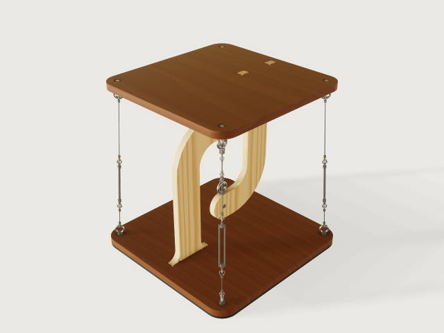 | **[12. Tensegrity table](jigs/12-tensegrity-table/)**<br>The floating table: a top hanging from a hook on the base by one short rope and held level by three to six tensioned outer cables. Set the size, the cables and the load; the Jig sizes every tension and refuses a load the fittings cannot carry. | Woodwork, statics | 6/10 | CC-BY-4.0 |
| 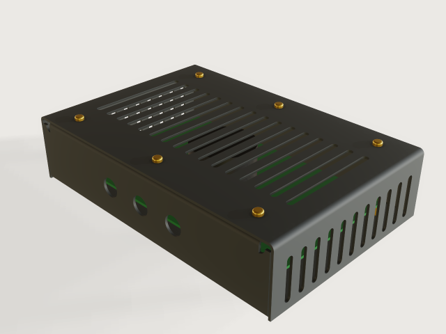 | **[13. Sheet-metal enclosure](jigs/13-sheet-metal-enclosure/)**<br>A sheet-metal electronics case sized from what goes in it: a board, a power supply or a stack of them. Laser cut and bent from two sheets, a chassis and a cover, with the bend order proven at every change of the form. | Sheet metal, electronics | 6/10 | CC-BY-4.0 |
| 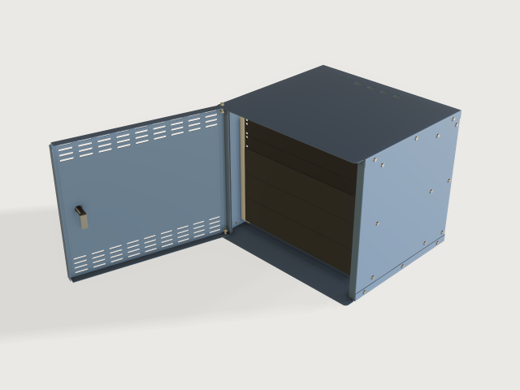 | **[14. 19-inch rack cabinet](jigs/14-rack-cabinet/)**<br>A 19-inch rack cabinet sized from what goes in it: how many units, how deep the gear is and what it weighs, on a wall or on feet. Laser cut and folded from one sheet thickness, bolted together with clinch nuts, EIA-310 rails, a door on hinge pins with a quarter-turn lock. | Sheet metal, racks | 6/10 | CC-BY-4.0 |
| 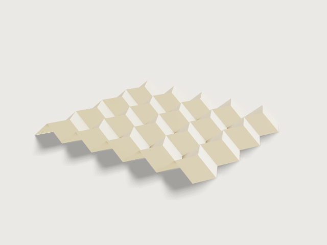 | **[15. Miura-ori fold panel](jigs/15-miura-ori/)**<br>A Miura-ori sheet that folds and unfolds with one slider: pick the sheet, rows, columns and angle, watch it fold, and export the crease pattern with mountains and valleys on separate layers to print, score or cut. | Origami, paper and laser cutting | 6/10 | CC-BY-4.0 |
|  | **[16. Loudspeaker box](jigs/16-loudspeaker-box/)**<br>A cabinet for one loudspeaker driver from its data sheet: the volume from Thiele and Small's alignments, measured on the model, a flared port tuned by Helmholtz, and finger-jointed or rebated panels for the router or the saw. | Woodwork, acoustics | 7/10 | CC-BY-4.0 |
| 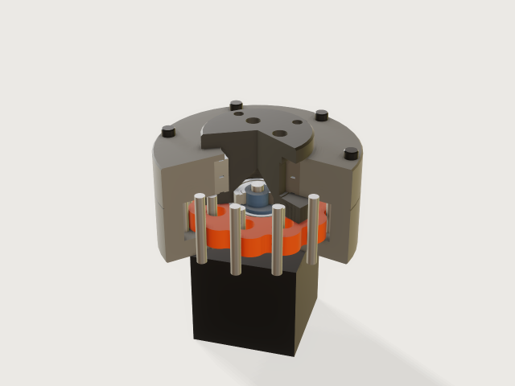 | **[17. Cycloidal drive](jigs/17-cycloidal-drive/)**<br>A printable single-stage cycloidal reducer for a NEMA stepper: the true lobe profile from the pin count and eccentricity, steel pins, bearings from a table, and a slider that runs it. | 3D printing, robotics | 7/10 | CC-BY-4.0 |
|  | **[18. Geodesic timber dome](jigs/18-geodesic-dome/)**<br>A timber-strut geodesic dome (1V, 2V or 3V) with laser-cut steel hubs: give a radius or a floor area and get the strut schedule, the timber to buy, the hub count and the plates to send to the laser. | Building, laser cutting | 7/10 | CC-BY-4.0 |
| 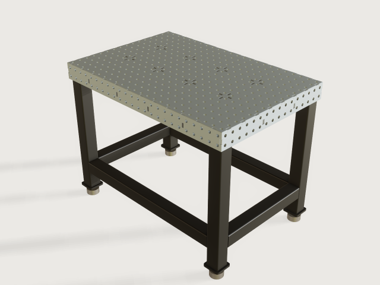 | **[19. Welding table](jigs/19-welding-table/)**<br>A fixture welding table you laser cut and MIG weld yourself: 16 mm or 28 mm holes on a 50 or 100 mm grid, a perforated top on half-lapped ribs, perforated side plates, and a base of square tube. The plates meet in plain contact with one short recessed tab per pitch, so the welds lie below the datum faces and nothing stands proud. The form limits the load to what keeps the sag within the flatness limit; the mass, the weld share and the sway are measured or worked out from the model. | Welding, laser cutting | 7/10 | CC-BY-4.0 |
| 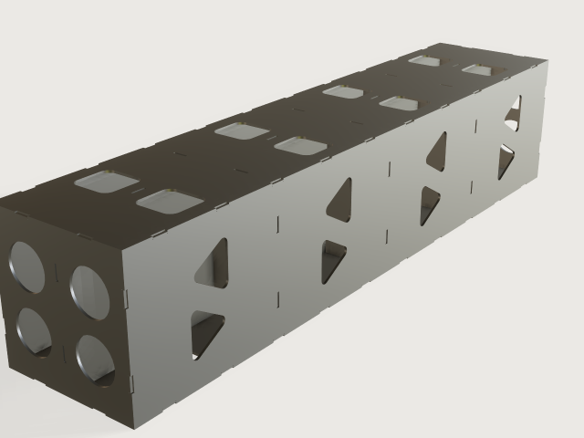 | **[20. Welded plate box](jigs/20-welded-box/)**<br>A rectangular box, cube or beam of laser-cut steel plate from 3 mm up, to build machines from: short recessed tabs, a half-lapped egg-crate of ribs inside, and openings that follow each wall. Tab and slot from the laser hold it straight while it is welded. | Welding, machine building | 7/10 | CC-BY-4.0 |
| 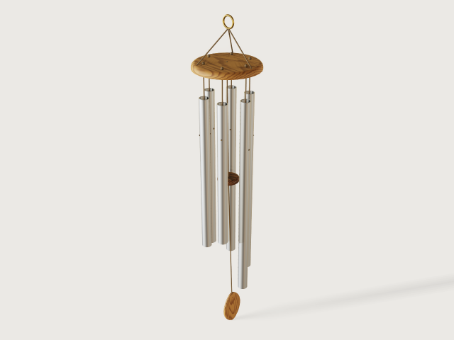 | **[21. Tuned chimes](jigs/21-tuned-chimes/)**<br>A wind chime of tubes, or a glockenspiel of bars, cut to pitch from the free-free beam formula: pick the scale and the stock you bought, get every length and node hole, a full-size cut-and-drill sheet, and a form that corrects itself from a tuner reading of your own test piece. | Metalwork, acoustics | 7/10 | CC-BY-4.0 |
| 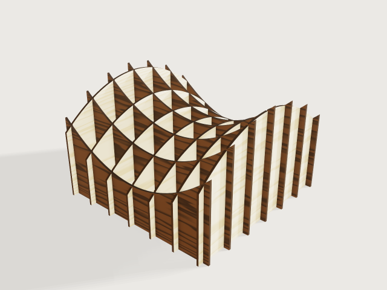 | **[22. Sliceform sculpture](jigs/22-sliceform/)**<br>A sculpture of two families of laser-cut plywood slices, birch one way and walnut the other, that slide into each other with half-lap slots and show a saddle, a ripple or a ball. Every slot meets its partner half way up its crossing, fitted to your two sheets as measured and to your laser's kerf. | Laser cutting, art, mathematics | 7/10 | CC-BY-4.0 |
|  | **[23. Built-up RC wing](jigs/23-rc-wing/)**<br>A built-up balsa wing for a radio-controlled model from its span, chords, NACA digits, sweep, washout and flying weight: every rib cut from a lofted wing with its spar slots, leading and trailing edge stock, a ply joiner and film, and the numbers an aeromodeller wants. | Aeromodelling, laser cutting | 7/10 | CC-BY-4.0 |
| 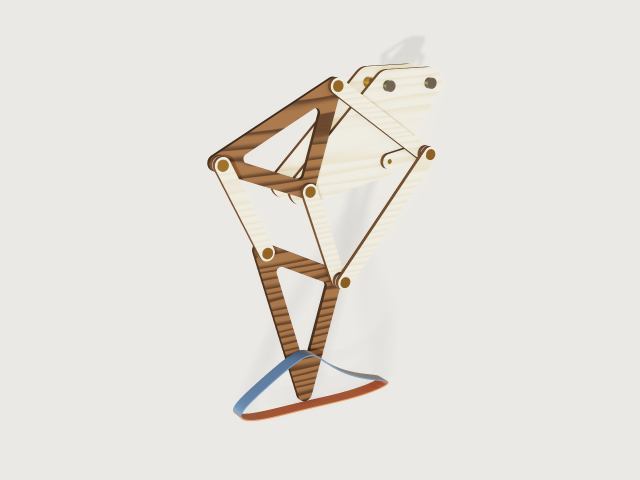 | **[24. Jansen linkage leg](jigs/24-strandbeest-leg/)**<br>Theo Jansen's walking linkage scaled to the hip height you ask: drag the crank and the leg walks along its drawn foot path. Laser-cut birch bars and walnut triangles on brass rod pins, one leg or a pair half a turn apart. | Mechanisms, laser cutting | 7/10 | CC-BY-4.0 |
| 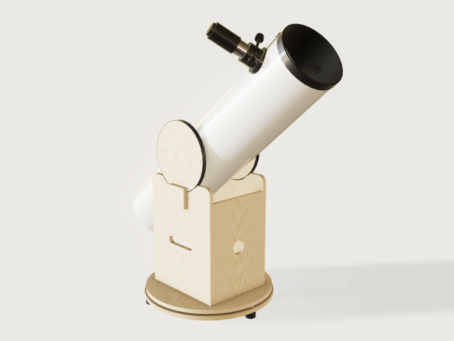 | **[25. Dobsonian telescope](jigs/25-dobsonian-telescope/)**<br>A Newtonian on a plywood rocker box, from your mirror: the secondary for the field you choose, the spider, the focuser position, the altitude bearings on the real balance point (computed from the masses, then measured on the model), the rocker box and a cut sheet for the plywood. | Woodwork, optics | 8/10 | CC-BY-4.0 |
| 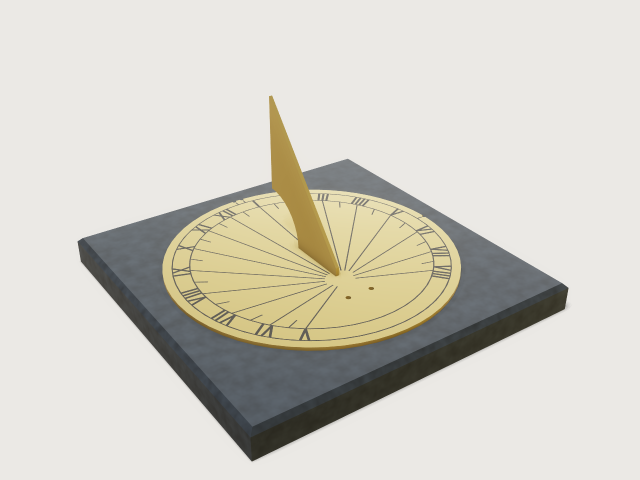 | **[26. Sundial for your place](jigs/26-sundial/)**<br>A horizontal garden dial or a vertical wall dial, also for a wall that does not face south, drawn for your latitude and longitude so that it reads the clock time of your zone: a brass plate and gnomon to laser cut and engrave, on a slate slab. | Laser cutting, engraving, astronomy | 8/10 | CC-BY-4.0 |
| 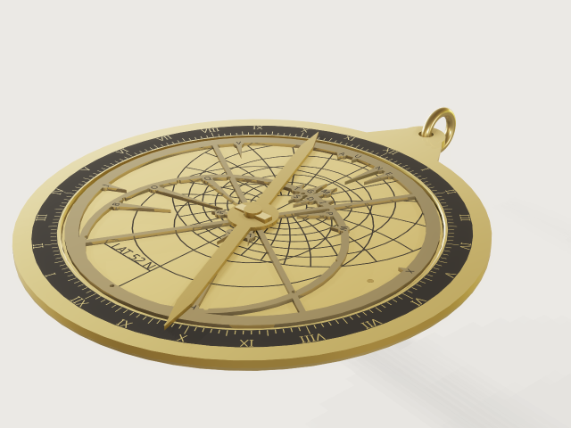 | **[27. Planispheric astrolabe](jigs/27-astrolabe/)**<br>A planispheric astrolabe for a place from 25 to 65 degrees north (not the tropics, not the southern hemisphere), in brass: a mater with its degree scale, a plate of almucantars and azimuths in exact stereographic projection, a rete of lettered star pointers from the Yale Bright Star Catalogue with the ecliptic ring, a rule, and an altitude scale with an alidade on the back, to laser cut and engrave. | Laser cutting, engraving, astronomy | 8/10 | CC-BY-4.0 |
| 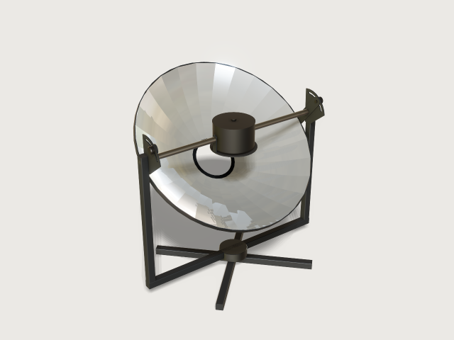 | **[28. Parabolic solar cooker](jigs/28-solar-cooker/)**<br>A parabolic solar cooker from flat petals of mirror sheet: give your pot and the size of the dish, and get the petal template to cut, the steel plates to laser cut and the sunlight it brings to the pot. The dish tilts on an axle through the focus, so the pot stays level and in the light at every sun height. | Sheet metal, energy | 8/10 | CC-BY-4.0 |
| 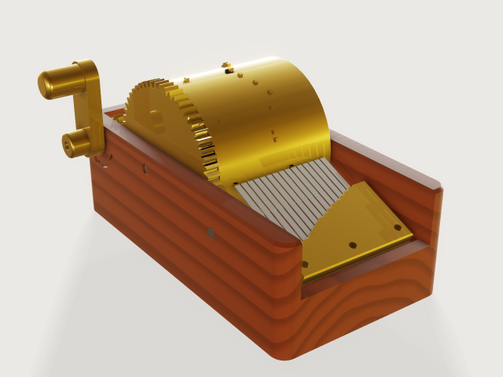 | **[29. Music box](jigs/29-music-box/)**<br>A printable cylinder music box: a pinned drum for three old tunes, a comb whose teeth are tuned by the cantilever formula, cut from spring steel or printed, and a crank that plays the tune while the pins pass the comb. | 3D printing, mechanisms | 8/10 | CC-BY-4.0 |
| 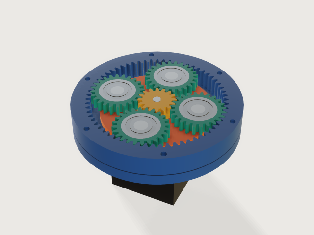 | **[30. Planetary gearbox](jigs/30-planetary-gearbox/)**<br>A printable single-stage planetary reducer for a NEMA stepper, from the reduction and the size you ask for: true involute teeth with profile shift, a planet count that always assembles, ball bearings on steel pins, six print plates that each fit a 220 mm bed, and a slider that turns every gear by the true kinematics. | 3D printing, mechanisms | 8/10 | CC-BY-4.0 |
| 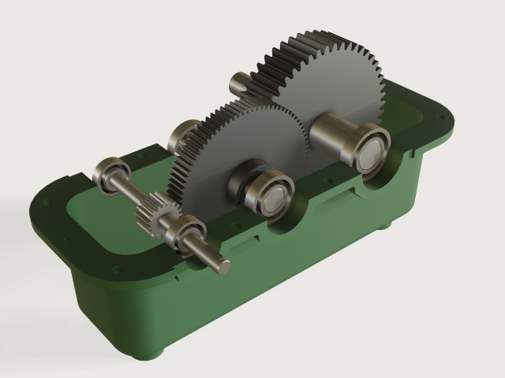 | **[31. Two-stage gear reducer](jigs/31-gear-reducer/)**<br>A two-stage spur gear reducer in a split cast iron housing, sized from the ratio, speed, power and driven machine: involute teeth, modules by the Lewis formula, shafts and bearings from the torque, and a slider that turns every gear. | Mechanisms, casting | 8/10 | CC-BY-4.0 |
| 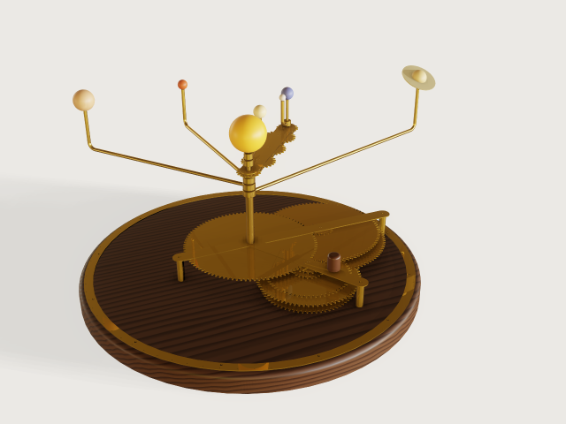 | **[32. Geared orrery](jigs/32-orrery/)**<br>A hand-cranked brass orrery, Mercury to Saturn and the Moon, each on its own gear train searched to the accuracy you ask; set the date and every bead stands where its gears put it, at its body's real mean longitude on the day the arms were set and drifting only by its train's error after. Laser-cut brass gears, stock brass tube and rod, a walnut plinth. | Mechanisms, laser cutting, astronomy | 8/10 | CC-BY-4.0 |
| 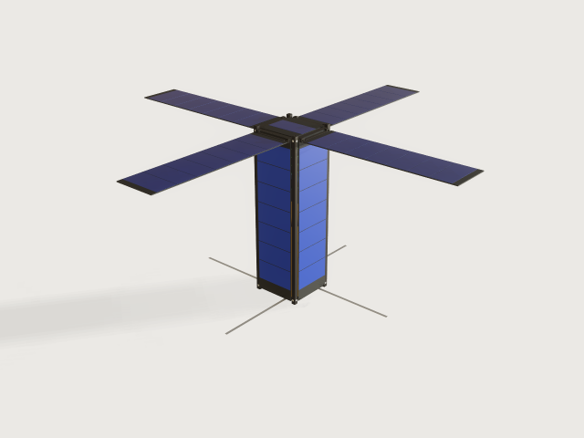 | **[33. CubeSat](jigs/33-cubesat/)**<br>A CubeSat structure and layout to the CubeSat Design Specification: the form factor, the payload, the PC/104 stack, the battery, the radio and the solar wings. Drag it from stowed in the dispenser to deployed in orbit, and the form keeps it inside the CDS envelope, mass and centre-of-gravity limits. | Aerospace, CNC milling | 8/10 | CC-BY-4.0 |
<!-- jigs:end -->

## Using a Jig

**Desktop.** Open a `.3dcraftjig` file (File › Open, or double-click it once 3DCraft is installed). It opens on its
**Parameters** tab: drag or type the values; the model follows. A value outside a parameter's range is clamped and the
form says so. Then **File › Export…** (STL, 3MF or STEP for a part; DXF or SVG for a cut sheet). **Save** saves the
result as an ordinary `.3dcraft` model; the Jig file itself is never changed. **Open for editing** makes an editable
copy if you want to change the design itself.

**Web.** The 3DCraft web build opens a Jig served from the same site:
`https://3dcraft.dev/app/?open=/examples/jigs/<id>.3dcraftjig`. The gallery at
[3dcraft.dev/examples](https://3dcraft.dev/examples/) links every Jig that way, beside the examples and the
assemblies, and offers the file for download. In the browser the model follows a parameter when you let go of it.

**Agents and scripts.** `param.list` lists the parameters, `param.set {"values": {...}}` sets several at once
(out-of-range values are refused with the range), for instance:

```sh
craft3d-cli run jigs/05-laser-box/laser-box.3dcraftjig \
  --cmd param.set --params '{"values": {"width": "220 mm", "height": "60 mm"}}' \
  --cmd file.export --params '{"path": "box.svg", "set": "Cut sheet"}'
```

## Building and checking

Every `<id>.3dcraftjig` is committed, so the Jigs open and work in 3DCraft without building anything.

The tool that made and checked them, `tools/jigs.py` (Python 3, standard library only, on Linux or macOS), needs the
exact 3DCraft build this repository is pinned to, the commit in [`tools/pin.json`](tools/pin.json), and refuses any
other: it compares what it rebuilds byte for byte with the committed files, which only that build reproduces. When
the repository is released the pin is the 3DCraft 0.1.0 release itself, so the `craft3d-cli` that its installer puts
on your `PATH` runs it (or name the binary in `CRAFT3D_CLI`).

```sh
tools/jigs.py build laser-box          # jigs/NN-<id>/build.json to <id>.3dcraftjig beside it; rewrites meta.json
tools/jigs.py check --quick laser-box  # rebuild in a scratch folder, lint, exports
tools/jigs.py check laser-box          # the same, plus check-range and the bend sequence
tools/jigs.py render laser-box         # preview.png and thumb.png in jigs/NN-<id>/
tools/jigs.py site [dir]               # a local web folder (default site/, not committed): every Jig, its picture, a gallery
```

`check` runs `craft3d-cli check-range` with a fixed seed: the defaults, the corners of the parameter ranges, every
choice and random points, each regenerated from nothing and checked as `document.check` checks it. A Jig is only
published when every point passes. `build` and `check` rewrite the `stats` (timings measured on your machine) and
`craft3d` fields of the Jig's `meta.json`. Give `check` an id: without one it rebuilds and checks all 33 Jigs, which
takes hours. Where `systemd-run` exists, every run is capped in memory.

## Licence

The Jigs and what is written and drawn about them (their pages and pictures, `AGENTS.md`, `CATALOGUE.md`, the
feedback) are under **CC BY 4.0** ([`LICENSE-CC-BY-4.0.md`](LICENSE-CC-BY-4.0.md)); the code, the tools under `tools/`
and the reproducers under `findings/`, is MIT ([`LICENSE`](LICENSE)). One Jig differs: `gt2-pulley` adapts the GT2
tooth outline of droftarts' *Parametric Pulley - lots of tooth profiles*
([thingiverse.com/thing:16627](https://www.thingiverse.com/thing:16627)), licensed Creative Commons
Attribution-ShareAlike as its page states (the page names no version), and is therefore shared under
**CC BY-SA 4.0** ([`LICENSE-CC-BY-SA-4.0.md`](LICENSE-CC-BY-SA-4.0.md)), with attribution to droftarts. Each Jig
carries its licence in its document information (an SPDX id), and it is shown in the table above, in the gallery and
on the Jig's page. Credit a Jig as:

> "Laser-cut box" by Johan Coppens, from the 3DCraft Jigs (CC BY 4.0), https://github.com/johancoppens/3dcraft-jigs

with its title and licence. Other sources, and the products Jigs are sized after: [`ATTRIBUTION.md`](ATTRIBUTION.md).
