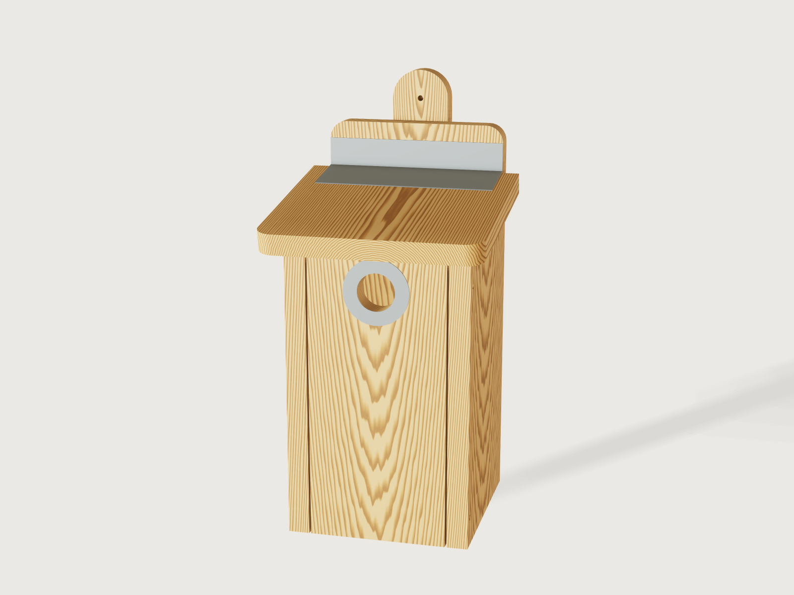

# Nest box from one plank

Pick the bird, and the box follows: the entrance, the floor, the height, and even the shape. A great tit gets a round
hole, a redstart an oval one, a house sparrow a terrace of three with an entrance in each end wall, a black redstart a
half-open arch, a spotted flycatcher an open front. All of it is one table of a nature organisation's own measurements,
driving one design that is sawn from one plank and screwed together.



## What it shows

How much a small Jig can do when one choice carries the design:

- A choice from a table (`table.set`, `variable.publish` with `choicesFrom`): `species` selects a row of inside sizes,
  and the rest of the document reads from it (`nest_sizes[species].opening_width`, and so on).
- Features that follow the choice (`feature.when`): round, oval, arched and open-fronted entrances are four cuts of one
  front board, of which one is on; a terrace adds two partitions and entrances in the end walls; the open front is fixed
  and overlaps the sides, the others pivot between them.
- The sketch follows counts (`sketch.pattern`, `patterns`): four drain holes per compartment.
- Ranges that depend on the table: the plank width and length have formula minimums (`plank_width_needed`,
  `plank_length_needed`), and the hanging choice ends at each row's `hanging_max`, so a board too small or a wire on a
  building bird's box cannot be set.
- Curves from formulas (`sketch.curve`): the oval entrance and the predator guard's inner edge.
- A plan that follows the form (`sketch.text` with formulas): the plank and its boards in sawing order, labelled with
  their sizes. A named set (`set.define`) gives the marking-out sheet, and `cut.list` the saw list.

A static model of a nest box is one bird in one plank; this one is eight, and tells you what plank to buy.

## The real thing

**Source.** The inside sizes are Vogelbescherming Nederland's sheet *Nestkasten in soorten en maten*
([PDF](https://www.vogelbescherming.nl/docs/f7ec8dd5-33b0-43d0-9405-53e657e83354.pdf)): for each species the inside
floor and height in cm, the opening and the hanging height. The sheet gives the numbers on small drawings; each row in
the table `nest_sizes` was read off the rendered PDF.

| Species | Floor inside (cm) | Inside height (cm) | Opening (cm) | Hang at (m) |
|---|---|---|---|---|
| Blue tit (pimpelmees) | 12 x 12 | 26 at the back | round 2.8 | 2 to 3 |
| Great tit (koolmees) | 12 x 12 | 26 at the back | round 3.2 | 2 to 3 |
| Pied flycatcher (bonte vliegenvanger) | 12 x 12 | 26 at the back | round 3.2 | from 2 |
| Common redstart (gekraagde roodstaart) | 12 x 12 | 26 at the back | oval 3 x 5 | 2 to 3 |
| House sparrow (huismus), terrace of 3 | 3 x 11 x 12 | 21 at the back, 19 at the front | round 3.5, in the middle of the front and in each end wall | from 2 |
| Starling (spreeuw) | 16 x 16 | 30 at the back | round 4.5 | 2 to 5 |
| Black redstart (zwarte roodstaart) | 18 x 18 | 20 at the front | arch 13 wide, 6 high | from 2 |
| Spotted flycatcher (grauwe vliegenvanger) | 12 x 12 | 16 at the front | open, 10 wide, 11 high | from 2 |

Where the sheet is silent, or where this Jig departs from it, it says so, because these are this Jig's readings:

- **House sparrow.** The sheet draws a hole in the left end wall and one in the middle of the front, none on the left
  compartment's front. The right compartment's hole is out of sight; the Jig puts it in the right end wall, mirroring the
  left. So the terrace has one entrance per compartment: left end, middle of the front, right end. The three
  compartments are 11 cm wide and share 12 cm of depth.
- **Roof fall.** Only the house sparrow has a front height on the sheet (19 cm). For the tits, flycatcher, redstart and
  starling the single height is taken at the back, where the sheet draws it, and the front is lower by a fall of one
  sixth of the depth, the slope the sheet draws on these birds (20 mm over 120 mm, about 9.5 degrees).
- **Black redstart.** The sheet labels 20 cm at the front corner of a flat-topped box. The model keeps 20 cm at the
  front and raises the back to 22 cm: a departure from the drawing, so that rain runs off the roof where the box stands
  outdoors. The sheet's box stands inside buildings, ruins or niches, where a flat lid is enough.
- **Spotted flycatcher.** The sheet's 16 cm is taken at the front, the only reading under which its 11 cm opening leaves
  the 5 cm parapet it draws. The back is 18 cm. The front board overlaps the side boards, is screwed to their front edges
  and is not hinged: an opening 10 cm wide in a board between the sides would leave free cheeks 8.5 mm wide, so the
  opening is made in a board 150 to 170 mm wide (as wide as the box outside), leaving 25 to 35 mm of board each side. Cleaning goes
  through the opening.
- **The height of the entrance.** Not on the sheet. Avon Wildlife Trust's
  [*Basically Boxes*, part 1](https://www.wildlifetrusts.org/sites/default/files/2018-05/BasicallyBoxes-part1.pdf)
  (published by The Wildlife Trusts) says a bird box should "Have the entrance hole/window no less than 125mm from the
  floor". For hole-fronted birds the Jig puts the top of the hole 25 mm under the ceiling at the front, which keeps that
  (130 mm for the house sparrow, more for the rest), and an assertion proves it. The two open-fronted birds are lower,
  and the rule's "window" would cover them: the black redstart's arch starts 95 mm up, the spotted flycatcher's opening
  50 mm up. There the species' own sheet is followed over the general rule. The flycatcher's 11 cm opening in a 16 cm box
  cannot reach 125 mm at all. The black redstart's arch has its base about 9 cm up in the sheet's drawing, and the model sets it at 95 mm
  (the arch's top is then 45 mm under the ceiling); 125 mm would push it to 15 mm under the ceiling, against the drawing.
- **Left out.** The sheet lists the tree sparrow (ringmus) with an opening printed "40", in a sheet otherwise in
  centimetres. The BTO's [Make a nest box](https://www.bto.org/learn/helping-birds/nest-boxes/make-nest-box) table gives
  28 mm for the tree sparrow, so this row is left out rather than guessed. The BTO also gives smaller sizes for tits
  (25 and 28 mm) than the Dutch sheet (28 and 32 mm); this Jig follows the Dutch sheet throughout.

**Making it.** One plank of untreated European larch, sawn timber left rough inside so fledglings can climb out. No
stain or preservative, no perch, a panel to open for cleaning: all from *Basically Boxes*, which also gives the 15 mm
minimum for the wood and the advice that the grain should run down the boards where possible.

The **plank plan** gives the sawing order, with a 3 mm saw kerf between boards. On the seven birds with one compartment
every board has its grain along the plank and its width across it, so sides, front, back, batten and the roof all shed
rain along the grain (the roof's grain runs down the slope). The house sparrow's terrace is 402 mm wide at 18 mm, wider
than any common plank, so its front, back, floor and roof lie with their long side along the plank and the grain runs
along the box; this is unavoidable from one plank, and the zinc strip and the roof's overhang keep the water off that
end grain. The picture shows the roof's grain down the slope for every bird, which is true of all but the terrace.

Assembly, all butt joints with stainless screws (pre-drill): the two sides on the back board, the floor between the
sides and against the back, the roof resting on the sloping sides and against the back. On the batten style, screw the
batten to the back first, from inside the box, with three 4 mm screws about 1.6 times the plank's thickness long
(25 mm for a 15 mm plank, 30 mm for 18 to 20 mm, 40 mm for 25 mm), so that they do not come through the batten. The front board hangs between the sides on
two pivot screws through the holes near its top; a third screw through the lower holes locks it, and taking that one
out swings the front out for the yearly cleaning. The gap of 5 mm over the top of the front is the ventilation, and the
6 mm holes in the floor drain it, four to a compartment.

The zinc strip laps the roof by 50 mm and runs 25 mm up the back board, covering the joint: nail it on with a bead of
sealant. The predator guard is a zinc plate around each round or oval entrance, 12 mm of rim wide, against woodpeckers
and squirrels enlarging the hole; it does not stop a cat's paw. Its outside diameter is an output, and it is on the
marking-out sheet to cut from 0.8 mm zinc. A terrace gets one per entrance. The two open-fronted birds have no guard.

Hanging: the batten screws to a wall or post with two 5 mm holes; two screws through the back reach through the open
front; two holes for a sleeved wire round a branch keep nails out of the tree. The house sparrow and black redstart are
limited to the batten or screws, because the sheet puts them against or in buildings; the starling too, because its box
of about 3 kg should not hang on a wire. Hang the box at the height *Hang at least* shows, out of full sun and with a
clear flight line. Clean it out once a year after the season.

## Parameters

| Group | Parameter | Range | What it changes |
|---|---|---|---|
| Species | Bird species | 8 birds | Every inside size, the entrance's shape, the number of compartments, hanging height |
| Plank | Plank thickness | 15 to 25 mm | Outside sizes and the plank it needs; the inside stays the species' |
| Plank | Plank width | from the widest board up to 320 mm | Refused below what the bird needs |
| Plank | Plank length | from what is needed up to 4 000 mm | The same, for the sum of the boards |
| Options | Predator guard | yes or no | Zinc plate round every round or oval entrance |
| Options | Hanging | up to three styles, per bird | A batten behind the box, or holes in the back |
| Options | Roof overhang at the front | 20 to 60 mm | How far the roof reaches past the front; also the plank length |

Outputs: entrance width and height, boards to saw, plank length needed, plank left over, widest board across the plank
and the width to rip off at it, predator guard diameter, the hanging heights and the mass of the larch boards (at
590 kg/m³).

Minimum plank at the 18 mm default, batten included (the defaults, 300 x 3 000 mm, fit every bird at that thickness):

| Bird | Width (mm) | Length (mm) | Boards |
|---|---|---|---|
| Blue tit, great tit, pied flycatcher, redstart | 190 | 1 877 | 7 |
| House sparrow | 290 | 2 839 | 9 |
| Starling | 230 | 2 150 | 7 |
| Black redstart | 250 | 1 797 | 7 |
| Spotted flycatcher | 190 | 1 477 | 7 |

## Checks

The thirteen assertions, each measured on the model: round holes at the row's diameter, one per compartment (front and
end walls); the front board's volume equals the plate less the closed-form area of its opening; the floor's extents
equal the row's inside width and depth; four drain holes per compartment; the ventilation gap over the front (at least
90 % of 5 mm); the hole's rim at least 125 mm above the floor for hole-fronted birds (the end walls included); no wall
of the front board under 15 mm, which covers the cheeks and the wood above the hole (the thinnest, 15 to 17 mm, is the
plank itself or the wood over the hole), not asserted on the black redstart's arch, where `measure.thickness` could
not bound the sharp corners of the opening (its cheeks are 23.5 mm, and the closed-form volume pins the arch); the pivot hole facing the edge of the front board, and
pivoted fronts having two side holes where fixed fronts have none; the guard on the front board below its top; the back
height equal to the row's; and no board overlapping another. That every board fits the plank is held by the form's
ranges, not by an assertion.

`tools/jigs.py check` runs `check-range`: 106 points (the defaults, up to 64 corners of the box of the ranges, every
choice and 32 random points from seed 1), all passing, none unproven. Every bird is built at least once. Assertions that do not apply to a bird are inactive there,
such as the hole-rim rule on the open-fronted birds. The overlap check covers the larch boards only, because the pair
zinc guard and front with a coincident curved edge cannot be decided by the kernel
([J-002](../../3DCRAFT-FEEDBACK.md#j-002-measureoverlap-errors-when-a-curve-coincides-with-a-circle)).

Not checked: the strength of the screws, a form tester's reading of the plan, or any real bird's acceptance.

## Export

- **Saw it:** select the sketch *Plank plan* in the Features tab, then **File › Export**, the selection, as SVG or DXF:
  the plank outline with each board at its place in sawing order, numbered and labelled along x across. Boards are drawn
  as the rectangles they are sawn from; rip them to the true shape from the marking-out sheet.
- **Mark it out:** **File › Export**, **Sheet of set: Board layout**, as SVG or DXF: every board, partition and guard plate
  once at true size, each on its layer.
- `cut.list` (csv) gives the saw list per board and thickness. The zinc strip appears there as a plate whose "thickness"
  is its length along the roof (see Platform notes), so read that row for what it is.

## Files

`build.json` (the source), `meta.json`, `formtest.md`, `preview.png`, and `nest-box.3dcraftjig`,
`thumb.png` from the tool.

## Rebuild

```sh
tools/jigs.py build nest-box
tools/jigs.py render nest-box
tools/jigs.py check nest-box
```

The tool needs the 3DCraft build this repository is pinned to: see
[Building and checking](../../README.md#building-and-checking) in the README.

## Difficulty

5 out of 10. Table-driven topology: terrace with end-wall entrances, fixed or pivoted front, formula-driven plank plan.

## Platform notes

Entries in `3DCRAFT-FEEDBACK.md`, each with a reproducer in `findings/`:

- A touching plate and a ring whose inner edge is a `sketch.curve` coincident with a drilled circle cannot be measured
  by `overlap` ([repro](../../findings/J-002-overlap-curve-hole/repro.json)): the Jig's overlap assertion leaves out the
  zinc parts, the workaround.
- `cut.list` and `cut.export` refuse a `bodies` list naming a conditional feature that is inactive at this point
  ([repro](../../findings/J-003-cut-bodies-inactive/repro.json)); so this Jig cannot limit `cut.export` to the wood, and
  the marking-out sheet goes through a named set.
- `cut.list` reads an extruded bent strip as a plate as thick as the strip's length, and a board with an eased arris as
  a thick plate along its length ([repro](../../findings/J-004-eased-plate/repro.json)); so the boards stay sawn square
  (with corners rounded in their own plane) and the cut list carries the zinc strip's odd row.
- `material.preset` with a pattern cannot be applied to a conditional body that is inactive at the defaults: the
  pattern must be given by hand ([repro](../../findings/J-005-preset-inactive-body/repro.json)).
- A named set of kind sketch is accepted by `set.define` but `file.export` refuses it ("holds no flat face";
  [repro](../../findings/J-007-set-of-sketch-export/repro.json)), so the Plank plan has no entry of its own in the export
  dialog: it has to be picked in the Features tab, as the Jig's description says.
- A rectangle or text in a sketch cannot be switched off by a formula: zero size is refused
  ([repro](../../findings/J-006-sketch-entity-when/repro.json)). The Plank plan draws an absent batten or partition as
  a 0.01 mm speck with a label of that size, the workaround.

## Licence

[CC BY 4.0](../../LICENSE-CC-BY-4.0.md); credit line in the [README](../../README.md#licence).
