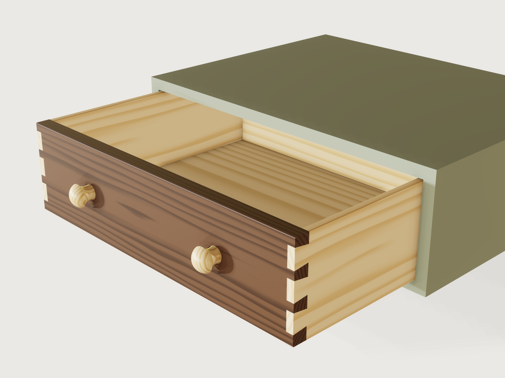

# Dovetail drawer

Tell it the hole the drawer must fill, the running clearance you like, your board thickness, the joint and the timber,
and the old rules do the rest: tails on the sides, pins on the front and back, a slope of 1 in 8 for hardwood or 1 in 6
for softwood, tails counted from the height of the board, the groove for the bottom buried in the lower half pin, and a
top gap that a wet season cannot close. Drag the last slider and the drawer runs out of its case.



## What it shows

- **The form asks what the maker knows.** The opening and its clearances, not the inside of the drawer; the joint, not
  a list of tail widths. The drawer's own sizes are outputs.
- **The form changes the structure.** Three joints (through dovetails, half-blind front with a through back, box
  joints), three tail layouts, a tail count from the height (`round`, one to as many as fit; 3 at the defaults), a back
  with its own tail count, one or two knobs (`knob_count`), two kinds of knob or none (`feature.when`).
- **Tables with `choicesFrom`**: `joint_kinds`, `tail_layouts`, `timbers`. The timber row sets the slope, both densities
  (`body.material`), and the wood movement.
- **Ranges that follow other parameters.** `top_clearance` cannot go below the seasonal swelling (`top_clearance_min`,
  from the height and the timber); `side_thickness` follows the drawer's size (`side_thickness_min`).
- **`sketch.pattern` carries the count.** One sketch holds every pin socket of a side, front and back, each row a pattern
  whose count is a formula; `feature.extrude` and `feature.boolean` make all of a side's sockets in one cut. The joint
  stays exact because the tails and the pins are drawn from the same variables.
- **Board sections with the detail in them.** `sketch.path` draws a side's section with its groove and round-over
  `edge_radius` in one profile, so the groove costs no feature.
- **Knobs from `feature.revolve`** on a profile with a dome whose centre sits on the axis; `feature.pattern` makes one or
  two.
- **A drive parameter that costs one body.** *Pull the drawer out* moves only the case (`case_shift_y`), never the
  boards, so it costs no booleans and no regeneration of the joints.
- `set.define` for the template sheet, `variable.measure` for the mass.
- A one-tail joint has no full pin, but a `sketch.pattern` needs at least one instance: the seed then parks at three times
  the drawer's height, outside the board, where its cut removes nothing.

A static model of a dovetailed drawer fits one hole in one timber; this one fits yours and says what to saw.

## The real thing

**Where the tails go.** Pins on the front and the back, tails on the sides: William Fairham's *Woodwork Joints* (1921,
[Project Gutenberg 21531](https://www.gutenberg.org/ebooks/21531)) has "the dovetail pins on the drawer fronts and the
drawer backs" and through dovetails at the back. Pulling on a knob pulls along the sides, and a tail on the side is what
stops the front coming off. The old version of this Jig had them the other way round; that was a mistake.

**Slope.** Fairham: an inclination of "one in eight is considered correct... the variation should on no account be less
than one in six", meaning never steeper. Glen D. Huey,
[*My Take on Dovetail Angles*](https://www.popularwoodworking.com/article/my-take-on-dovetail-angles) (Popular
Woodworking, 2008), gives the customary split, 9° (1:6) for softwoods and 7° (1:8) for hardwoods. The rule of the table
is 1:8 for hardwood sides and 1:6 for pine.

**Proportion and layout.** Christian Becksvoort,
[*Don't Fear the Hand-Cut Dovetail*](https://www.finewoodworking.com/2013/12/05/dont-fear-the-hand-cut-dovetail-part-1)
(Fine Woodworking 238): 50 % tails is the strongest joint, but "aesthetically boring and resembles a machine-cut joint"; he
removes 70 to 80 % of the pin board. Fairham confirms machine-made pins and tails are "of exactly the same size". The
three layouts are those shares: 50, 70 and 80 %.

No source gives a rule for the *number* of tails, so this one is the Jig's: `round((height - cover) / (1.6 x front
thickness))` for the even and classic layouts, 1.8 x for fine pins, at least 1. Box joints have a wide bottom finger that covers
the groove, like the dovetails' half pin, and the other fingers about 1.2 times the side's thickness (at least two
fingers at the front), and the back the same size, its fingers all equal: 0.75 to 1.5 times the side at the front, 0.72
to 1.2 at the back, over the range.

**The groove stays hidden.** The sources disagree on where to bury it, because their joints do. Christopher
[Schwarz](https://www.popularwoodworking.com/techniques/english-dovetailed-drawers/) puts it in a half-tail or a full tail in
the side, and [Tom McLaughlin](https://www.finewoodworking.com/2021/12/10/make-and-fit-a-dovetailed-drawer) (Fine Woodworking
294) locates the bottom tail so it hides the groove; that works behind a half-blind front, where the tail's end is covered,
but a groove in a tail would show at the end of a through dovetail. So this Jig uses the half pin: the lower half pin is
made wide enough that the side's groove runs out into its socket and the front's groove ends inside it, hidden in both
joints. [Ken Burton's *Tablesaw Dovetails*](https://www.woodcraft.com/blogs/cabinetry-furniture-making/tablesaw-dovetails)
(Woodcraft) keeps a chest's back-panel groove inside a full-width half pin the same way (for drawers he uses true half
pins and lets the groove run through); this is the Jig's own application of it to a drawer. Groove: 8 mm above the lower
edge (this Jig's choice), 6 mm wide and half the side deep, the maximum per Adrian Van Draanen,
[*An A-Z of Making and Fitting Drawers*](https://www.finewoodworking.com/2026/06/24/from-the-archives-an-a-z-of-making-and-fitting-drawers)
(Fine Woodworking 11, 1978), who also gives sides of 8 to 12 mm (the Jig allows up to 14 for big drawers and asks at least
12 from a 720 mm opening), fronts of at least 20 mm, plywood bottoms of 3 to 6 mm and a back lower than the sides
by "about 0.5 cm (1/4 in.)" (6 mm here).

**The bottom.** Birch plywood, slid in from the back after glue-up; the back stops at the top of the groove
(Garrett Hack, [*How to Build Solid Drawer Bottoms*](https://www.finewoodworking.com/2010/06/03/how-to-build-solid-drawer-bottoms),
Fine Woodworking 213; McLaughlin). Its thickness follows its shorter span between the boards: 6 mm up to 450 mm, 9 mm up
to 650 mm, 12 mm beyond. Van Draanen stops at 6 mm and no source gives a limit for a drawer this large, so **the
thresholds are trade judgement**: they keep span^4 / thickness^3 about equal, so the three thicknesses sag about alike.
A panel over 6 mm is rebated from below to a 6 mm tongue on three sides, so the groove stays 6 mm and the flat top stays
level with it; a 12 mm panel's underside clears the runner by 2 mm. It stops 1 mm short of each groove's floor, and one
screw per 200 mm of width goes through a hole near its rear edge into the back's lower edge; solid-wood bottoms would
want slots there (Fairham, Fig. 368), plywood does not. There is no muntin, even at 1000 mm wide: heavy loads in a very
wide drawer want one, which this Jig does not build.

**Grain.** The front and the back along their length, across the drawer; the sides along their length, front to back; the
bottom's face veneer across the drawer (for a solid bottom the same way, Hack); a turned knob along its axis.

**Half-blind.** A 1/4 in. lap (6.35 mm) on the front, from Fairham; the back stays through-dovetailed. The sides are shorter
by the lap.

**Clearances.** Each side 0.8 mm by default; McLaughlin works to about 1/32 in. Wood moves across its grain with the
seasons, so the top gap has a floor: height x the larger of the two timbers' tangential dimensional-change coefficient x a
swing of 4 percentage points of moisture content. A flat-sawn 138 mm walnut-and-maple drawer needs about 2 mm. The
coefficients are the Wood Handbook's (table 13-5 in the 2010 edition, as reproduced in
[FPL-RP-711](https://doi.org/10.2737/FPL-RP-711) and on a
[*Wood Movement* chart](https://www.thesolidwoodflooringcompany.com/wp-content/uploads/2023/02/WoodMovement.pdf); that chart
gives the 3 to 4 points a heated house swings in a year). Quartersawn stock moves less: the floor is a flat-sawn worst
case. The back clearance of 10 mm is this Jig's. Densities are The Wood Database's average dried weights:
[walnut](https://www.wood-database.com/black-walnut/) 610, [maple](https://www.wood-database.com/hard-maple/) 705,
[white oak](https://www.wood-database.com/white-oak/) 755, [cherry](https://www.wood-database.com/black-cherry/) 560,
[yellow poplar](https://www.wood-database.com/yellow-poplar/) 455, [white pine](https://www.wood-database.com/eastern-white-pine/)
400 kg/m³.

**Making it.** Plane the boards to thickness, square the ends. Saw or machine the tails from the template, mark the pins
from them. Plough the sides' grooves right through. The front's groove must stop half the side's thickness (5.5 mm at the
defaults) short of each end, inside the half pin, so a plough or table saw cannot finish it: use a router with stops, or
plough it and chop the ends. Assemble with glue dry-fitted first, slide the bottom in, drive the screws, then trim the
sides with a plane until the drawer runs. Oil or shellac; wax the runners. The knob's tenon goes through the front and is
wedged from inside; the brass knob takes an M4 screw through its hole.

**The knob** is 18 to 38 mm across, a quarter of the height clamped to that, and above 450 mm of drawer width there are
two: both this Jig's choice.

At the defaults: three tails front and back, tails 28.5 mm at the wide end, pins 12.2 mm at the narrow end, drawer
518.4 x 138 x 410 mm outside, 496.4 x 377 x 118 mm inside (22.1 L), 3.02 kg of boards.

## Parameters

| Group | Parameter | Default | Range | What it changes |
|---|---|---|---|---|
| The opening | Width of the opening | 520 mm | 150 to 1000 mm | The drawer's width; one or two knobs; the bottom's thickness |
| The opening | Height of the opening | 140 mm | 70 to 300 mm | The boards' height, the tail count, the knob's size |
| The opening | Depth of the opening | 420 mm | 150 to 800 mm | The sides' length; the bottom's thickness |
| The opening | Running clearance each side | 0.8 mm | 0.4 to 15 mm | The drawer's width |
| The opening | Clearance at the top | 2 mm | the seasonal swelling, to 12 mm | The drawer's height |
| Stock | Front board thickness | 22 mm | 20 to 32 mm | Tail length, the tail count |
| Stock | Side and back thickness | 11 mm | from 8 mm (12 from 720 mm wide or deep), to 14 mm | Socket depth, groove depth |
| Joinery | Joint | Through dovetails | through, half-blind front, box joints | Where the joints show; the slope; the length of the sides |
| Joinery | Tail layout | Classic hand-cut | even, classic, fine | Tails' share and how many |
| Joinery | Timber | Walnut front, maple sides | four pairs | Slope, mass, the top clearance's floor |
| Pull | Pull | Turned knob | turned, brass, none | The knob and its hole |
| Pull | Pull the drawer out (view only) | 55 | 0 to 75 % of the depth | Only the view |

Outputs: the drawer's outside and inside sizes and volume, tails at the front and the back, the slope, a tail and a pin
at the front, the mass of the boards, the swelling, and the saw list.

The picture always shows walnut and maple (see Platform notes); the timber changes the geometry and the numbers.

## Checks

The 21 assertions, all passing at the defaults:

- The volumes of the front, a side and the back equal their closed forms: sockets, slope, groove and holes together.
- The tails at the front and back counted on the model (sockets' baselines).
- The slope measured on the model: the baselines' area against the slope of the timber's row.
- The groove measured on the model: tail ends whole (hidden in the half pin), its floor half the side's thickness deep,
  6 mm wide and running to the back; its lower wall 6 to 12 mm above the side's lower edge; the bottom's volume against
  its closed form (tongue, thicker core, holes) and its underside above the lower edge; the back stopping at the groove's
  top.
- Pins and tails wide enough at their narrow ends (a chisel, at least 3 mm; at least 4 mm of tail at the baseline).
- No board overlaps another or the case, at any pull. (The drawer rests on the case's floor, so they touch there.)
- Width and height on the model equal the opening less the clearances, and the top gap covers the season's swelling.

`tools/jigs.py check` runs `check-range`: 106 points (defaults, 64 corners, every choice, 32 random), all passing, none
unproven, slowest 0.05 s (`meta.json`). Combinations meant to break it, tried by hand with `param.set`: the top gap below the swelling
is refused, a side thinner than the size allows is refused, a pull past 75 or a front under 20 mm is refused, and changing
the height or timber under a too-small gap is refused unless it is set together (the form clamps it instead); the smallest
even-layout drawer in softwood, the smallest half-blind and the smallest box-jointed one pass.

A grid over the height, thicknesses, joints, layouts and slopes puts the narrowest pin at 4.9 mm, the narrowest tail
end at 4.9 mm and box fingers at 0.75 to 1.5 times the side at the front and 0.72 to 1.2 at the back: the chisel and baseline limits are guards, not limits you will meet. Not checked: the glue, the wood's real
moisture, the runners or how a drawer of a given load behaves.

## Export

- **File › Export, Sheet of set *Marking templates*, SVG or DXF:** the side's outside face with its tails, the front's and
  the back's end grain with their pins, and the bottom, at true size. Register the side on its **lower edge**: its top edge
  stops at the start of the round-over, 1.5 mm below the board's top (136.5 of 138 mm at the defaults). Print at 100 %. The
  default SVG line is a 0.01 mm hairline for a laser and rasterises blank in Inkscape: export with `stroke` (`file.export`,
  0.25 mm in this Jig's `meta.json`) or give the paths a stroke before printing.
- **For CAM:** select the five boards and use **File › Export**, the selection, as STEP (from a script,
  `file.export` with `bodies`: Front, Left side, Right side, Back, Bottom). The case and knobs are not boards: a named set cannot pick bodies for STEP yet
  ([finding](../../findings/J-045-3d-export-set/repro.json)).
- **Saw list:** the *Saw list* outputs give every board's length and height. `cut.list` lists a 6 mm bottom as a plate and no other board; a 9 or 12 mm bottom is "not a plate" too, because of its rebate's step (see Platform notes).

## Files

`build.json` (the source), `meta.json`, `formtest.md`, `preview.png`, and `joint-drawer.3dcraftjig`,
`thumb.png` from the tool.

## Rebuild

```sh
tools/jigs.py build joint-drawer
tools/jigs.py render joint-drawer
tools/jigs.py check joint-drawer
```

The tool needs the 3DCraft build this repository is pinned to: see
[Building and checking](../../README.md#building-and-checking) in the README.

## Difficulty

5 out of 10: multi-body booleans, sketch patterns whose count changes the topology, table-driven layout and closed-form volumes.

## Platform notes

- `cut.list` lists plates only: a dovetailed, grooved or eased board, or a bottom rebated to its tongue (the step), is "not a plate", so the saw list is a set of outputs
  (F-077 and F-086 in the Examples' feedback).
- A pattern's colours cannot follow a table, so the picture stays walnut and maple whatever the timber
  (J-009, [`findings/J-009-pattern-colours-from-a-table`](../../findings/J-009-pattern-colours-from-a-table/repro.json)).
- A boolean that splits a face leaves it one face to `count` queries; the tails are counted by their baselines instead
  (related to F-141; [`findings/J-023-split-face-counts-as-one/repro.json`](../../findings/J-023-split-face-counts-as-one/repro.json)).
- A `feature.extrude` with `cut` leaves the extrusion with an automatic name (F-002), so the cutters and booleans are
  named in two steps.

## Licence

[CC BY 4.0](../../LICENSE-CC-BY-4.0.md); credit line in the [README](../../README.md#licence).
