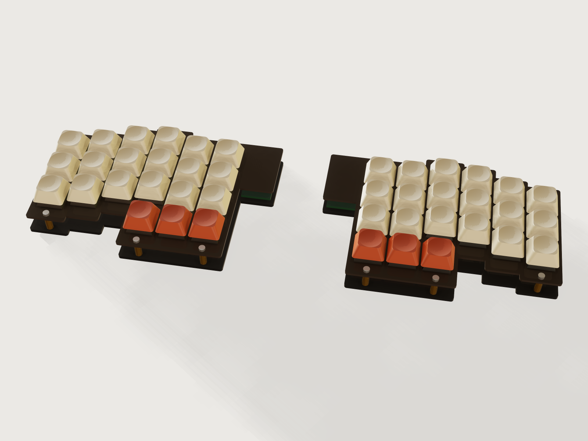

# Sandwich keyboard plate

A laser-cut sandwich keyboard for MX-style mechanical switches: a 1.5 mm switch plate on M2 standoffs over a
bottom plate, column-staggered, split or in one piece, with room for a controller board under the plate. Say how
many rows, columns and thumb keys you want, pick a stagger and a plate material, and the form writes the cut sheet
for your laser, every outline already compensated for the beam.



## What it shows

- **One seed column, copied per column.** The right half's first column is one rounded-corner strip with its
  switch cutouts patterned along the rows (`sketch.pattern`, `feature.offsetProfile`, `feature.extrude`, a top and a
  bottom layer joined with `feature.boolean`). `feature.transform` with `keep` copies it to each further column,
  moved by its stagger from a table, and a chain of `feature.boolean` unions joins them; `feature.when` drops the
  columns the form does not ask for, so a pattern's count needs no per-instance offset (none is available: J-011,
  F-027).
- **The form changes the structure.** Rows change the number of cutouts in a column; columns add or remove whole
  strips, switch and keycap columns; thumb keys add or remove a strip below the inner columns and their cutouts,
  which also moves bottom screws below that strip; the stagger table (`choicesFrom`) moves every column; split or
  one piece decides whether the two mirrored halves (`feature.mirror`) stay apart or are unioned into one plate
  with one central controller bay.
- **Six screw positions, whatever the layout.** Every screw is a formula: three columns (inner, middle, outer) along
  the top and the bottom edge. A bottom screw under a column with a thumb key moves below the thumb strip, so the
  count never changes and no hole ever lands in a switch.
- **The beam path is the model.** `feature.offsetProfile` grows every plate outline out and every cutout in by half
  the kerf; the bodies are the laser's path, so a 14 mm cutout is a 13.85 mm rectangle in the model at a 0.15 mm
  kerf, and it comes out 14.00 mm after the beam.
- **Standard values in tables, limits in the ranges.** `table.set` holds the stagger per column for each layout, the
  plate materials with thickness, stiffness and colour, the standoff lengths and the controller sizes. The published
  ranges are formulas: `rows` is capped by the span the plate material can carry, `plate_border` starts at the larger
  of what the screw needs and what keeps the column strips joined to the thumb strip, `thumb_keys` at the columns.
- **What the form does that a static model cannot:** count, layout and stagger change at a touch; the *Pull apart*
  slider lifts the layers so you can see how it goes together.

## The real thing

- **The switch.** The cutout and the pitch are Cherry's. Metal frame cutout 0.551 ± 0.002 in (14.0 ± 0.05 mm)
  square, corners R 0.012 in (0.3 mm) at most, frame 0.06 ± 0.004 in (1.5 ± 0.1 mm) thick (Cherry Corporation, *MX
  Series Desktop Profile 0.60 Inch Keyswitches*, web data sheet, printed 2007-01-22; the same 14 ± 0.05 mm and R 0.3
  mm in the Cherry *Tastenmodul MX* data sheet, July 1985). Pitch: "Standard lead spacing: 19.05 mm (16 mm min.)"
  (Cherry GmbH, *CHERRY MX1A-Fxxx* data sheet, 2015-12-17). Body sizes from the 2007 sheet: the housing 0.61 in (15.6
  mm) across, 0.46 in (11.6 mm) tall, of which 0.20 in (5.0 mm) below the frame; pins 0.13 in (3.3 mm).
- **Plate.** The switch clips need a plate 1.5 ± 0.1 mm thick, so the plate is 1.5 mm in every material offered (a
  thicker plate does not clip). Cherry's sheet is written for a metal frame; 1.5 mm cast acrylic is what hobby
  builders use and the clips hold it, but it is brittle, so press the switches in slowly with the plate supported.
  Cutout corners are R 0.25 mm as cut (Cherry allows R 0.3), the outline's outer corners R 1.5 mm; the inner corners
  where strips meet stay as sharp as the beam leaves them, a known stress raiser in acrylic that this Jig does not
  relieve.
- **Stiffness (judgement).** The plate spans from a top screw to a bottom screw with nothing between; in 1.5 mm
  acrylic that is flexible. The Jig treats a key press as 1 N at the middle of a simply supported strip 15.6 mm wide
  (Cherry's housing width as the load path), with E = 3300 MPa for cast acrylic (Evonik/Röhm PLEXIGLAS GS/XT technical
  information 211-1, ISO 527) and 70 GPa for aluminium, and allows 1 mm of flex at 1 N. The 1 N, the 15.6 mm and the
  1 mm are this Jig's judgement, not a standard; a real plate is stiffened by its neighbouring columns and the switch
  housings, and weakened by the cutouts. The formula limits the unsupported span to about 88.6 mm in acrylic: the
  form caps the rows accordingly (3 with thumb keys at the default border, as few as 2 with the steep stagger and 3
  or 4 thumb keys where a screw column has the highest column above the thumb strip, 4 without thumbs), and shows the span and the flex (0.99 mm/N at the defaults). Aluminium is 21 times stiffer
  and has no such limit in the range.
  Anodised aluminium is cut on a fibre laser and anodised after cutting; acrylic is cut on a CO2 laser, film on,
  cutouts and holes first, the outline last.
- **Kerf.** Every outline is offset by half the kerf, measured on a test cut (default 0.15 mm, range 0 to 0.3 mm, so
  the corner of a cutout, the beam's radius at most 0.15 mm, stays within Cherry's R 0.3). Export with the laser's
  own compensation off.
- **Sandwich.** Twelve M2 round spacers (diameter 4 mm, this Jig's size, a stock part; choose 10, 12 or 15 mm), an M2
  pan-head screw from above and below, 24 screws in all. The form gives the stock screw length (M2 × 5 mm for every
  plate here, the thicker sheet plus 3 mm of thread, a judgement). Holes are 2.4 mm as cut, the medium fit for M2 (the
  path 2.25 mm at the default kerf): 2.4 mm comes from a fastener maker's ISO 273 chart (Albany County Fasteners, Close
  2.2 / Normal 2.4 / Loose 2.6); the text of ISO 273 itself was not consulted, so check it if you need a normative
  source. The switch pins end 8.3 mm below the plate top (5.0 housing + 3.3 pins); with a 10 mm
  standoff they stay 3.2 mm clear of the bottom plate, room for wiring and diodes (1.5 mm is this Jig's minimum, a
  judgement).
- **Layout.** The stagger values are this Jig's own: column 1 is the inner stretch of the index finger, 2 the index,
  3 the middle, 4 the ring, 5 the little finger, 6 and 7 outer stretches, in millimetres forward or back from a
  generic finger-length curve; no named keyboard's layout. Thumb keys sit in a row under the inner columns, one pitch
  below the lowest of those columns. A smaller column count drops the outermost columns first.
- **Controller.** The bay at the inner top corner (one per half in a split board, one in the middle of a one-piece
  board) takes a board of the size chosen in the form (18 × 33, 18 × 24 or 21 × 51 mm, the size classes of common
  small USB boards), the board set back 2 mm from the plate's top edge and its USB socket 1 mm, so a plug can reach it.
- **Build.** Peel, press the switches in from above until the clips snap, hand-wire the matrix, tape the controller
  into its bay, screw the standoffs to the bottom plate, set the top plate on them and screw it down. Keycaps go on
  last. The keycaps and switches in the model are simplified solids (1U only, no stabilisers), to show the board, not
  to be made.
- **Material data.** Acrylic density 1190 kg/m³ (Röhm *PLEXIGLAS GS/XT* technical information 211-1, 1.19 g/cm³,
  ISO 1183), aluminium 2700 kg/m³. Colours are this Jig's own.

At the defaults (3 rows, 6 columns, 3 thumb keys per hand, classic stagger, split, smoke acrylic): 42 keys, two
halves each 138.45 × 95.35 mm, 73 g of plate, four parts with 4.42 m of cutting, 12 standoffs and 24 screws.

## Parameters

| Group | Parameter | Default | Range | What it changes |
|---|---|---|---|---|
| Layout | Rows of keys | 3 | 2 to 5 (fewer on acrylic, see Stiffness) | Cutouts per column, plate height |
| Layout | Columns per hand | 6 | 3 to 7 | Column strips, switches, keycaps; drops the outermost first |
| Layout | Column stagger | Classic column stagger | Flat, gentle arc, classic, steep | How far each column moves forward or back (table) |
| Layout | Thumb keys per hand | 3 | 0 to 4, at most the columns | A row of keys under the inner columns; moves the bottom screws |
| Layout | Split or one piece | Split | Split, one piece | Two halves with one controller each, or one plate with one controller in the middle |
| Case | Plate material | Smoke acrylic | Smoke, clear acrylic; black, silver anodised aluminium | Colour, density, plate and bottom thickness (1.5 and 2 mm acrylic, 1.5 mm aluminium) |
| Case | Standoff length | 10 mm | 10, 12, 15 mm | Height between the plates |
| Case | Controller board | 18 × 33 mm | 18 × 33, 18 × 24, 21 × 51 mm | Size of the bay |
| Case | Border around the keys | 7 mm | 6.5 mm (5.5 for aluminium, but 6.5 with the steep stagger and 3 or 4 thumb keys) to 14 mm | Plate beyond the keys at the top and bottom, where the screws sit; on the 0.5 mm grid |
| Laser | Laser kerf | 0.15 mm | 0 to 0.3 mm | How far every outline moves for the beam |
| View | Pull apart (view only) | 0 | 0 to 100 | Lifts the layers apart; cut files unchanged |
| View | Show keycaps | on | on, off | Hides the keycaps to show the plate and switches |

Outputs: keys per hand and in total, parts to cut, the width and depth of one piece, the sheet area, the numbers of
standoffs and screws, the screw length, the longest unsupported plate span, the plate's flex at a key press and the
mass of the plates.

## Checks

34 assertions, at every change of the form (some apply only with thumb keys, keycaps shown, or the layers together):

- **Cutout (Cherry, literal 14 ± 0.05 mm):** measured between the walls of a cutout on the model, with the kerf.
- **Pitch and web (Cherry, literal 19.05 mm):** measured between cutouts of neighbouring columns and rows, the web
  equals the pitch less the cutout path (5.2 mm at the defaults).
- **Plate:** the switch plate's measured thickness is 1.4 to 1.6 mm.
- **Key count:** the walls of the cutouts, counted, are 2 × (rows × columns + thumb keys).
- **Closed form:** bottom plate volume / its thickness less switch plate volume / its thickness is the total cutout
  area, keys × ((14 − kerf)² − (4 − π) × (0.25 − kerf/2)²), the rounded corners included.
- **Holes:** twelve screw holes in each plate (24 faces); the smallest hole as cut, from its measured wall area, is not
  smaller than the thicker sheet.
- **Cut sheets:** each of the two sets holds every plate of its thickness once.
- **Clearances, measured:** standoffs clear the switches by more than 2 mm and the controller by more than 1 mm; the
  controller clears the switches by more than 1 mm, the switch plate by more than 0.5 mm and the bottom plate by its
  lift; its USB socket reaches within 3 mm of the plate's edge; the switch pins are at least 1.5 mm above the bottom
  plate; neighbouring keycaps and the thumb row clear each other by the keycap gap (1.05 mm).
- **Standoffs:** each of the six stands on its hole (the hole's rim meets the standoff, measured).
- **Solid junctions:** a section of the bottom plate down every column that has a thumb key is the column's full
  length to the bottom of the thumb strip, so no slit can open between a column and the thumb strip.
- **Ligaments, measured:** the distance from a screw hole to the plate's edge is at least the sheet's thickness, for
  the top and for the bottom plate (distances, because `measure.thickness` cannot prove these plates: F-020).
- **Stiffness:** the measured distance between each top and bottom screw of the three screw columns stays within the
  span the material allows. The limit behind it is the judgement above.

Tried by hand with `param.set`, every point built and passed unless refused: maximum (5 rows, 7 columns, 4 thumbs,
steep, one piece, aluminium); minimum (2 rows, 3 columns, no thumbs, flat); a 21 × 51 mm controller on 3 and 4
columns, one piece and split, with 2 and 5 rows; 0.3 mm kerf with the steep stagger; the steep stagger with 3 thumb keys
at a 6.5 mm border, its exported switch plates scanned to 56 contours (2 × (21 cutouts + 6 holes + 1 outline)), so no
slit; aluminium at the smallest 5.5 mm border; refused: a 5.5 mm border with the steep stagger and 3 thumbs, 4 rows of
acrylic with thumb keys, 4 thumb keys on 3 columns, a 5 mm border on acrylic, a 0.35 mm kerf, 6 rows. Two deliberate
edits to a scratch copy were caught: a 13 mm cutout (five assertions failed) and one standoff moved 4 mm off its hole.

`tools/jigs.py check` runs `check-range`: the defaults, 64 of the 4096 corners of the box, every choice and 32 random
points, 108 in all, every one passed, none unproven. That is a sample of the range, not every value. It does not check
the fit of real switches in a real sheet (a test cut of one row does) or the strength of a plate in use.

## Export

- **File › Export…, Sheet of set *Cut sheet, switch plates*, DXF or SVG, then again for *Cut sheet, bottom plates***:
  one file per sheet thickness, every plate once on it, each on its own layer (*Top plate* and *Bottom plate* for the
  right half, or the whole in one piece; *Left top plate* and *Left bottom plate* otherwise), true size, the beam offset
  already in the outlines. Set *Sheet width* in the dialog to your bed. Export with the laser's own kerf compensation
  off.
- `cut.list` lists the plates with thickness, area and cut length.

## Files

| File | |
|---|---|
| [`build.json`](build.json) | the source: 338 steps |
| [`meta.json`](meta.json) | title, process, framing, exports |
| [`formtest.md`](formtest.md) | a maker's job and its acceptance |
| [`preview.png`](preview.png) | the picture |

## Rebuild

```sh
tools/jigs.py build keyboard-plate
tools/jigs.py render keyboard-plate
tools/jigs.py check keyboard-plate
```

## Difficulty

5 out of 10: counts change topology across coupled multi-body booleans and kerf offsets, all on planar plates.

## Platform notes

- A pattern instance has no index, so the stagger of each column cannot come from a table in one pattern (J-011, F-027):
  each column strip is a `feature.transform` of the seed column, switched by `feature.when`, and the chain of unions
  passes columns that are off through (a feature's `when` replaces entities a sketch could otherwise leave out: J-006).
- `metallic`, `transmission` and other appearance numbers cannot follow a choice
  ([J-053](../../3DCRAFT-FEEDBACK.md#j-053-metallic-roughness-and-transmission-take-numbers-only-so-a-material-look-cannot-follow-a-choice)): the plate materials change colour and density only, so the
  smoke acrylic renders as dark glossy plastic rather than see-through, and aluminium as a dielectric anodised colour.
- An extrusion `cut` or `join` in one step cannot be named (F-002): the Jig extrudes and joins in two named steps.
- `measure.thickness` cannot prove a plate with cutouts over the range (found 1.5 mm, proved 0 at some points: F-020):
  the thin walls are proven by distances from a screw hole to the plate's edge instead.
- A slit between strips cannot be reported by the kernel: the Jig excludes it by the border's range and proves it
  with a section along each thumb column.
