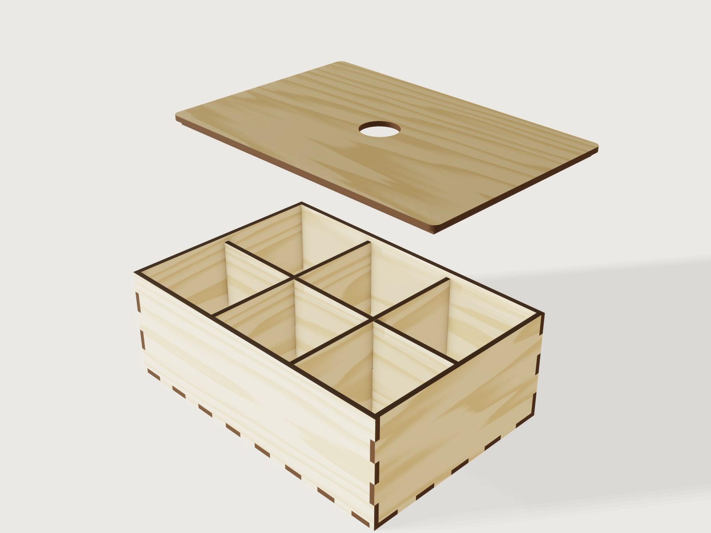

# Laser-cut box

A finger-jointed box you laser cut from birch plywood and glue or press together. Say what must go in it or
where it must fit, give your sheet's measured thickness and your laser's kerf, choose how many compartments
and which lid, and the form writes one flat sheet of parts, every outline already compensated for the beam.



## What it shows

- **One closed outline per panel, with fingers from chained patterns.** Each of the front, the side and the
  bottom is one profile: lines from `sketch.path`, repeated along each edge by `sketch.pattern` with `chain`,
  so the number of fingers on any edge is a formula and the outline still closes. `sketch.line` picks up from
  the last image point of a run (`e10[last]`).
- **The beam path, not a guess.** `feature.offsetProfile` (sharp corners) grows every profile by
  (kerf - fit clearance) / 2 before `feature.extrude`; a body *is* its laser's path. A kerf of 0.15 mm and a
  snug fit move each outline out by 0.05 mm, and the fingers and sockets come out true after the beam has
  burned.
- **The form changes the structure.** Compartments across and front to back add or remove dividers
  (`feature.when` on six separate plate bodies, three each way); every divider has two or more tabs (chained
  in its outline) through mortises in the floor, a grid of them from `sketch.pattern` with `count2`; where
  dividers cross they are cross-halved. The four lid choices add or remove the lid and its frame, cut a round
  hole or a slot in it, or a thumb notch in the front wall. The form also says whether the sizes are inside or
  outside, and everything else follows.
- **Tables and ranges.** `joint_fits` (`choicesFrom`) gives the per-flank clearance for a press, snug or loose
  fit. Ranges are formulas: finger width at least twice the sheet; width and depth large enough for a fingertip
  grip inside the lid frame when the lid has a hole or a slot; at most four compartments of at least 30 mm clear.
- **Birch plywood with burnt edges.** Every body is the dark colour of a laser-burnt edge; `face.appearance`
  lays a birch `wood` pattern on each panel's two faces, its grain along the panel's long side.
- **A form that opens the lid.** The last slider lifts the lid off so you can look inside; the cut files
  are the same at any value.

## The real thing

- **Process.** Laser cutting of 1.5 to 6 mm birch plywood, flat on the honeycomb, in one pass per outline. Press
  fit needs no glue, snug fit a little PVA in the fingers, loose fit is for a hand assembly with glue. Sand or
  wipe the burnt edges only if you want them lighter.
- **Assembly order.** Dry-fit first. Join the back, the two sides and the front to the bottom, tabs of the
  bottom into every wall. Stand the dividers running across in their floor mortises; then lower the dividers
  running front to back over them, the slots of the two families sliding together (the across dividers must go
  in first, because their slots open upward). To fit the lid: drop the locating frame into the box, spread glue
  on it, lower the lid plate onto the frame flush with the walls, and press; when the glue has set, the frame
  is centred with its 0.3 mm gap on every side.
- **Finger joints.** Each edge gets an odd number of equal fingers, the nearest odd number to span / wanted
  finger width, at least 3. The front and back own the corner posts, the sides fit between them and the
  bottom's fingers lock into all four walls.
- **Thickness.** Plywood sold as 3 mm is rarely 3 mm; measure your sheet with calipers. Every finger depth and
  slot follows the number you enter.
- **Kerf.** Measure yours with a test cut: cut a 20 mm square and measure it. The Jig does not assume a kerf for
  any laser; the default 0.15 mm is only a starting value.
- **Lid.** The lid plate sits flush on the walls; a frame glued under it, 0.3 mm clear of the walls on every side,
  stops it sliding. A round hole, a slot or a thumb notch in the front wall lifts it off. The hole and the slot
  are sized from the frame's opening, at most 22 mm wide.
- **Compartments.** Each divider stands on the floor with tabs through mortises in it, so a single row of
  dividers cannot slide or topple; dividers crossing each other are cross-halved. They stand 0.5 mm below the
  lid frame and stop 0.2 mm short of the walls at each end.
- **Judgement, not a standard.** The fit clearances (0, 0.05 and 0.1 mm per flank), the 18 mm fingertip, the 3 mm
  around a grip and the 30 mm smallest compartment are this Jig's choices from practice, not a cited value.
- **Density.** Mass is the volume of all parts times 680 kg/m³ for birch plywood (Handbook of Finnish Plywood,
  2002, Table 3-1, as also used by the flat-pack bookcase in 3DCraft Examples).

At the defaults (inside 180 × 120 × 60 mm, 3 mm sheet, 3 × 2 compartments, round hole): 10 parts, about 233 g,
6.36 m of cutting.

## Parameters

| Group | Parameter | Default | Range | What it changes |
|---|---|---|---|---|
| Size | Sizes are measured | Inside | Inside or Outside | Whether the three sizes below are the room inside or the box's outside |
| Size | Width | 180 mm | 50 mm (more with a hole or slot lid) to 400 mm | Across the front |
| Size | Depth | 120 mm | 50 mm (more with a hole or slot lid) to 400 mm | Front to back |
| Size | Height | 60 mm | 15 mm + 5 sheets to 250 mm | Inside: floor to under the lid frame, or the rim; Outside: the whole box with its lid |
| Sheet and laser | Sheet thickness, measured | 3 mm | 1.5 to 6 mm | Every joint, slot and wall |
| Sheet and laser | Laser kerf | 0.15 mm | 0 to 0.4 mm | How far the outlines move out for the beam |
| Sheet and laser | Joint fit | Snug, glued | Press, snug or loose | Per-flank clearance of the fingers (0, 0.05, 0.1 mm) |
| Joints | Finger width | 12 mm | 2 sheets to 40 mm | The wanted finger width |
| Compartments | Compartments across | 3 | 1 to 4 (each at least 30 mm clear) | Dividers running front to back |
| Compartments | Compartments front to back | 2 | 1 to 4 (each at least 30 mm clear) | Dividers running across |
| Lid | Lid | Round finger hole | Open tray, round hole, slot, thumb notch | Whether there is a lid and how you lift it |
| Lid | Lift the lid (view only) | 70 | 0 to 100 | Lifts the lid off in the view; cuts unchanged |

The outputs: inside width, depth and height, inside volume, each compartment's clear size, the finger counts
along the width, the depth and up the corners, the smallest finger as cut, the parts to cut, the total cut
length (within 0.1% of the exported outlines at the points compared), the material volume and the mass.

## Checks

24 assertions run at every change of the form. Most are measured on the model and fire on a modelling error;
combinations the form must not allow are kept out by the ranges above:

- The back panel is its own mirror image across the width and the side panel across the depth (`symmetric`), which
  is what an odd finger count along those edges gives. The odd count up the corners comes from its formula alone.
- Measured on the panels: one finger along the width, one up the corners and one along the depth, each at
  least the sheet thickness.
- Back, side and bottom panels: their volume equals the closed form (sheet × (outline area + perimeter × beam
  offset + 4 × offset²)), the mortises taken out of the floor.
- Inside width, depth and height measured on the model, each equal to what the form asked; inside volume
  as their product against the closed form from the inputs.
- The locating frame's width is the inside width less twice its gap plus twice the beam offset.
- The dividers clear the lid frame (measured distance, the lid may be lifted).
- The divider slots and the floor mortise, measured on the parts, are at least the sheet thickness; the divider
  tabs reach through the floor.
- A round hole or a slot takes a fingertip (18 mm), measured on the lid.
- Every compartment is at least 30 mm clear, measured against the dividers.
- The number of bodies is the number of parts; the named set *Cut sheet* holds exactly one flat face of each.

Tried by hand with `param.set`: a slot lid at 50 and 74 mm square and at 300 × 60 mm with 3 mm sheet; a round
hole, Outside 50 × 50 mm, 6 mm sheet (refused by the width range); a 3 × 1 open tray; a narrow 6 mm box at the
range limits; four compartments at 140 mm outside with a 6 mm sheet (refused by the compartment range; a 3 mm sheet allows them).

`tools/jigs.py check` runs `check-range`: the defaults, 64 of the corners, every choice and 32 random points,
103 points, all passed, none unproven. That is a sample of the range, not every value. It does not check the
fit of a real sheet (only your test cut does) nor the strength of the joints.

## Export

- **File › Export…, Sheet of set *Cut sheet*, DXF or SVG**: every part once on one sheet, each on its own layer,
  at true size with the beam offset in the outlines. Set *Sheet width* in the dialog to your bed's width (without it the sheet is one long row). Export with the laser's own kerf compensation off.
- Or `cut.export` with `copies: true` (`width` your bed, `gap` 5 mm): the same parts in rows, without nesting.
  Leave `kerf` at 0: the kerf is already in the model.

## Files

| File | |
|---|---|
| [`build.json`](build.json) | the source: 242 steps |
| [`meta.json`](meta.json) | title, process, framing, exports |
| [`formtest.md`](formtest.md) | a maker's job and its acceptance |
| [`preview.png`](preview.png) | the picture |

## Rebuild

```sh
tools/jigs.py build laser-box
tools/jigs.py render laser-box
tools/jigs.py check laser-box
```

## Difficulty

6 out of 10: chained finger outlines, kerf offsets, tab-and-mortise grids and ranges coupled across lid style and sheet.

## Platform notes

- Faces are coloured one literal face name at a time (F-025 in 3DCraft Examples' feedback list).
  A cut through `feature.extrude`'s `cut` leaves an automatically named extrusion (F-002): this Jig extrudes and
  subtracts in two named steps instead.
- `sketch.path` refuses an image point as its `start`, `sketch.line` takes it: the panels end each run with a
  `sketch.line` (J-008, `findings/J-008-sketch-path-from-image/`).
- A `pattern`'s colours take no expressions, unlike `color`: the veneer cannot follow a choice of material, so
  the Jig stays birch plywood only (J-009, `findings/J-009-pattern-colours-from-a-table/`).

From the showcase model of 3DCraft's `plan/laserbox.md` (2026-10-16), redone.

## Licence

[CC BY 4.0](../../LICENSE-CC-BY-4.0.md); credit line in the [README](../../README.md#licence).
