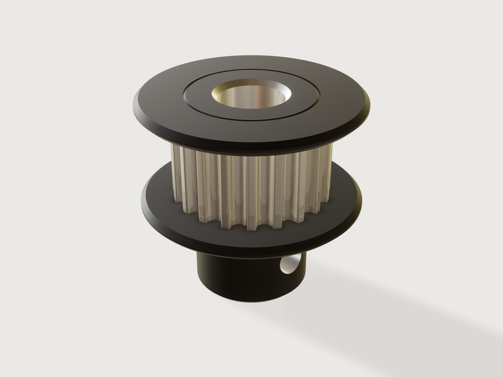

# GT2 pulley

A timing pulley for 2 mm GT2 belts from what you have on the bench: the belt width, the shaft and how you will make
it. Flanges, face width and set screws follow the Gates design rules, and one choice turns the same pulley from a
black-anodised machined part with bright hobbed teeth and two pressed-on flanges into a one-piece PETG print, lying in
its print orientation with a printable flange and captive nuts.



## What it shows

- A spline through published points (`sketch.spline` with `live`), one groove and one land, repeated into a closed ring
  by `sketch.pattern` with `chain` and `angle`, so 12 to 60 teeth stay one profile: two faces per tooth instead of the
  old polyline's twenty-one.
- Choices driven by tables (`table.set`, `variable.publish` with `choicesFrom`): the belt, the process, the set screws
  and the DIN 6885 keyway by the shaft.
- A choice that changes the structure, not only sizes (`feature.when`): round bore, D flat or keyway; flanges on both
  sides or none; a hub with no, one or two screws; a tapped hole or a teardrop hole with a captive nut slot; three
  parts when machined, one when printed.
- A choice that changes the build (`feature.transform` with a formula angle): the printed pulley lies hub down when the
  hub carries the flange, and flips hub up when the hub is narrower than the flange next to it, so it is on the bed
  without supports.
- Colour per feature that survives the booleans (`body.appearance`): bright teeth on a black anodised body.
- Ranges that follow other parameters: the fewest teeth from the belt, the shaft, the screw and the hub; the largest
  shaft from the tooth roots and the hub; the largest groove fit from the width of the tooth land; the shortest hub from
  the screw and its nut.

A static model is one pulley. This one is every pulley from a 12-tooth idler on a 2 mm shaft to a 60-tooth drive on a
keyed shaft, and it tells you when the shaft no longer fits.

## The real thing

**Sources.** Gates, *Light Power & Precision Drive Design Manual* (©2015):

| Value | In the Jig | Where |
|---|---|---|
| OD = pitch diameter − 0.508 mm for 2 mm pitch | `pitch_line_offset` 0.254 mm | Sprocket table p. 29 (OD = pitch − 0.020 in) |
| Fewest grooves 12 | teeth from 12 | Inside idler table p. 68; the 2MGT sprocket table starts at 12 |
| Flange height for moulded, sintered or cast flanges: minimum 1.10 mm, nominal 1.50 mm | Printed 1.5 mm, proven ≥ 1.10 mm | Table 22, p. 78 |
| Flange of a machined sprocket: 2MR-12S-06 has 0.281 in OD and 0.480 in over the flange, about 2.5 mm high | Machined 2.5 mm, also proven ≥ 1.10 mm | Sprocket table p. 29 |
| Guide flanges are permanently mounted parts | Machined: two washers pressed on seats and staked | p. 37 |
| Sprocket diameters less than the belt width are not generally recommended | Fewest teeth from the belt width | p. 62 |
| Face width: flanged belt + 1.00 mm, unflanged belt + 3.00 mm | + 1 mm with flanges on both sides, + 3 mm otherwise | Table 23, p. 78 |
| Flanging a two-sprocket drive: one sprocket flanged on both sides, or each on opposite sides | Flanges choice | p. 62 |
| 2MGT belt overall thickness 1.52 mm | Clearance reference only | Table 15, p. 72 |
| Set screw at least one set-screw diameter from the hub end | hub at least 2 × screw diameter long | p. 37 |
| One screw over the keyway, the second at 90 degrees; 12 to 16 grooves one screw, others two | first screw over the flat or key, second at 90° | p. 37, sprocket table note p. 29 |
| Type 6F sprockets from 17 grooves: the hub is narrower than the tooth roots (20 grooves: 0.364 in over a 0.481 in OD); 4-40 screws into a 2.2 mm wall on a 4.76 mm bore | Machined hub under the tooth root radius; at least four threads of wall | Sprocket table p. 29 |
| Stock 2MGT widths 4, 6 and 9 mm | Belt width choice | p. 15 |

Belt widths 10, 12 and 15 mm are the sizes sold for 3D printers and CNC. ISO 4032 hex nuts (M2.5 5 × 2 mm, M3 5.5 × 2.4
mm, M4 7 × 3.2 mm), ISO 273 medium clearance holes (2.9, 3.4, 4.5 mm), tap drills for ISO 261 coarse threads (2.05, 2.5, 3.3 mm)
and DIN 6885-1 keyways (b × hub depth from 2 × 1.0 mm on 6 to 8 mm shafts, to 8 × 3.3 mm on 22 to 30 mm shafts) set the
tables `hub_options` and `keys`. A D-shaft flat is min(0.5 mm, shaft / 10) deep, the half-millimetre of NEMA motor
shafts and proportionally less below 5 mm.

**Machined aluminium, black anodised (the default).** Three parts, built like Gates' type 6F. Turn the barrel, the hub
and two flange seats from one bar and anodise it black, then hob the teeth, which leaves them bright: the hub and the
seats stay under the tooth root radius, so the hob runs out over them (the hub is proven at least 0.39 mm under the
roots, and the ranges keep the seats' wall). Turn or stamp two washers 1 mm thick and 2.5 mm above the outside
diameter, press them on the seats, the hub-side one over the hub, and stake the seat ends over. The screw holes are
the tap drill, tapped by hand; the hub wall gives at least four threads. Plain 2 700 kg/m³ aluminium; the mass output
counts the two washers too.

**3D printed PETG.** One body with its flanges, printed as the file lies; no supports. The flange farther
from the bed has a 45 degree cone on the belt side (the usual way to print a flange that a belt can run against),
the bed flange a 0.4 mm first-layer chamfer, the bore is 0.2 mm over the shaft and the screw holes are the ISO 273 medium
clearance with a teardrop point so they print without supports. A set screw runs in a hex nut pushed into a slot from
the hub end; that slot and its ceiling are the only bridges (span under the width of the nut, under 8 mm). With two screws, each nut slot starts at least half a nut width plus 1 mm from the axis, so the two pockets keep 1 mm between them. The groove
ends under a flange are 0.76 mm ledges that a printer bridges. Printed groove fit (default 0.2 mm, largest value keeping a tooth land of 0.2 mm) widens each groove
for the belt; tune it to your printer. A toothed end that stands on the bed gets a 0.4 mm chamfer across the tooth tips;
the other toothed ends stay square, also when machined, because that chamfer costs a boolean across every tooth. The
pulley flips to print hub up as soon as the hub is narrower than the flange beside it. 1 270 kg/m³.

**Tooth outline.** The GT2 2 mm belt tooth outline (21 points) comes from droftarts' *Parametric Pulley - lots of tooth
profiles* ([thingiverse.com/thing:16627](https://www.thingiverse.com/thing:16627), 2012), licensed Creative Commons
Attribution-ShareAlike, as its page states (the page names no version). This Jig adapts it and is shared under
[CC BY-SA 4.0](https://creativecommons.org/licenses/by-sa/4.0/), a later version of the same licence, which the licence
allows for an adaptation. Changes: the points below the chord are left out, the chord's distance from the centre is computed from the
outline's own end points so the grooves meet the land arcs exactly, and a spline runs through the points instead of
straight segments.

## Parameters

| Group | Parameter | Range | What it changes |
|---|---|---|---|
| Pulley | Teeth | From what the belt, shaft, screw and hub need (12 for a small belt on a thin shaft, 24 for a 15 mm belt) to 60 | Pitch and outside diameter, largest shaft |
| Pulley | Belt width | 4, 6, 9, 10, 12, 15 mm | Toothed face width (belt + 1 mm with flanges, belt + 3 mm without) and the fewest teeth |
| Pulley | Made by | Machined aluminium, black anodised; 3D printed PETG | Number of parts, colours, density, bore allowance, wall limit, flange shape and height, tapped hole or captive nut, print orientation |
| Pulley | Printed groove fit | 0 mm up to what keeps a 0.2 mm tooth land, at most 0.3 mm | Only when printed: how much each groove is widened for the belt |
| Bore | Shaft diameter | From 2 mm (at least the screw, 6 mm for a keyway) up to a limit from the tooth roots and, machined, the hub | Bore; a keyway's corner counts in the limit |
| Bore | Bore type | Round, D-shaft, Keyway | Flat or DIN 6885 keyway at the first screw |
| Flanges and hub | Flanges | On or off | Both flanges and their seats; the face width |
| Flanges and hub | Hub | On or off | The hub; without it the pulley is pressed or glued on |
| Flanges and hub | Set screws | Plain, or 1 or 2 × M2.5, M3 or M4 at 90° | The screws, hub diameter and the shortest hub; ignored without a hub |
| Flanges and hub | Hub length | From what the screw needs up to 20 mm | Hub length, ignored without a hub |

Outputs: pitch diameter, outside diameter, belt travel per turn, toothed face width, bore as modelled, hub diameter,
overall length, volume and mass.

## Checks

Every assertion is a measure of the model or a closed form, and every one that applies at a point passes at every point
of the check:

- the parts: one body, or the pulley and two flange washers when machined with flanges; the washers do not overlap the
  pulley;
- one land per tooth on the outside diameter (cylindrical faces of radius OD/2 are counted and must equal the teeth);
- the tooth lands' total area at least teeth × 0.2 mm × their length;
- the rim's cross-section at mid-face against an independent closed form, at every tooth count: the circle of the outside
  diameter less, per tooth, the outline's polygon area scaled by the groove fit and the chord segment, less the bore's
  area with its flat or keyway, within 0.05 mm² + 0.005 mm² per tooth (the spline bulges about 0.001 mm² per tooth past
  the polygon of its points);
- the overall length; printed, the part resting on z = 0;
- each flange's outer cylinder at least 1.10 mm above the outside diameter (Gates Table 22);
- the wall from the bore and keyway to the groove surfaces, at least 0.8 mm machined, 1.2 mm printed;
- machined: the hub at least 0.39 mm under the tooth root radius (the hob), at least four threads from the bore or key
  to the hub's wall, and the seats' wall over the bore;
- printed with screws: at least 1 mm of hub behind the nut slot, and with two screws 1 mm between the nut slots;
- with a set screw: the screw's centre at least one screw diameter from the hub end (Gates), measured on the model, and
  the bore at least as wide as the screw;
- printed: at least two chamfered edges in the first layer and no conical face steeper than 45 degrees (0.5 degree of
  tolerance on the exact 45 degree cone).

The distances carry a margin of 0.01 mm because the sharpest cases sit exactly on the limit.

`tools/jigs.py check` runs `check-range`: 111 points (the defaults, up to 64 corners, every choice, 32 random points), all passing, none unproven, slowest 1.3 s (`meta.json`). The ranges were also tried with `param.set` at about 180 combinations that could break
them: machined and printed, every bore type, flanges and hub on and off, M2.5 to M4 screws, 6 and 15 mm belts, the
fewest teeth (and 60 for part of the machined set), the smallest and largest shaft, the largest groove fit and the
shortest hub; all passed. Earlier review found that
keyway and nut corners reach further than their floors, two nut pockets can merge on a thin shaft, a printed tooth land
can vanish and a screw can exceed the shaft: the ranges and assertions above now exclude them.

Not checked: the press fit of the washers, the belt's life, the torque the set screws hold, or how well your printer
keeps the grooves; the bridge over a nut slot and the 0.76 mm ledges at the groove ends under a printed flange are
stated above, not measured.

## Export

Choose **File › Export**: **STEP** for machining (exact, with the flanges as separate bodies, hub at the bottom), **3MF** or **STL** for printing: the body is already on
z = 0 in its print orientation, hub down or hub up as the Jig decided, so no rotation is needed in the slicer (3MF
carries the colours).

## Files

`build.json` (the source), `meta.json`, `formtest.md`, `preview.png`, and `gt2-pulley.3dcraftjig`,
`thumb.png` from the tool.

## Rebuild

```sh
tools/jigs.py build gt2-pulley
tools/jigs.py render gt2-pulley
tools/jigs.py check gt2-pulley
```

The tool needs the 3DCraft build this repository is pinned to: see
[Building and checking](../../README.md#building-and-checking) in the README.

## Difficulty

6 out of 10: a three-part build, coupled ranges and process-driven topology.

## Platform notes

- `sketch.spline` with expressions needs `live: true` (examples' feedback F-011); the groove spline uses it.
- `feature.revolve` with `cut` keeps an automatic name for its hidden tool (examples' feedback F-002, reported for
  extrude; same for revolve), so the lead-in cuts here are an explicit `feature.boolean`.
- `measure.draft` samples cones and reports radians (examples' feedback F-067): the no-overhang assertion gives its bound
  in degrees, and the failure message shows radians.
- `body.appearance` takes a colour from expressions but `metallic` and `roughness` only as numbers, so one choice
  cannot switch a body between a bright metal and a plastic look: this Jig makes the toothed rim as two extrusions that
  differ only in appearance, one on per process
  ([repro](../../findings/J-053-appearance-numbers-not-expressions/repro.json)).

## Licence

[CC BY-SA 4.0](../../LICENSE-CC-BY-SA-4.0.md), because the tooth outline comes from a source licensed
Creative Commons Attribution-ShareAlike (*Tooth outline*); its credit line, which names droftarts' source, is in
[`LICENSE-CC-BY-SA-4.0.md`](../../LICENSE-CC-BY-SA-4.0.md).
