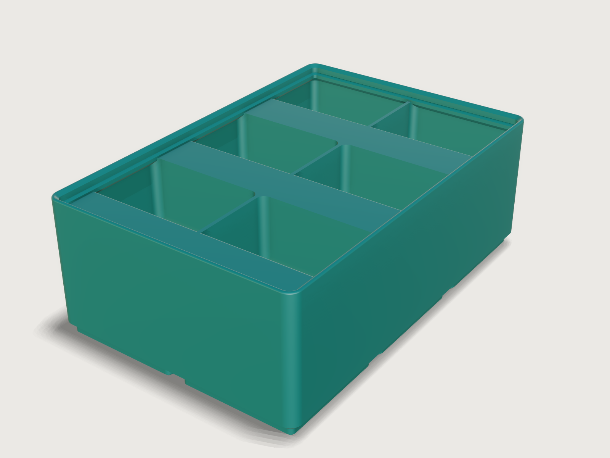

# Gridfinity bin

A storage bin for the open [Gridfinity](https://gridfinity.xyz/) system by Zack Freedman, printed standing on its feet
without supports. Choose its size in grid units and height units, how many compartments and rows it holds, label tabs,
scoops, and what goes in the base. Switch its fit gauges on and it proves that it seats in a baseplate and stacks on the
next bin.



## What it shows

- **One compartment, patterned.** A single rounded pocket is built once (`feature.extrude`, `feature.fillet` on its floor
  with `chain`, a scoop and a label tab cut from it with `feature.boolean`), then copied with `feature.pattern` in two
  directions. Every compartment gets rounded corners and a rounded floor from those few steps, whatever the count.
- **A profile swept round the bin.** The stacking lip is one `feature.sweep` of its section along the bin's closed outline,
  with the rounded tip in the section as a `sketch.path` arc, so its faces are exact planes, cylinders, cones and tori.
- **Choices that change what is built.** `table.set` with `choicesFrom` holds the hole styles; `when` conditions switch the
  magnet, screw and bridge-layer cuts, the tab, the scoop, and the lip or plain rim; the corners-only style changes a
  pattern's step and count by formula (`feature.pattern`).
- **Ranges that follow each other.** How many compartments fit depends on the bin's width and wall; the tab needs a height
  of 3 units; the wall's limit depends on the lip; and the rows follow the compartments side by side, so a bin holds at most
  48 (`variable.publish` with formula `min` and `max`). A bad combination is refused with the reason.
- **Checks against a real fit.** One option, *Show fit gauges*, adds a baseplate socket and the foot of a stacked bin at the
  bin's two far corners (`feature.when`), and the assertions that measure against them (`assert.add` with `when`) switch on
  with it: `overlap`, `distance` to each 45 degree face, and `clearance` on the lip. With it off, the file holds just the bin.

A static model of a bin is one bin; this one is every size from 1 x 1 x 2 to 6 x 6 x 15, with up to 48 compartments.

## The real thing

**The system.** Gridfinity is Zack Freedman's open modular storage system (Voidstar Lab, 2022, MIT licence). Every number
below that decides whether a bin fits comes from these sources, read as numbers; no code was taken:

- [gridfinity-unofficial/specification](https://github.com/gridfinity-unofficial/specification), its block and baseplate
  profile drawings: 42 x 42 x 7 mm grid, 41.5 mm bin (0.5 mm clearance), 4.75 mm foot, 5 mm baseplate, 6 x 2 mm magnets,
  M3 screws. The drawings label the corners "3.75Ø" and "8.0Ø"; the plate's 4 mm radius less the 0.25 mm gap on each
  side gives 3.75 mm, so 3.75 is a radius, as kennetek's `BASE_TOP_RADIUS = 7.5 / 2` also says.
- [kennetek/gridfinity-rebuilt-openscad](https://github.com/kennetek/gridfinity-rebuilt-openscad) (MIT), `src/core/standard.scad`
  and `gridfinity-baseplate.scad`: the foot profile (0.8 mm chamfer, 1.8 mm straight, 2.15 mm chamfer), the lip (0.7 mm
  chamfer, 1.8 mm straight, 1.9 mm slope, a 1.2 mm support and a 0.6 mm tip radius), 6.5 x 2.4 mm magnet holes and 3 mm screw
  holes 8 mm in from the unit's sides, 7 mm base height, 1.2 mm dividers.

**Where this Jig decides for itself, and why:**

- The wall is at least 1.2 mm (three 0.4 mm lines), not the reference's 0.95 mm, for FDM strength.
- The label tab's support is at 45 degrees, not the reference's 36, so it prints without supports. The tab is sized by what it
  carries: a flat area 12 mm front to back, room for 12 mm label tape. That holds in the back row too, where the lip
  overhangs the tab by 1.4 mm at the default wall, so the tab is 14.4 mm deep there and everywhere (the reference's is 15.85).
  Where the row or the height is short the flat is smaller, and the output *Flat label area* says how much.
- The screw holes are 5.8 mm deep, not the reference's 7 mm, leaving 1.2 mm of floor above them.
- With both magnets and screws, each hole's ceiling has two thin steps (a slot, then a square, one 0.2 mm layer each), the
  standard way to bridge a ring without supports.
- The top of the dividers and tabs is 0.6 mm under the wall's top, 0.25 mm below the feet of a bin stacked on this one.

**A note on the published geometry.** A published plate's ridges between sockets come to a knife edge 5 mm above the socket
floor, while the bin's underside between its feet starts at 4.75 mm. Both are published numbers, so on paper a multi-unit bin
overlaps the very top 0.25 mm of each ridge, where the ridge is narrower than one printed line and does not print to its tip.
The bin rests on the two 45 degree faces of the socket. The gauge here is therefore cut to stand clear of everything else, 0.2
mm above the socket floor and 0.05 mm under the foot's top, so it can only touch on those two faces, and each is proven on
its own. This Jig's companion [`gridfinity-baseplate`](../08-gridfinity-baseplate/) stops its sockets flat at 4.75 mm, so a bin in
that plate has no ridge above its underside at all.

**Printing.** Standing on its feet, as modelled: the 3MF is in print orientation. PETG (or PLA), 0.4 mm nozzle, 0.2 mm
layers, three perimeters. The foot's 0.8 mm bottom chamfer is the first-layer chamfer, and every hole has a 0.4 mm chamfer at the bed. No supports: no sloped face leans further
over than 45 degrees. Flat downward faces remain in three places, and they are short bridges: the ceiling of each magnet
hole (6.5 mm across), the ceiling of each screw hole (3 mm), and the strip between neighbouring feet (0.5 mm wide, wider
only in the small star where four feet meet). The tops of the 1.2 mm dividers stay square: three lines of plastic leave no
room for a chamfer. Press or glue in 6 x 2 mm magnets. A 6-unit bin is 251.5 mm long, so check it against your print bed.

The mass and filament length shown are for the model printed solid. PETG density 1.27 g/cm³ is from the
[Prusament PETG data sheet](https://www.3dprintergear.com.au/assets/files/technical-data-sheet%20(1).pdf) (ISO 1183); a
slicer's infill in the feet and floor will use less.

## Parameters

| Group | Parameter | Range | What it changes |
|---|---|---|---|
| Size | Width | 1 to 6 units of 42 mm | Outside width, feet, how many compartments fit |
| Size | Depth | 1 to 6 units of 42 mm | Outside depth, feet, how many rows fit |
| Size | Height | 2 to 15 units of 7 mm (3 with a label tab) | The wall's height, the base included, without the lip |
| Compartments | Compartments side by side | 1 to the number that fit, each at least 12 mm wide (at most 12) | Dividers across the width |
| Compartments | Rows of compartments | 1 to the number that fit, each at least 14 mm deep (at most 12, and at most 48 compartments in all) | Dividers from front to back |
| Compartments | Label tab | None, Full width, Centred 42 mm strip | A sloping tab at the back of every compartment |
| Compartments | Scoop | on or off | A rounded front in every compartment |
| Base and rim | Holes in the base | None; magnets in every unit; magnets at the bin's four corners; M3 screws; magnets and screws | The holes in the feet |
| Base and rim | Stacking lip | on or off | The Gridfinity lip, or a plain rounded rim |
| Base and rim | Wall thickness | 1.2 mm up to 1.8 mm with the lip, 2.4 mm without | The outer walls; the lip keeps its own size |
| Checks | Show fit gauges | off (default) or on | Adds the baseplate socket and stacked-foot gauges at the far corners, and proves the fit |

Outputs: outside width and depth, height with the lip, inside depth, each compartment's clear width and depth, the label
tab's width and its flat label area in the back row, the magnets needed, and the mass, volume and filament length if printed solid. At the defaults
(2 x 3 x 6, six compartments, full-width tabs, scoops, magnets in every unit) the bin is 83.5 x 125.5 mm and 45.55 mm tall,
each compartment 39.95 x 40.23 mm clear, 24 magnets, 12 mm of flat label area, and 174 g or 56.8 m of filament as a solid print.

## Checks

The assertions, in words: the width and depth are units x 42 mm less 0.5 mm; the bin stands on z = 0 and its top is at
units x 7 mm plus the lip's height. The bottom of the first unit's foot has the closed-form area of the published profile less
its holes, there is one bottom face per unit, and the feet's side area equals the closed form of the 0.8, 1.8 and 2.15 mm
profile in every unit. A section 0.5 mm under the floor is the whole outline, so nothing breaks through it. The straight band of
the lip stands the published 1.9 mm in from the outside.

With *Show fit gauges* on, at the bin's two far corners: the bin does not enter the baseplate socket, the foot's lower and
upper 45 degree faces each touch the socket's (each measured on its own: a socket 0.1 mm looser or tighter, or looser on one
of the two faces only, fails the assertion for that face), the foot of a stacked bin enters no compartment or tab and rests
on the lip.

For printing: facing compartment walls are at least 1.2 mm apart both ways (in a low bin the tab's sloping underside takes the
place of the back wall and is measured instead), the side and front walls measure the wall thickness, no flat face leans
further than 45 degrees from the bed, the conical corners of the feet and lip are no steeper than 45 degrees, and the only
flat downward faces above the bed are the hole ceilings and the web between the feet, at their own heights. The counts: one
floor per compartment, one scoop and one tab front per compartment when they are on, and as many magnet and screw holes as the
style asks. The label tab's flat area reaches the lip or rim above it, measured on the back row, where it is shortest.

To keep them light on a large bin, the lip band, the first foot, the wall and the divider distances are measured on the
first unit, row or column; the others are pattern copies.

`tools/jigs.py check` runs `check-range`: 103 points (the defaults, 64 corners of the box of the ranges, every choice and 32
random points from seed 1), all passing, none unproven; the slowest regeneration takes 1.3 s on a busy machine. Most corners
are not in that sample, so the combinations that should break the Jig were tried by hand with `param.set`. A label tab on a
2-unit bin, the lip with a 2.4 mm wall, and more than 48 compartments are refused, with the range that applies. These pass
with the gauges on: the largest bins the form allows (6 x 6 x 15 with 12 x 4 and 8 x 6 compartments, magnets and screws), 1 x
1 x 2, a 2 x 2 (whose diagonal gauges come closest to each other) and 2 x 1 x 3 with a 2.4 mm wall and no lip. Those largest
bins take about 8 s to open, regenerate and finish all 27 assertions on the same machine; the assertions run off the form's
thread.

The cone-corner draft is measured on sampled faces of the first unit's foot and its corner of the lip (the others are
copies of them), so it is a strong check rather than a proof (F-067 in 3DCraft Examples' feedback list). Wall thickness uses
plane-to-plane distances, because `measure.thickness` finds the wall but cannot prove it on this body (F-020 in the same
list).

Not checked: the actual print, the strength of a filled bin, how a magnet holds, or a ridge in a real baseplate.

## Export

Choose **File > Export...**, format **3MF** (or STL or STEP). With *Show fit gauges* off, as it is by default, the file holds
just the bin, in print orientation: send it to the slicer and print it on its feet, without supports. Switch the gauges off
before exporting if you turned them on: they are bodies of the model, and an export writes them too (see Platform notes).

## Files

`build.json` (the source), `meta.json`, `formtest.md`, `preview.png`, and `gridfinity-bin.3dcraftjig`,
`thumb.png` from the tool.

## Rebuild

```sh
tools/jigs.py build gridfinity-bin
tools/jigs.py render gridfinity-bin
tools/jigs.py check gridfinity-bin
```

## Difficulty

6 out of 10: lofted foot profiles, a swept lip, patterned compartments, formula-coupled ranges and cross-body fit gauges.

## Platform notes

Entry [J-045](../../3DCRAFT-FEEDBACK.md#j-045-a-3d-export-cannot-be-given-a-named-set-and-without-bodies-it-writes-hidden-bodies-too-see-f-045-f-161) in `3DCRAFT-FEEDBACK.md`, with a reproducer in `findings/`:

- A mesh export without `bodies` also writes bodies hidden with `feature.visible`, so a Jig's measuring gauges end up in the
  maker's slicer unless they name the body to export; a model cannot mark a helper body as not being a part
  ([repro](../../findings/J-045-3d-export-set/hidden-body.json)). Related to F-161 in 3DCraft Examples' feedback list
  (hidden helper bodies in the cut list). Workaround: the gauges are built only when *Show fit gauges* is on, so the default
  export is one printable bin.

## Licence

[CC BY 4.0](../../LICENSE-CC-BY-4.0.md); credit line in the [README](../../README.md#licence).
