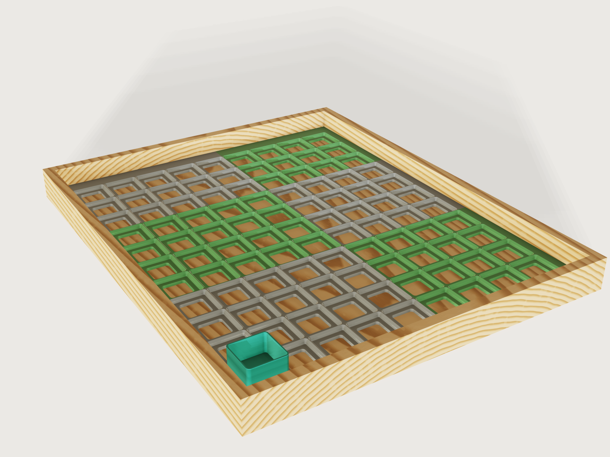

# Gridfinity baseplate

A Gridfinity baseplate made to measure for a drawer. Give the drawer's inside and your print bed: the plate holds as
many 42 mm cells as fit, centred, with filler strips out to the walls, and splits itself into pieces that each fit the
bed. The pieces are held together by printed bowtie clips. Any Gridfinity bin, including those of the
[`gridfinity-bin`](../07-gridfinity-bin/) Jig, seats in it.



The defaults are a 400 x 500 mm drawer and a 256 mm bed: 9 x 11 = 99 cells, fillers of 10.75 mm left and right and
18.75 mm front and back, six pieces in two columns and three rows (the largest 220.75 x 186.75 mm), 29 clips, a plate
8.35 mm high and about 0.90 kg of PLA.

## What it shows

- **A form that asks what the maker knows.** Drawer width and depth, and the print bed. Everything else follows:
  cells, fillers, pieces, clips, the filament to buy. A few formulas per axis (`variable.set` with `floor`, `ceil`, `min`, `max`,
  `if`) do the sharing out.
- **Topology that follows the form.** The number of cells, of pieces and of clips all change with a number, not by
  scaling. Each of the 16 piece slots is a chain of features with a `when`; `feature.transform`, two nested
  `feature.pattern`s and `feature.boolean` make a piece, with its own count of cells.
- **One cell cut, reused.** The socket (`feature.loft`, ruled, through rounded squares drawn with `sketch.path`), the
  magnet holes (`feature.pattern`), the screw hole, the window and the weight pocket are unioned once into a single
  cut, on or off by `when`. Every piece copies that one cut and patterns it across its own cells only: at the largest
  plate that is 3 times less work than one 196-cell cutter applied to every piece
  ([finding](../../findings/J-061-subtract-many-lump-tool/repro.json)).
- **One pocket cutter, copied to every joint.** A ruled `feature.loft` of the bowtie, flared at its mouth, goes to the
  joints by `feature.transform` and `feature.pattern`. The clips in place are a `sketch.pattern` with `count2` and
  `step2`: one clip per cell along a joint, one joint per step of the middle pieces.
- **Two states of the same parts.** With the drawer on, the clips sit in their pockets; with it off, the same count of
  clips lies flat in rows computed from the bed, and a `feature.block` removes the unused places of the last row.
- **Published ranges that depend on other parameters.** Screw holes exist only in the Solid style, and magnets and clips
  need a floor; the form keeps those off where they cannot exist (`variable.publish` `min` and `max` as formulas).
- **A closed form against the model.** The volume of the first piece is computed from the frustums of the socket, the
  chamfer, the windows, holes and pockets, and compared to the measured body.

A static baseplate is one grid for one drawer. This one is every drawer up to 600 x 600 mm and every printer from
180 mm up.

## The real thing

**The system.** Gridfinity is Zack Freedman's open storage system (Voidstar Lab, 2022, MIT licence; see
[gridfinity.xyz](https://gridfinity.xyz/specification/) for the 6 x 2 mm magnets and M3 screws). The dimensions here are
read, as numbers, from kennetek's reference implementation
[gridfinity-rebuilt-openscad](https://github.com/kennetek/gridfinity-rebuilt-openscad) (MIT), and checked against its
source on 2026-11-08:

| Value | Number | Name in the source |
|---|---|---|
| Grid pitch | 42 mm | `GRID_DIMENSIONS_MM`, `BASEPLATE_DIMENSIONS` |
| Socket, from the bottom | 0.35 mm straight, 0.7 mm at 45 degrees, 1.8 mm straight, 2.15 mm at 45 degrees | `_BASEPLATE_PROFILE`, on `BASEPLATE_HEIGHT` 5 |
| Opening's corner radius | 4 mm | `BASEPLATE_OUTER_DIAMETER` 8 |
| Bin foot, from the bottom | 0.8 mm at 45 degrees, 1.8 mm straight, 2.15 mm at 45 degrees (4.75 mm) | `BASE_PROFILE` |
| Bin's top size and radius | 41.5 mm, 3.75 mm | `BASE_TOP_DIMENSIONS`, `BASE_TOP_RADIUS` |
| Magnet hole | 6.5 mm across, 2.4 mm deep, 8 mm in from the cell's sides | `MAGNET_HOLE_RADIUS`, `MAGNET_HOLE_DEPTH`, `d_hole_from_side` |
| Weighted bottom | 6.4 mm, a 21.4 mm square pocket 4 mm deep | `bp_h_bot`, `bp_cut_size`, `bp_cut_depth` |
| Screw clearance hole | 3.35 mm | `d_screw` |

The screw hole's countersink is this Jig's own: 90 degrees and 6.4 mm across, for a DIN 7991 M3 flat head (6 mm) with
0.2 mm to spare on each side.

A bin's foot and the socket are made for each other: with the foot standing on the socket's floor, both 45 degree faces
lie in the same planes as the socket's, and the 1.8 mm straight parts stand 0.25 mm apart. The Jig measures this on a
foot of exactly the published profile in the first cell.

**Where this Jig departs from those numbers, and why.**

- *The top of the socket stops at 4.75 mm, not 5.* At 5 mm the published openings of two cells meet in a knife edge,
  which a nozzle cannot lay down. A bin's foot ends at 4.75 mm and `gridfinity-rebuilt` starts the bridge between a
  multi-unit bin's feet there (`_base_bridge_solid`, on `BASE_PROFILE_HEIGHT`), so the top 0.25 mm of the ridge can
  only dig into that bridge. Stopping the chamfer at 4.75 mm leaves a flat ridge at the height the bin's underside
  already has, and touches no surface a bin bears on. The ridge is 0.5 mm wide between two cells of a piece, and 0.25 mm
  on each side of a joint between two pieces.
- *The floor is 3.6 mm where the reference has 3.4 mm* (`h_skel` 1 plus the 2.4 mm magnet hole), so that 1.2 mm of skin
  stays under the magnet holes.
- *The weight pocket has 3 mm corners and no finger channels.* With the reference's square corners a pocket corner
  touches the magnet holes at no thickness. The rounded corners keep 1.24 mm of wall there; the channels would run under
  the clips. A square weight up to about 19.6 mm, or a disc up to 21.4 mm across, fits, 4 mm thick at most.
- *The screw hole is in the middle of the cell, and in the Solid style only.* The middle is this Jig's own position: the
  reference puts its baseplate screws at the cell's four corners (`hole_pattern`), which here belong to the magnets. In
  the Light style the middle of a cell is a window; in the Weighted style a countersink there would leave 0.875 mm over
  the weight pocket.

**Layout.** Along each axis, the plate is the drawer less the clearance. Cells = floor((plate - 8 mm) / 42 mm), so each
filler strip is at least 4 mm, and the rest is shared equally between the two fillers. An end piece carries a filler,
so it holds at most floor((bed - filler) / 42 mm) cells; a middle piece carries none and holds floor(bed / 42 mm). Pieces
are as few as those two limits allow, the middle ones all equal, the two end ones sharing the rest (differing by one at
most). So the 14 cells of a 600 mm drawer fit a 180 mm bed in 3 + 4 + 4 + 3, four pieces, and the 13 cells of a 589 mm drawer
in 3 + 4 + 4 + 2; sharing them out as if every piece carried a filler would take five. Four is the most any drawer in
the range needs, so the plate has at most 4 x 4 pieces, all of them separate bodies named `Piece A1`
(front left) to `Piece D4`, in two colours like a checkerboard so that the joints show.

**Joints.** A bowtie clip 12 mm across the joint, 15 mm at its ends, 6 mm at its neck and 1.8 mm thick sits in a pocket
in the underside, one per cell along every joint. The pocket is the clip's outline grown by the fit on every side (its
corners by formula, from the flank's slope) and the fit above it, and its mouth flares out by the first-layer chamfer. The flanks' slope is 3:4, so a joint opens by at most
fit / 0.6 per half; the drawer's clearance limits it anyway. Lay the pieces upside down, drop the clips in (a drop of
glue if you want them to stay), turn the plate over and put it in the drawer. Thin has no floor for pockets and its
pieces just butt together; the drawer holds them.

**Printing.** FDM, each piece flat with the top up, as modelled: PLA or PETG, 0.2 mm layers, a 0.4 mm nozzle, two or three
perimeters. The bottom's outer edge of every piece has a 0.4 mm first-layer chamfer against elephant's foot, which also
keeps joints closed at the bed. No supports: the sockets' faces all lean away from the bed at 45 degrees or better, and
the only ceilings are the clip pockets' (a span of at most about 16 mm) and the weight pockets' (about 21 mm), bridged.
The clips print flat in rows, with the same 0.4 mm first-layer chamfer; together with the pockets' flared mouths this
keeps elephant's foot from using up the fit. If they still bind, increase the fit. Press or glue the magnets in.

**Why two colours?** The pieces can be printed in any colours; the picture alternates grey and green so that the
sharing-out shows.

## Parameters

| Group | Parameter | Range | What it changes |
|---|---|---|---|
| Drawer | Drawer width, depth | 60 to 600 mm | Cells, fillers, pieces, clips |
| Drawer | Drawer clearance | 0 to 3 mm in total | The plate is the drawer less this |
| Printer | Print bed | 180 to 400 mm | The usable size of the bed's smaller side: how the plate is split |
| Plate | Style | Light, Solid, Weighted, Thin | A 3.6 mm floor with a window per cell, a full floor, a 6.4 mm bottom with a pocket for a weight per cell, or a frame with no floor |
| Plate | Magnet holes | on, off | Four per cell; not in Thin |
| Plate | Screw holes | on, off | One countersunk M3 hole per cell; Solid only |
| Pieces | Joints between pieces | Bowtie clips, None | Clips and pockets; None in Thin |
| Pieces | Clip fit | 0.05 to 0.4 mm | Play between a clip and its pocket, on every side |
| View | Show drawer and sample bin | on, off | The drawer and a 1 x 1 bin for the picture; switch off before exporting |

Outputs: cells across, deep and in all, the fillers, pieces across, deep and in all, clips, magnets, the largest piece's
width and depth, the plate's height, its volume and the filament for it at PLA's 1.24 g/cm³ (PETG, at about 1.27, takes
about 2 % more).

## Checks

32 assertions, all passing at the defaults (those for an option that is off are inactive):

- Layout, measured on the bodies: one body for each piece; the count of sockets across the plate and in the first piece;
  the plate's extents; that it is centred in the drawer; its height; the two fillers, from the outer face of the first piece to its first
  socket; the first and second columns and rows of pieces no larger than the bed (the last piece of a row has no more
  cells than the first and the same filler, and the middle ones are all the same).
- Fit: a bin's foot of the published profile, in the first cell, overlaps nothing, touches the socket's chamfers
  (clearance 0), its straight sides stand 0.25 mm off the socket's, and its top is level with the plate's.
- Printing: at least 1.2 mm of floor everywhere under the magnet holes and clip pockets (Thin apart: its ridges are the
  system's own profile, 0.5 mm at the top); the leanest face of a cell no flatter than 45 degrees from the vertical.
- Closed form: the volume of the first piece from its block, chamfer, cells and flared half pockets, within 0.01 %.
- Clips: their count; two half pockets per clip; the first clip stands exactly the fit off its pocket; clips overlap no
  piece; at least 1.2 mm of wall between a Light cell's window and the clip pocket, between a magnet hole and a clip pocket,
  and between a magnet hole and a weight pocket.
- Clips to print: as many as the joints need, in rows that fit the bed both ways, of the volume of that many chamfered clips
  (within 0.01 %).

The foot check, the centring and the clips in place run with *Show drawer* on, the clips to print with it off. What is measured on the first piece holds for the
others because they are made by the same pattern of the same cut.

`tools/jigs.py check` runs `check-range`: 101 points (the defaults, 64 corners, every other choice, 32 random points,
seed 1), all passing, none with unproven assertions. Beyond that, these were set by hand and pass: the smallest
drawer (one cell); 600 x 600 on a 180 mm bed in every style; a drawer 1 mm wider than the bed (just split); a bed equal to the
plate (just not split); a 589 mm drawer (the 13-cell row with the widest filler, the most cramped end pieces); clip fit at
both ends; Thin with no connector; a one-piece-wide, four-piece-deep plate; and, with the drawer off, the 84 clips of a
600 x 600 drawer on a 180 mm bed (seven full rows, 177 x 123 mm), and small counts that leave a part-filled last row.

Not checked: real prints, the strength of the clips, the magnets' pull, and that every piece prints without warping. The
clips and pockets are verified at the joints named above, and the rest by the pattern.

## Export

Switch **Show drawer and sample bin** off, then **File > Export**, **The model**, as 3MF: one object per piece
(`Piece A1`, ...), each of which fits the bed, and one object `Clips to print`, the clips in rows that fit the bed, all
flat on z = 0 in the print orientation. Arrange the pieces on as many plates as the slicer needs. The clips are not in
their pockets in this file: those exist only with the drawer on, for the picture and the fit checks. To print one piece at a time, select it first (**The selection**), or name it: `file.export {"path":
"A1.3mf", "bodies": ["Piece A1"]}`. See the platform
note below for why an export cannot simply take a named set.

## Files

`build.json` (the source), `meta.json`, `formtest.md`, `preview.png`, and from the tool `gridfinity-baseplate.3dcraftjig`
and `thumb.png`.

## Rebuild

```sh
tools/jigs.py build gridfinity-baseplate
tools/jigs.py render gridfinity-baseplate
tools/jigs.py check gridfinity-baseplate
```

## Difficulty

6 out of 10: topology-driven partitioning with coupled ranges, per-piece patterns and fit checks.

## Platform notes

Entries in `3DCRAFT-FEEDBACK.md`, each with a reproducer in `findings/`:

- A mesh export (3MF, STL) takes a list of body names or every body, never a named set
  ([repro](../../findings/J-045-3d-export-set/repro.json)). A list cannot follow a layout whose number of bodies
  changes, and a name that is switched off is refused; so the Jig has a *Show drawer* parameter, which a maker switches off
  to export every body. With a set this switch would not exist. Related: F-045.
- `feature.chamfer` refuses the first-layer chamfer round a bowtie, at the concave corners of its neck: already
  [F-033](https://github.com/johancoppens/3dcraft-examples/blob/main/3DCRAFT-FEEDBACK.md#f-033). The clip to print and the
  pocket's flared mouth are lofts instead.
- Subtracting a many-lump tool from each of many small targets is 3 times slower than giving each target its own cutter
  of only the lumps that reach it ([repro](../../findings/J-061-subtract-many-lump-tool/repro.json),
  [the fast form](../../findings/J-061-subtract-many-lump-tool/repro-small-tools.json)): 1.9 s against 0.66 s, 4.6 s of CPU
  against 2.0 s, for 196 cells in 16 pieces. So this Jig cuts every piece with its own pattern, at a cost of three more
  features per piece.

## Licence

[CC BY 4.0](../../LICENSE-CC-BY-4.0.md); credit line in the [README](../../README.md#licence).
