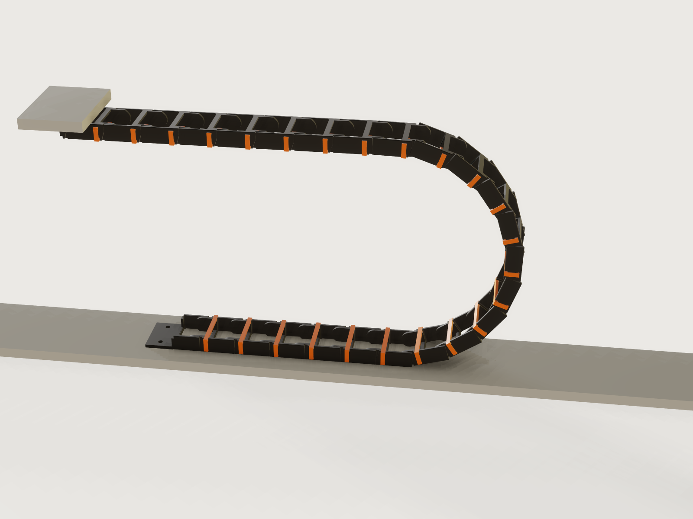

# Cable drag chain

A printable cable drag chain (energy chain) for a CNC machine or a 3D printer, designed from what you know: your cables, the
machine's travel, the height of the moving end and the smallest bend the cable allows. The form derives the link size, the
pitch, the number of links and where to put the fixed end, by igus' published rules, and a slider runs the machine so that you
see the bend roll. The output is one link, one lid and the two end pieces, in print orientation, and how many of each to
print. The design is original; a drag chain as such is a generic type.



## What it shows

- **The form asks for the need, not the part.** Two sizes of round cable and a flat ribbon go in; `inner_width`,
  `inner_height`, `pitch`, `link_count`, `bend_radius` come out. The counts change the width, a thin second cable adds a
  separator rib to every link (`feature.when`), and the material choice (`table.set`, `variable.publish` with `choicesFrom`)
  changes the strain limits and with them the pitch.
- **Ranges that depend on the design** (`variable.publish` with formula limits). The moving end cannot be set lower than the
  cable's bend allows; the counts and the ribbon width stop where the link would pass 100 mm inside; the second cable cannot
  be thicker than the largest; and the travel stops at twice the span this chain carries by itself.
- **A drive parameter that rolls the chain** (§4.1): `carriage_position` places every link by formula. A chain rolling over
  its bend is a polygon rolling on a line: the links on the lower run stay put, the half-polygon of the bend pivots about one
  hinge on the ground, and the upper run follows it. `floor()` picks the pivot, `asin()` the phase. It is drawn with three
  `feature.pattern`s, linear for the two runs and circular about a moving centre for the bend, whose counts change as you
  drag.
- **Proofs on the model.** On the machine view, hidden copies of the link and lid (`feature.visible`, switched off by `feature.when` in
  the print view), one neighbour straight and one bent to the stop, let the Jig measure the real hinge gap, the real stop gaps and
  the real overlap at both limits. The form's outputs use the formulas those `Model:` assertions tie to the model, so nothing in
  the form reads "cannot be measured" in the print view.
- **The print set** is a `Show` choice. The link, the lid and the two end pieces are the original bodies moved by `feature.transform`
  with `if()` in its offsets: on the machine they are the first lower link, the first lid and the end pieces, and in the print view
  they lie on the bed. So a plain export of the print view holds exactly those four objects.

## The real thing

**Sources, and what was read.**

| Rule | Source, as read |
|---|---|
| Chain length: `LK = S/2 + K` with the fixed end at the middle of the travel; `K = R × π + 2T`; off centre `LK = S/2 + ΔM + K` | [igus, energy chain technical terms](https://www.igus.eu/energy-chain/wiki/technical-terms), read on the page, and [igus blog: how do I calculate the chain length](https://blog.igus.eu/?p=7508) |
| Longest travel of a self-supporting chain: `SFLG = 2 x FLG` | [igus technical terms](https://www.igus.eu/energy-chain/wiki/technical-terms), read. igus takes FLG from the data sheet of a series; for a chain of your own it has to be estimated, as described below |
| Filling: 10 % clearance, at least 1 mm beside each cable and at least 2 mm in height; "The minimum distance is always 1 mm"; separate cables when `d1 + d2 ≤ 1.2 × hi`; a compartment at most 1.5 x the diameter for similar cables side by side | [igus, Assembly the chain](https://www.igus.eu/contentData/Product_Files/Download/pdf/EN_assembly_the-chain_web.pdf), page 6 and its text on clear height, read from the PDF, and the [igus filling rule](https://www.igus.eu/energy-chain/wiki/filling-rule) |
| Chain radius at least the cable's minimum, the largest possible is best; 10 × diameter when the cable's figure is unknown (NFPA 79, 2007, as igus quotes it) | [igus TechTalk: how to select the bend radius](https://www.igus.ca/_wpck/pdf/US_en/TechTalk-How-To-Select-The-Bend-Radius-Of-A-Cable-Carrier.pdf), read. NFPA 79 itself was not read |
| Snap design: `y = 0.67 ε l² / h`, `P = (b h² / 6)(E ε / l)`, `W = P (μ + tan α) / (1 − μ tan α)`; partly crystalline plastics almost to yield, amorphous to about 70 % of the yield strain; about 60 % for frequent re-opening; friction for PA | [Bayer MaterialScience, *Snap-Fit Joints for Plastics*](https://fab.cba.mit.edu/classes/S62.12/people/vernelle.noel/Plastic_Snap_fit_design.pdf), Tables 1 to 3, read from the PDF |
| PETG: yield elongation 3.5 %, modulus 1.7 GPa, density 1.27 g/cm³ | [Prusament PETG data sheet](https://cdn.shopify.com/s/files/1/1745/6181/files/prusament-petg-v0-technical-data-sheet.pdf), v1.0, printed specimens, horizontal direction, read |
| PA12: elongation at yield 5 %, modulus 1400 MPa, density 1.01 g/cm³ | [Fiberlogy Nylon PA12 data sheet](https://fiberlogy.com/app/uploads/2026/05/FIBERLOGY_NYLONPA12_TDS.pdf), May 2025, read. It does not say whether the specimens were printed |

**My own judgement**, where no source gives the number: 0.9 of the yield strain for PA12 (Bayer's "almost to the yield point"),
friction 0.5 for both filaments (Bayer's PA figure, 0.30 to 0.40 on steel, times its factor of 1.5 for like on like; PETG is
not in the table), the self-support estimate described below, the proportions of the link (pitch about twice the link height, at least six links in the bend, wall
0.16 × inner height + 0.8 mm), the 100 mm limit on the inner width, and reading igus' 10 % as 10 % of the largest cable for
every gap. The inner height is the largest cable plus igus' clearance and nothing more, which keeps it within igus' 1.5 x d for
cables of 4 mm and up; below that igus' own 2 mm minimum gap makes it a little more (5 mm for a 3 mm cable).

**How the rules are applied.** igus' bend radius R is taken to the hinge line, so that the clearance height is H = 2R + link
height. That relation is my reading: the igus pages I read define H and R by name only. The Jig is stricter than igus on the
cable in two ways. A cable under tension lies against the inside of the bend, so the centre of the thickest cable, lying there,
must be outside the cable's minimum radius. And a printed joint has play: the hinge clearance and the stop gap let each joint
turn (stop gap + hinge clearance) / (link height / 2) past its nominal angle, so the radius the cable is checked against is the
tightest local radius with that play taken up, not the nominal one. The chain is built with the fixed end at the middle of the travel, the shortest chain by
the rule (the formula with ΔM is the one to use if your machine must have it elsewhere). The link count is rounded up.

**The link.** Each side wall is two plates: an inner tongue with a pin at the rear hinge and an outer cheek with a hole at the
front hinge, joined by a web. A bottom bridge is printed with the link; the orange lid clips on so that cables can be laid in.

- **Hinge.** A 45-degree cone pin in a 45-degree cone hole, so that both print without support. Springing the cheek over the
  pin is a cantilever from the end of the web, and Bayer's formula gives the strain. The root of that cantilever is rounded at
  0.6 of the wall thickness, the ratio Bayer's page 8 suggests, and the design keeps the nominal strain low enough that 1.6 times it
  (Bayer's Fig. 9 reads about 1.55 at that ratio, taken as 1.6) stays under the filament's yield strain. The pin is a stub of the tongue: the
  force that would spread the cheeks acts through the same cone, so I expect a chain pulled hard to pop apart rather than break (not tested).
- **Stops.** In the plane of the cheek, the rear end of a link and the tip of the one before it have flat faces that meet at
  both limits: straight (the lower faces, so the upper run is held against sagging) and fully bent (the upper faces, which
  limit the bend). Both stops act only after the joint's play is taken up; that play is an output, and the bend and the
  self-support below are sized with it.
- **Lid.** A bar with a snap arm at each end that catches under a rib on the outside of the wall. Both the rib and the barb
  are 45-degree flanks, and the arm's root is rounded. It takes the 60 % strain allowance for frequent opening. The lids are
  on the inside of the bend, so on the lower run they open upward and on the upper run they face down. The cross-bars have
  rounded edges where the cables bear on them.

**Self-support.** The Jig estimates how far the upper run can carry itself, and the travel stops at twice that span (igus' SFLG
= 2 x FLG). The estimate is mine, not igus': the run is a beam of the unsupported length, half the travel plus a link. Two
limits apply. Its sag, length² x joint play / (8 x pitch), stays under 45 % of the gap between the runs. And the stop force,
weight per length x length² / (8 x link height / 2), must not spread the cheeks off the pins: through the 45-degree cones each
cheek sees half of that times (1 − μ)/(1 + μ) with μ taken as 0.2, against the force that springs the cheek, with a factor of
safety of 1.65 in the limit and 1.5 in the assertion. Cables are weighed at an assumed 2 g/cm³ of their section, a ribbon at
1.5 mm thick (my estimate; a heavier cable shortens the span). Beyond the limit a chain needs a guide trough, which this Jig does
not design: raise the moving end, use larger links, or use a trough. The sag is shown in the form, and is what you should expect
to see.

**Printing.** Print the link upright on its bottom bridge, the end pieces on their feet, and the lid standing on its end, so
that its section lies in the layers and the snap arms bend along the filament. Nothing needs support. The running faces, the
cheek's inside and the tongue's outside, have a first-layer chamfer so that elephant foot does not close the hinge gap. I would use a 0.4 mm
nozzle, 0.2 mm layers and walls filled solid, and a slicer's bed adhesion setting of your choice. PLA is not offered: the
sources above give no snap figure for it, and I judge it too brittle for a part that is sprung and flexed.

**Assembly.** Bolt the fixed end down with its hinge line at the middle of the travel (the form gives the hole position), and
screw the moving end to the carriage. Press each tongue into the cheeks of the link before it, one side at a time: the form
gives an estimate of the force. Snap the end pieces on last, lay in the cables, and press the lids on.

Not modelled: cables in the chain, strain relief and a guide trough for travels beyond the limit. The chain's life is not
computed. The press-on force is an estimate, and the strain limits rest on data sheet values of
the filament; print one link and try it before printing all of them.

## Parameters

| Group | Parameter | Range | What it changes |
|---|---|---|---|
| Your cables | Largest cable: diameter | 3 to 25 mm | Inner height, link height, pitch |
| Your cables | Largest cable: how many | 1 up to what fits 100 mm | Inner width |
| Your cables | Second cable: diameter | 2 mm to the largest | Inner width; a separator if it is thin enough |
| Your cables | Second cable: how many | 0 up to what fits | Inner width |
| Your cables | Flat ribbon cable: width | 0 up to what fits | Inner width |
| Your cables | Smallest bend your cable allows | 3 x the largest cable (at least 15 mm) up to what these links can serve (400 mm at most) | The lowest allowed height of the moving end; a long minimum radius also lengthens the pitch |
| Your machine | Travel of the machine | 100 mm to twice the self-supporting span | Chain length, link count, fixed point |
| Your machine | Height of the moving end | from what the cable and the link need, up to 1000 mm or more | Bend radius, links in the bend, pitch |
| Printing and view | Filament | PA12 nylon, PETG | Snap strain limits, so pitch and lid clip |
| Printing and view | Hinge clearance for your printer | 0.15 to 0.5 mm | Gaps at the hinge and at the stops |
| Printing and view | Run the machine (%) | 0 to 100 | Where the carriage is; the bend walks at half its speed |
| Printing and view | Show | On the machine, Print set | The running chain, or the four parts on the bed |

Outputs at the defaults (two 8 mm and two 5 mm cables, 80 mm minimum bend, 800 mm travel, moving end at 230 mm, PA12):
24 links and 24 lids to print, plus one fixed and one moving end; pitch 33.99 mm; link height 15.4 mm; inner 31 x 10 mm; outer
width 45.44 mm with the clips; bend radius 108.6 mm with 10 links in the bend (18 degrees per link); tightest local radius
91.8 mm with the joint's play taken up (3.3 degrees), the cable's centre at 90.8 mm; chain 815.7 mm long against the rule's
809.3 mm; fixed end at 400 mm from the start of the travel, its holes centred 365.2 mm from there; bend needs 150.3 mm past the
end of the travel; self-supporting span 674 mm, longest travel 1280 mm, sag of the longest run at this travel 36 mm; snap strain
1.46 % in the cheek (limit 3.13 %, so that 1.6 times it is at most the 5 % yield) and 1.01 % in the lid arm (limit 1.88 %); press-on
about 51 N per side; about 130 g of filament.

## Checks

Seventy-one assertions: 62 are active at the defaults, and 27 in the print view (where the ones that need the assembled chain are off). Measured on the model:

- **Cable space:** inner width at least the bundle, at most the 100 mm limit plus rounding; inner height at least the largest
  cable with igus' height clearance.
- **Hinge:** on a neighbouring link, straight and bent to the stop: the pin's cone to the hole's cone is the clearance × cos 45°
  (a tolerance of 0.02 mm); the two links do not overlap. Both end pieces seat in the chain with the same gap.
- **Stops:** on a neighbouring link the upper flanks close to the gap at the bend and the lower flank to the gap when straight,
  each against a bound set from the hinge clearance alone, so that a loosened stop fails; the pitch built is the one the bend
  needs, and at least the one the snap and the stops were sized for.
- **Snap:** the roots of cheek and lid arm exist with a radius of at least 0.4 of the wall, and 1.6 times the strain stays under
  yield; the cheek's and the lid arm's strain from the link's dimensions, each tied to the model by a `Model:` assertion (wall, free length, pin height and side
  gap; arm length and thickness; across the ribs and between the barb tips), under the filament's limits; pin engagement at
  least 0.6 mm; pin tip inside the cheek; the barb really has to spring over the rib.
- **First-layer chamfers:** the running faces of cheek and tongue each carry a chamfer of at least 0.4 mm, measured from the chamfer's area.
- **Walls:** cheek, tongue, the wall round the hole, the bottom bridge, the lid's arm and bar each at least 1.2 mm.
- **Printing, in the print set:** no overhang steeper than 45 degrees on the link and the end pieces (`measure.draft`, faces on
  the bed left out; the limit is −45.5° because the proven bound on cones is coarser than the 45° they are made at), none on
  the lid; each on the bed; no overlap.
- **Rule and self-support:** the links' total volume is at least (S/2 + K) / pitch times one link's, so the chain built reaches the
  rule; the fixed end sits at the middle of the travel; the sag from the joint play stays
  under half the measured gap between the runs; the spread on a cheek from the weight of the measured links stays under its holding force
  over 1.5; the travel is within 2 x FLG; the weight used for the limit is not below the model's.
- **Chain:** the volume of all links and lids is the count times the single part's (a pattern joins instances that overlap, and
  their volume then falls short, so this also proves that no two neighbours in a run overlap), no overlap between the runs and the end pieces, at least one link
  flat on each run, the upper run clear of the lower.
- **Machine:** the moving end's foot at the height asked for, within the polygon effect; the moving end at the carriage; the
  bend radius taken from the top of the bend on the model agrees with the formula, and the thickest cable's centre stays outside
  its minimum even at the tightest local radius the stops allow, joint play included.
- **Closed form:** the lid's volume is its section's area times its length. The separator is present exactly when the rule asks.

`tools/jigs.py check` runs `check-range`: 99 points (the defaults, 64 of the 4096 corners of the ranges, every choice, 32 random
points from seed 1). A further scan of 85 combinations, drawn at random from the form's own extremes (nine cable sets, both filaments, both hinge
clearances, the moving end at its lowest and 150 mm higher, the travel at 100 mm, at the form's limit and at 600 mm, the carriage at
both ends or mid-travel), found no failure; an earlier round of it found three real ones (a peak strain over yield in small links, a
lid root with no room for its radius, and the pop limit a hair too low), now fixed. Refused by the form, tried with `param.set`: a
moving end below its limit, a travel past 2 x FLG, a second cable thicker than the largest, more cables than fit.

Mutation tests in a scratch copy, each made at least one assertion fail, or the model refuse to build: a looser or moved hole, a
shortened lower-run step, a wrong bend angle, a wrong flank angle, a thin wall, a short lid arm, a chain one link short, the 2T left
out of K, a chain too short by the rule, a fixed end 40 mm off centre, a fixed or moving end out of place, a shallow lid seat, a tall
lid rib, too low an inner height or width, a tall pin, a web too long, either stop loosened by 1.2 mm, an extra link in the bend, a
wrong radius, a height limit lowered, a travel past the limit, no play in the floor of the height, no root fillet on the cheek or the
lid arm, no separator, a link in the print set turned on its side, a first-layer chamfer of 0.2 mm.

Not checked: the fatigue life of the snap and of the hinge, or wear. The unsupported length is an estimate (see Self-support), not a test.

## Export

Set **Show** to **Print set**, then **File › Export** as 3MF: the file holds exactly four objects, *Link*, *Lid*, *Fixed end* and
*Moving end*, in print orientation with their bottoms at z = 0, with no picking. Each can also be exported alone if the four together
do not fit your bed. The form says how many links and lids to print.

## Files

`build.json` (the source), `meta.json`, `formtest.md`, `preview.png`, and `drag-chain.3dcraftjig`,
`thumb.png` from the tool.

## Rebuild

```sh
tools/jigs.py build drag-chain
tools/jigs.py render drag-chain
tools/jigs.py check drag-chain
```

## Difficulty

6 out of 10. A rolling-polygon drive by formula, coupled snap and bend sizing, and neighbour-body proofs.

## Platform notes

- A pattern instance has no index to read a formula with ([J-011](../../3DCRAFT-FEEDBACK.md)): the chain is three patterns (lower
  run, bend, upper run) rather than one pattern placed by a function of the link's number.
- `measure.thickness` reads about zero where a 45-degree hole meets a flat face, an acute rim (compare F-020 in
  `~/code/3dcraft-examples/3DCRAFT-FEEDBACK.md`): the walls are asserted one by one instead.
- A named set cannot name what a mesh export writes
  ([findings/J-045-3d-export-set](../../findings/J-045-3d-export-set/repro.json)), and `file.export` also writes
  hidden bodies ([findings/J-045-3d-export-set](../../findings/J-045-3d-export-set/hidden-body.json)): so the
  helpers are switched off in the print view, and the parts are the originals moved there.
- A `variable.measure` cannot be given a condition; a measure of a body that is off reads "cannot be measured". So the measures of
  the assembled chain are assertions with a `when`, and the form's outputs use formulas.
- `clearance` between the lid and the link reported 0.07 mm (`measure.clearance` even "clear") where `overlap` found 13.5 mm³ in
  common ([findings/J-018-clearance-clear-on-overlap](../../findings/J-018-clearance-clear-on-overlap/repro.json), not minimal: a
  mutant of this Jig with its lid seat raised 0.5 mm): the lid's fit is asserted with `overlap` as well.
