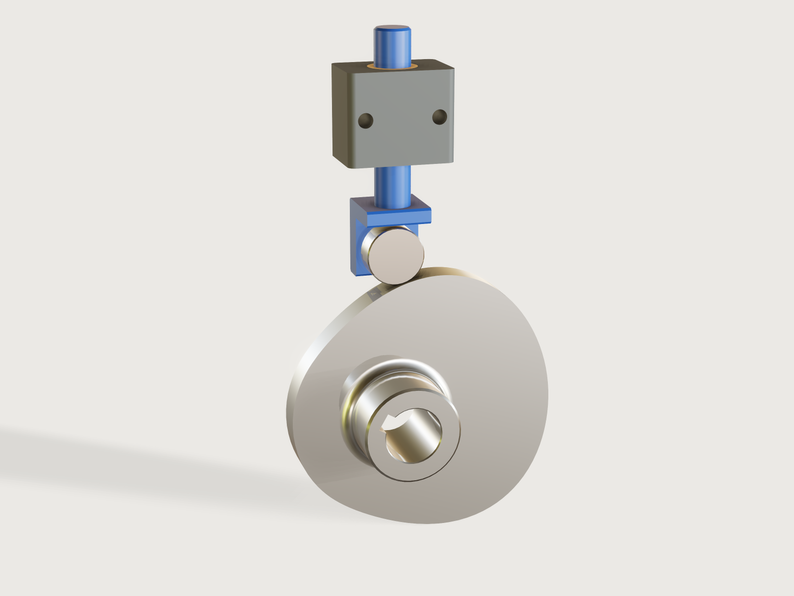

# Disc cam with roller follower

Give the motion a machine needs: the lift, the rise, dwell and return angles, the speed. Pick a motion law from a table
(cycloidal, simple harmonic, 3-4-5 polynomial) and a catalogue track roller, and the Jig lays out a disc cam by formula,
with its bore, keyway and hub, and a follower with stem, guide and anti-rotation screw. The real work is the refusal: a base circle too small for the
pressure angle or the curvature is refused, and the form says which base circle would do. Turn the drive
angle and the follower rides the cam.



## What it shows

- **A law from a table drives a curve** (`table.set`, `variable.publish` with `choicesFrom`, `sketch.curve`). Each row of
  `motion_laws` holds the coefficients of one law, and one closed formula curve, piecewise over the four intervals,
  is the contact profile: the roller path offset by the roller along its normal, in one expression.
- **The drive parameter runs the mechanism** (`feature.transform`, formulas). The cam turns by `drive_angle`; the
  follower's height is the law evaluated at that angle. No assembly, no motion commands.
- **Ranges that know the mechanics** (`variable.publish` with formula limits). The smallest base circle is computed
  from the lift, the angles, the law, the roller and the shaft. A base circle below it cannot be set, and the outputs
  give the base circle each limit asks for.
- **The form changes the structure**: the law changes the profile, the roller row changes the roller, the stud, the
  stem, the cam's width and the guide; the shaft row changes the bore and keyway; the hub is an option (`feature.when`).
- Peak velocity, acceleration, the inertia force from the measured moving mass (`variable.measure`) and the roller's
  speed against its rating are outputs. The roller speed and the cam-speed limit are taken at the largest cam radius, a dwell figure: on the flank the
  roller can run up to 13 % faster, which the rating's margin has to cover.

A static model of a cam is one motion; this one is every double-dwell motion in its range, and it tells you when the one
you asked for cannot be built.

## The real thing

**Motion laws**, with x the fraction of the interval, h the lift and β the interval angle (the standard forms):
cycloidal s = h(x - sin(2πx)/2π), simple harmonic s = h(1 - cos πx)/2, 3-4-5 polynomial s = h(10x³ - 15x⁴ + 6x⁵).
Velocity and acceleration are the derivatives. The peak factors in the table (cycloidal 2 and 2π, harmonic π/2 and
π²/2, 3-4-5 1.875 and 5.7735) agree with the table in Autodesk's
[Cam Calculation Formulas](https://help.autodesk.com/cloudhelp/2026/ENU/Inventor-Help/files/GUID-944089A6-3061-405A-B250-0C774C474C5E.htm)
(2 and 6.28, 1.57 and 4.93, and 1.88 and 5.77 in its 5th-degree row) and two assertions compare them with the coefficients in the model.
Simple harmonic motion against a dwell has an acceleration step at each end, a mathematical fact of the law (it starts
at π²h/2β², not zero). It is offered for slow cams; an output and the form's description say so.

**Limits.** R. L. Norton's cam design guidelines 6 and 7
([excerpt](https://designofmachinery.com/wp-content/uploads/2018/11/Ch182edp551.pdf); the file is chapter 18, page 551 of
the 2nd edition of the *Cam Design and Manufacturing Handbook* by its name and host, the page itself prints no title):
pressure angle limited to about 30 degrees with a translating follower, about 35 with a low-friction ball slide; the
absolute radius of curvature of the roller path larger than the roller radius at all points to avoid undercutting, with a
target above 2 times the roller radius (1.5 "used successfully in some applications"). The Jig aims at 2 (see Checks for how
closely), and the limit on the pressure angle is a parameter from 20 to 35 degrees.

**Geometry.** For an inline follower with pitch radius Rp and A = Rp + s: tan φ = v/A, and the roller path's radius of curvature is
(A² + v²)^(3/2) / (A² + 2v² - aA), from the parametric curve (v and a per radian). The contact curve is the roller
path moved in by the roller radius along the normal. These were derived for this Jig, not copied from a table; the
measured contact and the section area below test them.

**Roller.** Stud-type track rollers from the JTEKT/Koyo
[Needle Roller Bearings catalogue](https://bestbearings.az/uploads/products/pdf/KOYO%20KR%20NUTR1723584737.pdf), pages
B-222 (KR 16 to 32) and B-226 (NUKR 35 to 52), boundary dimensions per ISO 6278: outside diameter, width, stud
diameter and length, grease speed rating. The stem sizes in the table are this Jig's. So are the guide's fasteners: M6 to M12 bolts in normal
clearance holes of ISO 273 (6.6, 9, 11 and 13.5 mm, read from [this chart](https://www.albanycountyfasteners.com/media/6b/b8/g0/1764944339/clearance-hole-chart.pdf)), and an M4 to M10 anti-rotation screw, modelled at its nominal diameter.

**Keyway.** DIN 6885-1 key widths and hub keyway depths for the shaft's band
([table](https://fasten.it/en/norms/norm/din_6885-1); the page notes that the 1968 edition was withdrawn: check the current
edition). The keyway sits on the start of the rise, so it is the timing reference when you mount the cam.

**Making it.** Cut the profile by wire EDM or CNC from a hardened, bored blank and grind it; cut the bore and keyway to
the sketch *Bore and keyway*. The cam is 2 mm wider than the roller. Break the rim edges by hand (see Platform notes). A dog-point screw in the guide rides in a flat on the stem, so the follower cannot turn and the
roller stays on the cam.
The follower needs closing force to stay on the cam: a spring or gravity, greater than the inertia force in the
outputs plus your load. None is modelled. At the far end of the range a large cam on a small shaft is thin and hangs on a
short key; check the shaft and the key for your torque, which the Jig does not do. Seen from the hub, the cam
turns counter-clockwise as the drive angle grows.

## Parameters

**The motion**
- *Follower lift*: 3 mm up to 80 mm, less where the angles and the law would ask for a base circle over about 260 mm.
- *Rise angle*: 30 to 270 degrees.
- *Dwell at the top*: 10 to 200 degrees, and at most what the rise leaves.
- *Return angle*: 30 to 270 degrees, leaving at least 10 degrees of dwell at the bottom.
- *Motion law*: cycloidal, simple harmonic or 3-4-5 polynomial (table).
- *Cam speed*: 5 rev/min up to what the roller's speed rating allows, at most 3000.

**The cam**
- *Base circle radius*: up to 300 mm; the minimum is a formula of the motion, the roller and the shaft.
- *Track roller*: ten sizes, KR 16 to NUKR 52 (table).
- *Pressure angle limit*: 20 to 35 degrees, 30 by default.

**The shaft**
- *Shaft diameter*: 16 to 50 mm (table, with its key).
- *Hub on the cam*: on or off.

**Run it**
- *Drive angle*: 0 to 360 degrees.

At the defaults (25 mm lift, 120/40/120 degrees, cycloidal, 120 rev/min, base circle 48 mm, KR 26, 25 mm shaft): cam outside
diameter 146 mm, peak pressure angle 18.2 degrees, smallest radius of curvature of the roller path 58.4 mm (4.5 times
the roller radius), peak velocity 0.30 m/s, peak acceleration 5.65 m/s² (0.58 g), moving mass 0.30 kg, cam 1.39 kg, roller 674 rev/min against a rating of 10 000.

## Checks

Sixteen assertions run at every change of the form:

1. The peak pressure angle, sampled over both intervals at 21 points, is within the limit.
2. The smallest convex radius of curvature of the roller path, sampled over the decelerating half of both intervals at 11
   points and on the dwells, is at least 2.03 times the roller radius: Norton's target of 2 plus an allowance for the sampling.
3. The concave stretches of the roller path, sampled over the accelerating half at 11 points, keep at least twice the roller
   radius (Norton's rule is on the absolute radius of curvature).
4. The cam's section area, measured at mid-width, equals the closed form: the roller path's area from integrals of the law,
   minus the roller radius times the roller path's length (Simpson over the law), plus π times its square, less the
   bore and keyway (within 0.1 %; 10 729.42 against 10 729.43 mm² at the defaults).
5. The stud, concentric with the roller, sits one roller radius from the cam's profile less the stud radius, within
   0.05 mm, at the drive angle set: the follower really is on the cam, neither above it nor sunk into it.
6. In the top dwell the cam's height is the base circle plus the lift, measured on the turned cam.
7. and 8. The peak velocity and acceleration factors in the table agree with the law's coefficients.
9. and 10. The cam does not touch the follower, the nut or the guide; the follower does not touch the guide.
11. The stem top is above the guide at the lowest position.
12. The rim left under the keyway's corners is at least the wall the Jig asked for.
13. At least 2 mm of the guide block is left between the bush seat and each bolt hole, measured.
14. The bore runs right through.
15. The anti-rotation screw stays clear of the stem at the drive angle set: its flat is long enough for the stroke.
16. All seven parts exist.

**How the limits are enforced.** The base circle for the pressure limit is exact and closed: for each of the three laws the pitch
radius that just meets the limit has a closed form (the worst point of the interval is the root of a short equation), for both
intervals. The base circle for the convex curvature has no closed form, so the Jig takes three steps of a secant iteration in formulas plus a
guard step, aiming at 2.05 times the roller radius, and adds 0.5 mm. The shaft asks for the wall under the keyway. The form takes the largest of
these as the minimum of the base circle.

**What that does and does not prove.** The sampling reads the convex radius up to 1.2 % above its true value, and the peak pressure angle up to
about 0.1 degree below it, so assertion 2 holds the sampled value to 2.03 rather than 2. An offline search over 39 976 cams (all three laws,
every roller and shaft, the limit from 20 to 35 degrees), each at the form's minimum base circle and at the next value on the form's step, computed the true
radius on a fine grid: none is below 2 times the roller radius (the least 2.034), and the concave radius is never below 2.08 times it. A search is
not a proof: the true radius at a cam outside those is not guaranteed. The concave radius is checked by assertion 3 but does not
enter the iteration. Norton gives 2 as the target and reports 1.5 used successfully, so a small shortfall would be no failure of the cam.

**Range.** `tools/jigs.py check` runs 115 points (defaults, 64 corners of 4096, every choice, 32 random): all pass and none is
unproven. 88 further checks with `param.set`, eight designs at
extreme corners of the form, each at the minimum base circle and at eleven drive angles (dwell ends, mid-flanks and one degree either
side of the joints), all pass. The assertions on the follower's position hold only at the drive angles tried: at any one
setting of the form they prove the angle set.

## Export

- **For wire EDM or CNC:** select the sketch *Cam profile* in Features and export the selection as DXF: one closed spline at true size
  (at 34 mm base circle and 30 mm lift, 301 mm long). The sketch does not move with the drive angle. The sketch *Bore and keyway*
  exports the same way.
- **3D:** File > Export STEP, all bodies or the Cam alone. The bodies are where the drive angle has put them; set it to 0 for
  the cam in its reference position.

## Files

- `build.json`: the source (a JSON list of 3DCraft commands).
- `meta.json`, `formtest.md`, `preview.png`.
- [`cam-disc.3dcraftjig`](cam-disc.3dcraftjig): the published Jig.

## Rebuild

```bash
tools/jigs.py build cam-disc
tools/jigs.py render cam-disc
tools/jigs.py check cam-disc
```

## Difficulty

6 out of 10: a piecewise formula curve with a normal offset, closed-form and iterated limits as coupled ranges, and a follower driven by a slider.

## Platform notes

- **Rim chamfer.** The cam's rim edges are left sharp: `feature.chamfer` refuses the rim of a closed formula curve (its side is split in two
  pieces where one face changes, see F-158), and building the rim from a ruled loft made every later boolean cost about 3 s:
  [J-047](../../3DCRAFT-FEEDBACK.md#j-047-a-chamfer-cannot-follow-the-rim-of-an-extruded-freeform-outline-see-f-075-f-158).
- **Extremum of a formula.** 3DCraft has no maximum of a formula over an interval, so the peaks are sampled in about 150 variables, and a
  body's `boxMax` on the spline curve is an unknown output (F-057): [J-055](../../3DCRAFT-FEEDBACK.md#j-055-no-maximum-minimum-or-root-of-a-formula-over-an-interval).
- Expressions stop at 4096 bytes (F-011), which the sampled expressions come close to.

## Licence

[CC BY 4.0](../../LICENSE-CC-BY-4.0.md); credit line in the [README](../../README.md#licence).
