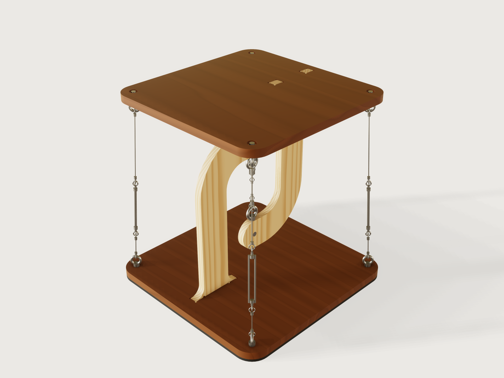

# Tensegrity table

The maker's "floating table", rebuilt for real hardware and a maker's questions. A plywood hook on the base reaches over
the centre, a plywood hook on the top reaches under it, and one short steel rope hangs the top from the base. Three to six
outer cables pull the top back down and hold it level, so nothing seems to touch. Say how high and how wide, how many
cables, and what it must carry: the Jig works out every tension, sizes the fittings from real catalogues, and refuses a
load the hooks or the rope cannot take.



## What it shows

- **The form asks what the maker knows**: table height and width, the number of cables, the load in kg, the sheet in the
  workshop, the router bit. The hook sizes, tensions and rope lengths come out.
- **The form changes the structure.** `cable_count` sets three to six cables and three to six sides of a polygon top, or a
  round top with that many anchors, all from one chained ring (`sketch.pattern` with `chain` and `angle`), and the statics
  follow it.
- **Ranges that follow the design** (formulas in `variable.publish`): the height range comes from the hooks, the rope and
  turnbuckle lengths and from what the posts can carry in buckling; the hook overlap from the eye nuts and rope eyes; the
  load limit from the fittings, the hooks and where the table rocks.
- **A choice recolours the plates** (`feature.when` on one chain per veneer, with `material.preset` patterns).
- **Revolves about a slanted line** (`feature.revolve` on a construction line in a `datum.plane`): rope, ferrules and
  turnbuckle bosses of one leaning cable are one profile. `feature.torus` makes the eyes and rope loops, `feature.pattern`
  turns all of it round the table.
- **Measured against the statics.** Assertions compare the model with the closed forms the load limit uses: volumes, the
  top's centre of mass, the hook's lever and the anchor circle (see *Checks*).

A static model is one table. This one is a family of them, and each knows what it may carry.

## The real thing

### How the table stands

The top hangs. The central rope pulls the top's hook up and the base's hook down. The outer cables pull the top down and
the base up, so the whole table is in **self-stress**, the principle Snelson and Fuller named tensegrity
([Snelson, US 3,169,611](https://patents.google.com/patent/US3169611A); [Fuller, US 3,063,521](https://patents.google.com/patent/US3063521A)).
With the outer cables tight and the central rope inside their circle, the top cannot tip whichever way the load stands.

The old version of this Jig had vertical cables on any top, a cable through a loose hole in the hook arm, crimp sleeves
on the floor under the base, and glued tabs nobody checked. This one differs in six ways:

- **Hooks with a real elbow and a flared foot.** The inside radius is 0.75 x the hook's depth and the foot flares to 1.7 x
  it, so the corner carries its curved-beam stress (the Winkler formula gives a stress factor of 1.37 at this radius, and
  the capacity uses it) and the tabs stand further apart.
- **Cables that lean a little, and a base to match.** Base anchors sit `cable_lean` further out than the top's, and the base
  grows with them, so the table is harder to tip. The lean barely stiffens the top against sway, because a push also tilts the
  top: 3.1 mm under 10 N at the defaults, 3.6 mm with vertical cables (the output, see *Sway* below).
- **Real hardware** with catalogue working loads, drawn at its catalogue size (see *Hardware*).
- **A cross dowel in each hook arm.** A vertical bolt through the hook's edge is unmakeable in 18 mm plywood; a steel M8
  barrel nut (12 mm across, 18 mm long) through the arm's thickness takes the load in bearing instead, an M8 rod runs from it to
  an eye nut outside the arm, and the rope eye hangs on that. Bearing is checked net of the rod bore on the loaded side
  (see *Statics*).
- **Flat faces stay flat.** Each anchor bolt lies in a pocket on the plate's outer face (19 mm across, 7.6 mm deep, for a
  socket head and a DIN 9021 washer), flush with the surface. A soft rubber strip 12 mm wide round the base's rim stands the table
  on its rim, not on inner feet, so a load anywhere on the top lies inside what supports it. Anchors stay 25.5 mm inside the
  corners, so a pocket keeps 16 mm of plywood to the rim and the strip stays clear of it, on a triangle too.
- **CNC reliefs where a square tab must fit a round-cornered slot**: 270-degree dog-bones at the slot corners and at the
  tab roots, sized from the router bit, so the shoulder really seats.

### Statics

The load is `Q`, anywhere on the top up to its furthest corner. `W` is the top's weight (off-centre by the hook, `e`), and
`n` cables stand on a circle of radius `r` around the central rope. In the Jig's variables (`document.inspect` shows them):

```text
alpha   = 2 R / (n r)                    share of a load at reach R on one cable (pile-group rule)
D_w     = 2 W e / (n r)                  the same for the top's own weight
T_v0    = 1.25 (alpha Q + D_w + Q/n) + 10 N     vertical part of the pretension of each cable
T_set   = T_v0 / cos(lean)               rope tension to tune to
T_max   = (T_v0 + alpha Q + D_w) / cos(lean)    worst outer tension
T_min   = (T_v0 - alpha Q - D_w - Q/n) / cos(lean)   least outer tension (stays > 0, 25 % of the swing spare)
T_c     = n T_v0 + W + Q                 central rope force, taken at its worst (outer cables keep their pretension)
```

The share `alpha` is the elastic method of a pile group, with a rigid top on a regular polygon of cables. Vertical load
is taken at its worst for each check: as lost by the outer cables (for slack), as carried by the central rope (for its
force). Both are safe-side bounds and cannot both happen.

`Q` is the *heaviest load you ask for* (the form's *Heaviest load it will carry*). The tension in the cables is set for it, so
putting more on the table than that is not covered: at the defaults (tensioned for 5 kg) a cable goes slack above 7.5 kg at the
edge (`A cable goes slack above…`). The form shows both that and the most the table can be set for. Set the load, then tension to
the value the form gives for that load.

**Hook capacity.** The post is a beam-column. It takes `T_c` with lever `p`, the distance from the rope to the post's
centre line, and with the Winkler stress factor at the elbow, against a design stress of `f = 24.8 x 0.6 / 1.2 / 1.5 =
8.3 MPa`: the characteristic compression strength of 13-ply birch plywood (24.8 MPa across the face grain, the lowest
strength used) with EN 1995-1-1's `kmod = 0.6` for a permanent load, `gamma_M = 1.2`, and a load factor of 1.5 on top
(`gamma_F`, the EN 1990 value for a variable load, applied to all of it). Buckling of the post out of the hook's plane uses the
Euler load of a cantilever (buckling length 2 x the post) with the creep-reduced modulus `7452 / 1.8 MPa` (`kdef = 0.8`) and
a factor 3; the two combine as `1/T = 1/T_bend + 1/T_buckle`. The tab joint (rolling-shear of the plywood at the glue line,
`2.34 x 0.6 / 1.2 / 1.5 = 0.78 MPa` over the tab's four walls, lever between the tabs; a stand-in for the glue line, not a test
of it), the plate's bending at the foot and the bearing of the cross dowel in the arm are limits too. The dowel's bearing uses
the plywood's compression value (8.3 MPa, on the safe side of its embedment strength) over 12 mm by the 9.5 mm of plywood that
remains beside the 8.5 mm rod bore, 942 N, a limit that governs the widest thick tops.

**Rocking.** The table stands on the rim strip, so its support reaches `base_apothem - 6 mm`. A load on the top beyond that line
would rock it; the most any point of the top overhangs that line is `6 mm - lean x cos(pi/n)`. The load limit takes the smaller
of the statics and that rocking limit, `M g (support) / (overhang)`, which never governs here: at least 113 kg above the limit
over 5906 sampled combinations. It assumes a floor flat enough for the strip to bear along the edge: a continuous rim can wobble on an uneven floor where three
feet would not, which is why the strip must be soft (sponge rubber, not hard rubber or felt), and it may need shimming.

The load limit is the largest load for which every capacity holds.

Over the range the load limit runs from 2 kg (a tall table at its full hook overlap) to 17 kg (a wide top in 24 mm plywood), in
5906 random combinations of the formulas: median 9 kg. The hook post governs in 93 % of them, the dowel in 4 %, the hardware in 3
%. The form always shows it, and the load stops there.

| At the defaults | |
|---|---|
| Load limit (`load_limit_kg`) | 8 kg |
| Load set | 5 kg |
| Pretension of each outer cable, for that load | 60.5 N |
| A cable goes slack above, at the edge | 7.5 kg |
| Largest outer tension (limit of the cable set: 405 N) | 88.5 N |
| Central rope force (limit of the central path: 489 N) | 322 N |
| Post capacity | 489 N (bending 767 N, buckling 1354 N / 3) |
| Tab joint, plate at the foot, dowel bearing | 997 N, 1025 N, 942 N |

**Independent check.** The closed forms above are not checked against themselves. A separate 6-degree-of-freedom
stiffness solve (a rigid top on elastic cables with E = 57.3 kN/mm², the central rope in series with both hooks in bending,
plus the geometric stiffness of the pretension; 72 load directions round the top) was run at 12 points across the range, each
tensioned for and loaded with its own load limit. Its outer cable changes bear the closed forms out: the closed form
over-estimates the largest outer tension by 8 to 43 %, under-estimates the least by 5 to 15 N (the least closed-form value stays
at least 21 N, so no cable goes slack), and the central rope's real increase is 10 to 35 N where the closed form allows the full
69 to 137 N. At the default table at its 8 kg limit: largest outer tension 120 N solved against 135 N closed form, least 33.2 N
against 26.0 N. This is an unpublished check: the script is not in this repository, and this is what it gave.

**Sway.** Push across the hooks (their weak direction) at the top surface. The form's estimate is a closed solution of the
sideways shift and the tilt together, with the outer cables' axial and tension stiffness, the central rope's tension stiffness
and both hooks bending sideways in series. It over-estimates: under the same assumptions, without the hooks' side-flex, the
6-degree solve gives 1.62 mm where the closed form gives 1.91 mm (default table at its limit; 2.29 mm with the hooks' flex,
what the form shows then). It says how the top moves, not how far it can safely go.

**What the load limit means.** It is the largest **static** mass that may rest anywhere on the top, including right at
its edge over a cable, *with the cables tensioned for that load*, and every rope, fitting and hook within its working
load, and with the factors stated above. It is not for sitting, standing or climbing on, and not for children to hang from. The
top hangs from one rope and has no second load path: if the central rope or a hook fails, the top falls. Keep it to books and
plants. The form says this too (the *Load* group and the description). What it cannot prove: your batch of plywood, the glue, the
ferrules, the floor. The eye nut is not derated for the lean (up to 8°; see below), and the cross dowel has no catalogue
rating; before you trust it near people, have someone competent look at it. A table this size tips over when pushed: the form gives
the push at the top that tips it, about 33 N at the defaults, a light shove. Do not stand it where it can be knocked over.

### Hardware

Sized for stainless indoor use, with suppliers' declared values:

| Part | Light | Standard | Strong | Source (read) |
|---|---|---|---|---|
| Outer rope, 7x7 AISI 316 | 2 mm, MBL 248 kg | 3 mm, 559 kg | 4 mm, 994 kg | [GS Products](https://www.gsproducts.co.uk/2mm-7x7-stainless-steel-wire-rope-cable/) |
| Central rope, 7x7 AISI 316 | 3 mm, 559 kg | 4 mm, 994 kg | 4 mm, 994 kg | [GS Products](https://www.gsproducts.co.uk/3mm-7x7-stainless-steel-wire-rope-cable/) |
| Turnbuckle, 316 eye/eye | M5, 120 to 170 mm, SWL 170 kg | M6, 160 to 220 mm, SWL 375 kg | M6, 160 to 220 mm, SWL 375 kg | [Blue Bottle Marine](https://trade.bluebottlemarine.com/products/turnbuckles-eye-eye-stainless-steel-316g.html) |
| Eye nut DIN 582 A4, outer | M6, WLL 75 kg | M6, 75 kg | M8, 140 kg | [S3i](https://s3i.co.uk/lifting-eye-nut-ce-marked-stainless-steel.php) |
| Eye nut DIN 582 A4, centre | M8, 140 kg | M8, 140 kg | M8, 140 kg | S3i |
| Cross dowel and rod | steel M8 barrel nut, Ø12 x 18, M8 rod | the same | the same | [Essentra](https://www.essentracomponents.com/en-gb/p/cross-dowel-barrel-nuts), search excerpts only (the page refuses direct reading) |
| Turnbuckle thread pitch | M5, 0.8 mm | M6, 1 mm | M6, 1 mm | [ISO 724 table](https://www.engineeringtoolbox.com/metric-threads-d_777.html) |

The ropes are loaded to at most a sixth of their minimum breaking load, the 6:1 factor of
[S3i's 7x7 rope data sheet](https://www.s3i.co.uk/image/s3i/stainless-steel-wire-rope-7x7-data.pdf) for safe working load.
An eye made with a pressed ferrule and thimble is weaker than the rope; the factor of 6 is meant to cover that, an
assumption of the Jig's. The rope's stiffness uses E = 57.3 kN/mm² on
the nominal area ([S3i](https://www.s3i.co.uk/wire-rope-technical.php)). The working limit in the form is the smallest of
rope, turnbuckle and eye nut: for the Light set the 2 mm rope at 405 N. An eye nut's rating holds for an axial pull;
`cable_lean` stops at 8 degrees, so the eye nuts are pulled within 8 degrees of their axis, and the WLL is used
unreduced there, a judgement the Jig states and which a certified lifting design would not make. The cross dowel has no
catalogue working load: Essentra recommends its M8 barrel nut for boards of 22 mm and up, so at 18 to 21 mm this Jig relies on its
own bearing check, a judgement. It stops the sheet at 18 mm, the barrel's length.

### Making it

Birch plywood, 18 to 24 mm: 18 mm gives a real table; WISA's and Metsä's declared values for 13-ply 18 mm are the
characteristic strengths above (other thicknesses differ by a few per cent over that table,
[Metsä DoP](https://www.metsagroup.com/globalassets/metsa-wood/dop-documents/dop_metsa_wood_birch_plywood_muf_2019-12-2_en.pdf)). The veneer is a colour only: walnut, oak and birch are veneers on the same birch core, so all three keep the
structural values.

1. **Cut on a CNC router.** Export the **Cut sheet** (below); 6 mm bit by default, set your own. Grain of the hooks along the
   post. Cut the pockets (19 mm, 7.6 mm deep) on each plate's outer face, or drill them with a Forstner bit, and drill the
   anchor holes 6.6 mm.
2. **Drill the hooks.** A 12 mm hole across the arm's thickness for the cross dowel, and an 8.5 mm hole down into the arm's
   edge, centred in the thickness, to reach the dowel: use a drill press and a fence. At 18 mm plywood that leaves 4.75 mm of
   wall each side.
3. **Glue the hooks to the plates** with a rigid glue (epoxy or PU, not PVA: it creeps under a permanent load). Glue
   the tabs into the slots square to the plate, shoulders tight.
4. **Hardware.** Bolt an eye nut at each anchor with an M6 socket screw and a DIN 9021 washer from the outer face. Put the
   cross dowels in, thread the M8 rod through the arm into the dowel, and turn the eye nut on the rod against the arm's edge.
5. **Ropes.** Press a ferrule and thimble on the ropes, ending the cable from each eye nut in a loop on the turnbuckle's eye.
   The outputs give each rope's length between its eyes; add the rope that forms the two eyes. Set the turnbuckles about a third open so there is thread left both ways.
6. **Tension.** Hang the top on the central rope. Bring every outer cable to just taut, then turn all the turnbuckles evenly,
   in small steps, by the form's *Step 1* output: about 0.4 turn at the defaults. The form works this out from
   the cable and the hooks' stiffness (a stiff plywood value, so by this estimate the turns reach the target tension or fall short
   of it rather than over-tighten). A luggage scale cannot read a cable that is already installed. Pluck each cable: they should sound alike
   (equal pitch, equal tension); the pitch of a short stiff rope does not give its tension in newtons. Check again after a day:
   rope beds in and plywood creeps.
   **Never turn past the form's maximum** (0.68 turn at the defaults, against 0.40 to reach the tension). Over-tension cannot be
   seen or read, and one turn is about 150 N per cable there. The maximum is where the central path or a cable reaches its design
   limit with your load on, worked out with the stiff value above, so counted from a true just-taut the real tension at that many turns is no higher; turns taken up before the cables were really just taut are not counted, so judge just-taut carefully. At the
   load limit the two nearly meet (0.60 and 0.63 turn at 8 kg): if you cannot set a turnbuckle that finely, choose a lighter load.
7. **Proof test.** Keep hands and feet clear of the top and lower the load you tensioned for gently onto the table's edge, right
   over a cable: that cable must stay taut. If it goes slack the top tilts while the other cables still hold: lift the load off,
   add a little turn to every turnbuckle and repeat, never past the maximum. If it still goes slack at the maximum, the table is not
   good for that load: set a lighter one. Do not load beyond what the form says. The form gives these steps too.

## Parameters

| Group | Parameter | Default | Range | What it changes |
|---|---|---|---|---|
| The table | Table height | 480 mm | from 343 mm (the hooks, the rope and turnbuckle) to 850 mm (the posts, the height the top allows) | The whole table, posts, rope lengths |
| The table | Top width | 420 mm | 300 to 700 mm | Top and base, hook depth, anchors |
| The table | Top shape | Polygon | polygon or round | Outline; the polygon has as many sides as cables |
| The table | Outer cables | 4 | 3 to 6 | Sides, anchors, statics |
| The table | Hook overlap | 170 mm | 107 mm (eye nuts and rope eyes meet) to what the height allows | Central rope length, post length |
| Stability | Cable lean | 30 mm | 0 to about 8 degrees (60 mm at most) | Base anchors further out, base bigger, a little less sway |
| Load: static only, never sit or climb | Heaviest load it will carry | 5 kg | 0 to the load limit | Pretension, every tension; the form's slider stops at the load limit |
| Hardware | Rope and hardware | Light | 3 sets | Rope, turnbuckle, eye nut sizes, working limits |
| Hardware | Plate material | Walnut veneer | walnut, oak, birch | Colour |
| Making | Plywood thickness | 18 mm | 18 to 24 mm, step 3 mm | Hooks, plates, every capacity |
| Making | Slot clearance | 0.2 mm | 0.05 to 0.5 mm | Slot fit |
| Making | Router bit | 6 mm | 3 to 8 mm | Dog-bone reliefs |

Outputs in the form: the load the table is tensioned for, the most it can be set for, where a cable goes slack at the edge, the
tension of each outer cable, the turnbuckle turns to reach it and the turns never to pass, the proof-test load, largest outer tension and the working limit of a cable and its
fittings, central rope force and what the central path carries, sway under a 10 N push, the push that tips the table, rope
lengths between their eyes (lower and upper outer pieces, central), table mass.

## Checks

The 20 assertions, each measured on the model and compared with a value the statics use:

- Height of the whole table as set; the hooks clear of each other by 10 mm; hooks and fittings clear of the cables.
- Closed-form volumes of the top plate (outline, holes, slots with reliefs, pockets, within 0.2 %) and of a hook (within 0.5 %).
- The top's centre of mass where the statics assume it (within 1 mm); the hook foot at the statics' lever position; the
  anchors at the statics' circle.
- The hook's height and the top's reach as the capacities take them (`post_length_mm`, `load_reach_mm`).
- Cable count from the top's holes; the cut sheet holds the two plates and two hooks; the plywood wall beside the rod bore
  at least 3 mm; the rim gasket's closed-form volume, and the gasket at least 5 mm clear of the anchor bolts.
- Each cable's lower eye ring on its base anchor, upper eye ring on its top anchor, and the cable's height the statics' span.
- No overlap of plates and hooks, or of bolts, dowels and rods with the wood they pass.

No assertion merely restates the load limit: that is a formula, and the published range is its check. What the assertions
guard is that the model's geometry is the geometry the statics assume. The statics themselves are the closed forms above
and the independent solve. The geometry assertions compare the model with the very variables the capacities read (`lever_mm`,
`anchor_r_mm`, `span_mm`, `post_length_mm`, `load_reach_mm`). Mutation test on a scratch copy: adding 20 mm to `lever_mm`, 15 to
`anchor_r_mm`, 30 to `span_mm`, 30 to `post_length_mm`, 20 to `load_reach_mm` or 3 to `thickness_mm`, reversing the cable's lean,
moving the base anchors 20 mm or the top anchors 10 mm, and thinning the rim gasket each fail an assertion.

`tools/jigs.py check` runs check-range (the defaults, 64 corners of the box of ranges, every choice and 32 random points):
all pass, none unproven. A further run of 306 points (300 random, seed 23) on this final model also passes. An earlier longer
run found a boolean failure the standard points missed, a cutter end cap on the arm's face at some values, now fixed. The combinations tried by hand
to break the Jig, and what the form does:

| Tried | Result |
|---|---|
| 80 kg on the table | refused: the load stops at the limit (8 kg at the defaults and at the form test's table) |
| Hook overlap 300 mm at the default height | refused: range from 107 to 256 mm |
| Height 300 mm at the default width | refused: range from 343 mm, the hooks and rope do not fit lower |
| Width 250 mm | refused: range from 300 mm |
| Lean 200 mm | refused: range to 56 mm at this height |
| 15 mm plywood | refused: the thickness starts at 18 mm (the barrel nut's length) |
| Round six-cable top, 700 mm wide, 750 mm high; triangle 320 mm wide | build and pass all assertions; looked at |

Checked by hand, not a limit in the load limit: the DIN 9021 washer on the plywood (220 mm², about 2 MPa at 405 N).

Not checked: the true strength of your plywood batch, a glue line in your shop, creep of the rope and ferrules over the
years, a floor that is not flat, or any fall.

## Export

- **File › Export, Sheet of set: Cut sheet** (SVG or DXF): the top plate, base plate and both hooks at true size, on one
  sheet, with holes and slots, ready for CAM. `meta.json` proves both formats, at the defaults and at a six-sided round top.
  Pockets are not on the sheet as cuts of their own: they are the 19 mm circles round the anchor holes in the description
  above, machined or drilled at the depth stated (the cut sheet shows the through holes). Pockets, hook drilling, and rope assembly follow the *Making it* list.

## Files

`build.json` (the source), `meta.json`, `formtest.md`, `preview.png`, and `tensegrity-table.3dcraftjig`,
`thumb.png` from the tool.

## Rebuild

```sh
tools/jigs.py build tensegrity-table
tools/jigs.py render tensegrity-table
tools/jigs.py check tensegrity-table
```

## Difficulty

6 out of 10. Coupled statics in formulas, slanted revolves, count-driven topology, multi-body booleans.

## Platform notes

- **A material's grain cannot follow a choice** (J-009,
  [`findings/J-009-pattern-colours-from-a-table`](../../findings/J-009-pattern-colours-from-a-table/repro.json)): a colour
  in `body.appearance` takes an expression but a pattern's colours do not, so the three veneers are three conditional
  chains (`feature.when`) with their own wood pattern, costing 18 features to show one plate.
- **Alternatives by `feature.when` cannot share a source body.** Three `feature.transform` of one plate, on for one veneer
  each, are refused ("the body already went into" the first, though that one is inactive). Why this Jig needs one chain per veneer
  ([finding](../../findings/J-028-when-alternatives-share-source/repro.json)).
- A `feature.boolean` of a cutter whose end cap falls exactly on a face can fail at some parameter values, within the
  tolerance: the rod bore cutter runs 3 mm past the arm to stay clear of it.

## Licence

[CC BY 4.0](../../LICENSE-CC-BY-4.0.md); credit line in the [README](../../README.md#licence).
