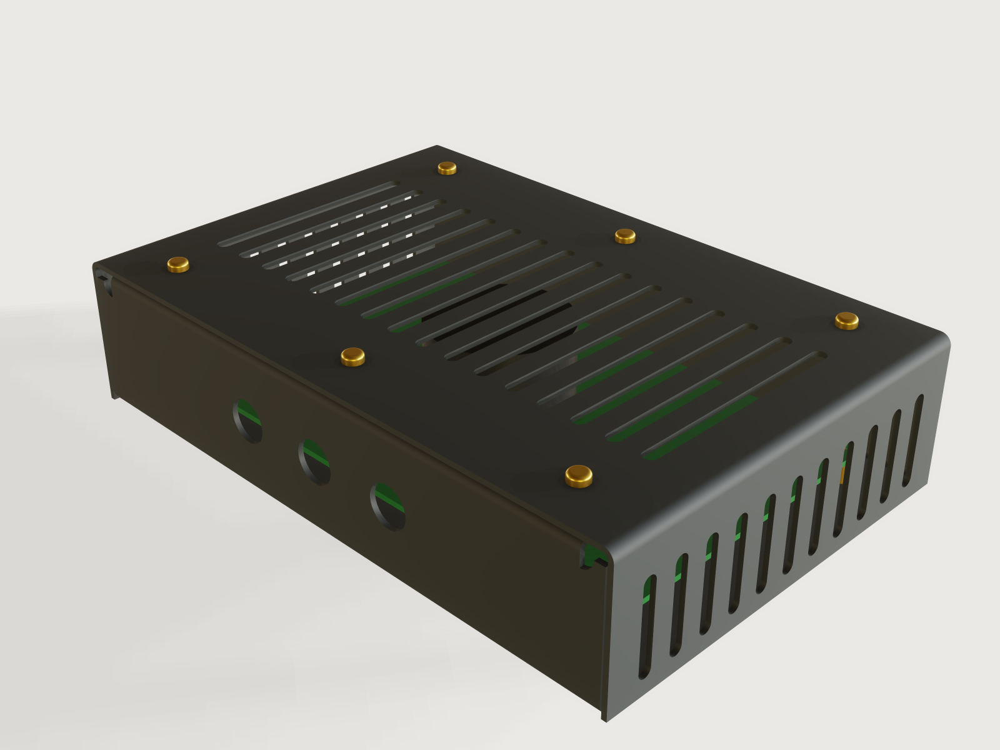

# Sheet-metal enclosure

Tell the form what goes in the case: a board, a power supply or a stack of them, how far its mounting holes sit in from
the edges and how tall its tallest part stands. It builds a two-part sheet-metal case around that: a **chassis** (floor,
front and back walls, return flanges with clinch nuts) and a **cover** (top and two sides, held by brass screws), each
laser cut from one flat sheet and bent on a press brake. Die, radius and shortest leg come from a shop's published
table, the bend order is proven at every change of the form, and the flat patterns with their bend lines export with
nothing to pick.



## What it shows

- **Two press-brake parts, each one sheet** (`feature.sheetMetal`). The chassis is a floor with two walls bent up and
  a return flange bent in again on each (`tip`, with an `outline` that carries the clinch-nut holes, drawn as if the
  bends had no width, so 3DCraft lays them out past the allowances). The cover is a top with two skirts bent down. The
  connector holes and vent slots are `cutouts`, each sketch switched on and off by the form (`feature.when`), so they
  are in the flat pattern. `bendRelief` cuts the notch at each end of a return bend.
- **Tables drive the shop's numbers** (`table.set`, `choicesFrom`). `sheet_stock` holds die, inner radius and shortest
  leg per thickness; `materials` the minimum radius, K-factor bands, density and colour. Radius, K-factor, allowance,
  hole margin, flange lengths and fastener size follow by formula.
- **The form asks what the maker knows.** The board's width and depth, the inset of its mounting holes, how many are
  stacked, the tallest part, the standoff, the room around it. The case's inside grows round that; outside sizes, blank
  sizes and mass are outputs.
- **The form changes the structure.** Boards add standoffs, spacers and height. The connector count and the vent
  choice add or remove cut-outs (`sketch.pattern`, counts from formulas). The cover screws multiply with the width.
- **Ranges that know the press brake.** The tallest part and the number of boards are limited by what a straight punch
  can bend (*Ranges and the press brake*), the connector holes by the panel they must fit, the depth by the two return
  flanges.
- **The bend order is proven by the model.** The assertion `bendable` runs the search of `sheetMetal.bendSequence` at
  every change of the form, with a straight punch and the table's V-die. `press.json` asks `tools/bendcheck.py` for the
  same proof with its own tooling.

A static drawing is one board's case. This is the case for your board, in your stock, at your shop.

## The real thing

**The design.** The instrument case a sheet-metal shop folds every week. A U-shaped chassis carries the floor and the
front and back panels, so connectors stay on the chassis when the cover comes off. A U-shaped cover wraps the top and
the sides. There are no welded or closed corners to dress: the cover's edges are flush with the walls' outer faces and
the cover slides down over the open sides with 0.5 mm of clearance a side. Air comes in low through the side slots and
leaves through the top. Long top slots are cut into rows with bridges between them, so no strip between two slots is
longer than 12 webs (72 mm in thin sheet, a judgement of what stays flat). The old version of this Jig put the connectors on the lid and could not prove its base
bendable; this one puts them on the chassis and proves both parts everywhere the form lets you go.

**Making it, in order.**

1. Laser cut both flat patterns, as exported.
2. Chassis: bend the two return flanges first, on the flat.
3. Press the clinch nuts into the return flanges from the underside now, the flange held in the press. Not before the
   return bends: at the hole-to-bend distances used here, a nut already in place would meet the punch's flank as the
   flange comes up (a reading of the tool geometry, not modelled). Not after the walls: the walls would be in the way.
   On a large blank the rest of the sheet hangs far below the anvil, so ask the shop how it holds it (an offset anvil,
   or pressing the nuts after the walls with one).
4. Bend the two walls, one after the other. The second wall is the one the height limit below is about.
5. Cover: bend the two skirts, either first.
6. Powder coat DC01, masking the nut threads. Aluminium and stainless may stay as they are, or be bead blasted. The
   0.5 mm fit a side leaves room for the coat.
7. Assemble, the chassis upright on blocks or over a bench edge so you can reach underneath and gravity holds the board on its standoffs (turned over, the loose board falls away), the feet still off:
   - Screw the standoffs **to the board first** (M3, from above). The return flanges overhang the board's edges front
     and back, so a driver cannot reach the board's screws once the board is in the chassis. Build a stack the same way,
     spacers between the boards.
   - Slide the board and its standoffs in **from an open side** of the chassis, the standoffs on the floor. A scan of 144
     points of the range with the path of the content as a box from one side to the other found it clear of the walls,
     return flanges and nuts.
   - Screw the standoffs down from below, through the floor. Lower the cover over it and fit its screws, about 2 t plus the
     nut's height long: M3 × 5 up to 1.5 mm sheet, M4 × 8 from 2 mm (the 2 mm head room below the nuts takes what comes
     through). Press on the four rubber feet.

The model does not cover electrical safety. A metal case on a mains supply needs its protective earth bonded by
someone competent: the powder coat insulates, and neither the Jig nor its checks say anything about that.

**The shop's table.** Four stock thicknesses, the same for the three materials:

| Thickness (mm) | V-die (mm), all three | Inner radius (mm), steel / aluminium / stainless | Shortest leg (mm), steel and aluminium / stainless |
|---|---|---|---|
| 1 | 8 | 1.40 / 1.27 / 1.58 | 5.90 / 5.90 |
| 1.5 | 10 | 1.65 / 1.47 / 1.90 | 7.50 / 7.60 |
| 2 | 12 | 1.88 / 1.67 / 2.22 | 9.10 / 9.20 |
| 2.5 | 16 | 2.41 / 2.11 / 2.94 | 12.00 / 12.10 |

Read from [247TailorSteel, *Bending guidelines*](https://www.247tailorsteel.com/en/bending-guidelines): groove width,
leg length ("the minimum overlay of the sheet on the mold") and internal radius of a 90 degree bend. The shop lists
CRS CR4, AlMg3 EN AW 5754 H111 and AISI304L 2B. It does not name DC01; taking CRS CR4 for DC01 is a reading made for this Jig (both are
cold-rolled soft steels of EN 10130 type). It has no aluminium at 0.8 or 1.25 mm, so those are left out. 3 mm is left
out because 3 mm stainless, with its 15 mm leg, leaves no wall height a straight punch can bend at some depths.

**Minimum radius per material.** The radius used is the larger of the shop's and this one.

- **DC01.** The [steel overview at Henstol](https://henstol.pl/de/blog/biegeradius-stahlblech/) reports that
  ArcelorMittal's data sheet gives no minimum radius for DC01, so the Jig takes R = t, the value in
  [Laserteile-online's bending limits](https://laserteile-online.eu/en/knowledge/manufacturing-guidelines) for 1 to
  2.5 mm (secondary, a shop's table). At 1 and 1.5 mm the shop's radius above is larger and is used. At 2 and 2.5 mm
  the rule sets R = t, 2.0 and 2.5 mm, about 0.1 mm more than 1.88 and 2.41 mm.
- **EN AW-5754 H111.** EN 485-2's minimum radius factors for a 90 degree bend, as tabulated by
  [Metallservice](https://www.metallservice.ch/msm/msm-home/services/metall-lexion/mechanische-kennwerte-f%C3%BCr-walzblankes-aluminium-halbzeug.pdf)
  and [color-metal.ro](https://color-metal.ro/en/determining-minimum-bending-radius) (both secondary; the standard was not
  read): 0.5 t up to 1.5 mm, 1.0 t above. At 2 and 2.5 mm that exceeds the shop's radius (2.0 against 1.67,
  2.5 against 2.11) and the Jig uses it, so the shop needs a punch with that nose.
- **Stainless 304.** [Outokumpu, *Forming of stainless steel*](https://www.outokumpu.com/expertise/stainless-basics/forming):
  "For austenitic and ferritic stainless steel this ratio is 1". The shop's radii are all above that.

**K-factor.** The rule-of-thumb air-bending table in the
[METU MECH 114 handout *Sheet Metal Work*](https://users.metu.edu.tr/sonmez/MECH%20114/Sheet%20Metal%20Work.pdf),
headed "Generic K-Factors": 0.33 / 0.38 / 0.40 for soft / medium / hard material up to r = t, 0.40 / 0.43 / 0.45 from
t to 3 t. Reading soft as the aluminium, medium as the steel and hard as the stainless is mine (the handout heads soft
"Aluminum" and medium and hard "Steel"). The table gives bands with an edge at r = t, where K would jump (0.43 to 0.38 for steel at 2 mm). The Jig interpolates in
r/t between the band middles (r/t 0.5 and 2), so it follows the table there and has no jump: that is this Jig's treatment, not the
handout's. K moves with the shop's tooling
and the flat pattern is only as true as this number. The form has no K input: a shop with its own bend deduction re-unfolds
the part from the bend lines and the allowances the form reports, or changes the table in `build.json`.

**Hole to bend.** Every hole keeps the larger of 2.5 t + R ([Fabcon, *Sheet Metal DFM: Pre-Release Guidelines*](https://fabcon.com/articles/?p=534):
"Hole-to-bend distance: ≥ 2.5t + r", and AGENTS.md §4.3) and the shop's shortest leg (247: holes over 5 mm "may not
fall within the leg length"; this Jig applies it to every hole, the conservative reading) from the tangent line of the
nearest bend.

**Bend reliefs.** Each return flange stops short of the wall's end, so that the cover's inner bend radius clears it,
and each end of a return bend has a round notch R + t + 0.5 mm deep: [SendCutSend's depth rule](https://sendcutsend.com/blog/guide-to-designing-bend-reliefs/)
("at least the material thickness + the bend radius + .02"). A strip at least 2 t and 2 mm wide stays beside the notch.

**Fasteners.** Cover screws M3 up to 1.5 mm sheet, M4 from 2 mm, pan head, brass, through clearance holes in the cover
(3.4 and 4.5 mm: the medium series of a [clearance table by Optimas](https://optimas.com/technical-resources/tapping-sizes/),
ISO 273 itself not read). They go into self-clinching nuts in the return flanges: PEM CLS in steel and aluminium, SP in
stainless. Holes 4.22 mm and 5.41 mm, centre-to-edge at least 4.8 and 6.9 mm ([CLS-M4-2 data sheet](https://www.pemnet.com/products/product-finder/cls-m4-2/)
read; CLS-M3-2 and SP-M3-1 and SP-M4-1 from distributors' listings). Pick the shank code for your sheet thickness from
PEM's bulletin. The return flanges always leave more than that distance. The heads and the nuts are drawn from these
listings (pan head 5.6 × 2.4 mm M3, 8 × 3.1 mm M4; distributors differ on the M3's diameter, 5.6 or 6 mm) and only
for looks and clearance. The standoffs (M3, 5.5 mm), rubber feet (14 mm, 6 mm high) and board thickness (1.6 mm) are
choices made for this Jig, not from a source. Densities (7850, 2670, 7900 kg/m³) are nominal: only the mass output uses them.

**Look.** Anthracite powder coat (RAL 7016) on the steel, a matt natural tone for the aluminium, a lighter grey for the
stainless. Brass screws and standoffs, and a green board and a dark part to show through the slots. Preview at
`look.rotation` 0, the most neutral of the four rotations tried; the warm workshop light still tints the front wall.

## Parameters

| Group | Parameter | Range | What it changes |
|---|---|---|---|
| What goes in it | Board width | from what the sheet needs (50 to 66 mm) to 400 mm | The inside width |
| What goes in it | Board depth | from what the return flanges need (about 62 to 97 mm) to 300 mm | The inside depth |
| What goes in it | Boards in the stack | 1 to what the press brake can bend, at most 4 | Standoffs, spacers, height |
| What goes in it | Tallest part on a board | 3 mm to what the press brake can bend | The inside height |
| What goes in it | Standoff height | 0 to 30 mm, less on the smallest cases | How far the first board stands off the floor |
| What goes in it | Mounting holes from the edge | 3 mm to min(20 mm, half the board's smaller side − 22 mm), so at least 1.4 mm of board stays outside the hole | The four M3 holes in floor and board; the feet follow |
| Fit | Room around, at least | 2 to 60 mm | Clear space to walls and sides. The case gives more where thick sheet needs the floor holes further from a bend |
| Sheet | Material | Steel DC01 powder coated, Aluminium 5754 H111, Stainless 304 | Radius, K-factor, die, leg, colour, density |
| Sheet | Sheet thickness | 1, 1.5, 2, 2.5 mm | Everything derived, and M3 or M4 cover screws |
| Front panel and air | Connector holes in the front | 0 to what fits, at most 8 | Round holes across the front wall |
| Front panel and air | Connector hole diameter | 4 mm to what the panel allows, at most 28 mm | Each hole |
| Front panel and air | Ventilation | None, Top slots, Top and side slots | Vent cut-outs, the top slots bridged into rows on large cases. A row needs room: the smallest cases drop it, and the output counts what is cut |

Outputs at the defaults (160 × 100 mm board, 25 mm part, 1.5 mm steel): outside 184 × 123 mm and 51 mm high with feet
and screw heads; inside height 39.6 mm against a press-brake limit of 54.6 mm; two sheet parts 0.81 kg; radius 1.65 mm, allowance 3.534 mm per bend, V-die 10 mm; chassis blank
180 × 240.88 mm, cover blank 263.67 × 123 mm; 38 vent slots.

### Ranges and the press brake

The chassis is a U with two return flanges. Bending its second wall leans the first wall, with its return flange, over
the punch by 45 degrees at the end of the stroke. With `F` = inside depth − R (from the bend axis to the far wall) and
`L` the return flange, the geometry of the tools in `tools/bendcheck.py` (a punch 12 mm wide and 120 mm tall in a clamp
80 mm wide) gives the limit on the inside height:

```
min(F − L − 9.2, max(169.2 − F + 2 R − t, 55.5 + R, F − L − 57.3)) − 2.5    (mm)
```

The first term keeps the return's tip beside the punch. The three inside the `max` keep it out of the clamp's corner:
the bend stays below the clamp, or the return flange passes the corner, or it stays beside it. The same reasoning limits
the cover's skirts. This was derived from the stroke and then checked against the model: a scan (an unpublished check: its script is not
in this repository) of 49 combinations of
thickness, material and depth in steps of 4 mm of height found no case where the formula allows a failing height, and it
sits within one step of the true boundary. At most 200 mm: a judgement, since the 220 mm tool has no ram above it in the
model and a real press brake does. The wall also has a floor: `L + R + 10 mm` of wall (the wall's own return must clear the punch as it is bent).

The limit is not a simple "deeper is better": for 1.5 mm steel the tallest part may be 51 mm at a board depth of 80, 40 mm
at 100 to 110, 63 mm at 140, and 123 mm at depth 100 with 60 mm of room. At the default board the inside height stops at
54.6 mm and the tallest part at 40 mm. The form clamps there and its tallest-part description says why; the outputs give
the inside height of this case and the height the press brake still allows. The ram of a real press brake is wider than
the 80 mm clamp and is not modelled, so the 200 mm cap covers only the clamp's height, not a ram above it.
A taller case at this depth needs other
tooling; the one gooseneck outline tried at the pin did worse than the straight punch, so the Jig does not offer it.

## Checks

Thirty assertions, each measured on the model:

- **Process:** `bendable` for both parts (straight 88 degree punch, table die, 0.5 mm clearance over the whole stroke);
  inner radius at least the material's minimum (`bendRadius`); every flange at least the shop's leg to the mould line
  (`flangeLength`); every hole and slot at the bend margin from a bend (`holeToBend`); bend ends relieved (`relief`).
- **Closed forms, independent of the sheet-metal code:** chassis flat length and cover flat width (`flatExtent`) against
  2 × (flats + allowances); cover volume against its flat pattern, less screw holes, top and side slots, plus the bend
  correction θ t² L (0.5 − K).
- **Fit:** nothing overlaps; the room to the walls at least as built; the room to the skirts and the cover's clearance
  from the chassis exact; the cover rests on the return flanges (distance 0); each screw centred in its cover hole and
  nut hole; the clinch nuts under the screws; the standoffs reaching the board; the tallest part clears the cover and hangs the head room below the nuts' level; its
  height against the closed form; the boards' stack height.
- **Counts and places:** four floor holes exactly under the board's mounting holes; the connector count, in the front
  wall; the cover screws; the feet at their height and the floor screw heads above their soles; the clinch nuts under the return flanges; chassis and cover each as deep as the walls, so the cover ends flush.

**Would they notice?** A scratch copy was broken nineteen ways, one at a time, and each was caught: K-factor changed on
either part, cover screw holes moved 1.5 mm, nut holes moved 2 mm, floor holes moved, connector holes on the back wall
or moved to a bend, a wall length off by 2 mm, the bend radius at 60 %, the cover 1 mm too wide, the stack pitch off,
a foot put over a floor screw, slot counts wrong, the inside height without room for the nuts, the cover 3 mm short at each end, a standoff too short, a clinch nut moved 3 mm. The side vent slots
drawn inside out while this Jig was built were caught the same way, by the closed-form cover volume.

**Range check.** `tools/jigs.py check` runs `check-range`: 104 points (defaults, corners, every choice, 32
random from seed 1), every one passing, none unproven, with `tools/bendcheck.py` over 24 points on top: both
parts proven at every one, chassis in the order 2, 3, 0, 1 (return flanges, then walls), cover 0, 1, with the straight
punch. A separate grid by hand, 287 points over two random draws (every material and thickness, smallest and largest sizes,
height at both ends, boards, inset, standoff, vents and connectors at their extremes, each read off its live range), found
nothing failing. It found earlier that the height formula left the second wall colliding at two combinations; the
thickness of the sheet is in the formula since.

Not proven: the strength of the fasteners, your board's real connector positions, cooling (the slots are a usual
pattern, not sized for a power), electrical safety, and bend accuracy beyond the table's K-factor.

## Export

- **Flat patterns, nothing to pick.** In the window: **File › Export**, **Flat patterns of every part**, DXF or SVG:
  the chassis and the cover side by side at true size, outlines on the layer `outline`, each bend on `bendUp` (dashed)
  or `bendDown` (dash-dot), every hole and slot in place. Or **Flat pattern of …** for one part. Headless: `file.export`
  with `"sheetMetal": ["Chassis", "Cover"]`; `meta.json` proves both ways.
- **For the press-brake operator:** `sheetMetal.bends` on each part gives per bend the angle, radius, K-factor,
  allowance, setback, deduction and flange length, and the flat size. `cut.list` (csv) lists each flat pattern with
  its size, area, cut length and holes, the hardware beside it marked as not plates.
- **Order:** return flanges, nuts, walls for the chassis; either skirt first for the cover (*Making it*).

## Files

`build.json` (the source), `press.json`, `meta.json`, `formtest.md`, `preview.png`, and
`sheet-metal-enclosure.3dcraftjig`, `thumb.png` from the tool.

## Rebuild

```sh
tools/jigs.py build sheet-metal-enclosure
tools/jigs.py render sheet-metal-enclosure
tools/jigs.py check sheet-metal-enclosure
```

## Difficulty

6 out of 10. Two coupled press-brake parts, table-driven process data, ranges from tool geometry, bend order proven at every change.

## Platform notes

Nothing is worked around. Known and already reported: a flat pattern's DXF splits each straight edge at the bend zone
(the examples' [F-051](https://github.com/johancoppens/3dcraft-examples/blob/main/3DCRAFT-FEEDBACK.md#f-051)). The material's metallic and roughness cannot follow a table
([J-053](../../3DCRAFT-FEEDBACK.md#j-053-metallic-roughness-and-transmission-take-numbers-only-so-a-material-look-cannot-follow-a-choice)), so aluminium and stainless differ from the powder coat by colour
only.

## Licence

[CC BY 4.0](../../LICENSE-CC-BY-4.0.md); credit line in the [README](../../README.md#licence).
