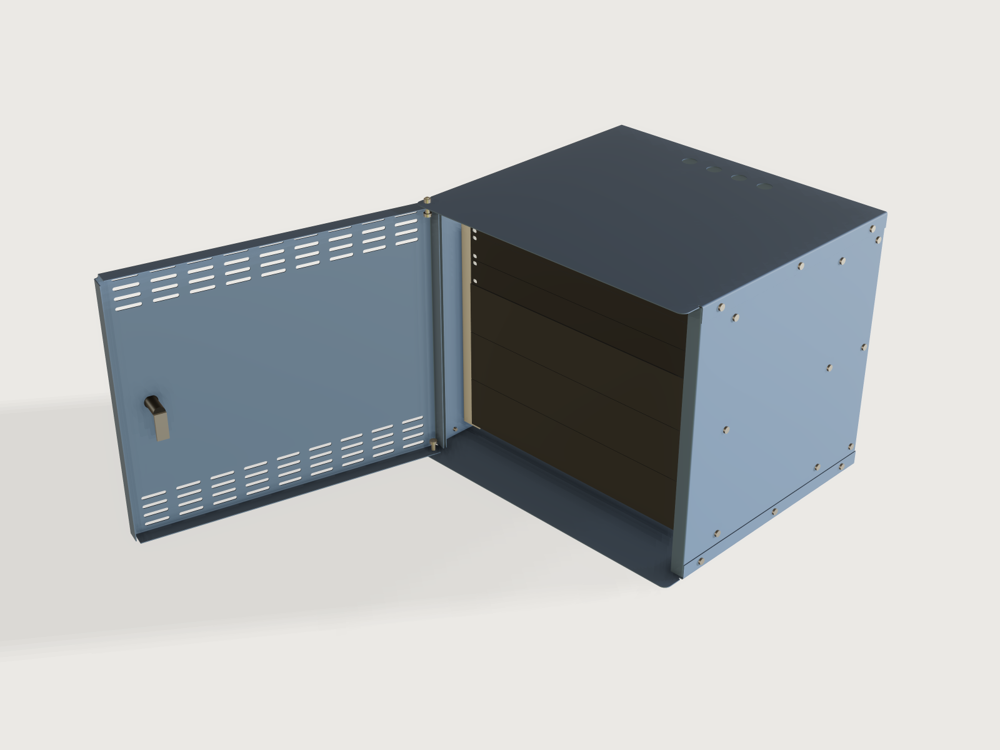

# 19-inch rack cabinet

Say how many rack units you need, how deep your gear is and what it weighs, on the wall or on the floor. The Jig folds a
19-inch cabinet around that: two sides, a lid, a pan and a back plate, EIA-310 rails bolted to the sides, a door that
really turns on two pins and locks behind the side's lip, cable glands, and filler panels that fit. Every part is one
flat blank, laser cut and bent on a press brake; the form tells you what each wall fixing has to hold.



## What it shows

- **Seven sheet-metal parts** (`feature.sheetMetal`), six of them bent: the lid and pan with the side flanges set back at the front
  (`insetStart`, `insetEnd`, `bendRelief`), the sides with one lip, the back pan, the rails with a return on their leg
  (`tip`), the door pan, and the flat filler panel. Holes in the flanges are drawn where they lie in the flat. Cut-out sketches come and go with
  the form (`feature.when`, `cutouts`).
- **One hinged door, driven by its opening angle** (`feature.transform`): the door, the lock and the cam turn together
  about the pin axis, so the form's slider opens it; at 0 the cam has turned behind the lip.
- **Lefts and rights for free** (`feature.mirror`, `feature.transform`): the left side and rail are mirrors of the
  right's; the rear rails are moved copies. A shop cuts one blank and bends it the other way.
- **Tables drive the shop's numbers** (`table.set`, `choicesFrom`): `sheets` holds thickness, V-die, radius, shortest
  leg, density and strength; `cable_entries` holds the gland counts and hole sizes.
- **The form limits itself by formulas:** the gear mass cannot exceed what the rails, the back plate at the wall fixings
  or the floor allow; the depth follows the gear depth; the number of filler panels follows the units; a door is offered
  only where a catalogue cam reaches behind the lip. Outputs give the loads, the cam to order and the parts to cut.
- **Assertions prove the rack is a rack:** hole places by EIA-310 (measured on the rail, against numbers typed from the
  standard), every screw lined up with both holes it passes through, a driver path to every wall fixing, the cam
  behind the lip. Press-brake proof by `bendable` and `tools/bendcheck.py`.

A drawing of a rack cabinet is one height and one depth. This one is yours, and it knows what the wall has to carry.

## The real thing

**The standard.** EIA-310-D and IEC 60297-3-100 were not read (sold, not free); the numbers come from these published
pages, which were read:

| What | Value used | Source |
|---|---|---|
| Rail hole centres | 465.1 mm (18 5/16 in, 18.312 in) | [Digital Loggers, Rack specifications](https://digital-loggers.com/rackspecs.html); [IBM: Rack installation specifications](https://www.ibm.com/docs/POWER9/p9had/p9had_oemrack.htm): 465 mm ± 1.6 mm |
| Clear opening between rails | 450 mm minimum (17.72 in) | Digital Loggers, IBM |
| Vertical pattern | 15.9, 15.9, 12.7 mm (5/8, 5/8, 1/2 in), 44.45 mm a unit, the unit's boundary in the middle of the 1/2 in gap, so holes at 6.35, 22.225 and 38.1 mm from the boundary (arithmetic from those) | IBM, Digital Loggers |
| Square holes | 9.5 mm (± 0.1), for M6 cage nuts; round alternative 7.1 mm | IBM |
| Panel width, height | 482.6 mm; 44.45 n - 0.8 mm (Wikipedia gives 44.45 n - 0.794 mm, uncited; 0.8 is the figure used) | [Wikipedia, 19-inch rack](https://en.wikipedia.org/wiki/19-inch_rack) |
| Rack load | 20 kg per unit on average | IBM (its requirement for racks holding its servers) |

The panel slots are 7.1 mm wide (the round hole's size) and 10 mm long, a choice made for play sideways; 3.75 mm of metal
stays beside each slot at the panel's end.

**Gear and depth.** The form asks for the gear's depth from its rack ears to its far end. The front rails stand 60 mm
behind the side lips (room for handles and patch cords), the cable room behind the gear is at least 90 mm (a
judgement), and the cabinet depth is that sum, rounded up to 5 mm. A cabinet of 600 mm (wall) or 800 mm (floor) at most.

**The parts, and how the load gets to the wall.** Sides of one flat sheet with a front lip (one bend), a lid and a pan
with a flange down (up) outside each side, a back pan inside the sides with four flanges, front and optional rear rails
of C section whose legs lie against the sides' inner faces. Everything bolts through M6 screws driven from outside,
into self-clinching nuts in the part inside: so the screw heads are on the skin and a driver reaches every one. The
gear hangs on the rails, the rails hand their load to the sides through three M6 screws per rail, the sides carry it
to the back's side flanges (M6 in shear), and the back plate is fixed to the wall. The lid and the pan close the box.

**The door** is a pan with its top and bottom flanges drilled for two ISO 7379 shoulder screws (M6, shoulder 8 mm,
head 13 × 5.5, hexagon socket 4; [Ganter's sheet](https://reiman.pt/pub/media/technical_data/GANTER/datasheets/ISO%207379.pdf)
read), one in the lid and one in the pan, in the tongue that carries past the sides. Each screw is put in from inside
the door with an Allen key (the head sits in the door's own pan) and held by a nut and washer on the outside of the lid
and pan; a 2 mm nylon washer on the lower one carries the door. Because the door stands in front of the sides, it turns
without meeting a jamb. The pin sits in from the door's face by the hole-to-bend margin (14.9 mm in 1.5 mm steel, 17.3 mm
in 2 mm), and in from the door's edge only as far as the top flange's end and the lid's side bend need (13.2 and 15.1 mm).
The door's face stands forward of the side's lip by the larger of the two things the swing asks, plus 1.5 mm: the rear
corner at the hinge sweeping past the lip, and the outer corner coming round at the full 110 degrees. The rear edge then
clears the lip by 6.9 mm in 1.5 mm steel and 9.9 mm in 2 mm sheet; the form calculates it.

**It closes behind the lip.** The opposite side of the door takes a quarter-turn cam lock of the common double-D
cut-out, Ø22.2 mm over the arcs and 20.2 mm across the flats ([Essentra L-handle cam lock, sheet read](https://datasheet.sic-components.com/CAM_LOCK_L_DS.pdf)),
a 45 mm steel cam, 19 × 4 mm, that reaches behind the side's lip. The sheet gives the cam's face at H = 18.5 + CH mm
from the underside of the lock's bezel, which sits on the door's outer face. So the cam needs CH of at least the door
face's distance in front of the lip, plus the lip's thickness, less 18.5 mm, rounded up to the catalogue's next even
offset (CH from -14 to 24 mm, in 2 mm steps above 4 mm). The output gives the CH to order: 20 mm in 1.5 mm sheet, 24 mm
in 2 mm sheet, the face 1.3 to 1.9 mm behind the lip. Two assertions prove it on the model: the cam's face is 18.5 mm + CH
from the door's face, and it lies behind the lip's back face. The Door choice is limited by formula to where a CH of
24 mm or less reaches. That is why 2.5 mm sheet is not offered: its larger bend margins push the door out so far that
it would need a CH of about 32 mm.

**Sheet and bending.** Press-brake data are read from [247TailorSteel's bending guidelines](https://www.247tailorsteel.com/en/bending-guidelines):

| Sheet | V-die | Inner radius (shop's) | Shortest leg |
|---|---|---|---|
| Steel DC01, 1.5 mm | 10 mm | 1.65 mm | 7.5 mm |
| Steel DC01, 2 mm | 12 mm | 1.88 mm (the Jig uses 2.0, the minimum R = t, see below) | 9.1 mm |
| Aluminium 5754 H111, 2 mm | 12 mm | 1.67 mm (uses 2.0) | 9.1 mm |
| Stainless 304, 1.5 mm | 10 mm | 1.90 mm | 7.6 mm |

Its tables list CRS, AlMg3 EN AW 5754 H111 and AISI 304; taking CRS for DC01 is a reading made for this Jig (cold-rolled soft steel of
EN 10130 type). Minimum bend radii and the K-factor rule are those of the [`sheet-metal-enclosure`](../13-sheet-metal-enclosure/README.md)
Jig, whose README lists the sources, not re-read here (R = t for DC01 up to 2.5 mm, secondary; EN 485-2 factors for
5754 via two secondary tables; Outokumpu for 304; the METU handout for K). Holes keep the larger of 2.5 t + R and the
shop's shortest leg from a bend (247TailorSteel on holes over 5 mm within the leg; 2.5 t + r is AGENTS.md's rule, from Fabcon as cited in the enclosure's README, not re-read).

**Fasteners.** M6 screws and clinch nuts (PEM type CLS, hole 8.75 mm, centre to edge 8.6 mm, body 11.18 mm across and
4.08 mm high; values from PEM's product pages seen through search, not its bulletin; CLS for steel and aluminium, SP
for stainless, pick the shank code for your thickness). Clearance holes are the medium series of ISO 273 via
[Optimas' table](https://optimas.com/technical-resources/tapping-sizes/) (read: M6 6.6, M8 9, M10 11 mm). The clinch
nuts in the rail legs, the back's side flanges and the sides are pressed before assembly, as the assembly order says.
Cage nuts for gear on the rails: square hole 9.5 mm; a distributor lists M6 cage nuts for 0.7 to 1.6 mm and 1.7 to
2.5 mm sheet; pick the one for your sheet. M8 fixings to the wall, Ø9 mm holes, large washers 8.4 × 24 × 2 mm
(DIN 9021 listings).

**How heavy can it be? The wall fixing.** The back plate has two keyholes below (head hole 18 mm, slot 9 mm, 18 mm
travel), to hang it on, and two round 9 mm holes above. A wall cabinet pivots on its lower edge. With the gear hung at
its half depth and the sheet parts measured for their real mass and centre of mass, the two upper M8 fixings take the
moment as a pull. They sit in plain holes, so a 24 mm washer bears on an intact plate. The lower fixings, near the
pivot, take shear on their shank at the keyhole's end and almost no pull. `Pull on each upper wall anchor` and `Shear
on each of the four wall anchors` are live outputs, and their labels say who must check the anchors. What limits them is not the bolt but the
sheet around it: the back plate bends locally, so the form takes a plate clamped around the fixing at the nearest
folded edge as its model (a simplification: stress `σ = 3 F / (π t²) · (1 − r²/a²)`, with the washer's radius and
the distance to the fold, kept to 2/3 of the sheet's proof stress). This is a judgement and the conservative part of
the number: compare EN 1993-1-3's pull-through of a screw head, which for these 24 mm washers and 1.5 mm sheet is about
7.8 kN (read in a reproduction, not the standard), an order of magnitude more. The gear mass the form allows is the
lowest of the rail rule of 20 kg per unit (IBM's), the fixing rule at 95 %, and a cap per sheet (on the wall 100 kg for
1.5 mm steel, 150 kg for 2 mm, 80 kg for 2 mm aluminium, 120 kg for 1.5 mm stainless; on the floor 150, 250, 150 and 200
kg, a judgement: commercial 9 and 12 U wall cabinets of 1.2 to 1.5 mm sheet are rated about 60 kg, Intellinet's data
sheets, and 100 kg for Digitus's). DC01's proof stress is taken at 140 MPa, the lower end of the range in EN 10130 listings (the same
for the assumed value of the table found; 5754 H111 at 80 MPa and 1.4301 at 230 MPa, EN 10088-2 listings).

The wall itself is out of the model. The anchor you choose must be rated, from its maker's data for your wall, for the
pull and the shear the form shows, and someone competent should check it. A wall anchor in a hollow block is a very
different number from one in concrete; the form cannot know which you have.

**Assembly, in the order a driver can reach everything.** On the bench, the door off:

1. Press the clinch nuts: the sides' cap nuts before the lip is bent, the rail legs' and the back's after bending.
2. Stand the sides on the pan, inside its flanges: M6 screws through the pan's flange holes into the sides' clinch nuts
   (driver from outside the sides). Close the lid the same way.
3. Slide the back in from behind, between the sides; screw through the sides' holes into the back flange's nuts. The
   back's top and bottom flanges stiffen its edges.
4. Lift the rails in through the front and screw them from outside the sides into their leg nuts.
5. Mark the wall and set the four anchors. Drive the two lower M8 screws (hex head, no washer: the 18 mm keyhole passes
   a 13 mm head) until they stand 4 mm proud. Lift the empty cabinet, put its keyholes over the heads and let it slide
   down onto the shanks. Hold its top against the wall: on the lower screws alone it would tip forward. Drive the two
   upper screws with their 24 × 2 mm washers through the round holes, then tighten all four. The driver reaches every
   fixing straight through the open front, between the rails (a clear path is asserted for all four, rear rails included).
6. Only then fit the gear, panels and door: the door last, its screws through the door's own pan into the lid and pan
   from inside.

The floor cabinet stands on four M10 levelling feet in the pan. Earthing the cabinet is not modelled; any metal cabinet
carrying mains gear must have its parts bonded by someone competent.

**Look.** Blue-grey powder coat (the sheet table's colour; the aluminium and stainless rows have their natural tone),
bright rails, dark gear and panels. The workshop's warm key light tints bare aluminium beige, so its colour in the table
is a cool grey that renders as a neutral silver (checked at rotations 0 and 180). The material's metallic and roughness
cannot follow the table ([J-053](../../3DCRAFT-FEEDBACK.md#j-053-metallic-roughness-and-transmission-take-numbers-only-so-a-material-look-cannot-follow-a-choice)).

## Parameters

| Group | Parameter | Range | What it changes |
|---|---|---|---|
| Your gear | Rack units | 6 to 15 (wall) or 24 (floor) | Height, rails, door, panels |
| Your gear | Gear depth | 150 to 450 mm (wall), 650 mm (floor) | Cabinet depth, rear rails' place |
| Your gear | Gear mass | 5 kg to the limit the form computes | The load outputs; the limit follows every other choice |
| Your gear | Mounting | Wall, Floor | Wall fixings or feet |
| Build | Sheet | Steel DC01 1.5 or 2 mm, Aluminium 5754 H111 2 mm, Stainless 304 1.5 mm | Thickness, radius, die, shortest leg, flanges, limits |
| Build | Rear rails | on, off | A second pair of rails near the back |
| Door | Door | None, Plain, Vented | The door, its pins and lock; vents as short bridged slots |
| Door | Hinged on the | Left, Right | Hinge and lock change sides |
| Door | Door shown open | 0 to 110 degrees | Drives the door and the lock's cam |
| Cabling and panels | Cable entries | none, or 2 or 4 glands of M20, M25 or M32 (20.5, 25.5, 32.5 mm holes) | Holes in lid and pan |
| Cabling and panels | Filler panels | 0 to the units not used by the gear | 1 U panels cut from the same sheet |
| Cabling and panels | Panel style | Blank, Connector holes | Twelve 24 mm D-size connector holes across a panel (the M3 screw holes for the connectors you buy are not drawn) |

Outputs at the defaults (9 U, 300 mm of gear, 40 kg, on a wall, 1.5 mm steel): outside 539 × 456 mm, 485 mm from the
wall to the door's face; 88.5 mm of cable room behind the gear; sheet parts 20.54 kg; pull on an upper anchor 186 N
against a plate limit of 237 N, shear 148 N each; gear allowed 50 kg at this size; cam offset CH 20 mm; radius
1.65 mm, die 10 mm, allowance 3.53 mm per bend; lid blank 585 mm wide, side blank 469 mm deep, back blank 584 mm wide.

**Parts list, as outputs:** rails to cut (2, or 4 with rear rails, from one blank, half bent the other way), filler
panels to cut, doors to cut, and blanks in all. At the defaults that is 13: lid, pan, back, two sides, four rails, a door
and three panels.

## Checks

Fifty assertions, measured on the model at every change of the form (those for a door, floor cabinet, panels or a shut
door that are not in play are off):

- **EIA-310:** three square holes in every unit on the rail; the holes of the lowest and the highest unit at the exact
  places (6.35, 22.225, 38.1 mm from the unit boundary, in numbers typed from the standard, not read from the variables);
  hole centres 465.1 mm apart; 450 mm clear between the rails; the sides' lips leave at least 488.6 mm, so 482.6 mm gear
  and its ears pass.
- **Fit of what goes in:** panels 482.6 mm wide, the stack n U less 0.8 mm, resting on the rails, and a screw through a
  panel's slot centred in the rail's square hole; the gear's ears on the rails, its far end the cable room from the back.
- **Nothing overlaps**, with the door at the angle shown: every part and all fixed hardware.
- **The door works:** on both pins at the running clearance of the shoulder, the door clear of the sides at the angle
  shown and at its designed distance when shut. The cam's face is the catalogue's H = 18.5 mm + CH from the door's
  face (door shut), and it lies behind the lip's back face, past its edge, not in it. The cam is on the side away from
  the hinges.
- **The wall:** a 30 mm driver path clear of the rails to all four fixings; two round holes above and two keyholes below,
  at their heights, none in a floor cabinet.
- **Every screw:** rail, back and cap screws each centred in their two holes (a screw that lands in the wrong place
  fails one of these), the holes in the part inside being the 8.75 mm clinch-nut holes.
- **Sheet metal:** bend radius at least the material's, every flange at least the shop's shortest leg, holes the margin
  from a bend, bend ends relieved, and the lid, pan, side and rail proven bendable with a straight punch.
- **Closed forms:** the lid's, side's, rail's, back's and door's blanks against the sums of flats and bend allowances;
  the side's volume against its flat area (holes taken out) and the bend's own correction, independent of the K-factor.
- **Loads:** the wall pull with the measured sheet masses within the plate limit; vent, gland and hole counts.

`tools/bendcheck.py` (press.json) proves each part bendable with a straight punch and the table's V-die, tools as long
as the part's longest bend, 0.5 mm clear over the whole stroke: lid and pan their two flanges in either order; the side's
one lip; the rail's return first, then the leg; the back and the door one opposite pair of flanges first, then the other pair (the search picks the pair). `tools/jigs.py check` runs it at every point of its sample (press.json lists the parts): 31 of 31 points pass, every
part proven wherever it is on. The
in-model assertion covers the lid, pan, side and rail at every change of the form; on the back and the door, each search
measures thousands of distances, seconds of CPU at every change of a parameter, so those two are left to bendcheck (this is the
regeneration cost of F-019 in the examples' feedback).

**Range check:** `tools/jigs.py check` runs `check-range` (111 points, seed 1): every one passes, none unproven. A wider
scan by hand ran the door through nine angles from 0 to 110 degrees, on every sheet, at three cabinet sizes and both
hinge sides (216 points), and 70 random combinations of the other parameters; every gear mass was also tried at its
maximum at the corners of the wall range (20 points). Nothing failed. The range check and scans cover those points, not every combination.

**Would they notice?** A scratch copy was broken twenty-two ways and every break was caught. The K-factor of the side and
the cam's offset were caught only after the checks for them were added. The breaks: the cam's face a sheet thickness out,
the cam's offset 2 mm short, the lock on the hinge side, the door's swing allowance too small, the keyholes moved to the
top, the hole centres 1 mm off, the unit height, the first
hole, the lip narrowed so the ears could not pass, the opening reduced, the door's pin hole moved, the cam short of the
lip or in front of it, a nut hole off, a rail bolt moved, a wall fixing where the rails block it, a panel slot off by 2 mm,
the door gap too small to swing, the K-factor of the side, the square holes grown, the rear room reduced so the gear
hits the back, a rail leg or a back flange too short for its nut hole.

Not proven: strength of the anchors in your wall, the screws in tension and shear beyond the bearing of the sheet, door
sag, ventilation sized to a heat load, or the electrical safety of what you put inside.

## Export

- **Flat patterns, nothing to pick.** In the window: **File › Export**, **Flat patterns of every part**, DXF or SVG; or
  **Flat pattern of …** for one part. Headless: `file.export` with `"sheetMetal": ["Lid", "Pan", "Side right", "Back", "Rail right", "Door", "Panel"]`.
  Cut: Lid and Pan (Pan has the foot holes when the cabinet stands on the floor), two sides from one blank bent the other
  way, four rails from one blank when the rear rails are on, one back, one door, one panel per filler. Bend data: `sheetMetal.bends` per part.
- **For the press-brake operator:** `sheetMetal.bends`; the outputs give radius, die and allowance; press nuts before or after bending as the assembly says.
- **What to cut, how many:** the parts-list outputs. `cut.list` is not offered as the parts list: it sees the mirrored
  and moved copies (left side, rails) as one-off bodies and lists the hidden helpers, so the counts come from the outputs.

## Files

`build.json` (the source, no generator), `press.json`, `meta.json`, `formtest.md`, `preview.png`, and
`rack-cabinet.3dcraftjig`, `thumb.png` from the tool.

## Rebuild

```sh
tools/jigs.py build rack-cabinet
tools/jigs.py render rack-cabinet
tools/jigs.py check rack-cabinet
```

## Difficulty

6 out of 10. Seven press-brake parts, a hinged door with a cam lock driven by its angle, coupled statics limits and process checks across bodies.

## Platform notes

Nothing is worked around except known things: an `overlap` assertion cannot name a feature that is off, so its list is
a query by name ([J-026](../../3DCRAFT-FEEDBACK.md#j-026-overlap-errors-on-a-feature-switched-off-by-when-instead-of-skipping-it)). `bendable` on
the back and the door is left to `tools/bendcheck.py` because measures run at every regeneration (the examples' F-019).
An output has a label but no description ([J-059](../../3DCRAFT-FEEDBACK.md#j-059-an-output-cannot-have-a-description)),
so the statement that a competent person must check the wall anchors is carried by the outputs' labels and the
Mounting and Gear mass descriptions.
A flat pattern's DXF edge split is known (the examples' F-051).

## Licence

[CC BY 4.0](../../LICENSE-CC-BY-4.0.md); credit line in the [README](../../README.md#licence).
