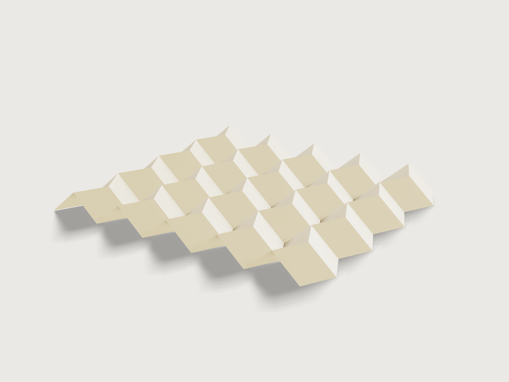

# Miura-ori fold panel

Drag one slider and a sheet folds: this is the Miura-ori, the pleat a whole sheet makes in one motion. Choose your
sheet, how many rows and columns of parallelograms and how steep they are, and the pattern fills the sheet. Print it,
score it, or cut it on a plotter or laser with the mountains and the valleys on separate layers. Switch on thick panels
and the same pattern becomes card or plywood on a fabric hinge, and the slider then folds exactly as far as the panels
really allow.



## What it shows

- **One slider, every crease.** `feature.fold` is driven by a single angle on one family of creases and 3DCraft solves
  the rest (`e33[*]` carries the angle, all others are solved). *Fold* runs from 0 (flat) to 100 (folded flat, or as far
  as the panels go) and is linear in the facets' tilt. On paper 50 is the zigzag creases at exactly a right angle. With
  thick panels 100 is the panels' stop and 50 is half that tilt, so the creases stand at less than a right angle (50.8 degrees at
  the defaults). The form says so and the outputs give the real crease angles.
- **Folding flat, for real.** At 100 the paper is folded flat by 3DCraft's layer solver (taco-taco, taco-tortilla, the
  order of up to 224 facets stacked on one another), not by a formula.
- **The Miura-ori as sketch patterns.** Eight seed lines (four zigzag pieces and four straight pieces, each a mountain or a
  valley) are repeated by `sketch.pattern` with counts that are formulas of *Rows* and *Columns*, so a change of the grid
  changes the topology. Each seed is named with its copies (`e33[*]`) so the fold follows them.
- **The sheet decides the cells.** A table of sheets (`table.set`, `choicesFrom`) and `Margin` give the area to fill; rows
  and columns then give the cell width and row height by formula, and `variable.publish` ranges that are formulas stop
  rows and columns where a cell would fall below 10 mm.
- **Kinematics held to closed forms.** A folded Miura-ori has known overall dimensions. The Jig measures the solved fold
  (`extent`, `boxMax`) and compares its depth, length and width to the closed forms to 0.001 mm.
- **Level and square at every position.** Two `feature.transform` steps turn the folded sheet back so it lies level and
  its creases stay along the axes, so the slider folds it in place. They are switched off at 100, where 3DCraft will not
  build on a flat-folded body: from Fold 99 to 100 the pack, standing on edge, lies down on the sketch plane and turns. The
  form says so too.
- **Thick panels from the same pattern** (`panels` of `feature.fold`): one six-sided prism per cell set back from every
  crease, on a fabric sheet that is the same fold, recoloured by `body.appearance` with colour expressions.

A static model is one sheet at one angle. This is every sheet up to A1, any grid to 14 x 16, any angle from 45 to 80
degrees, at any fold, in paper or panels, and always ready to send to the cutter.

## The real thing

**The pattern.** The Miura-ori is a tessellation of parallelograms: straight creases run across, zigzag creases up the
sheet, and at each interior vertex three creases are one kind and one the other. It has one degree of freedom, which is
why it unfolds in one motion: pull two opposite corners and it opens. It is named after Koryo Miura (his 1985 ISAS report,
known here only by its citation in the literature; not read). Its kinematics are worked out by Schenk and Guest (*PNAS*
110(9), 2013, read in the PubMed Central text): a, b the parallelogram's sides, γ its acute angle and θ the facets' tilt
out of the plane, 0 to 90 degrees. The equations of that paper are images in the web text and could not be read, so the
Jig's formulas are derived here: straight creases fold by `2 atan(tan θ cos γ)` and zigzag ones by `2 θ`; the facets' tilt θ
is what the slider moves. Depth `a sin γ sin θ`, length and width in closed form follow from the facets staying rigid. The
Jig does not take them on trust: it measures the fold and holds them to 0.001 mm over the range.

**Sheet sizes.** ISO 216 A series and US Letter and Tabloid (checked against published size tables; A-series values are
the standard's). *Art board 500 x 700* and *Laser bed 400 x 600* are common workshop sizes chosen by this Jig, not
standards.

**The pack.** Paper folds to 180 degrees in the crease pattern, and a real pack has thickness. At Fold 100 the form gives the
pack's length `C a cos γ + l`, its width `a sin γ` and its thickness: the most layers stacked at one spot times the thickness of a
sheet, with the sheet taken at a bulk of 1.25 cm³/g (typical uncoated paper, this Jig's assumption), so 160 g/m² is 0.2 mm a
layer. The length and width are the limit at 90 degrees of the closed forms the assertions hold at every other fold. The stack is
`rows × min(columns, 2 ceil(l / (2 a cos γ)))`, with `a` the cell width and `l` the zigzag edge: every row stacks whole, and a
facet covers only the columns within a zigzag edge. It is not the facet count (`fold.inspect` `count`, 80 at the defaults);
worked out here, and matched against a separate count of overlapping facets on 40 grids. A flat-folded pack cannot be measured
as a solid, so this is not an assertion. Folding by hand, your pack will be a little thicker than this, as creases never close
fully.

**Making it, by hand on paper or card.** (Practice, not proven by the model.)

1. Export the crease pattern as SVG with a line width (see Export). Print it at 100 % (no "fit to page"), centred,
   on the sheet you chose. Measure one cell: it must be the *Cell width* and *Row height* the form shows.
2. Score each line against a steel rule with an empty ballpoint or a bone folder, on the side where the fold will be
   a valley: valleys (blue) on the printed side, mountains (red) from the back. Prick their ends through to find them,
   or score everything on the printed side and fold the mountains back. Paper up to 120 g/m² folds without scoring; 160
   g/m² folds well if scored; 200 g/m² and up needs scoring on both sides. This is workshop practice, not from a source.
3. Cut the outline (black), pre-fold every crease one way and then the other, then fold: pinch the zigzag creases row by
   row and push the straight ones in alternately. Once a few rows are in, the whole sheet collapses together.

**Plotter or laser.** The DXF and SVG have the outline on the layer `boundary`, mountains on `mountain` and valleys on
`valley`, each at true size, so the machine can score them on different passes or tools, or cut the outline only. A
half-cut belongs on the outside of its fold, so the uncut skin is the hinge: mountains from the front, valleys from the
back (flip the sheet about its long edge against a stop and mirror the job in your software). On thin stock one pass
from the front for all creases will do, the valleys then with the score on the inside, which thin paper forgives. Test
the power on a strip first; a laser leaves a brown line, so start low. This too is practice, not proof.

**Thick panels.** Card, grey board or plywood panels glued on a fabric or tape hinge: one panel per cell, the hinge the
sheet they are glued to (the membrane model of thick origami; see Zirbel et al., *J. Mech. Design* 135(11), 2013, whose
abstract was read). Each panel stands back from every crease by half the *Gap between panels*, not from the outline. They
fold with the paper's motion. A valley, where the panels lie on the inside of the fold, is the crease that closes: the
panels' inner edges meet when the zigzag crease has folded by `2 atan(half gap / thickness)`, and a mountain opens freely.
The Jig stops 5 % of the gap short of touching (this Jig's own margin), so at Fold 100 the panels still clear each other by 5 % of
the gap you set (the output gives what is left, and an assertion measures it). Thick panels on a one-sided hinge cannot fold flat: the panels would pass through
each other, as 3DCraft refuses; 3DCraft's guide names the methods that do fold them flat (offset and tapered panels), not
built here or there (F-015 in the examples' feedback). So a thick Miura folds part way. How far depends on the panels: the facets' tilt
at the stop follows only the thickness and the gap, the same on every grid and at every parallelogram angle, and a steeper
parallelogram then reaches a smaller angle at the straight creases.
The fold of the panels is shown in the form as *Furthest fold*. To cut them, export the set *Panels cut sheet* (below): it holds the
panels as the laser should draw them, half a *Laser kerf* larger than the finished panel next to every crease, so a cut panel comes
out at the gap you asked for. Along the sheet's outline there is no compensation (the fold sets panels back only from creases), so
an outer panel ends half a kerf short of the fabric's edge, which does no harm. Set the kerf to 0 if you saw or cut the panels another
way. For paper the outline is cut and the creases scored, and the kerf is of no account. Glue
them onto the fabric, using the printed crease pattern under it to place each one: the panels are mirrored pairs, so
sort them by leaning direction first, and glue the outer row and column last (they are the larger ones: no set-back at the outline). The order of work is this Jig's advice.

**Not modelled:** real paper bending at a crease (zero width here), the fabric's stretch, friction, and the score depth
and tool on your machine. The model is a rigid fold with zero paper thickness apart from the thick-panel option.

## Parameters

| Group | Parameter | Range | What it changes |
|---|---|---|---|
| Fold | Fold | 0 to 100, step 1 | Everything: the sheet's fold, its footprint and depth; on paper 50 is the zigzag creases at 90 degrees, with panels 100 is their stop and 50 is half that tilt |
| Pattern | Rows | 3 to 14, or what leaves cells at least 10 mm high | Creases and facets across the sheet |
| Pattern | Columns | 3 to 16, or what leaves cells at least 10 mm wide | Creases and facets along the sheet |
| Pattern | Parallelogram angle | 45 to 80 deg (to 70 deg above 144 cells) | The cells' lean; steeper packs flatter |
| Sheet | Sheet | A5 to A1, US Letter, US Tabloid, art board 500 x 700, laser bed 400 x 600 | The pattern's size (it fills the sheet) |
| Sheet | Landscape | on or off | Long side along the columns |
| Sheet | Margin | 0 to 30 mm | Free paper round the pattern |
| Sheet | Paper weight | 80 to 400 g/m² | Mass and pack thickness |
| Thick panels | Thick panels | on or off | Panels on fabric hinges instead of paper |
| Thick panels | Panel thickness | 0.3 to 6 mm, at most a third of the narrowest cell | The panels' prisms; less folds further |
| Thick panels | Gap between panels | 0.6 to 20 mm, at most half the narrowest cell | The fabric hinge; more folds further |
| Thick panels | Laser kerf | 0 to 0.5 mm, at most half the gap | How much larger the cut sheet draws the panels |

A cell cannot be sized directly: rows, columns, sheet and margin set it, and the outputs show it. Rows and columns are limited
to keep the layer search within 3DCraft's work allowance (at the angle limit below); the limit is in the *Checks*.

Outputs: cell width, row height, zigzag edge; the crease angles (straight and zigzag); the current length, width and
depth of the fold, and at 100 the length, thickness and width of the pack; total length of the mountain and of the valley creases
(metres, for a plotter's or laser's time); paper mass; the most layers at one spot and the thickness of the flat-folded pack; the
furthest fold with these panels; the gap left at the tightest crease.

At the defaults (8 rows, 10 columns, 70 degrees, A4 on its long side, margin 10 mm, 160 g/m²): cell 26.84 by 23.75 mm with a
zigzag edge of 25.27 mm; Fold 50 puts the straight creases at 37.8 and the zigzag ones at 90 degrees; the fold is 212.1 by
179.8 mm and 17.8 mm deep; 1.950 m of mountain creases and 1.748 m of valley creases; 8.2 g of paper; folded flat, 32 layers at
the thickest spot, a pack 117.1 by 25.2 mm and 6.4 mm thick.

## Checks

Twenty-two assertions, cheap enough to run at every change of the form. All are measured on the model unless they say
otherwise.

Paper (and the fabric sheet of thick panels):

- **One flat facet per cell**: the fold has rows × columns facets (`count`).
- **Area** of the folded sheet against rows × columns × cell width × row height (`area`): every cell, folded or not.
- **Depth** (`extent` z): against `a sin γ sin θ`, to 0.001 mm: the solved fold against the kinematics.
- **Level** (`boxMax` z): the fold's top is at half its depth, so it lies level about z = 0.
- **Length and width** (`extent` x and y): against the closed forms, to 0.001 mm. The same solved fold, read along the
  sheet and across it.
- **Kawasaki and Maekawa** at every interior vertex (`kawasakiFails`, `maekawaFails`, 3DCraft's own count, eq 0). Both are
  necessary for folding flat, and prove nothing more on their own.
- **Flat-foldable** (`flatFoldable`): 3DCraft decides an order of the layers with every crease at 180 degrees, whatever the
  slider says. Only this one proves folding flat.
- **Mountain and valley crease pieces** (`count` of the fold's edges by seed, with their measured lengths): the piece counts and
  lengths behind the total-length outputs.
- **The zigzag creases fold by twice the facets' tilt**, from the measured depth: an independent check on the crease-angle output.
- **The pattern fills the sheet** (`extent` of the flat sheet against the sheet less the margins, both ways).

Thick panels:

- **Six-sided prism per cell** (`count`), and their **volume** against the closed form: each panel set back from the
  creases around it, not from the outline.
- **Top and bottom** of the panels (`boxMax`, `boxMin` z) and **width** (`extent` y), against closed forms, to 0.001 mm: they
  place the panels on the front of the sheet and leaning with it.
- **The gap at the closing crease** (`distance` between the two panels' sides at the first zigzag valley), against
  `2 (c cos θ - t sin θ)`, to 0.001 mm, at every Fold: a real distance on the model.
- **The stop** (Fold 100 only): that distance is 5 % of the gap, to 0.001 mm. A stop placed earlier or later fails it.
- **The cut sheet** (`volume` of the hidden panels as drawn): half a kerf larger than the finished panels next to the creases.
  The hidden fold of those panels lies flat; the set takes its faces.

`tools/jigs.py check` runs `check-range`: 105 points (defaults, 64 of the 2 048 corners, every choice, 32 random), all
passing, none unproven. Beyond the range check (unpublished checks: their scripts are not in this repository):

- **Is the layer search enough?** `flatFoldable` searches within 3DCraft's work allowance, so its range limit is part of
  the Jig's. Asking it for every sheet in both orientations at the extreme margins and grids of 120 to 224 cells at 60, 70 and
  80 degrees (981 points), and a further 211 points at 80 degrees on grids to 144 cells:
  every point within the published ranges passes. The 84 points that ran out of work were all above 144 cells at 80
  degrees, which the *Parallelogram angle* range now excludes (70 degrees above 144 cells). This is sampling, not a
  guarantee (the search is NP-hard and the 45-to-80 degree range holds many values); if a grid the scan missed runs out of
  work, the form shows the assertion's refusal.
- **Is the stop really where the panels touch?** The tilt at which 3DCraft refuses the fold was bisected to 0.001 degree in 18
  combinations of angle, thickness and gap (45, 62 and 80 degrees), and to about 0.1 degree in 72 more with grids from 3 × 3 to
  14 × 16: in each it is `atan(c / t)` within the bisection's resolution, whatever the angle and the grid, so no other pair of
  panels meets first.
  A further 73 points were set at Fold 100 across thickness, gap, grid, angle and margin extremes, all passing.
- **The whole slider:** 126 points of Fold from 0 to 100 at the defaults, 14 × 16 at 70 degrees on A4 portrait, 12 × 12 at 80 degrees, 3 × 3 at 45
  degrees on A1 and thick panels (including 14 × 16 on A1): all pass.
- **Refusals, tried by hand with `param.set`:** 20 rows or 17 columns (range 3 to 14 and 16), 9 rows on A5 with a 30 mm margin
  (range 3 to 8), an angle of 85 degrees, 75 degrees on 12 × 14 (range to 70), Fold 101, panels 6 mm thick on cells too small
  for it (range to 3.5 mm) and a gap of 15 mm on the defaults (range to 11.9 mm), a paper weight of 500.
- **Mutation tests** on scratch copies, 19 in all: the stop placed 20 % early, or a stop gap of near zero, fails the stop assertion;
  a kerf ignored or of the wrong sign fails the cut sheet's volume; a wrong count of crease pieces, a wrong crease-length formula or a
  wrong zigzag angle output fails its own assertion. And: an interior vertex moved 3 mm
  (Kawasaki 35 fails, flat-foldable false), a crease family turned mountain to valley (Maekawa 36 fails), a row's straight
  creases swapped (flat-foldable false), all kinds flipped, crease copies missing (facets 80 → fails), the level axis off by 2
  degrees (depth, level, length and width fail), no in-plane turn (length and width), the margin ignored (fills-the-sheet), the
  zigzag offset wrong (depth, length), the panel clearance off (volume, top, gap), panels on the back (top, bottom, gap), the stop tilt too large
  (the panels collide and the fold fails), no in-plane turn of the panels (width), a shifted outline (the sketch fails).

**The real limit of folding with thickness is proven in the sense the model can prove it:** the closed form for when
the panels touch was bisected against 3DCraft's own collision check, at every Fold value the measured gap at the closing crease
equals the closed form, and at Fold 100 it is the stop gap. It holds for rigid panels with hinges on the fabric's plane; real fabric has
thickness and slack, so a real panel folds a little further or stops a little sooner; 5 % of the gap is kept in reserve.

What the checks do not cover: every combination of the ranges; real paper's stiffness and thickness at a crease; the
sequence of folding by hand.

## Export

The fold exports flat whatever its angle.

- **Crease pattern** (the file a plotter, a laser or a die maker needs). *File › Export…*, **Crease pattern of: Miura-ori**, as DXF
  or SVG; agents: `file.export` with `"fold": "Miura-ori"`. In either format the outline is the layer `boundary`, the
  mountains the layer `mountain` and the valleys the layer `valley`, at true size. An SVG without `"stroke"` has hairlines (0.01
  mm, a laser's): for printing give it a line width, `"stroke": 0.3`. The layer names are fixed by 3DCraft (F-063 in the examples' feedback);
  a die maker's CUT and CREASE layers are a rename in the CAM program.
- **Panels** (thick panels on): *File › Export…*, **Sheet of set: Panels cut sheet**, DXF or SVG; agents: `file.export` with
  `"set": "Panels cut sheet"`. Every panel, once, true size, in rows. Give *Sheet width* your board or bed width. The panels are
  in document order, not numbered; see *The real thing*. The set holds the panels as the laser draws them, kerf included.
- A shape for a laser cutter to mark is the same as the above with a low-power layer for the creases.

A whole-model STEP or 3MF also holds the hidden flat body *Panels as drawn*: export the fold's crease pattern or the set *Panels cut sheet*, not the whole model. In the export dialog give the sheet width for *Panels cut sheet* (600 mm, say), or the panels (80 at the defaults) lie in one long row.

## Files

| File | What it is |
|---|---|
| `build.json` | The source: variables, sketch patterns, folds, transforms, sets, outputs, assertions, the form |
| `meta.json` | Card, preview framing, exports |
| `formtest.md` | The form test |
| `preview.png` | The picture |

`miura-ori.3dcraftjig` is the published Jig (open it in 3DCraft, or with `craft3d-cli run`).

## Rebuild

```sh
tools/jigs.py build miura-ori
tools/jigs.py render miura-ori
tools/jigs.py check miura-ori
```

The picture sets the camera and the light direction (`meta.json`, `preview`); no other framing keys.

The tool needs the 3DCraft build this repository is pinned to: see
[Building and checking](../../README.md#building-and-checking) in the README.

## Difficulty

6 out of 10: count-driven fold topology with coupled closed-form kinematics and thick panels; 3DCraft does the folding.

## Platform notes

- F-063 (examples' feedback, open): a fold's DXF names its layers `boundary`, `mountain`, `valley`, and they cannot be
  renamed to CUT and CREASE.
- F-015 (examples' feedback): thick panels are not built when folded to 180 degrees. The Jig stops them where they meet.
- [J-051](../../3DCRAFT-FEEDBACK.md#j-051-a-body-folded-flat-cannot-be-built-on-or-moved): a flat-folded body cannot be moved, so at
  Fold 100 the pack is not levelled and squared, as it is at every other position; at 99 it stands on its edge and at
  100 it lies in the sketch's plane.
- [J-067](../../3DCRAFT-FEEDBACK.md#j-067-the-flat-fold-layer-order-search-gives-up-on-larger-miura-grids): the layer-order search of `flatFoldable` runs out of
  work on larger Miura grids at steep angles; the Jig keeps to 14 × 16 and to 70 degrees above 144 cells to stay within its allowance.

## Licence

[CC BY 4.0](../../LICENSE-CC-BY-4.0.md); credit line in the [README](../../README.md#licence).
