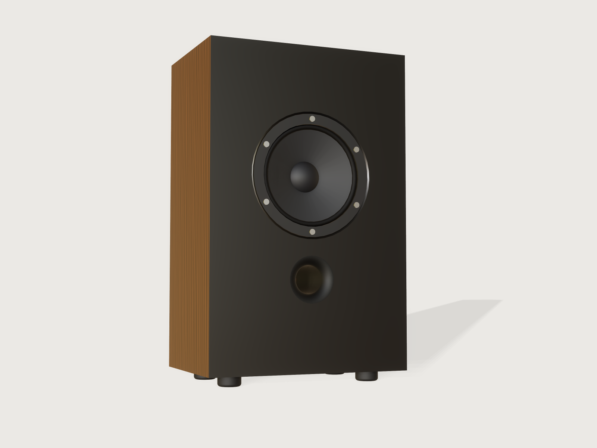

# Loudspeaker box

Type in your driver's data sheet, choose sealed or vented, and the form draws the cabinet that driver wants: the
volume from Thiele and Small's alignments, the net air then measured on the model itself, a flared port tuned by
Helmholtz, the driver let into a chamfered rebate, walnut veneer and a black baffle, and a cut sheet for the router
or the saw.



## What it shows

- **Physics in the document.** `variable.set` formulas carry the whole design: the sealed box from Small's relations,
  the vented alignments by a fixed-point recursion in the tuning ratio and Small's polynomial coefficients, the f3 by
  eight Newton steps on the 4th-order response. No Python and no lookup of finished numbers.
- **The alignment is a table.** `table.set` holds the six alignments, each with its target coefficients and the Qts it
  can use; `variable.publish` with `choicesFrom` shows them, and the Qts range follows the choice.
- **The net volume is measured, not assumed.** `feature.boolean` unions the boards, driver, port, a port plug and the
  brace into one hidden body, the *Air gauge*, and the measure `cavity` reads what that body encloses: the driver, port
  tube and brace come off it because they are solid in the gauge. The port has to be plugged (an open tube encloses no
  shell), and the boards must meet without a gap.
- **Two sets of boards.** The boards you see are the finished cabinet, joints closed. A second, hidden set of *plates*
  carries what the router needs: the finger-fit clearance, the dog-bones and the through holes. The cut sheet is drawn
  from these, so the gauge stays sealed and the picture stays clean; the plates are proven in their own right (see Checks).
- **Ranges that depend on the physics.** Vas, Fs, Xmax, cutout, frame and depth have formula limits (`variable.publish`
  `min`, `max`), so a net volume outside 5 to 120 litres, a port too long for the cabinet or a driver too deep cannot be set.
- **The form changes the structure.** Vented adds the port, its seat and its checks; sealed removes them. The joint choice
  cuts finger notches or rebates (`feature.when`). The number of fingers along each edge, the number of screws and whether
  there is a brace all follow the sizes.
- **Grain that runs through the joints.** Every board uses one `wood` texture with a shared origin, and `face.appearance`
  on the edge faces paints them as veneer or as baffle, so the joints disappear in the finish as they do on a real cabinet.

A static model of a speaker fits one driver. This one has no driver in it until you enter yours.

## The real thing

**Sealed.** Small's closed-box relations (*Closed-Box Loudspeaker Systems*, JAES 20 and 21, 1972 to 1973):
alpha = Vas/Vb = (Qtc/Qts)² - 1, fc = Fs Qtc/Qts, f3 = fc sqrt(a + sqrt(a² + 1)), with a = 1/(2 Qtc²) - 1.

**Vented.** A vented box is a 4th-order high-pass. Small's coefficients with box leakage QL (*Vented-Box Loudspeaker
Systems*, JAES 21, 1973), as printed by Futtrup and Candy (*Voice Coil*, January 2025, on
[audioXpress](https://audioxpress.com/article/voice-coil-focus-quasi-alignment-families)):
a1 = (QL + h Qt)/(sqrt(h) QL Qt), a2 = (h + (alpha + 1 + h²) QL Qt)/(h QL Qt), a3 = (h QL + Qt)/(sqrt(h) QL Qt), with
h = fb/Fs. An alignment fixes A1 = a1² - 2a2 and A2 = a2² + 2 - 2a1a3 (Thiele, *Loudspeakers in Vented Boxes*, JAES 19,
1971); h and alpha come from the recursion in that article, three rounds from the lossless start. QL is 7, the value used
in Scan-Speak's note below.

**Verified against a manufacturer's table.** Scan-Speak's
[Technical Note 07](https://www.scan-speak.dk/datasheet/tech/Scan-Speak_Technote07_Box-alignments.pdf) lists QB3 and closed
boxes for two drivers at QL 7. Set in this Jig:

| Driver | Alignment | Jig | Scan-Speak |
|---|---|---|---|
| Fs 33, Qts 0.35, Vas 42 L | QB3 | Vb 23.4 L, fb 37.6 Hz, f3 41.9 Hz | 23.5 L, 37.6 Hz, 41.9 Hz |
| Fs 21, Qts 0.25, Vas 124.5 L | QB3 | Vb 27.2 L, fb 32.8 Hz, f3 41.3 Hz | 27.2 L, 32.8 Hz, 41.3 Hz |
| Fs 33, Qts 0.35, Vas 42 L | Sealed Q 0.707 | Vb 13.63 L | 13.63 L |

The note's model includes a series resistance and its first box is 0.1 L larger than this Jig's; the reason for that
difference was not established. The BL4Q targets A1 = 1.464, A2 = 1.286 and LR4Q's A1 = 0, A2 = 2 are that article's; they
were checked here by expanding the 4th-order Bessel and Linkwitz-Riley polynomials.

**How far each vented alignment goes.** Qts stops at 0.40 for QB3, 0.38 for BL4Q and 0.42 for LR4Q. Those limits come from
the port-speed rule below: with the 4th-order model (QL 7), drive set so that the cone reaches Xmax somewhere above half of
fb, the highest port speed stays under the rule's value up to those Qts (0.98, 0.95 and 0.98 of it) and passes it just above
them (1.03 at QB3 0.41, 1.005 at BL4Q 0.39, 1.03 at LR4Q 0.43). That calculation was done outside this Jig.

**Port.** fb = c/(2 pi) sqrt(S/(Vb Leff)), c = 343 m/s, with the effective length made of the straight tube, the flare's
acoustic length (S ∫ dx/S(x) by Simpson's rule over the bell) and two end corrections: 0.613 r for the free inner end
(Levine and Schwinger, 1948) and 0.85 r for a flanged mouth (Rayleigh's 8/(3 pi)), the mouth's own radius there and scaled
to the throat. The plain-tube sum is the familiar 0.732 D
([AJ Designer](https://www.ajdesigner.com/phpvent/subwoofer_vent_port_equation_length_l.php)). The bore is the smallest
whole millimetre for which v = 2 pi fb Sd Xmax / S stays under 17 m/s, and large enough that about 20 mm of tube stands inside
the box. 17 m/s (5 % of c) is common practice in vent calculators and is not a hard limit: Salvatti, Devantier and Button
(*Maximizing Performance from Loudspeaker Ports*, JAES 50, 2002) report Young's and Harwood's advice to stay below about
10 m/s for a straight port, and the form shows the speed so you can judge. Enter a larger Xmax to get a larger port.

The tube is a pipe as well as a mass: its first resonance, about c/(2 L), is an output, about 1.4 kHz at the defaults and lower
for long tubes. It can fall inside a woofer's band, so cross over well below it. The first thing to do with a finished box is an
impedance sweep and to trim the tube by a few millimetres: every box's leakage and stuffing differ, and no formula knows them.

**Volume.** Net air is target Vb. The gross interior adds back the magnet, the basket arms, the part of the port inside the box
and the brace, and takes off the air the baffle's hole adds behind the cone (the rear surface of the cone and frame,
integrated as a surface of revolution). The Jig's driver is a thin cone and frame, a solid motor and four arms, so the
displacement is a fair stand-in for an open basket, not a measurement of yours. Stuffing is not modelled: it raises the
effective volume, so a stuffed sealed box comes out a little lower in Q than the form says.

**Cabinet.** Four cabinet shapes, none with two equal sides; the width grows to fit the driver and the height to fit driver and port.
MDF, 720 kg/m³ (a typical figure, not a measured one), veneered after assembly, baffle painted. Walls of 12 to 25 mm and a window
brace below the driver or port when the box is tall enough. The back board has a round terminal hole, closed by a cup with two
posts whose plug fills the hole, so the net air is unchanged.

**Making it.** Finger joints: CNC router, 6 mm cutter (8 mm above 24 mm board); the plates carry a dog-bone in every inner corner and a
relief on each finger flank (0.1 or 0.2 mm per part, so the mating faces stand 0.2 or 0.4 mm apart, chosen in the form) already, so cut the profile with cutter compensation only. Odd finger counts,
fingers about three boards wide. The front and back panels keep all eight corners. Fill the dog-bones before veneering; the
preview shows the cabinet finished. Rebated joints: table saw or router. Sides are rebated all round on the inside, front and back
along top and bottom, top and bottom are plain; the outputs give each blank's size and the rebate width (one board) and depth (half a
board). The driver sits flush in a rebate 5 mm deep and 0.5 mm over the frame, with a 2.5 mm chamfer round it; screws are drawn at the
frame's size (4, 6 or 8).

At the defaults (6.5 inch driver, QB3): 15.59 L target, 15.58 L measured, fb 43.3 Hz, f3 48.3 Hz, port 39 mm bore and 102.5 mm from
mouth to inner end, 16.3 m/s at Xmax, first pipe resonance 1.4 kHz; cabinet 289 x 446 x 193 mm, seven boards, 5.9 kg for the six
outer boards.

## Parameters

| Group | Parameter | Range | What it changes |
|---|---|---|---|
| Box | Box alignment | 3 sealed (Qtc 0.577, 0.707, 1.0), 3 vented (QB3, BL4Q, LR4Q) | Volume, tuning, whether there is a port |
| Driver data sheet | Fs (Hz) | 18 to 150, narrowed so a port fits | Tuning and the port |
| Driver data sheet | Qts | 0.20 to the alignment's limit (0.38 to 0.42 vented, 0.52 to 0.90 sealed) | Volume, tuning |
| Driver data sheet | Vas | so that the net volume is 5 to 120 L | Volume |
| Driver data sheet | Sd (cm²) | 30 % of the cutout area up to the cutout less a 6 mm rim | Port bore, cone in the model |
| Driver data sheet | Xmax | 1 mm to a limit set by the port that fits | Port bore |
| Driver data sheet | Baffle cutout | 60 mm to what the volume can carry | Hole, driver seat |
| Driver data sheet | Frame outer diameter | cutout + 8 mm to 1.45 cutouts | Rebate, baffle width, screw count |
| Driver data sheet | Mounting depth | at least 30 mm, more for wide surrounds, to the box depth less 25 mm behind the magnet | Motor in the model |
| Box | Board thickness, measured | 12 to 25 mm | Every joint and the outside sizes |
| Box | Cabinet proportions | golden slim, bookshelf, tower, compact | Height to width to depth |
| Box | Joint and machine | finger joints snug or easy (CNC), rebated (saw or router) | Board outlines and the fit |

Outputs: net volume target and measured (and the difference in %), f3, fb or fc and Qtc, port bore, length, air speed and first pipe
resonance, tuning and sealed Qtc from the measured air, the level at f3, the outside sizes, boards to cut, the blank sizes of the baffle
and back, the sides and the top and bottom, the rebate width and depth, the narrowest finger, the router cutter and the mass of the six
outer boards.

## Checks

Twenty-seven assertions, of which those that do not apply are inactive (the port's when sealed, the brace's when there is none, the fingers' when rebated):

- **Measured on the sealed model:** the net air (`cavity`) within 0.25 % of the target. The band is that tight on purpose: at the
  defaults, leaving the driver, the port or the baffle hole out of the volume account moves the net air by 0.3 to 1 %.
- **Port as built:** the tube's outside diameter (section) and length (extent) equal the design within 0.02 mm; the wall's section
  area leaves at least the bore that 17 m/s at Xmax needs, so a bore that shrinks on the model is caught; the inner end at least one
  bore from the back wall; clear of the driver by 5 mm; the mouth at least 11.5 mm from the bottom board.
- **Driver:** the motor at least 25 mm from the back wall; the frame at least 11.5 mm from a side and from the top.
- **Brace and terminal:** the brace 5 mm clear of driver and port, 8 mm above the bottom board, overlapping no board; the terminal cup 3 mm clear of the brace.
- **Joints:** no two boards overlap (`overlap`, in both joint styles); no finger under three quarters of a board wide (fingers are about three boards wide, but with three fingers
  along a very shallow box the narrowest can fall just under one board; below three quarters the assertion fails, and that is the form's refusal); the
  boards counted are six, plus the brace.
- **The cut plates themselves**, which are what the machine cuts: assembled, the six plates do not overlap; the plate's cutout is concentric with the driver's frame (1 mm clear, measured) and its port hole with the port's bore (one wall clear, measured); the terminal cup's plug fits the back plate's hole without overlap; and the section of the baffle, back, side and bottom plates equals its closed form (the outline, less the notches with their fit, the dog-bones and the holes), within 0.5 mm².
- **Response:** the 4th-order transfer function at the reported f3 is -3.01 dB within 0.05 dB (a check that the Newton steps converged).

`tools/jigs.py check` runs `check-range`: 107 points (the defaults, 64 corners, every choice, 32 random points), all passing, none unproven. That is a sample of the
box, not all of it, so the limits were attacked by hand with `param.set`: 18 points across the vented alignments, shapes and board thicknesses with Fs at both ends of
its range, Xmax at its ceiling and the depth at its limit, a sweep of 44 mounting depths, 59 further points with cutouts from 60 to 300 mm at five depths in both joint styles, and sealed, rebated and large cases. None failed. The largest
difference between measured net air and target seen in those runs was 0.05 % (sealed Butterworth at the defaults); that is what the runs showed, not a bound. Dropping the
driver, port, hole or brace from the volume account, narrowing the bore, moving or shrinking a plate's driver, port or terminal hole, or cutting a plate's finger notches short each fails an assertion; these mutations were run.

Not checked: the driver's real displacement, stuffing, the strength of the joints, or the sound.

## Export

- **File › Export…, Sheet of set: Cut sheet, DXF or SVG.** One through-cut outline per board, including the cutout, port bore and terminal
  hole, the finger joints with their clearance and dog-bones, each board on a layer of its own. Set *Sheet width* to your bed and set
  your CAM's cutter compensation to outside.
- **Sheet of set: Rebate and mouth pockets.** The two pocket floors in the baffle: the driver's rebate and the port's mouth, for a
  separate pocketing pass (5 mm deep and the flare radius deep).
- Rebated joints: the same *Cut sheet* gives the blanks; cut the rebates to the sizes in the outputs. `cut.list` is not used here:
  it does not read rebated boards (see Platform notes).

## Files

`build.json` (the source), `meta.json`, `formtest.md`, `preview.png`, and `loudspeaker-box.3dcraftjig`,
`thumb.png` from the tool.

## Rebuild

```sh
tools/jigs.py build loudspeaker-box
tools/jigs.py render loudspeaker-box
tools/jigs.py check loudspeaker-box
```

## Difficulty

7 out of 10: coupled Thiele-Small physics, ranges by formula, a measured cavity gauge and two joint topologies.

## Platform notes

- There is no frequency unit: `38 Hz` is refused, so Fs, fb and f3 are plain numbers with the unit in the label and `1/(1 s)` in the
  formulas ([J-056](../../3DCRAFT-FEEDBACK.md#j-056-no-frequency-or-electrical-units-hz-v-a-w-h-mah-wh-see-f-106), [repro](../../findings/J-056-frequency-electrical-units/frequency.json)).
- `cut.list` reads a rebated board as a plate along the wrong axis, or gives it no dimensions (J-004), and lists hidden bodies
  ([J-046](../../3DCRAFT-FEEDBACK.md#j-046-cutlist-and-cutexport-cannot-be-limited-to-the-parts-to-cut-see-f-161-j-003), [repro](../../findings/J-046-cut-list-set/hidden-body.json)); limiting it with `bodies` fails on a feature that is off
  (J-003). So the blanks are outputs instead.
- A veneer cannot follow a choice of wood, as a pattern's colours are literal (J-009, F-171); there is one walnut. Faces are coloured by literal names
  (F-025): the driver's are.
- The driver's profile is drawn so that the basket arms land on a flat ring on the frame: a basket arm crossing the rim where the frame's
  cone meets its cylinder made a face the kernel could not tessellate at some depths (it reported the boundary crossing itself).
- Every arc in the driver and port profiles is given by a centre written as a formula: an arc given by a through-point loses its centre when its points come close to collinear, and a long session of extreme values left one document unrecoverable ([J-033](../../3DCRAFT-FEEDBACK.md#j-033-a-sketch-arc-given-by-a-through-point-loses-its-centre-when-it-flips-or-flattens-and-can-leave-a-document-unrecoverable-see-f-112-f-113), [repro and the broken file](../../findings/J-033-sketch-arc-centre-escapes/)).
