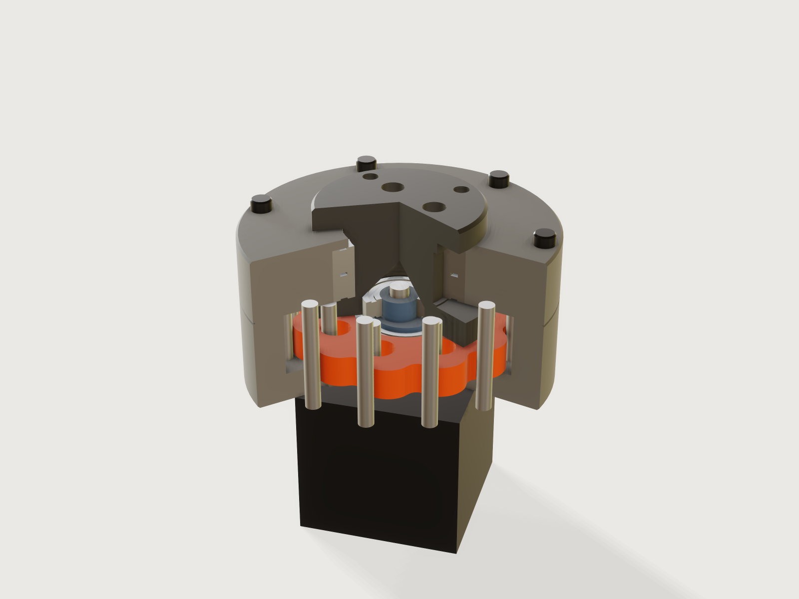

# Cycloidal drive

A printable single-stage cycloidal reducer for a NEMA stepper. Choose the reduction and the housing diameter: the pin
count, the lobes, the eccentricity and the true lobe profile follow, the form refuses a ratio that would undercut the
lobes or crowd the pins, and dragging one slider orbits the disc and turns the output by exactly the ratio asked.



## What it shows

- **A curve from a formula, and one lobe made into all of them.** The disc's outline is the equidistant of a curtate
  epitrochoid drawn with `sketch.curve` (one lobe, t from 0 to 2π / lobes) and repeated with `sketch.pattern` (`chain`
  plus `angle`, a ring of runs that closes on itself), so the side of the disc is one face per lobe and the model can
  count them. It is the only sketch of the disc: bore and output holes are in it too, so the disc is one
  `feature.extrude` and no boolean ever runs on the spline.
- **Tolerance as a design choice.** The Jig is created at a linear tolerance of 0.01 mm (`file.new`, `meta.json` `new`;
  `document.setTolerance` is the same setting), about what an FDM printer can hold. It makes the spline cheap: the
  profile sketch and extrusion alone took 1.9 s at the default 1e-6 and 0.36 s at 0.01 mm.
- **A drive parameter, no assembly.** *Turn the input* drives `feature.transform`s by formula: the eccentric turns by
  the input, the disc orbits at the eccentricity and turns by minus the input over the lobes, the output turns the same.
  At the defaults the slider runs to 360° times the ratio: one full turn of the output.
- **Ranges that are formulas** (`variable.publish`): the highest ratio follows from the housing (`reduction_max`), the
  smallest housing from the motor, the rollers and the clearance (`housing_diameter_min`), the lobe depth from all of them
  (`depth_min`, `depth_max`). The combination that would undercut cannot be entered.
- **Tables** (`table.set`) of motors and bearings with `choicesFrom`; the bearings are picked by formula from standard
  sizes. Structure follows the form with `feature.when`: one or two discs (with a second cam and a `feature.loft`
  transition on the eccentric), pin rollers, and three views, cutaway, closed and print layout.
- **Assertions that measure the model** (`assert.add`): lobes and pins counted on the bodies, the disc's volume against a
  closed form, the disc's running clearance at the current input angle.

A static model of a cycloidal drive is one ratio at one angle; this is every odd ratio from 7 to 35 and it runs.

## The real thing

**How it works.** The ring of N pins stands still in the housing. The disc has N − 1 lobes and rides on a bearing on the
eccentric. One turn of the input makes the disc orbit once and roll one lobe round the ring, so the disc, and the output
pins that sit in its holes, turn by 1 / (N − 1) of a turn the other way. The reduction is the number of lobes. Holes in
the disc are larger than the output pins by the eccentricity plus a small clearance, so the orbit is taken out and only
the rotation is passed on.

**The profile.** The disc is the inner equidistant of the curtate epitrochoid traced by the pin centre:

```text
T(t) = ( R cos t - e cos(N t),  R sin t - e sin(N t) )
C(t) = T(t) - (r + c) · n(t)       n = (R cos t - e N cos N t, R sin t - e N sin N t) / sqrt(R² + (eN)² - 2 R e N cos((N-1) t))
```

with R the pin circle radius, r the pin's contact radius, c the running clearance, e the eccentricity. That the disc's
outline is an equidistant of a shortened epitrochoid is the standard form; the equations here are written so that the
form needs no atan2. They are the auxiliary-angle form of N. Petrović, M. Matejić, N. Kostić, M. Blagojević and N.
Marjanović, *Parametric Modeling of a Cycloid Drive Relative to Input Shaft Angle* (University of Kragujevac,
[PDF](https://scidar.kg.ac.rs/bitstream/123456789/16774/1/2015-M33-MASING-Matejic%20-%20Rad.pdf)), the source read for this
Jig, turned by half a lobe: the two agree to 1e-12 mm numerically (the paper's text extract is damaged at its equations 1
and 2, read here as Ra = R / N and Rb = R − Ra). The classic references, D. C. H. Yang and J. G. Blanche, *Design and application guidelines for
cycloid drives with machining tolerances* (Mechanism and Machine Theory 25(5), 1990) and J. Sensinger, *Unified approach
to cycloid drive profile, stress, and efficiency optimization* (J. Mech. Design 132(2), 2010), are cited from their
bibliographic records: their full text was not available, and no formula is taken from them.

**Undercut, derived here.** With K = e N / R (the shortening ratio; the form calls it *Lobe depth*, in percent) and u the
cosine of the rolling angle, the trochoid's radius of curvature on the convex part is

```text
ρ(u) = R (1 + K² - 2 K u)^(3/2) / (1 + N K² - K (N + 1) u),
```

its minimum is at u\* = (2 − N + (2N − 1) K²) / (K (N + 1)) and comes to R √(27 (N − 1)(1 − K²) / (N + 1)³), or at the
lobe tip (R (1 + K)² / (1 + N K)) when u\* lies below −1. The disc is an inward offset, so its sharpest radius is that
minimum less r + c; it must stay positive or the offset folds over itself (a cusp). This derivation is the Jig's own: it
was checked against a numerical curvature of the trochoid at nine parameter sets (N 8 to 36, K 0.25 to 0.85, both
branches), and agreed to five digits. The form keeps the sharpest radius at or above 0.6 mm, about what a 0.4 mm nozzle can follow.

**Standard parts.**

- *Motor mounts:* NEMA 14, 17 and 23 hole spacing (26, 31, 47.14 mm), pilot (22, 22, 38.1 mm) and shaft (5, 5, 6.35 mm),
  from the [NEMA size table at hallikainen.org](https://pic.hallikainen.org/techref/io/stepper/nemasizes.htm); that page
  says of itself that its values may be wrong, and the 17 and 23 rows agree with other published tables. Shaft length
  varies with the motor. The D-bore runs right through the eccentric, so a shaft from 20 mm (`shaft_reach`, for 10 mm of
  engagement) up to the form's *Longest motor shaft that fits* will do; a longer one must be cut. The model draws a 24 mm shaft,
  the length of one NEMA 17 datasheet ([Same Sky](https://www.digikey.at/en/htmldatasheets/production/3324032/0/0/1/nema17-23-01d-amt112s.html),
  0.94 in); no length was verified for NEMA 14 or 23, so check yours against that output.
- *Bearings:* 618-series deep groove ball bearings, sizes read from SKF and distributor listings
  ([61804](https://uk.rubix.com/en/deep-groove-ball-bearing/p-G1321131318), [61808](https://uk.rubix.com/en/deep-groove-ball-bearing/p-G1321131331),
  [61805](https://uk.rs-online.com/web/p/ball-bearings/2867502), [61809](https://uk.rs-online.com/web/p/ball-bearings/2076969),
  [61810](https://www.bearingboys.co.uk/Thin-Section-Ball-Bearings/61810-SKF-Open-Thin-Section-Ball-Bearing-50mm-x-65mm-x-7mm--129355-p);
  61800, 61803 and 61807 from thin-section listings). The disc bearing is 61803 on NEMA 14 and 17, 61804 on NEMA 23;
  the output runs in two identical bearings chosen by formula from the 61804 to 61810 rows; the eccentric's top runs in a
  61800. The miniature 688 was left out, since listings disagree on its width.
- *Pins:* hardened steel dowels of the ISO 8734 type, 4, 5 or 6 mm, chosen from the housing diameter. The ring pins and
  the output pins are one size, so you buy one kind. The form tells the two lengths, which may not be stock lengths: cut
  or grind the next longer. The optional rollers are bought sleeves (brass tube, inside the dowel size, wall 1 mm).
- *Screws:* M3 socket-head cap screws for the cover (bolt count from the housing) and three for the flange, and the motor's own
  thread for four more (M3 on NEMA 14 and 17, M5 on NEMA 23); the form gives the longest length that fits each, so buy the
  nearest stock length at or under it. M3 heat-set inserts go in the housing wall, the hub and the flange.

**Printing.** FDM in PETG or ABS, 0.2 mm layers, at least 4 walls. Everything is laid out in *Print layout*: the housing
stands on its floor, the cover on its top face (it is flipped), the disc flat, the eccentric on its base (the transition
between two cams is at most 45° from the vertical, by construction), the output hub on its plate, with a 45° conical roof
over the bearing recess, and the flange on its face. No supports are needed, but one flat overhang prints as a bridge: the
ledges of the flange's three screw counterbores, 3 mm up from the bed. They are short spans; turn on your slicer's bridge
settings. Housing, cover and hub have a 0.6 mm first-layer chamfer, the flange
0.8 mm, and the eccentric's base 0.25 mm (it is only 1.5 mm thick there). The disc has none: a chamfer round the lobes is
refused (see Platform notes), so turn on your slicer's elephant-foot compensation. Press-fit seats are modelled at nominal size: a printed 4.0 mm hole usually needs
reaming for a dowel, and bearing pockets a test print; tune hole compensation in the slicer. Print the disc slowly: its
outline is the drive.

**Assembly.** Press the ring pins into the floor (and the rollers on them, if used). Screw the housing to the motor from
inside, with the screw heads sunk into the recesses of the floor. Press each disc bearing into its disc. With one disc, slide
the disc and bearing down past the journal onto the cam, as far as the base, and lower the eccentric onto the motor's
D-shaft, down among the pins. With two discs the eccentric has no base flange, and the lower disc would fall off a slip-fit
cam while being carried, so seat it among the pins first, with its bearing, and lower the eccentric into it on the D-shaft.
Then add the upper disc and bearing from above, past the journal (it is the same part, turned half a turn); each stops
against the sloping transition between the cams.

Axial location is not built in. The D-bore is a 0.1 mm slip fit with no set screw, so set the height yourself: rest the eccentric
on a 0.5 mm shim on the floor and fix it to the shaft with retaining compound. With two discs nothing stops the lower disc
dropping 0.5 mm onto the floor, where an orbiting face would rub: fix its bearing to the cam with compound, held up against
the transition while it sets.

Press the output pins into the hub, the two output bearings into
the cover from below, push the hub through them from below, and bolt the flange onto the hub from above with three M3
screws into heat-set inserts: it clamps the inner rings, and its four M3 insert holes (4.1 mm, through the 6 mm flange) are where you
bolt on what the drive turns. Set the support bearing into the hub's recess, lower the cover
with the hub onto the dowels (they locate it) and fit the cover screws into heat-set inserts in the housing wall (holes
4.1 mm, 6 mm deep: check your insert).

**What this Jig does not claim.** No load rating: there is no contact-stress or fatigue calculation, and a printed disc
at the rated torque of a stepper is a matter for test. The output bearings are a press fit, so a push of the output
towards the motor is only held by that fit. The bearing rings can creep on their fits: the inner ring on its slip-fit cam, and
above all the outer ring in the printed disc, which the load turns round: use retaining compound. No backlash figure beyond the running clearance you set. One disc is not
balanced: its mass orbits at the eccentricity, a radial force that turns with the input, so keep the input slow or use two
discs. Two discs half a turn apart cancel that force in the plane, but they sit at different heights, so a rocking couple
remains.

## Parameters

| Group | Parameter | Range | What it changes |
|---|---|---|---|
| The drive | Reduction ratio | odd, 7 up to a limit from the housing (31 at 80 mm, 35 at most) | Lobes and pins, the output's turn per input turn |
| The drive | Housing outer diameter | from a minimum set by motor, rollers and clearance (78 mm at the defaults) to 160 mm | Pin circle, pin size (4, 5 or 6 mm), bearings, output pins, bolt circle and flange |
| The drive | Motor | NEMA 14, 17, 23 | Mounting screws, pilot, shaft and disc bearing |
| The drive | Turn the input | 0 to 360° × the ratio | Runs the drive; the output turns the other way by this angle over the ratio |
| Cycloid disc | Discs | one, or two 180° apart | A second identical disc on a second cam; odd ratios make the two fit as the same part |
| Cycloid disc | Lobe depth | 25 to 85 %, limited by the combination | The eccentricity: deeper lobes for more engagement |
| Cycloid disc | Rollers on the ring pins | yes or no | Sleeves on the dowels, a larger contact radius, a smaller pin circle |
| Cycloid disc | Running clearance | 0.05 to 0.4 mm | Pulls the lobes back from the pins by that much |
| View | Show | cutaway, closed, print layout | The cutaway opens the housing and the output; print layout lays the printed parts on the bed |

Outputs: ring pins and lobes counted on the model, the reduction from those counts, pin circle diameter, eccentricity,
sharpest lobe radius, the output's turn at this input, the output pin count, the dowel diameter and both lengths, the bore
and outside of the disc and output bearings, the longest cover, flange and motor screws that fit, the longest motor shaft
that fits, and the height above the motor face.

## Checks

The Jig carries 41 assertions; those that do not apply at a point are inactive there. In words:

- **Ratio.** Ring pins (their seats in the housing in the print layout, where the steel is absent) counted on the model are
  one more than the lobes counted on the disc, and the reduction computed from those two counts is the one asked for.
- **Profile.** The disc's volume equals the closed form: the area π(R² + N e²) of the trochoid, less the perimeter times
  r + c (its length is 2πR times the series 1 + K²/4 + K⁴/64 + …), plus π(r + c)², less the bore and holes; within 0.2 %.
  It fails if the outline is the wrong curve or has folded. The closed form was compared numerically with the outline.
- **Undercut.** The sharpest lobe radius is at least 0.6 mm; the eccentricity is at least 0.6 mm.
- **Clearances, measured at the current input angle.** The disc is at most 1.15 times the running clearance from the
  pins or rollers and never touches them (a clearance measure fails on an overlap), and likewise for the second disc and
  for the disc holes against the output pins. A wrong disc rotation makes these fail: tried by hand with the disc turning by
  1/12 instead of 1/11 of the input, at 1 000° the disc overlapped both the ring pins and the output pins. Each cam is held
  to its bearing, 0.05 mm of slip fit all round (`clearance`, both bounds), so the eccentric has to turn with the disc: tried
  by hand, an eccentric left at 0° or turned backwards fails it. Only the upper bound is asserted:
  on this spline at this tolerance the measure's proven lower bound can be well below the value it finds (0.144 mm
  found, 0.054 mm proven at one point).
- **The output's turn.** An index mark on the flange (closed view) is measured against minus the input over the asked ratio,
  written out separately from the formula that places it (`centerOfMass`, x and y, within 0.05 mm), so a wrong ratio there
  fails it.
- **Assembly.** A bearing passes the journal on its way to its cam (a gap of at least 0.2 mm, by formula and limited in the
  ranges), and with two discs nothing under the lower cam is wider than the bearing's bore (the section of the eccentric
  there, measured): the eccentric is one printed piece, and each disc goes on from its own end.
- **Fit.** Pins clear of each other by 1.2 mm; lobe tips clear of the housing wall by 0.3 mm (by formula, and measured in
  the closed view); the cam's wall round the motor shaft at least 2 mm; at least 10 mm of a 20 mm shaft in the eccentric; a 24 mm shaft no
  longer than the longest that fits, and measured clear of the hub's recess roof by 0.5 mm (closed view); motor screw heads clear
  of the pin seats by 1.2 mm.
- **Print.** Every wall at least 1.2 mm (`measure.thickness`, closed view: housing, cover, hub, flange, eccentric), the
  disc web between holes and lobes at least 2 mm (`measure.distance`), in print layout each part on the bed at z = 0
  (`boxMin`, one assertion per part), no two parts overlapping, and the hub's bearing roof a 45° cone (`measure.draft`).

`tools/jigs.py check` runs `check-range`: 102 points (the defaults, up to 64 corners, every choice and 32 random points
from seed 1), all passing, none unproven. By hand, with `param.set`, the combinations that should be refused are:
ratio 33 at an 80 mm housing (range ends at 31), a 70 mm housing (ends at 78 mm), lobe depth 90 % (ends at 71 % there),
ratio 41 at 160 mm (ends at 35). Forcing past the form (variables set directly in a scratch copy): 36 pins, 78 mm housing,
85 % lobe depth and rollers gives "crosses or touches itself, or has a cusp" from the sketch and the undercut assertion
at −1.17 mm; crowded pins fail the pin spacing and eccentricity assertions.

Not checked: strength or life of anything, the printed fit of the seats, the overhang of the loft on the two-cam eccentric
(it is 45° at most by construction, but a loft face is only sampled by `measure.draft`, so it is not asserted), and the
eccentric's wall with two discs (`measure.thickness` could not bound the loft face; the cam-wall formula above applies).

## Export

- **To print:** set *Show* to *Print layout*, then **File › Export**, **The model**, as 3MF: one object per printed part (housing, cover, disc or two
  discs, eccentric, hub, flange) in print orientation. For one part, select that body first, or export with `"bodies":
  ["Disc 1"]`. The steel parts are not in this layout.
- **Assembly for CAD:** set *Show* to *Closed* and export STEP.

## Files

`build.json` (the source), `meta.json`, `formtest.md`, `preview.png`, and `cycloidal-drive.3dcraftjig`,
`thumb.png` from the tool. No generator is committed.

## Rebuild

```sh
tools/jigs.py build cycloidal-drive
tools/jigs.py render cycloidal-drive
tools/jigs.py check cycloidal-drive
```

## Difficulty

7 out of 10. A formula-driven trochoid, a loft, multi-body kinematics and coupled ranges at kernel limits.

## Platform notes

The preview is rendered without reflections (`look.reflections: false`): with them, the flat cut faces carried pale blotches.

- A chamfer cannot go round the disc's lobes: `chain` refuses a run of spline edges where the convexity changes, "not yet
  where one of the faces changes" (the family of the examples' [F-075](https://github.com/johancoppens/3dcraft-examples/blob/main/3DCRAFT-FEEDBACK.md#f-075) and
  [F-158](https://github.com/johancoppens/3dcraft-examples/blob/main/3DCRAFT-FEEDBACK.md#f-158)). So the
  disc has no first-layer chamfer and the README asks for elephant-foot compensation in the slicer.
- Booleans refuse near-tangent cuts at a coarse tolerance, "between half and twice the tolerance" (F-137). At 0.01 mm the
  cutaway's planes could graze a hole. The static planes therefore run midway between ring pins and the cut in the output
  is turned with it, so no plane comes within 0.08 mm of tangent to any hole over the range.
- A mesh export takes body names, never a named set ([finding](../../findings/J-045-3d-export-set/repro.json)):
  the printed parts are the whole of the print layout, so *The model* exports just them.

## Licence

[CC BY 4.0](../../LICENSE-CC-BY-4.0.md); credit line in the [README](../../README.md#licence).
