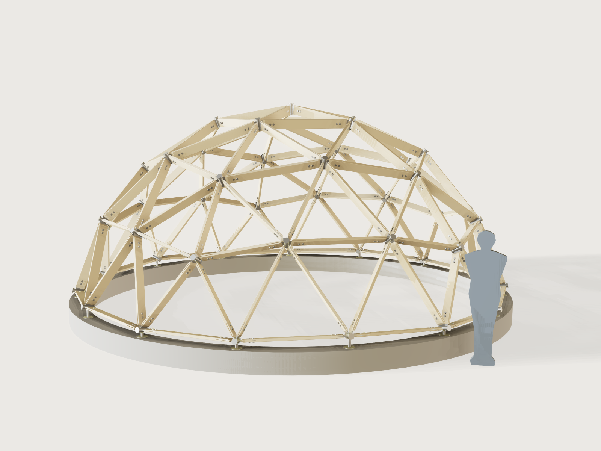

# Geodesic timber dome

A timber-strut geodesic dome you can build: pick how finely the sphere is divided and how much of it stands, give a
radius or the floor area you need, and read off how many struts of each length to saw, how many metres of timber that is,
and how many hubs of each kind to make. The struts stand on edge, each end sawn with a mitre and a kerf that takes a
laser-cut steel fin, two bolts through it; the fins weld to a short steel tube between two laser-cut cap plates. The
plates go to the laser as one sheet.



## What it shows

- **A table drives the structure.** `table.set` holds the published chord factors, strut counts, hub counts and face
  counts for each dome (`dome_types`), and `variable.publish` with `choicesFrom` offers them in the form. The strut
  lengths are the published factor times the radius; the factors are read from the table, not calculated.
- **Everything recomputed from the geometry.** The hub positions are built by formula: icosahedron corners from its
  closed-form coordinates, class I subdivision by whole-number weights, each point pushed out to the sphere. An assertion
  per strut type and frequency compares the distance between two such hub points with the published chord factor in
  the table (to the table's five decimals).
- **Symmetry keeps it small.** `feature.mirror` and a 5-fold `feature.pattern` build a sector from its fundamental
  domain: 4, 9 or 20 struts stand for the 25 to 165 of the dome. Each strut is one `feature.transform` of a master
  strut, its rotation worked out in formulas from the two hub points; the transforms copy one strut, one set of
  fins and bolts and one hub. No booleans join the struts, so 3V stays light.
- **Formulas for ranges.** The radius range follows from the dome type and the strut (`radius_min_formula`,
  `radius_max_formula`): the shortest strut must hold both fins and their bolts and not be stubby, the longest must
  come out of 4.8 m stock and keep its weak-axis slenderness within 180. The floor-area range follows the same limits,
  and the plate thickness is capped by the cheek the strut keeps beside the kerf.
- **Structure from the form.** The dome type changes the number of struts, hubs, strut types and the whole shape.
- **Masters stay out of sight.** The master strut, fin, bolt and hub at the origin are hidden with `feature.visible`;
  they are what the transforms copy and what the cut sheet draws.
- **A cut sheet and templates.** `set.define` gives *Hub plates to laser cut* (one fin per strut type, one cap plate, one
  anchor plate) and *Strut templates* (each strut's wide face with its four bolt holes, between the short points of
  the mitres; the mitre and the kerf are outputs). A static model could not give this schedule.

## The real thing

**Chord factors and counts.** Published chord factors, each verified at the row's strut count:

| Dome | Struts (chord factor) | Hubs | Faces | Source |
|---|---|---|---|---|
| 1V, 3/4 sphere | A × 25 (1.05146) | 11 (5 four-way, 6 five-way) | 15 | [Domerama chord charts](https://www.domerama.com/calculators/chord-charts/) |
| 2V, 1/2 sphere | A × 35 (0.61803), B × 30 (0.54653) | 26 (10 four-way, 6 five-way, 10 six-way) | 40 | Domerama; [Desert Domes 2V](https://www.desertdomes.com/dome2calc.html) |
| 3V, 3/8 sphere | A × 30 (0.34862), B × 40 (0.40355), C × 50 (0.41241) | 46 (15 four-way, 6 five-way, 25 six-way) | 75 | Domerama; [Desert Domes 3V](https://www.desertdomes.com/dome3calc.html) |
| 3V, 5/8 sphere | A × 30, B × 55, C × 80 (same factors) | 61 (15 four-way, 6 five-way, 40 six-way) | 105 | Domerama; Desert Domes 3V |

Strut length = radius × chord factor, the two hub centres apart. Domerama's chart gives the 3V factors for the 3/8; the
5/8 dome uses the same three lengths in the counts Desert Domes lists.

**The base of a 3V dome is not quite flat.** The 3V icosahedral subdivision (method 1, three chord factors) has no ring of
hubs at one height: the base hubs of the 3/8 sit at two levels, 1.6 % of the radius apart, and so do those of the 5/8.
Flat-base variants exist (Kruschke's, with four lengths) but they are other domes with other chord factors. This
Jig keeps the published three-length dome and says what it costs: 5 of the 15 base hubs of the 3/8 and 10 of the 15 of the
5/8 stand on the higher level, by the output *height difference between the two levels* (56 mm at the default radius,
more than a shim on a big dome). So every base hub stands on a seat: an anchor plate bolted to the ring and a
40 mm post welded under the tube, the posts of the higher hubs taller by that difference (the outputs give both lengths). The 1V and 2V domes have flat bases.

**The strut.** The sections on the form are the common CLS (38 x 89, 38 x 140 mm) and sawn structural sizes: check your
supplier. Sawn timber on edge (depth along the sphere's radius), arrises eased, each end cut with two mitres
in plan at half the tightest strut angle at any hub of that dome (between 54.6° and 60° between struts, so about 27° to
30° each side, the output *Mitre*), and below mid-depth the end is cut back parallel to the hub axis so that it clears
the tube. A full-depth saw kerf 2 mm wider than the fin plate takes the fin, as long as the output *Saw kerf: length*.
**The saw length is the strut's length over the long points of its mitres**, the length to cut the timber to before
mitring (the output *saw length*); the kerf then takes the very point away, so a finished strut measures a kerf-width
divided by tan(mitre) less, and that is what the model is measured against. The short points on the wide faces are the
other output (and the template). Density is C24 spruce at 420 kg/m³ (mean density of EN 338, as listed in
[Taylor Maxwell's strength data](https://www.taylormaxwell.co.uk/uploads/files/Strength-data-C16-C24-TR26.pdf)).

**The connection.** A laser-cut steel fin in the plane of the strut and the sphere's centre goes into the kerf
and takes two bolts through strut and fin in double shear. The bolt is M12 in timber at least 45 mm thick and 140 mm
deep and M10 otherwise; each cheek keeps at least 1.5 bolt diameters of timber beside the kerf, which caps the plate
thickness (a proportion rule of this Jig, not a clause of a standard). Spacing and distances follow EN 1995-1-1:2004+A1:2008 table 8.4 for bolts (read in the standard, and
as summarised by [Roy Mech](https://roymech.org/Related/Construction/Timber_connections.html)), for load along the grain:
along the grain between bolts a₁ = (4 + |cos α|) d = 5 d, loaded end a₃,t = max(7 d; 80 mm), unloaded edge
a₄,c = 3 d. The end distance is measured to the short corner of the mitred cheek, not to the tip. Clause 10.4.3
gives the holes (at most d + 1 mm in timber, at most d + max(2 mm; 0.1 d) in steel) and the washers (at least 3 d across
and 0.3 d thick; here M10: 30 mm × 3 mm, M12: 37 mm × 4 mm). The bolt is modelled as one solid, a washer as wide as
the block with the hexagon head (ISO 4017 k: 6.4, 7.5 mm) at one end and the nut (ISO 4032 m: 8.4, 10.8 mm, as listed by
[Würth](https://eshop.wurth.ae/Hexagonal-nut-ISO-4032-steel-6-8-zinc-plated-blue-passivated-A2K-NUT-HEX-ISO4032-8-WS16-A2K-M10/0317910.sku/en/US/AED)
and [Kramp](https://kramp.com/shop-us/en/p/hexagon-nut-m12x1.75-steel-zinc-plated-class-10-kramp--ISO40321210)) at the
other. The output gives the length to order: strut, two washers, nut and two thread pitches, rounded up to 10 mm.

**The hub.** Round steel tube (CHS 60.3 × 4 mm for 38 mm struts, 76.1 × 4 mm for thicker ones; both are cold-formed EN 10219
sections, see [Eurocode Applied](https://eurocodeapplied.com/design/en1993/chs-design-properties) for their
properties) as long as the fin is deep plus 60 mm, along the sphere's radius, with a 10 mm flanged laser-cut cap
plate on each end. The fins stop 2 mm from the tube (the weld gap) and the strut ends stop 20 mm further, so that the
fin can be welded all round; between the two closest fins at a tube at least 15 mm stays open for the torch (measured).
All steel is hot-dip galvanised. The fin plates are one shape per strut type; the caps are plain discs without fin
slots, so the fins are set out on the tube by angle. The angles depend only on the dome type, not on its size. Read each
row **clockwise, seen from outside the dome with the cap towards you**; a base hub starts at the first fin after its
open side, which faces the ground. "A 55.7 B" means fin A, then 55.7° clockwise to fin B. Most rows read the same either
way round. Three base rows do not: their hubs come in **two hands**, which are mirror images and are not
interchangeable, so weld five of each.

| Dome | How many | Fins round the tube, clockwise from outside |
|---|---|---|
| 1V | 6 | A 72 A 72 A 72 A 72 A 72 |
| 1V | 5 (base) | A 72 A 72 A 72 A |
| 2V | 10 | A 58.3 B 58.3 A 63.4 A 58.3 B 58.3 A 63.4 |
| 2V | 6 | B 72 B 72 B 72 B 72 B 72 |
| 2V | 5 (base, hand 1) | A 58.3 B 58.3 A 63.4 A |
| 2V | 5 (base, hand 2) | A 63.4 A 58.3 B 58.3 A |
| 3V 3/8 | 20 | A 55.7 B 62.2 C 62.2 B 62.2 C 62.2 B 55.7 |
| 3V 3/8 | 5 | C 60 C 60 C 60 C 60 C 60 C 60 |
| 3V 3/8 | 6 | A 72 A 72 A 72 A 72 A 72 |
| 3V 3/8 | 5 (base, hand 1) | B 55.7 A 55.7 B 62.2 C |
| 3V 3/8 | 5 (base, hand 2) | C 62.2 B 55.7 A 55.7 B |
| 3V 3/8 | 5 (base) | C 60 C 60 C 60 C |
| 3V 5/8 | 30 | A 55.7 B 62.2 C 62.2 B 62.2 C 62.2 B 55.7 |
| 3V 5/8 | 10 | C 60 C 60 C 60 C 60 C 60 C 60 |
| 3V 5/8 | 6 | A 72 A 72 A 72 A 72 A 72 |
| 3V 5/8 | 5 (base, hand 1) | B 62.2 C 62.2 B 62.2 C |
| 3V 5/8 | 5 (base, hand 2) | C 62.2 B 62.2 C 62.2 B |
| 3V 5/8 | 5 (base) | C 60 C 60 C 60 C |

Round the base ring the two hands alternate. On the 2V every second hub is hand 1. On both 3V domes, walking
counter-clockwise seen from above from an all-C base hub, the next hub is hand 2, the one after it hand 1, then the next
all-C hub.

**This table was computed outside the document** (a script run once on the same subdivision) and copied here; nothing in
the Jig produces or checks it row by row. AGENTS.md §3 wants what a Jig decides to live in the document, and 3DCraft
has no way to show a per-hub table in the form. The form computes and shows only the smallest and largest fin angle of
the dome you set. Tack the fins with a protractor or a printed disc, and check them by dry-assembling a ring of struts
before the final welds.

**Making it.** Saw the struts to the saw length in the form and cut both mitres so that their long point is at the end
(the arris eased, the lower half of the end cut back at the axial angle); band-saw the kerf at both ends to the kerf
length; drill the holes from the template, measured from the short point. Laser cut the fins and caps and tack them onto the tube with the fins in their
planes; weld; galvanise. Bolt the struts to the hubs on the ground ring by ring from the top down (or bottom up
with a centre pole). Weld a seat post under each base hub, bolt its anchor plate (4 × M12) to the ring; on a 3V dome
the taller posts go under the hubs of the higher level. Skin, roof and glazing are not part of this Jig.

**Scale figure.** The silhouette beside the dome is 1.75 m tall and is not built.

**Budget at 3V.** Nothing is switched off with frequency: every strut, fin, bolt and hub is drawn at 1V, 2V and 3V. It
holds because the struts are not joined into one body: each is a transform, a 5-fold pattern and a mirror of that
pattern (no booleans).

## Parameters

| Group | Parameter | Range | What it changes |
|---|---|---|---|
| Dome | Frequency and truncation | 1V 3/4, 2V 1/2, 3V 3/8, 3V 5/8 | The number and lengths of struts and hubs; the shape |
| Dome | Size given by | Radius, Floor area | Which of the next two sizes it |
| Dome | Radius | at least 1.5 m, the shortest strut must hold its two fins and may not be stubbier than 6 x its depth; at most 8 m, 4.8 m stock, slenderness L · √12 / thickness at most 180 | Everything |
| Dome | Floor area (m²) | the same range, as a floor area | Radius follows |
| Structure | Strut section | 38 x 89, 38 x 140, 45 x 95, 45 x 145, 45 x 195, 63 x 175 mm | Strut, kerf, bolt size (M12 at 45 mm thick and 140 mm deep, else M10), hub tube, longest possible radius (thickness) and largest plate |
| Structure | Hub plate thickness | 3 mm to a maximum set by the strut (a cheek of 1.5 bolt diameters), at most 10 mm | Fins, cap and anchor plates, the kerf |
| Structure | Laser kerf | 0.1 to 0.5 mm | The holes of the fin plates are drawn this much smaller, so the cut sheet comes out at size |
| Building | Base ring height | 150 to 600 mm | The ring, and the dome's height on it |
| Building | Show a person for scale | yes or no | The 1.75 m figure |

Outputs: for A, B and C the count, the saw length (long point to long point of the mitres) and the short-point length;
struts, total; timber to buy in metres at saw length; the mitre angle, the kerf length and width; hubs total and the 4-, 5-
and 6-way counts; the tube's outside diameter, wall and length; the smallest and largest fin angle; fin, cap and anchor
plates to cut; bolts, their diameter and the length to order; radius; height above the ground; floor diameter and area;
the level difference of the base and how many hubs stand on the higher level; the seat post's diameter and its two lengths; the mass of the struts and of the steel
(hubs, fins, bolts and seats).

## Checks

The assertions: Euler's formula for an open dome (hubs − struts + faces = 1); the strut count and hub count of the
table found again in the model (bolt holes in the timber, hub tube walls); the volume of all the placed timber equal to
the schedule times the master struts; each strut type's chord factor from the hub geometry against the table; hub
types adding up (4 n₄ + 5 n₅ + 6 n₆ = 2 × struts); for every strut of the fundamental domain the distance from its
orbit to the hub body at one of its ends (every hub class is covered), at most the closed-form gap of that end plus
0.5 mm and at least 0.35 of it (the kernel cannot prove a lower bound much closer than that: a wrong, shifted or turned
strut or a misplaced hub breaks these, as the review's mutations showed); each master strut's long-point length measured and in one
piece (its faces counted, see F-068); the longest strut in stock length and within slenderness 180 about the thin axis,
the shortest not stubbier than 6 × its depth; sound timber between the two fins of the shortest strut; bolt spacing,
edge distance and cheek thickness measured on the master strut, the bolt holes through; the fin inside the strut depth;
the fin holes at least the plate thickness; the cut sheet and the templates holding the right parts; struts and hubs above
the ring, and each seat post stopping 0.5 to 3 mm under its tube; at the tightest hub of each frequency two struts measured
clear of each other and the two closest fins with at least 15 mm of weld access.

`tools/jigs.py check` runs `check-range`: 106 points (the defaults, the corners of the ranges, every choice and 32 random
points from seed 1), all passing, none unproven. By hand, with `param.set`, the ends of the radius range were tried for every dome and strut section, the ends of the floor-area range
for three of those, and the combinations that must be refused: the form refuses a 1V dome of 2.2 m and a 3V dome of 4.9 m from 38 x 89 mm timber (slenderness), and a 8 mm plate on a 38 mm strut. What this does not prove: the structural strength of the dome under load
(the limits are proportion rules: slenderness 180 is the limit of BS 5268-2:2002, a code since withdrawn, cited through
[RoyMech](https://roymech.org/Useful_Tables/Timber/Timber_Axial.html), and EN 1995-1-1 gives no such limit; the rest are this
Jig's own rules; none of them is a calculation; have a structure of this size checked by an engineer). The clash and weld checks measure the tightest pair per
frequency, not every pair.

## Export

- **Laser:** **File › Export**, **Sheet of set: Hub plates to laser cut**, DXF or SVG: one fin plate per strut type, one
  hub cap plate and one anchor plate, each on its layer. The outputs say how many of each to cut (fins: two per
  strut of that type).
- **Strut templates:** **Sheet of set: Strut templates**, DXF or SVG: each strut type's wide face between the short points
  of its mitres with its four bolt holes, true size, for marking out (the mitre angle and the kerf are outputs).
- **Saw list:** the outputs (count and length of each type). `cut.list`, with the bodies `Fin A`, `Fin B`, `Fin C` and
  `Hub cap plate`, lists the plates at the 3V defaults. At 1V or 2V the named set is the one to export, because a body
  list naming an inactive fin fails ([J-003](../../3DCRAFT-FEEDBACK.md)).

## Files

`build.json` (the source), `meta.json`, `formtest.md`, `preview.png`, and `geodesic-dome.3dcraftjig`,
`thumb.png` from the tool.

## Rebuild

```sh
tools/jigs.py build geodesic-dome
tools/jigs.py render geodesic-dome
tools/jigs.py check geodesic-dome
```

## Difficulty

7 out of 10. Frequency-dependent topology with hand-derived 3D placements and coupled limits over many bodies.

## Platform notes

- A pattern instance has no index to read a table with ([J-011](../../3DCRAFT-FEEDBACK.md), see F-027): one
  `feature.transform` per strut of the sector's fundamental domain (4, 9 or 20), each with its own rotation, because a
  pattern cannot place the struts of a sector from a table.
- `feature.transform` takes an axis and an angle, not a target frame: placing a body along two directions means writing
  the matrix-to-axis-angle conversion by hand. Each strut placement carries nine helper variables for it
  ([J-052](../../3DCRAFT-FEEDBACK.md#j-052-featuretransform-cannot-place-a-body-by-a-target-frame)).
- There is no assertion that a body is in one piece ([F-068](../../../3dcraft-examples/3DCRAFT-FEEDBACK.md)): the master
  strut's faces are counted instead (24, or 22 where the kerf is wide enough to remove the cut-back end), and a measured
  length catches anything that sticks out.
- A bolt hole that the kerf cuts in two is reported as one face
  ([J-023](../../3DCRAFT-FEEDBACK.md#j-023-a-face-cut-in-two-by-a-boolean-counts-as-one-face-see-f-141)): the bolt-hole count
  assertion counts one face per hole.

## Licence

[CC BY 4.0](../../LICENSE-CC-BY-4.0.md); credit line in the [README](../../README.md#licence).
