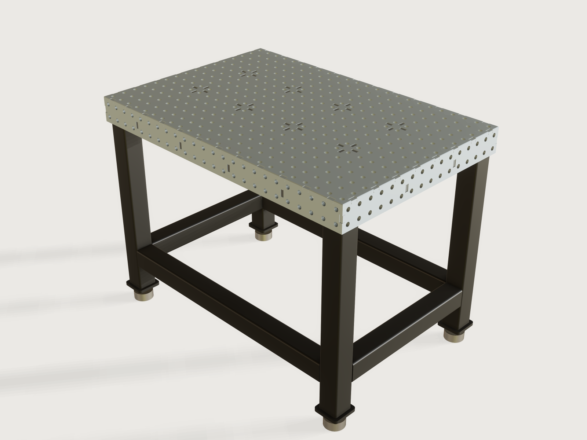

# Welding table

A fixture table you laser cut and MIG weld yourself. Pick the block system your clamps fit (16 mm holes on a 50 or 100 mm
grid, or 28 mm holes on a 100 mm grid), the size and the base, and the form gives a perforated top on a grid of half-lapped
ribs, perforated side plates and a square-tube base: a set of plates to cut, with the sag under your load limited and
the mass measured on the model. The plates meet in plain contact, with one short recessed tab per pitch, so the
welds lie below the datum faces and nothing stands proud.



## What it shows

- **One plate outline, one sketch.** Every part is cut from one sheet thickness. The top's outline carries its edge notches
  in a single profile: `sketch.path` and a chained `sketch.pattern` run one notch and its plain stretch along each edge, so
  its perforated body needs no boolean at all. The skirts and ribs use `sketch.rect`, `sketch.path` and `sketch.pattern` with
  `feature.extrude` `cut` and `join`, `feature.pattern` and `feature.mirror`: the back and right skirts are mirrors of the
  front and left, the ribs are one rib and a pattern.
- **Topology follows the form.** Hole counts, the number of tabs along each edge, the number and position of ribs, and the
  leg, foot and rail features all change with the choices: `table.set` with `choicesFrom`, `feature.when`, formula counts.
- **The top edge.** The outline's perimeter is chamfered 2 mm by intersecting the top with a frustum (`feature.loft`, `intersect`), so the edge break does not depend on how many notches the edge has.
- **Ranges that know the design.** `table_width` starts where the legs and ribs fit, the tab length stops short of the system
  holes, the tab pitch keeps the plain contact along most of the edge, `design_load` ends at what keeps the sag within the limit:
  the form cannot enter a table that cannot be made or welded.
- **The numbers are the model's.** The bending stiffness of the box comes from a `sectionInertia` measure (`variable.measure`) through
  a row of holes on the real bodies, the mass from `variable.measure`, the weld share from a section through the tabs, and
  closed-form volumes of the top and a side plate check the outlines.

A static model is one table; this one is every table a shop would order, with its limits.

## The real thing

**Hole systems.** Two families of fixture tables are widely published. Read from Siegmund's *Systems in comparison*
page [1]: System 16 has Ø16 mm holes on a 50 × 50 mm grid, 11.5–13 mm material, 100 or 150 mm side height; System 28 has
Ø28 mm holes on a 100 × 100 mm grid, 24.5–27 mm material and 200 or 300 mm sides. Their grid page [2] gives 100 mm as the
standard grid for System 28 and 22 and 50 mm for System 16. A Ø16 hole on a 100 mm grid is offered by another maker [3]. This
Jig takes 12 mm and 25 mm plate (stock thicknesses inside those published ranges), the shallower side of each system and these
three rows; it is a generic
system table, not any maker's product. [1] and [3] publish no hole position relative to the edge: here the holes are
centred, half a grid or more from the edge.

**One thickness.** Top, skirts, ribs and foot plates are all one plate (12 or 25 mm), which keeps the plate order simple,
and keeps every slot at least as wide as the plate that fills it. A rib is heavier than it would need to be for stiffness,
and that is the price: this is a judgement, stated, not a rule. One thickness is not one sheet: at the defaults the plates fit
one 3000 x 1500 mm nest, the largest tables need more (their nest is about 3000 x 4100 mm).

**The joints: short recessed tabs.** Between the top and the skirts, and between neighbouring skirts, the plates meet in
plain contact along most of the edge. Every *Tab pitch* (rounded to the hole grid, because a tab sits between two holes) one short
tab of *Tab length* enters a notch in the other plate, and the end of the tab stops *Tab recess* below that plate's outer face:
that pocket is what the MIG bead fills. It lies below the working surface and the side datum faces and grinds flush; nothing
stands proud, and MIG adds the material anyway. At the defaults a 25 mm tab every 100 mm makes 25 % of each edge weld and the
rest plain contact. The
form shows the real share (measured on a section through the tabs) and the total weld length, and its range keeps the share
at no more than 50 %. Tabs and notches sit between the hole columns, and the tab length stops where half a plate of
steel would be left to the nearest system hole (35 mm on the System 16, 50 mm grid).

One web falls below half a plate and the rules cannot help it: in System 16 on the 50 mm grid the skirt's first row of holes
sits 25 mm below the surface, so above a hole only 5 mm of steel is left (25 − 8 − 12), the system's own proportion. For heavy
clamping at those holes, bear that in mind.

Fit: the thread's maker cut 30 mm tabs in 30.1 mm slots in 5 mm plate, "a couple of light taps with a hammer" [8, post 11];
others cut size on size and tap together [8, post 5]. *Tab clearance* is one form parameter, per side, down to 0 (size on
size); SendCutSend suggests more for thick plate, 0.25 to 0.5 mm per side for plate of 1/4 in and thicker [4], so the default is
0.25 mm. Cut a two-tab test piece first, as one poster's designer supplied [8, post 7]. A 25 mm tab in 12 mm plate is a locator, adequate with clamps, and the pocket weld over its 2 mm recess has a
throat of only about 2 mm; the same holds for the 25 mm tab in 25 mm plate. So the inside stitches carry the load, not the
tabs. Laser cutting is what lets a table
like this come out straight without a welding jig: the thread's maker laid a ground ruler along his table and found no light
under it [8, post 11]. That is the only claim made here for the laser.

Real plate is not nominal: the same thread measures a nominal 5 mm plate at 4.85 to 5.1 mm [8, post 14], so 3 % under. *Tab
recess* starts above that: at least 3 % of the plate (0.4 mm on 12 mm, 0.8 mm on 25 mm), default 2 mm, so that a tab can never
reach past the outer face of the plate it enters, even on the thinnest plate. A plate thicker than nominal leaves the recess deeper, never less
deep.

Round dog-bone reliefs (*Beam kerf*, radius = the larger of 10 % of the plate and the kerf: 1.2 mm here, 2.5 mm in System 28)
sit at the inner corners of the notches and slots, turned sideways so they do not thin the steel over the first row of holes, so a
square tab seats although a laser cannot cut a sharp inside corner. SendCutSend [4] gives the reason, writing about router-cut parts
("Without dog bones, square tabs will hit the radius and won't seat fully"); a beam's corner radius asks the same. The
half-lap notches in the ribs have the same clearance and no reliefs of their own.

**Half-lapped ribs.** Ribs are half-lapped where they cross and tabbed into the top and into the skirts with the same tabs: the same
length and the same recess, in pairs either side of every crossing so a tab is never over a lap, and at each end into the skirt.
Ribs come at most about 250 mm apart, rounded to the hole grid, no closer than the torch can reach and the tabs need (a fixed
rule of this Jig, not a parameter). JASS 6 as quoted by Kobelco gives 40 mm as the shortest tack bead on plate over 6 mm
[5]: the default 25 mm tabs are shorter than that, so if your procedure follows it, use a longer tab where the grid allows
it (up to 48 mm on the 100 mm System 16 grid and 75 mm on System 28; on the 50 mm grid the holes stop it at 35 mm).

**How it goes together, and how the torch gets there.** (The welds are sized and ordered by the builder's own judgement
from the sources below; a qualified welder should own the procedure.)

1. Cut the plates with kerf compensation on (Export, below). Deburr by hand: as cut, the holes are the laser's; ream those
   that must locate a pin closely after the table is welded. This Jig does not model that
   step.
2. Lay the top working-face down on a flat strong-back and clamp it down (through the system holes) so that it cannot
   bow while you weld. Set the ribs along in their slots (their laps open away from the top), then the ribs across
   over them (laps towards the top): they mesh, and every tab enters a slot.
3. Slide the front and back skirts onto the top and the rib ends (their tabs enter the notches in the top's edge, the
   ribs' end tabs their slots), then the left and right, their corner tabs into the front and back ends. Everything goes
   in along straight lines; check the diagonals.
4. Still upside down and clamped, tack from the open side: the inside corners where ribs meet the top and the skirts, and
   at the crossings, beside each tab, from the centre outwards and alternating sides, at most 400 mm apart [5]. The pockets
   in the working face are against the strong-back and wait for step 7. Reach: the underside of every cell is open, and every
   cell, the end cells at the skirts included, is at least rib depth + 16 mm wide, so a torch at 45 degrees reaches the corner past
   the opposite rib (the 16 mm clears a 22 mm nozzle on that line; a judgement of nozzle size, see [10]).
5. Still clamped, stitch those inside seams in short runs from the centre out, alternating sides: this is the back-step and
   skip welding TWI recommends for distortion [6], and these stitches carry the load. Let the box cool before moving on.
6. Legs, still upside down. Weld the nut to the top of each foot plate, concentric with its hole (the stud goes in afterwards;
   the hole and nut vent the closed tube while it is welded), then weld the foot plates to the leg ends. Slide each leg into its
   corner against both skirts and the top. Weld the leg's free vertical edges to the skirts, working along the leg from its end;
   the first rib stands at least the leg's width plus 60 mm from the skirt (measured) so the torch fits beside it. The leg top is
   not welded: it bears on the top and the seams carry the leg. Weld the rails between the legs (each has a Ø8 mm vent).
7. Unclamp, turn the table over and stand it on its feet. The mass is in the form: a small table takes two people and a hoist, but a
   System 28 with its legs on, up to about 2.2 t, needs a crane. Sling round the box, never by the legs or their seams, and have the lift
   planned by someone competent. The box is now stiff and
   holds its shape without clamping. Fill the tab pockets on the working surface and on the skirts' outer faces, from
   outside, in small welds, centre outwards and alternating opposite sides, letting it cool between them; welding the top side
   after the inside balances the shrinkage about the neutral axis [6].
8. Grind the pockets flush and check the top with a ground straight edge, as the thread's maker did [8, post 11]. If you need a real machined datum, have the surface faced after welding.

Distortion (TWI [6]): the plates are tacked before anything is welded, and the joints are short. Do not weld a long seam in one
direction. The top stays clamped to the strong-back until the inside stitches are done (steps 2 to 5); the rest is welded with the box
already stiff.

**Strength, as orientation only.** The box is a stiff beam: the section through a row of holes (top with its holes,
skirts, the ribs along) is measured on the model, not assumed, and matches a closed form within 3 %. The sag at the centre adds
the table's own weight, spread over the span, to the stated design load, placed as a point at the centre, over the leg spacing:
δ = (F + 5/8 m g) L³ / 48 E I, E = 210 GPa, with m the measured mass of the top and its box (the legs' weight does not load the span). It stays within
0.15 mm (one maker's flatness figure [3]) or 1/10 000 of the span beyond 1.5 m, whichever is larger (a judgement, a beam model
of a stiff plate grid gives no more than an order of magnitude). A real 4-point supported grid is stiffer than this beam in one way
and softer in others; a machine maker would measure. On four corner legs that limit is why the 16 mm systems stop at 1800 mm
long: a 100 mm deep box of 12 mm plate would sag about 0.7 mm under its own weight at 3 m, and even 0.3 mm at 2.4 m. Longer tables
want a middle pair of legs or a deeper section, which this Jig does not model. The form stops the load at this limit, and
at the legs' share:

Local sag of the plate between ribs under 100 kg (a heavy fixture on one spot) is estimated as a simply supported plate
with k = 0.18 [9] (the table's value for an aspect ratio of 2; the panels here are nearer to square, so this is on the cautious side), reduced for the holes by the ligament efficiency: an estimate.
Each leg carries a quarter of the load and the measured mass. The form's cap takes the least of a maker's per-leg rating of
1000 kg on System 16 and 2000 kg on System 28 [1], and, divided by 3 as a judgement for someone qualified to verify, Euler buckling,
yield of the tube, the leg-to-skirt seams (two fillet seams of 0.7 × the wall, EN 1993-1-8's 207.8 MPa for S235 [14]) and the
foot stud. Each foot is an M16 stud (System 16) or M24 (System 28) in a nut welded inside the tube; the 17 mm or 25 mm hole in the
foot plate is a clearance hole, at least the plate's thickness (§ laser rule), and the stud's stress area (157 and 353 mm² [13]) at
235 MPa is the foot's load. The welded-nut joint and the feet's own rating belong to whoever builds it; check the feet you buy. Sideways sway under a 1 kN push is estimated from the legs alone, as cantilevers from the box, with the
lower rails treated as holding the feet together: at the defaults about 0.125 mm. The figure is a floor, not a promise,
since a rail joint is not rigid; rails near the floor do little for sway, they carry the load path and the forks.

**How it is lifted.** The mass is measured on the model (227 kg at the defaults, about 2.2 t for the largest table in the
range). With the lower frame, the rails stand 180 mm above the floor (fixed), so forks can go under them; a typical hand pallet
truck lowers to 85 mm and lifts to about 200 mm [11], so it can raise the table a little, and forks of 1150 mm reach across
a table up to about that wide. Slinging or lifting eyes
are not modelled: M16 DIN 580 collar eye bolts through corner holes (700 kg axial working load [12], axial only, which
means a lifting beam) is one real option, but check the thread reach and the plate with someone who signs for lifts. Without
a lower frame the forks go under the skirts.

Tipping: the form shows the push at working height that would tip the empty table over its feet (about 959 N at the defaults, over the outer edge of the foot pads); the width starts at
half the working height so a narrow, tall table cannot be entered. On top of that, a table with a load overhanging its edge tips more easily.

**Steel.** S235 plate 7850 kg/m³. Square hollow sections are EN 10219 sizes; the section area uses the standard's corner
formula, and the moment of inertia is scaled from it; against one supplier's EN 10219 table [7] 80×80×5 gives 14.4 cm² and
135 cm⁴ against the listed 14.4 cm² and 131 cm⁴, so the leg stiffness is about 3 % high. Bare ground steel is shown for the plates, a
black powder coat for the base.

At the defaults (System 16 on 50 mm, 1200 × 800 mm, 900 mm high, legs and frame, 80 × 80 × 4 mm tube, ribs at most
250 mm apart, 500 kg): 384 holes in the top and 160 in the sides, 4 ribs across and 2 along, 227 kg, sag 0.09 mm long way and
0.015 mm short way with the load and own weight, largest load the form allows 820 kg, 25 % of each edge welded, 2.2 m of weld at the tabs in all.

Sources, and what was actually read: [1] Siegmund, *Systems in comparison*,
https://www.siegmund.com/en-us/Product-Information/Product-Information/Systems-in-comparison (read: bore, grid, thickness, side
height, load per leg). [2] Siegmund, *Borehole grid and scaling*, https://www.siegmund.com/id/Borehole-grid-and-scaling,3575.php (read:
grids). [3] GPPH, *Traditional welding table*, https://gpph-group.com/en/products/traditional-welding-table (read: 16/28 mm, 50 and
100 mm grids, flatness ≤0.15 mm). [4] SendCutSend, *Mastering tab and slot design*,
https://sendcutsend.com/blog/mastering-tab-and-slot-design-for-efficient-metal-fabrication/ (read: clearance per side, dog-bones). [5]
Kobelco, *ABC of arc welding*, https://kobelco-welding.jp/education-center/abc/ABC_2003-01.html (read: JASS 6 table, tack length and
pitch). [6] TWI, Job Knowledge 36, https://www.twi-global.com/technical-knowledge/job-knowledge/distortion-control-prevention-by-fabrication-techniques-036 (read: back-step, skip,
balanced welding, tack spacing). [7] Murray Steel Products, EN 10219 cold-formed SHS,
https://murraysteelproducts.com/offers/structural/cold-formed-square-hollow-sections (read: table rows; the standard itself was not).
[8] mig-welding.co.uk forum, *Fusion 360 tab & slot welding table*, https://www.mig-welding.co.uk/forum/threads/fusion-360-tab-slot-welding-table.99241/ (read page 1, posts as numbered there). [9]
Roymech, *Plates*, https://roymech.org/Useful_Tables/Mechanics/Plates.html (read: coefficient table; the formula form follows
Roark, a secondary reference). [10] Torch nozzle sizes vary by torch; suppliers list MB 36 nozzles from 12 to 20 mm (search summary, not a
single data sheet: this Jig's 22 mm is a judgement). [11] Hoffmann and BITO pallet truck data sheets (search summary: lowered 85 mm,
raised 200–205 mm, fork length 1150 mm, width over forks 540 mm). [12] S3i, *Lifting eye bolt DIN 580*, https://www.s3i.co.uk/lifting-eye-bolt-ce-marked-stainless-steel.php (read: 700 kg WLL M16, axial). [13] Hexagon nuts ISO 4032 (Würth listings read in a search summary: M16 across flats 24, height 14.8 mm; M24 across flats 36, height 21.5 mm; the model uses 15 and 22 mm), stress areas 156.7 mm² for M16 and 352.5 mm² for M24 (Engineers Edge table, via a search summary; the formula A = π/4 (d − 0.9382 P)² gives the same). [14] EN 1993-1-8 simplified method: f_vw,d = f_u / (√3 β_w γ_M2) = 360 / (√3 × 0.8 × 1.25) = 207.8 MPa for S235 (search summary of IDEA StatiCa and structuralbasics.com; the standard itself not read).

## Parameters

| Group | Parameter | Default | Range | What it changes |
|---|---|---|---|---|
| Size | Block system | System 16, 50 mm grid | System 16 on 50 or 100 mm, System 28 on 100 mm | Bore, grid, plate, all joints, the maximum size |
| Size | Table length | 1200 mm | 800 mm to 1800 mm on the 16 mm systems, 3000 mm on System 28; step 50 mm | Hole columns, tabs, ribs across, mass |
| Size | Table width | 800 mm | half the working height (tipping), 400 mm, 800 mm on the 50 mm System 16 grid when it is longer than 1700 mm (stiffness), or what the legs and ribs need, to 1200/1500 mm; step 50 mm | Hole rows, tabs, ribs along |
| Base | Working height | 900 mm | 650 to 1000 mm, step 10 mm | Leg length, sway, buckling length |
| Base | Base | Legs and lower frame | Top only, Four legs, Legs and lower frame | Structure and how it is lifted |
| Base | Leg section | SHS 80x80x4 | 17 EN 10219 square hollow sections (40×40×3 to 120×120×6; on System 28 from 50×50×3, where the M24 foot nut fits) | Stiffness, capacity |
| Strength | Design load | 500 kg | up to what keeps the sag, with its own weight, and each leg, foot and seam within their limits | The sag and leg load shown |
| Joints | Tab length | 25 mm | 20 mm (or the plate) to what the holes leave: 35 mm, 48 mm on the 100 mm System 16 grid, 75 mm on System 28 | Length of every weld |
| Joints | Tab pitch | 100 mm | The hole grid (at most half the edge weld) to 400 mm, step 50 mm, rounded to the grid | Number of tabs, the weld share |
| Joints | Tab clearance | 0.25 mm | 0 (size on size) to 1 mm per side, step 0.05 mm | Notches and slots |
| Joints | Tab recess | 2 mm | 3 % of the plate to half the plate, step 0.1 mm | How far a tab stops below the outer face |
| Joints | Beam kerf | 0.4 mm | 0.1 to 1.2 mm, step 0.05 mm | Radius of the reliefs |

Outputs: mass, holes in the top and sides, sag long and short way with its own weight and the sag from own weight alone, local plate
sag, load per leg, leg capacity, sway under a 1 kN push, the push that tips it, leg and rail lengths (the saw list), fork clearance, ribs in each direction, the largest load the form allows, the weld share of the plate edges and the
total weld length.

## Checks

44 assertions at every change of the form (legs and rails only when the base has them):

- **Holes:** counts measured against columns × rows, and rows × perimeter in the skirts; the first and last hole of the top and of the front and left skirts stand on the grid (found by position); each foot plate hole is at least the plate's thickness.
- **Plates, closed form:** volume of the top and of the front skirt against their closed forms (holes, notches, slots,
  reliefs, pockets, slots for the rib ends).
- **Relief radius:** every small round in the top has a radius between the kerf and the relief radius, and there are as many
  as the notches and slots require.
- **Tabs:** a section through the tabs of the front and left skirts is tabs × tab length × plate exactly, which gives the
  measured weld share; the plain contact stays the larger part of the edge (at most 50 % weld). A tab's flank keeps the clearance in
  its notch, on each of the four edges of the top, and a rib tab in its slot (ribs in both directions), measured.
- **Recess, measured:** the top of the skirts and ribs, and the ends of the corner tabs and rib end tabs, stand exactly the recess
  below the outer face; no part but the top reaches within 3 % of the plate of the working surface.
- **Locating:** the skirt's top edge runs plain under the top (full length just below it, and the top's underside at the plate
  thickness), the front skirt's inner face is one plate in from the outside; the tab flank and rib tab distances fix the other
  direction. Each of the four edges of the top has its own path and its own tab flank check.
- **Assembly:** no two parts overlap (front and left skirts, ribs, legs, rails and feet; the back and right are mirrors, and the top is checked through the volumes and distances above).
- **Weld access, measured:** ribs stand at least rib depth + 16 mm apart (extent over each rib set); at all four sides the
  end cell is at least rib depth + 16 mm wide and the first rib stands at least the leg's width + 60 mm from the skirt.
- **Structure:** the box section through a hole row within 3 % of the closed form; sag within the limit; each leg within its
  capacity; legs as long as the cut list says, against both skirts and touching the top; the rails between the legs.
- **Sheet:** the top fits a 3000 × 1500 mm sheet.
- **Forks:** the rails' underside stands exactly at the fork clearance above the floor.

`check-range` passes 117 of 117 points (defaults, corners, every choice, 32 random), none unproven, slowest 3.88 s on a busy machine. Tried by hand on top of that with `param.set`: 144 combinations of system, smallest, largest and off-grid sizes, top-only and framed bases, smallest and largest leg section, long and short tabs, clearance 0 and 1 mm, recess at both ends of its range, largest kerf: 102 built and passed, and 42 were refused by the ranges as they should be (a leg too narrow for the M24 nut on System 28, or a tab too long for the holes at a large clearance). Mutation tests in a scratch copy, each noticed by an assertion: skirt, corner and rib tabs not stopping at the recess, narrower tab, wider notch, notches on each edge of the top and across-rib slots moved 5 mm, skirt holes moved 5 mm, hole pitch 0.5 mm long, skirt edge 1 mm low, shallower ribs, first rib towards the skirt, rail lowered 90 mm and raised 30 mm, wider top holes, smaller reliefs, leg off the skirts.

Measured only while the machine was busy with other builds (load average about 60 on 14 CPUs), so these are upper figures for the coordinator to re-measure. Budget for a complex Jig: 4 s, 12 s CPU, 12 s worst point. Opening the defaults takes 3.6 s (5.6 s CPU). A saved 1800 x 1200 mm System 16 table takes 7.4 s (10.2 s CPU), 10.0 s (13.6 s CPU) with a tab at every grid pitch, a 3000 x 1500 mm System 28 table 6.0 s (9.8 s CPU); the range check's own slowest point was 3.88 s.

Not checked: that a real weld reaches the penetration a recess suggests, and the behaviour of the joint under load: those belong to the welder and the engineer.

## Export

- **The plates:** File › Export…, DXF or SVG, *Sheet of set: Plates to cut*: every plate at true size, in the model's own
  shape, one layer per body (the top, four skirts, the ribs and the foot plates). Send it with **kerf compensation on**, as
  every plate laser does; the Jig's Beam kerf is for the reliefs and checks, not an offset. `cut.export` with its own kerf works on
  the top and skirts, but not on the ribs and feet (they are a pattern: J-010), so it is not offered here. Set a `width` to fold it onto a sheet.
- **STEP:** File › Export…, STEP: the whole table.

## Files

`build.json` is the source. `meta.json`, `README.md`, `formtest.md`, `preview.png`.

## Rebuild

```sh
tools/jigs.py build welding-table
tools/jigs.py render welding-table
tools/jigs.py check welding-table
```

## Difficulty

7 out of 10. Many coupled formulas and tab topology across parts, with process checks.

## Platform notes

- `cut.list` and `cut.export` find the top and skirts as plates but not the ribs and feet, which are patterns of plates
  ([J-010](../../3DCRAFT-FEEDBACK.md)): the cut sheet is therefore a named face set, and kerf compensation stays with the
  cutter's software.
- The chained `sketch.pattern` of the top's outline ends on an image point, which `sketch.path` refuses as a start (J-008): a `sketch.line` starts the next piece.
- The extrusion inside an extrude with `cut` or `join` cannot be named (F-002 in the examples' feedback): the eight
  `Extrude<n>` names the build reports are those tools.
- Hole rim chamfers were tried and dropped. `feature.chamfer` and `feature.fillet` take edges by named face pairs, not a
  query, so a varying number of hole rims cannot be chamfered (the same request as F-088 in the examples' feedback), and a
  countersink pattern subtracted as cones ([J-049](../../3DCRAFT-FEEDBACK.md#j-049-hole-rims-of-a-varying-count-cannot-be-chamfered-cheaply-and-a-countersunk-plate-is-no-plate-to-cutlist-see-f-086-f-088))
  costs more than 1 s of CPU on 384 holes and makes the plate unreadable by `cut.list`. The holes stay as cut and are
  deburred by hand; the outer edge of the top is chamfered (a frustum, see above).

## Licence

[CC BY 4.0](../../LICENSE-CC-BY-4.0.md); credit line in the [README](../../README.md#licence).
