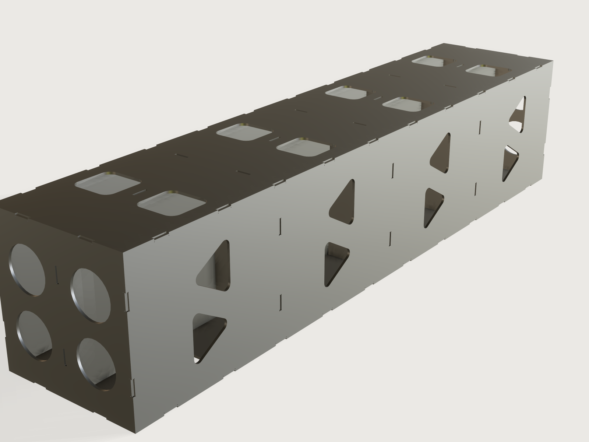

# Welded plate box

A rectangular box, cube or beam of laser-cut steel plate, from 3 mm up and up to 3000 mm each way, as a building block for
machines, where a standard profile falls short. Six plates meet in plain contact along their edges, short tabs with their
ends recessed below the mating face hold the weld, an egg-crate of half-lapped ribs slides inside, and openings of four
kinds follow each wall. Tab and slot from the laser hold the box straight and square while it is welded.



## What it shows

- **One sketch per plate, its tabs a chained pattern** (`sketch.pattern` with `chain`): every edge is a run of equal cells,
  closed at any count, so a plate is one sketch and one extrude, with no boolean per tab.
- **Ribs that sort themselves by the box.** Ribs always stand across the box's shortest side; the two families run along
  the other two sides. Built once in a frame of their own and placed by formula (`feature.transform` with an angle and an
  axis that follow the shape).
- **Openings that follow the wall.** `feature.when` switches each pair of walls between none, rectangles, rounded
  rectangles, circles and a truss of triangles; the size and count come from the wall and the ribs.
- **`feature.mirror`** makes the second plate of each pair, so the pairs are identical parts.
- **Formula ranges** keep every joint possible: the tab length and pitch follow the box's edges, the recess follows the
  plate, the plate follows the box.
- **Outputs a maker uses:** mass, the plate list with the largest plate against your sheet, weld length and weld share, and the stiffness of the section.

## The real thing

**The joint.** Plain contact everywhere, except one tab per pitch. The top and bottom plates cover everything; the front
and back cover the left and right; each lower plate's tab reaches through a notch in the plate above. A **dog-bone** at
every inside corner lets a square mate seat against the corner a laser leaves round; it is sized for a kerf up to 0.4 mm.
There is no kerf on the form on purpose: the cutter's kerf compensation puts the cut on the drawn line, and the *Tab clearance* sets the fit. The tabs and notches locate each plate along
its edges (the tab flanks), across (the notch floors) and against the neighbouring plate (plain contact). Only a plate
lifting off outward is not held by the cuts: clamps or the first tacks do that.

**Tab recess, and why nothing sticks out.** Every tab ends the *Tab recess* below the outer face of the plate it enters,
so it can never stand proud, even on a thin plate. Plate sold as 5 mm can measure 4.85 to 5.1 mm ([thread](https://www.mig-welding.co.uk/forum/threads/fusion-360-tab-slot-welding-table.99241/), #14, cianh91), 3 % below
nominal: the form's minimum recess, the larger of 0.3 mm or 5 % of the plate plus 0.1 mm, covers that with a margin. Its maximum, the smaller of 0.6 of
the plate or the plate less 1 mm, leaves at least 1 mm of tab engaged. Default 2.5 mm, for a 5 mm plate: it is what the weld fills. Every joint, ribs into walls included, has it
(asserted). The tab's whole length is the weld length: at the default, 30 mm per 130 mm pitch.

There is no code value for a joint like this. The 3 mm minimum effective throat of a fillet weld (EN 1993-1-8 §4.5.2(2),
[read here](https://www.ideastatica.com/support-center/check-of-welds-according-to-eurocode)) and of a partial joint penetration groove on plate up to 6 mm (AISC Table J2.3, [read here](https://steelcalculator.app/reference/weld-joint-types/)) would mean a recess of 4.3 mm or more; a thin plate with a shallow recess is under that, and a weld in a thin plate is a judgement and a test piece, not a code number.

**Clearance.** One value for all tabs, in the form, from 0 (size on size) up. A
[welding table in the same thread](https://www.mig-welding.co.uk/forum/threads/fusion-360-tab-slot-welding-table.99241/) had 0.1 mm: "a couple of light taps with a hammer" (#11, BelgiqueB; 30 mm tabs in 30.1 mm slots, #1). Measure your plate:
one that is thicker than nominal needs more. SendCutSend suggests 0.25 to 0.5 mm per side above 6 mm ([read](https://sendcutsend.com/blog/mastering-tab-and-slot-design-for-efficient-metal-fabrication/)); the form goes to 1 mm in total.

**Ribs.** An egg-crate of two families crossing, half-lapped like the [ribs of the welding table](../19-welding-table/): each rib is cut to half its height where it crosses another, one family from the top and one from below, a notch of the plate plus the clearance wide with dog-bones at the bottom. Which way: the ribs stand across the box's shortest side, so they are as low as they can be; the families run along the other two sides. *Ribs along the longer side* sets the count of the first family; the second follows at about the same spacing (0 for none). They enter the walls they touch with tabs of the same length, recess and clearance as the walls have; along a rib's length there is one tab per bay, along its height up to five at the pitch, so a rib does not follow the *Tab pitch* everywhere. The openings are centred between the ribs in each wall, so no rib lies behind an opening, and their size shrinks to the bay if it must.

**Openings** of each kind can always be had, at every wall the form accepts: the opening size follows the wall (aiming at the larger of 60 mm or 12 % of the longest side, limited by the wall and the ribs, never under 15 mm), the count falls down to one, a truss down to one pair (it runs along the wall's longer side, or along the side without ribs where the ribs cross it one way), with a web of at least the larger of 3 x the plate and 12 mm, and a quarter of the opening where the ribs leave room for it (a truss on a ribbed wall keeps the smaller web); the minimum box size and the plate limit are set for it, and checked on a grid of the smallest walls.

**What the cut edges do.** The cut edges and the slots in line hold the plates straight and square while the box is welded. That is all that is claimed: the model does not predict weld distortion. To keep the box straight, keep the tabs short and follow the sequence.

**Assembly and weld sequence.** Lay the base flat on a table: the wall across the shortest side that the first rib family's half-laps face away from (bottom, or back, or right, for the shortest side being height, depth or width). Stand the first family of ribs in their slots, half-laps up, lower the second family over them, its half-laps down. Bring up the other walls one by one along their own normals (every notch and tab allows it), then the last wall over the ribs' tabs. Clamp square on a flat reference. Tack the tabs at the middle of each long edge first, then outward, opposite corners and opposite faces in turn; weld the ribs' tabs through the walls last, short runs, cooling between, from the middle outward. Check, and machine or shim what must be flat.

**Stiffness, and no strength figures.** The form gives the mass (7850 kg/m³, every plate and rib), EI about both axes and GJ, for the section across the longest side. EI comes from the second moments of the walls, which the model measures and an assertion holds to the closed form; it counts the walls as one section, so it assumes the seams carry the shear between them, and it leaves out the openings and the ribs. GJ is Bredt's formula 4 A² t / perimeter for a **fully closed** section. It is an upper bound and nothing checks it on the model: the walls are separate plates that only touch, so `measure.section` sees four open plates (J = 38 276 mm⁴ at the defaults, against Bredt's 1.28e8), and only about 21 % of the seams are welded. The real value lies between the two and depends on your welds.

This Jig gives no strength figures: no load, stress, buckling or deflection under a load, because a short recessed weld, openings and a machine's own load paths are beyond what a form can answer. Whoever builds a machine frame from it must have the frame and its welds checked by a qualified person, on the machine's real loads.

**Plate size.** A plate is as large as the box's sides: the outputs give the longest side and the shorter side of the largest plate. Laser beds and sheets are commonly about 3000 x 1500 mm (ask your cutter); a 3000 x 3000 mm wall does not fit one. This Jig does not splice plates: for a wall beyond the sheet, plan a butt joint yourself, or keep the box within the sheet.

## Parameters

**The box:** *Width*, *Depth*, *Height*, each 100 to 3000 mm; *Plate thickness* 3 to 12 mm, less on the smallest boxes.

**Tabs and welds:** *Tab length along the edge*; *Tab pitch*; *Tab clearance* 0 to 1 mm; *Tab recess*, from the plate's tolerance up to what still leaves the tab engaged.

**Cutouts and ribs:** *Top and bottom*, *Front and back*, *Left and right*, each none, rectangles, rounded rectangles, circles or triangles; *Ribs along the longer side*, 0 to what the box allows.

Twelve in all. Steel only, at 7850 kg/m³ (the aluminium and S355 of the old form were dropped to stay at twelve).

## Checks

Sixty-two assertions (those of absent shapes and ribs are off). Measured on the model: every plate's and rib family's volume against its closed form (tabs, notches, slots, half-laps, reliefs, openings), so a wrong count or depth shows; the mass against the closed form at 7850 kg/m³, every plate and rib; the box's outside size; every tab end the recess below the outer face it enters, walls and ribs alike, so nothing stands proud; tab and notch flanks and notch floors where the clearance puts them; the walls' plain edges against their neighbours; every dog-bone, wider than the assumed kerf; the first opening of each kind where its grid puts it; the second moments of the walls against the closed box. Overlap between plates and between the two rib families, when there is clearance and at most 160 welds (above that the check costs seconds; at 0 clearance 3DCraft cannot prove it, Platform notes). Rules on the sizes: at least 1 mm of tab engaged, tabs clear of the half-laps, weld share between 3 and 50 %, and each opening asked for fitting its wall without being forced up to the 15 mm floor. GJ is not checked by anything (see Stiffness).

Ribs are limited to keep the regeneration light: at most 12, a bay of at least a seventh of the longest side, at most 5 tabs along a rib's height.

Mutation test in a scratch copy, 17 of 17 caught: a tab proud or too deep, a narrow or deep notch, small dog-bones, cells out of step, a plate short or too thick, openings moved or enlarged, a truss moved, rib tabs proud, a shallow half-lap, a rib too few, rib slots out of step, ribs placed off, a rib family at the wrong density.

The smallest walls, by a scan of 485 combinations (twelve box sizes from 100 mm, every plate thickness the form allows, every opening, no ribs, one rib and the most ribs allowed): all build, all assertions pass, every shape asked for has at least one opening.

`tools/jigs.py check` runs `check-range`: 109 points (the defaults, 64 corners, every choice, 32 random from seed 1), all passing, none unproven; slowest 0.89 s, mean 0.21 s, load 0.68 s and 2.31 s of CPU (`meta.json`; budget for a complex Jig: load 4 s, CPU 12 s, slowest point 12 s). A second run from seed 7, 137 points, passed too.

Not checked by any assertion: the weld as made, the plate's real thickness against the clearance, anything after welding, and what the box will do once it is bolted to something.

## Export

File › Export…, **Sheet of set** in DXF or SVG at true size: *Cut: top and bottom*, *Cut: front and back*, *Cut: left and right*, *Cut: ribs, first family* and *second family*, each one plate, tabs, notches, reliefs, slots and openings in one outline. STEP exports the whole box. The outputs are the plate list, ribs included, with how many of each. `cut.list` is not the plate list: it lists the six walls and a rib family only when that family has a single rib (J-010). Use the cutter's kerf compensation.

## Files

`build.json` (the source), `meta.json`, `formtest.md`, `preview.png`, and `welded-box.3dcraftjig`, `thumb.png` from the tool.

## Rebuild

```sh
tools/jigs.py build welded-box
tools/jigs.py render welded-box
tools/jigs.py check welded-box
```

The tool needs the 3DCraft build this repository is pinned to: see
[Building and checking](../../README.md#building-and-checking) in the README.

## Difficulty

7 out of 10. Coupled formulas, ribs re-oriented by the shortest side, cross-body checks and kernel limits.

## Platform notes

- `measure.overlap` cannot always tell touching plates apart at zero clearance, through `param.set` ([reproducer](../../findings/J-025-overlap-touching-plates/repro.json), in the family of F-130): the overlap checks are off at 0 clearance.
- `measure.section` treats plates that only touch as separate open sections, so the torsion of a welded box cannot be confirmed on the model (it also failed to mesh on a 2 m x 100 mm beam, while a 3 m cube measured); GJ is therefore a formula and an upper bound.
- A face colour cannot follow a choice (F-171), so cut edges are not picked out. The tool of a `feature.extrude` with `cut` cannot be named, so the build warns about those names.

## Licence

[CC BY 4.0](../../LICENSE-CC-BY-4.0.md); credit line in the [README](../../README.md#licence).
