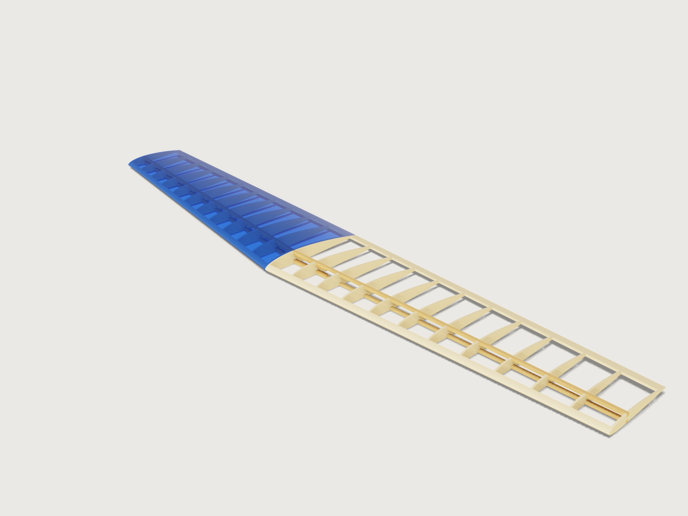

# Built-up RC wing

A strip-built balsa wing for a radio-controlled model, from what the aeromodeller decides first: the span, the root and
tip chords, the NACA digits, sweep and washout, how many ribs and how heavy the flying model will be. The Jig cuts every
rib from a loft of the true airfoil with its spar slots, adds spars, leading and trailing edge stock and ply joiners glued to the spars, and lays the
ribs flat for the laser. It refuses a tip so thin that the spar slots would leave no web, and it tells you the wing area,
aspect ratio, mean aerodynamic chord and where it lies, wing loading and stall speed. One half of the wing wears blue
film; the other half stays open so you can see the frame.



## What it shows

- **A formula airfoil** (`sketch.curve`): one closed curve from the NACA 4-digit equations, the parameter t running from
  the lower trailing edge through the nose to the upper trailing edge (x/c = t²), with the surface offset
  perpendicular to the mean line, and turned by the washout about the quarter chord. The form's digits go straight
  into the formula.
- **Every rib cut from a lofted wing by a pattern of plates** (`feature.loft`, `feature.pattern`, `feature.boolean`):
  a solid wing between the root and tip sections, trimmed to the zone between the edges and with the spar slots and joiner
  pockets cut, then intersected with a pattern of plates: one rib per plate, at its true chord and twist (the loft is ruled, so a rib between root and tip is the straight-line blend of the two sections; at 6 degrees of washout that differs from a truly rotated section by about 0.2 mm along the chord).
- **The ribs count, not only their size** (`feature.pattern` count from the form), and the covering is a choice:
  a bare frame or film on one panel (`when`).
- **The numbers of the aeromodeller** as outputs (`variable.output`, `variable.measure`): wing area, aspect ratio, mean
  aerodynamic chord and its position, wing loading, stall speed, Reynolds number at stall, rib spacing, frame mass,
  and the lengths of spar and edge stock.
- **A cut sheet without picking anything**: the named face set `Cut sheet` holds one face per rib, both panels, and
  exports through `file.export` as SVG or DXF, laid out to a sheet width.
- **Ranges that know the structure** (`variable.publish` with formula limits): a tip chord that would leave less than
  4 mm between the top and bottom spar slots cannot be set, and the form names the smallest that can. The same formula
  keeps the spar depth, the thickness digits and the root chord consistent, and the rib count stays between about 30 and
  110 mm of spacing for any span.

A plan drawn once is one wing. This one is any straight-tapered built-up wing of its range, and it says when the wing you asked for
cannot be cut.

## The real thing

**The airfoil.** The NACA 4-digit section. The camber line and thickness formula are the classic ones; the coefficients
a0 = 0.2969, a1 = -0.1260, a2 = -0.3516, a3 = 0.2843, a4 = -0.1015 were read in NASA TM-4741, Ladson, Brooks, Hill and
Sproles, *Computer Program To Obtain Ordinates for NACA Airfoils* (1996); the thickness is laid off perpendicular to the mean line. The model moves a4 to
-0.1036, the sum of the others, so the section closes exactly at the trailing edge: one closed curve the loft can use. This is the Jig's
own change: the difference from the published thickness grows towards the trailing edge, and the trailing edge stock (at least 14 mm deep, or 12 % of the tip chord) stands in for the rib over the last few percent.

An independent script (Python, not part of this Jig) reimplemented the equations and compared them with the ordinate tables of
NACA Report No. 824, *Summary of Airfoil Data* (Abbott, von Doenhoff and Stivers, 1945), Appendix I, report page 100 (NACA 2412, 1412 and 0009, read from the scanned page). With
a4 = -0.1015 the formula matches the table within 0.018 % of chord (the table is rounded to 0.01 %). With the Jig's -0.1036 the largest difference is 0.11 % of chord, at 95 % chord, near the trailing edge. The model itself, read with `measure.ray` on the root rib of NACA 2412 at 200 mm chord, stations 7.5 to 80 % of chord, is within 0.051 % of chord (0.10 mm) of the published table. The tables in *Theory of Wing Sections* by Abbott and von Doenhoff are the same sections; that book was not consulted directly.

**The wing's numbers.** Wing area S = span × (root + tip) / 2, aspect ratio span² / S. Mean aerodynamic chord MAC = (2/3) × root × (1 + λ + λ²) / (1 + λ), λ = tip / root, the
formula as printed on [Airfield Models](https://airfieldmodels.com/information_source/math_and_science_of_model_aircraft/formulas/mean_aerodynamic_chord.htm) (an aeromodelling reference), which leaves the spanwise position to a graphical construction; that position,
ȳ = (span / 6) × (1 + 2λ) / (1 + λ) from the root, and the trapezoid identity that the chord there equals the MAC, were derived from the definition MAC = (2/S)∫c²dy
([Wikipedia, Chord (aeronautics)](https://en.wikipedia.org/wiki/Chord_(aeronautics))), and the model measures that identity (see Checks). The sweep moves the MAC's leading edge back by ȳ·tan(sweep). Wing loading W/S is shown in grams per square decimetre, the aeromodeller's unit.

**Stall speed.** The lift equation L = Cl·(ρ V² / 2)·A ([NASA Glenn](https://www1.grc.nasa.gov/beginners-guide-to-aeronautics/lift-equation/)) solved for V with lift equal to weight: V = √(2W / (ρ S CLmax)), sea-level
air density 1.225 kg/m³ and kinematic viscosity 1.4607 × 10⁻⁵ m²/s ([International Standard Atmosphere](https://en.wikipedia.org/wiki/International_Standard_Atmosphere)).
The maximum lift coefficient is the Jig's stated value of 1.0, and it is an estimate, not a test: the low-speed wind tunnel data of Selig et al. (*Summary of Low-Speed Airfoil Data*, Vol. 2, Appendix B, NACA 2414, runs 774 to 778) show the section reaching about 1.05 to 1.07 at Reynolds numbers of 60 000 to 200 000, and a whole wing reaches somewhat less than its section. A real figure depends on your wing and your Reynolds number, which the form shows. Treat the stall speed as a guide to a landing speed, not a flight test.

**The structure.** Ribs: laser-cut balsa sheet, one per station of the pattern, in the plane of the flight direction (they follow the taper and sweep as a parallel-rib planform). Spars: a top and a bottom spar, in slots at 30 % of chord (the deepest part of the section), straight from root to tip, flush with the surface there. The stock (the form's table of common sizes) lies across the rib: a swept spar crosses each rib at an angle, so the slot in the rib is wider than the stock by the sheet thickness times the tangent of the spar's sweep, or the spar would not pass through a straight-walled laser slot. The leading edge is a balsa strip 4 % of root chord or 6 mm deep, sanded to the section; the trailing edge is stock 12 % of tip chord or 14 mm deep. The wing is joined by two flat, V-shaped birch ply straps, one glued to the underside of the top spars and one to the upper side of the bottom spars, each crossing the centre of the wing and reaching 1.5 rib bays into each panel: bending passes from spar to spar through the straps (joiner thickness: half the spar depth, 1.5 to 3 mm of ply). The ribs they pass are not cut through: the spar slots of those ribs are simply deeper by the joiner's thickness, and each strap follows its spar, so sweep and taper cannot take it out of the wing. A strap is cut flat and bent to the slight V of the spars (up to about 3 degrees each side, from the taper) when glued; the flat outlines are the sketch `Joiner flat pattern`. Frame proportions (the 30 % spar station, the edge depths, the 4 mm minimum web) are this Jig's own judgement, based on common practice for sport models; they are not from a standard.

**Laser.** Balsa sheet; a slot in the file is drawn narrower than its finished size by the laser kerf of 0.15 mm, with a fit clearance of 0.2 mm in the finished slot (both document variables, `laser_kerf` and `slot_fit_clearance`: the form is at its limit of twelve parameters, so change them there if your laser needs another kerf). A rib outline is drawn at true size and so comes out half a kerf small, which the sanding of a built-up wing takes up. The sheet exports with every rib at true size; 3DCraft has no way to number a part of a pattern, so the file has no rib numbers: the ribs come out in order from the root to the tip for each panel (see Platform notes), and a rib's chord says where it goes (neighbours differ by the taper divided by the rib bays, 6.3 mm at the defaults; on an untapered wing all ribs are the same, and on a near-untapered one sort them on the bench by the outline against the root rib). Glue the ribs on a straight board with the spars pinned to the plan.

**Making it.** Cut the ribs, and the joiner in thin ply. The straps cross the centre, so build the two panels together on one board: pin the two bottom spars end to end, lay the bottom joiner across their joint, on the spars' upper faces, and drop the ribs on from above (the slots are open, the inner ribs' slots are deeper and take the strap too). Glue, lay the top joiner into the top slots of the inner ribs, then the two top spars onto it, then the leading and trailing edge stock. Sand the leading edge to the section. For the washout, build on a flat board with the bottom spar pinned down and pack the tip trailing edge up by the output *Washout packing* (0.7 × tip chord × sin washout, 3.2 mm at the defaults), tapering to nothing at the root, so the tip stalls last. Cover with iron-on film. Materials are as listed in the meta: balsa 150 kg/m³ (an average of the sheet grades we consider typical), spruce 450 kg/m³ and birch ply 680 kg/m³ are this Jig's judgement, used only for the frame mass output. The Jig computes no strength: spar size, joiner length and how much load the wing takes are the builder's judgement; a model flying at high speed or with a heavy load must be checked by someone who can (a flying model that fails in the air is a danger to people below it).

## Parameters

**Wing**
- *Wing span*: 600 to 2000 mm, tip to tip (a little more with the deepest spars, which need a deeper root).
- *Root chord*: at least 100 mm, one twelfth of the span, and what the spar depth and joiners need, up to 400 mm or a 3.5:1 span to chord.
- *Tip chord*: from 45 % of the root chord, or the smallest tip that keeps a 4 mm web between the two spar slots and a 4 mm web between the joiner pockets at the inner ribs, up to the root chord.
- *Leading edge sweep*: 0 to 30 degrees.
- *Washout*: 0 to 6 degrees, the tip nose down.

**Airfoil**
- *NACA camber digits*: from a table: 00xx symmetric, then 12xx to 16xx, 22xx to 26xx ... 62xx to 66xx (first two digits of the code; 24xx is 2 percent camber at 40 percent chord).
- *NACA thickness digits*: the last two digits, 8 to 18 percent, at least what the spar depth and root chord need.

**Structure**
- *Ribs per panel*: the number of ribs in each half, tip and root ribs included, from a spacing of about 110 mm to about 30 mm, at most 24.
- *Rib sheet thickness*: 1.5 to 4 mm (no thicker than the spar is wide, so the laser cuts the slot).
- *Spar stock*: from a table of six common sections, 3 × 6 to 10 × 3 mm.
- *Covering*: a bare frame, or blue film on one panel with the other open.

**Performance**
- *Flying weight*: all up, from 15 to 150 g/dm² of the wing's area, a range for a sport model.

At the defaults (1200 mm span, 200 and 130 mm chords, 6 degrees sweep, 2 degrees of washout, NACA 2412, 12 ribs per panel, 3 mm sheet, 5 × 5 mm spars, 950 g, film on one panel): wing area 19.8 dm², aspect ratio 7.27, MAC 167.5 mm at 278.8 mm from the root with its leading edge 29.3 mm behind the root's, wing loading 48.0 g/dm², stall speed 8.8 m/s (31.6 km/h) at CLmax 1.0, Reynolds number 100 000 at stall, rib spacing 54.3 mm, frame mass 70 g (without covering or glue), washout packing 3.2 mm, leading edge stock 603 mm, trailing edge stock 600 mm, joiners 163 mm long.

## Checks

Twenty-three assertions:

1. The chord measured on the model at half span (`sectionExtent` of the leading and trailing edge stock), times the span, equals the wing area in closed form, within 0.8 % (allowing for the washout and for the nose of a strongly cambered section bulging slightly ahead of the leading edge point).
2. The chord measured at the MAC's station equals the closed-form MAC (the trapezoid identity above), within 0.7 mm.
3. and 4. The tip of the trailing edge and of the leading edge stand where the washout puts them: the centroid height of the two stocks at the tip, measured, equals the turn about the quarter chord plus the camber line (trailing edge up, leading edge down; flipping the sign fails).
5. The section area measured at the tip rib (ribs, leading and trailing edge) equals the NACA section's area (0.68088 × thickness × chord², the integral of the thickness polynomial) minus the two spar slots, within 1.5 % (heavy camber adds up to about 1 %, computed with an independent script): a wrong airfoil curve fails it.
6. The rib count (faces of the patterned plate): the number on the form.
7. The web between the top and bottom spar slots, the least distance between their floors over the whole panel (the tip rib is the thinnest): at least 4 mm. A rib cut through by its own slots fails this.
8. That least distance equals what the NACA formula gives at the spar station (the height between the two floors, with the washout, combined with how far camber and twist set the two slots apart along the chord), within 0.05 mm plus 0.3 % of the depth.
9. The gap between the spar and the slot wall equals the fit worked out for the stock, the kerf and the spar's sweep, within 0.05 mm.
10. The spar sits on the slot floor, with its 0.05 mm glue gap (within 0.02 mm).
11. and 12. The top and bottom spars lie flush with the rib outline (within the slot gap plus 0.6 mm): a spar that stands proud, or a section that does not match the spar, fails here.
13. and 14. The spars are clear of the ribs, and the joiners of the ribs and spars (`clearance`).
15. and 16. Each joiner is glued to its spar: the gap between them, measured, is the 0.05 mm glue gap (within 0.02 mm).
17. and 18. Each joiner is centred under its spar: the distance from its front face to the spar's, measured, equals the small width difference (within 0.05 mm).
19. The web left between the two joiner pockets, measured between the pocket floors of the two inner ribs, is at least 4 mm.
20. Every spar slot, measured between its walls, is at least as wide as the sheet is thick (the laser rule of thumb).
21. The joiners, measured on the model, reach past the root rib and the next one.
22. The spacing between two ribs, measured on the model, equals the spacing the form works out from the span and rib count (within 0.02 mm); the form keeps it between about 30 and 110 mm.
23. The frame's mass is at most 80 % of the flying weight (measured, with the densities above).

Mutation tests broke the geometry in scratch copies, one at a time: an airfoil 15 % too thin (section area and spar flush fail), the wrong camber (spar flush), the tip section 10 mm short (chord, area and MAC assertions), top slots 5 mm too deep (web and section area), slots narrower than the spar, a rib missing from the pattern, a spar moved out of its slot, the MAC set to the mean chord, the joiner moved or shifted off its spar (the glue-gap assertions), a joiner pocket too shallow (joiners clear), a bottom pocket 5 mm too deep (the pocket web), joiner and pocket shifted half off the spar (centring), the sign of the washout flipped (trailing edge height): each failed at least one assertion.

`tools/jigs.py check` runs the range check: 133 points (the defaults, 64 corners of the 4096 corners of the published box, every choice, 32 random points from seed 1) all pass, with no assertion unproven. It is a sample, not the whole box. By hand with `param.set`, combinations outside the range are refused with a reason (for example a thin NACA with a deep spar and a small tip), and the far points of sweep, washout, span and rib count build and pass. The Jig proves its geometry; it does not prove the wing's strength (see The real thing).

## Export

- **Cut sheet (laser):** the face set `Cut sheet`, by File > Export... or `file.export {set: "Cut sheet", gap: "3 mm", width: "600 mm"}`, to SVG or DXF: every rib of both panels with its slots, flat and at true size, ordered from the root to the tip per panel. Cut in balsa of the sheet thickness on the form.
- **Joiners:** the sketch `Joiner flat pattern` (File > Export, select the sketch, DXF; or `file.export {sketch: "Joiner flat pattern"}`), from thin birch plywood: the two V-shaped straps at true size, flat.
- Spars, leading and trailing edge are stock: their lengths are in the outputs.

## Files

- `build.json`: the source; `meta.json`: title, form test, exports, statistics; `preview.png`: the picture.
- `formtest.md`: the job the form must do.

## Rebuild

```
tools/jigs.py build rc-wing
tools/jigs.py render rc-wing
tools/jigs.py check rc-wing
```

## Difficulty

7 out of 10: formula airfoil, ruled lofts, rib pattern booleans and coupled range formulas over one wing.

## Platform notes

- [J-010](../../3DCRAFT-FEEDBACK.md): a pattern of separate plates is one body to `cut.list`; the ribs reach the laser as a named face set.
- [J-011](../../3DCRAFT-FEEDBACK.md) (see F-027): no index in a pattern, so a rib cannot be numbered, and the plate pattern cannot vary per rib: slots and notches are cut in one solid before the plates intersect it, and the sheet has no rib numbers.
- [J-007](../../3DCRAFT-FEEDBACK.md): a named set cannot export a sketch, so the joiners' flat pattern is exported by naming the sketch.
- New entries proposed from this Jig: `sketch.line` and `sketch.point` coordinate expressions stop at 1000 characters while `sketch.curve` and variables take longer ones (`findings/J-069-expression-size-caps`). Between bodies that come close and nearly tangent the Jig proves the gap with `measure.clearance` rather than `measure.overlap`, which was slow on such a pair while it was built.
- The film is modelled 0.5 mm off the frame (real film is far thinner) so that it does not fight with the frame in the render; `Film` is a picture of the covering, not a part with a thickness to cut.
- Sharp edges and flat ends of the plates stay as cut: the real ribs and strips are sanded by the builder, which is not modelled.
