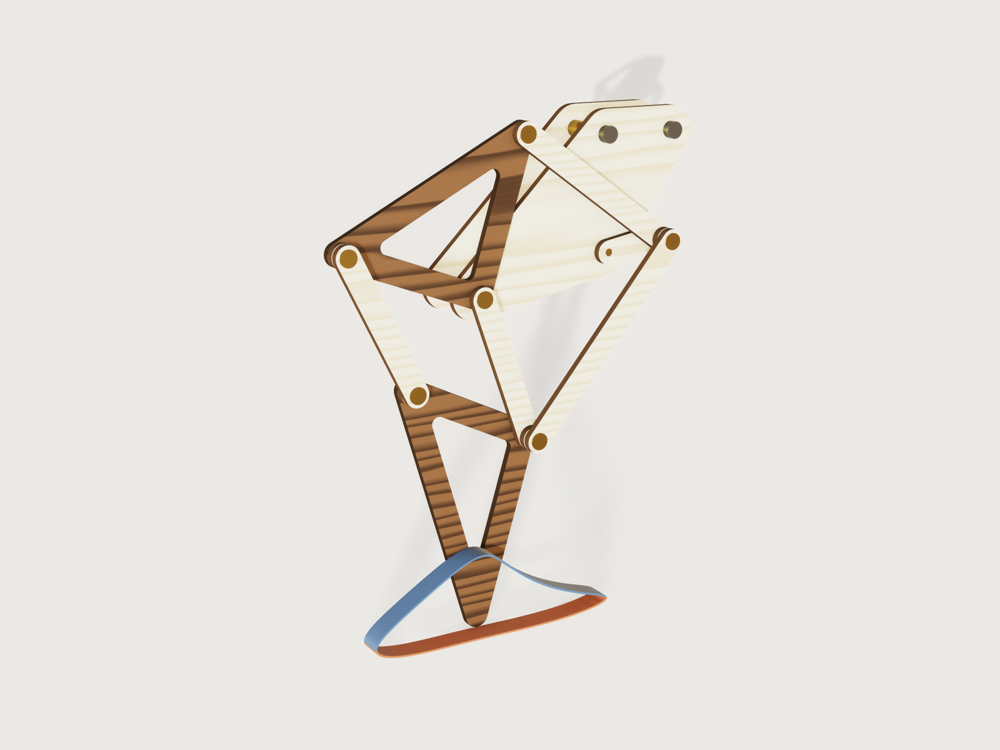

# Jansen linkage leg

A walking leg after Theo Jansen's linkage, the mechanism of his *Strandbeesten* ("Strandbeest" is his name for his own
works, so this Jig is called after the linkage; its id keeps the old name). A crank, four bars and two rigid triangles
on a fixed frame turn a rotation into a long, nearly flat stroke along the ground and a high return. Ask for the hip
height (the crank axle above the ground), the plywood you have and the brass rod for the pins, and the form gives you
every part to laser cut, the rod to saw and the washers to buy. Drag the crank angle and the leg walks along the path
of its own sole, drawn in terracotta where the foot is down and blue where it swings. One leg, or a pair half a turn
apart that always has a foot down.



## What it shows

- **A drive parameter walks the linkage, by formulas only.** Every joint is a closed-form circle-circle intersection
  of the crank angle (`variable.set`), written as angles: the crank pin A turns about the axle O; the hip triangle's
  direction from the fixed pivot B is the direction of A from B plus the angle the triangle B-A-C has at B (law of
  cosines); the knee E the same with the other sign; the foot triangle's direction from E follows from the triangle
  D-E-F. Each part is drawn once at the origin (`sketch.path`, `sketch.circle`, `feature.extrude`) and placed by a
  `feature.transform`: turned by its direction and moved to its first joint. No assembly, no solver: the form's
  *Crank angle* slider runs it.
- **The foot path is a formula curve.** The position of the foot's sole as a function of the crank angle, the whole
  chain of intersections in one expression of `t`, is drawn by `sketch.curve` in four pieces and swept as a ribbon
  (`feature.sweep`): the stance from where the foot drops into the lowest 15 % of its step to where it leaves it, and
  the swing. Each piece starts at the path's lowest or highest point, where its tangent is level, so the ribbon's
  section stands square to it. *Draw the foot path* switches it off.
- **Searches in formulas.** Where the path is lowest, highest and longest and where it crosses the stance level has no
  closed form, so the document finds them itself: parabolic steps (three samples, the vertex of their parabola, a finer
  step) for the extremes, secant steps for the crossings. The lowest point sets the scale: the form asks the hip height,
  the axle's height above the ground, and the crank is (hip height − half a bar width) / 6.1223, since the sole is half
  a bar width below the centre of the foot's rounded tip.
- **The tightest poses in closed form.** Every joint angle depends on the crank only through the distance from A to B,
  so the linkage is most folded when the crank points at the pivot and most stretched when it points away. The joint
  angles over the whole turn and the least gap between parts on one layer are worked out at those two poses, in closed
  form, and the gap sets the range of the bar width.
- **The form changes the structure.** *Legs* builds one leg or two back to back, the second half a turn on, with a pivot
  rod and an axle through both (`when` on 22 features and 13 assertions). *Open triangles* cuts windows into the two
  walnut triangles (`feature.boolean` subtract by `when`). The rod choice brings its DIN 125 washer from a table
  (`table.set`, `choicesFrom`), and with it the layer pitch and every pin length.
- **Cut sheets from named sets.** `set.define` by material and face direction: one sheet of every birch part, one of
  the walnut triangles, true size, for two legs twice over. The set *Leg parts* is every part of the leg.

A drawing of a Jansen leg is one size at one crank angle. This is every size from a desk toy to a garden walker, any
plywood and rod, one leg or two, and it walks.

## The real thing

**The linkage.** Jansen's link lengths ("holy numbers"), in his units, with the crank m:

| a | b | c | d | e | f | g | h | i | j | k | l | m |
|---|---|---|---|---|---|---|---|---|---|---|---|---|
| 38.0 | 41.5 | 39.3 | 40.1 | 55.8 | 39.4 | 36.7 | 65.7 | 49.0 | 50.0 | 61.9 | 7.8 | 15.0 |

Read in two sources that agree: the table in Wikipedia's [Jansen's linkage](https://en.wikipedia.org/wiki/Jansen%27s_linkage)
(which does not say which bar is which) and Table 1 of J. Wang, *Durability-Aware Multi-Objective Optimization of the
Jansen Linkage*, [arXiv:2606.22129](https://arxiv.org/abs/2606.22129) (2026). Its equations 1 to 3 give the topology
used here. The bar letters are the paper's; its joints are named J1 to J5, the pivot G and the foot F, which here are A,
C, D, E, F, the pivot B and the foot G. The crank axle O is at the origin, the pivot B at (-a, -l), the crank pin
A = O + m (cos θ, sin θ); then C from A (bar j) and B (b), D from C (e) and B (d), E from A (bar k) and B (bar c), F from
D (bar f) and E (g), and the foot G from F (h) and E (i). The hip triangle B-C-D (sides b, d, e) and the foot triangle
E-F-G (g, h, i) are rigid plates. The crank turns counter-clockwise seen from the front, the foot then moves along +x on
the ground, and the walker walks towards -x (to the left in the front view).

Each intersection has two branches. This Jig uses the one Jansen drew, with the hip triangle standing above B and the
foot below, which gives the flat-bottomed path his search was for. An own computation (Python, steps of 0.1 degree, not
part of the Jig): with the other intersection for C and D the same equations give a share of 20.3 % in the lowest 15 %
of the step and a stance 43.6 units long, close to Wang's Table 4 (0.202 and 43.3); on Jansen's branch they give
61.6 % and the flat bottom. The paper does not say which branch it took.

At any size the shape is the same. In crank radii: the centre of the foot's tip comes as low as 6.1223 below the axle,
the foot travels 4.527 along the ground and lifts 1.497; it spends 61.6 % of the turn in the lowest 15 % of its step
(Wang's definition of the stance). Since that is more than half a turn, two legs half a turn apart always have a foot
down. The *step length* is the foot's travel relative to the leg, not how far a walker gets per turn: that depends on
how many legs are down and how the body rides on them, which this Jig does not work out.

The knee nearly folds: the bars k and c close to 8.65° at E when the crank points at the pivot (and the three closing
joints, C between j and b, E between k and c, F between f and g, stay between 8.65° and 142.4° over the turn; other
pairs of links, such as e and f at D, do pass through a straight line, which a pin joint does not mind). That is why a Jansen leg is fussy about bar k:
Wang reports that 2 % on k already breaks the assembly, and the mutation test below with k at 62.5 units bears that out.

**Layers.** No two parts that cross may share a layer. From the frame outwards:

| Layer | Parts |
|---|---|
| 0 | front frame plate: the axle O, the pivot B and the mounting holes M and N |
| 1 | crank, hip triangle, foot triangle |
| 2 | bar j, bar c, spacer rings at D and F |
| 3 | bar f, spacer rings at A and E |
| 4 | bar k |

Bars j and k pass right over the axle once a turn, so the crank, glued to the axle, is the axle's last layer and the
drive goes behind the front frame. Three layers would do, but bar k then passes within 5.9 units of the pivot B and
would run into the washer that holds bar c on B's end; k gets a layer of its own on top. The layering was chosen by an
own search over every assignment (Python, a turn in steps of half a degree), then proven on the model as the Checks say.
Where a pin crosses a layer without a part of its own, a birch spacer ring of the bar's width fills it, cut with the
bars. Between two layers on every pin sits a DIN 125 washer, with 0.2 mm of end play.

**The frame.** Two frame plates, the room for the drive apart, are joined by three spacer tubes (bore the hole, outside
diameter the washer's): on the pivot rod B, glued into both plates, and on two bolts at M (two crank radii above the
axle) and N (as high, four thirds of a crank radius further towards +x). M and N lie outside the space any moving part
sweeps over the turn: bolt the module to your chassis there, with bolts of the rod's size and a DIN 125 washer under the
head and under the nut (the outputs give the grip). The axle runs in both plates, so it cannot tilt; the crank is glued
to its front end and a washer glued on behind the back plate keeps it from sliding out. Drive it by a pulley or gear on
the axle between the plates (the outputs give the largest radius that clears the spacer tubes by 1 mm), from a motor or
from a hand-cranked shaft on your chassis; to try the leg by hand, turn the crank itself. With two legs the second leg
stands behind the back plate, mirrored, its crank half a turn on the same axle.

**Pins.** Brass rod, sawn to the lengths in the outputs and deburred (the model chamfers the glued end by a tenth of the
rod). Each pin is glued (cyanoacrylate or epoxy) into its lowest part: A into the crank, C and D into the hip triangle,
E and F into the foot triangle, B into both frame plates, the axle into the crank. The other parts turn on it, and a
washer glued onto the rod's front end, not to the part, keeps them on.

**Washers.** DIN 125 form A, brass: bore, outside diameter and thickness 3.2 / 7 / 0.5 mm for 3 mm rod, 4.3 / 9 / 0.8
for 4 mm, 5.3 / 10 / 1.0 for 5 mm, 6.4 / 12 / 1.6 for 6 mm (read from the DIN 125 table on
[roymech.org](https://roymech.org/Useful_Tables/Screws/Din125.html)).

**Laser cutting.** Birch plywood for the frame plates, crank, bars and rings; walnut plywood for the triangles; both of
the thickness you measured. Every hole is drawn the kerf smaller than the rod plus the clearance, so the beam cuts it to
size; the outlines are not offset, so the parts come out half a kerf smaller all round, which a linkage does not mind.
The rules held over the whole range: a hole at least as wide as the sheet is thick; a web round every hole at least the
rod diameter and the sheet thickness (the brief's edge distance, and the laser's smallest feature), after the kerf; the
triangles' windows rounded by the sheet thickness and at least two sheet thicknesses across. Lay every bar with the face
grain along its length: the sheet export lays the parts as they stand at the crank angle set, so turn the bars in your
laser software (or use `cut.export`, below, which lays each part along its length). The laser-burnt edges are shown
dark. Sand the faces lightly, wax them, and run the leg in by hand.

**Proportions** (own judgement, not from a source). Bars at most 0.6 crank radii wide: wider, the parts crowd each other
and the leg turns into paddles. Bar k at most 60 sheet thicknesses long: longer, a plywood bar flexes out of its plane.

**Making it.** Cut both sheets; saw and deburr the rod; glue each pin into its lowest part, square to it (a scrap with a
hole the same size makes a jig), and let it cure. Glue the pivot rod into both frame plates through its spacer tube,
and bolt the box together at M and N through theirs.
Stack the parts layer by layer with a washer between every two, glue the retaining washers on, and turn the crank by
hand: nothing may rub.

What the Jig does not do: strength. Plywood of 3 mm at the largest size the form allows for it (a hip height of 271 mm,
bar k 180 mm long) makes a sculpture, not a vehicle: a walker that carries a load needs its bars and pins checked by
whoever builds it.

## Parameters

| Group | Parameter | Range | What it changes |
|---|---|---|---|
| Walk | Crank angle | 0 to 360°, step 1° | Turns the crank: every joint and part follows. The foot is in mid-stance near 10°, the default, and lowest near 329°. |
| Walk | Draw the foot path | yes or no | The ribbon of the sole's path. Switch it off before exporting the model as STEP or a mesh: it is a drawing, not a part. |
| Size | Hip height | 100 to 271 mm at the defaults; the least follows from the rod, sheet, kerf, windows and the width cap, the most from 60 sheet thicknesses of bar k | The axle's height above the ground: the size of everything. |
| Size | Legs | one leg; a pair, half a turn apart, back to back | The structure: a second leg behind the back plate, a pivot rod and an axle through both. |
| Parts | Open triangles | yes or no | Windows in the two walnut triangles. |
| Parts | Bar width | from the hole plus its kerf and two webs, to 0.6 crank radii and to what lets the parts on one layer pass with 1 mm to spare (9.32 to 14.01 mm at the defaults) | Every bar, ring and the rim round the triangles' pins; the frame's rim is a bar width. |
| Stock | Plywood thickness | 2.5 mm to the hole (3.2 mm with 3 mm rod) | Layers, pitch, pins, the least size. |
| Stock | Brass rod and washers | 3, 4, 5 or 6 mm with DIN 125 M3 to M6 washers | Holes, washers, pitch, webs. |
| Stock | Hole clearance | 0.1 to 0.5 mm | How much larger a hole is cut than the rod. |
| Stock | Laser kerf | 0 to the clearance less 0.05 mm | How much smaller the holes are drawn. |
| Drive | Room for the drive | 10 to 60 mm | The gap between the frame plates for the pulley or gear, and the spacer tubes. |

At the defaults (one leg, hip height 150 mm, 3 mm plywood, 3 mm rod, clearance 0.2 mm, kerf 0.12 mm, bars 10 mm, open
triangles) the outputs read: crank radius 23.68 mm, step length 107.22 mm, step height 35.46 mm, stance 61.58 % of the
turn, least gap between parts on one layer 10.92 mm (at the most folded pose), longest part 113.74 mm (the foot
triangle); brass rod 14.7 mm for pins A and E, 11.0 mm for D and F, 7.3 mm for C, 34.0 mm for the pivot B and 30.3 mm
for the axle, 123.0 mm in all; two M3 mounting bolts with a grip of 27.0 mm; three spacer tubes 20.0 mm long; a pulley
or gear of up to 42.87 mm radius; 25 washers.

## Checks

45 assertions, 34 of them active for one leg and 43 for two:

- **The bars close the linkage, measured.** The pins C, E and F sit centred in the far holes of bars j, k and f (the
  distance from the rod's surface to the hole is half the clearance less half the kerf, within 0.001 mm): a bar of the
  wrong length, a moved or a loosened hole fails it. The back leg's three the same with two legs. Every other hole of
  every part is held by two measures together: a hole moved by more than its clearance makes the pin overlap the part,
  and a hole of the wrong size changes the plywood volume, which must equal its closed form to a millionth.
- **Nothing overlaps**: the 25 (or 41) parts, pins with their washers included, have no volume in common.
- **Parts on one layer pass each other** by at least the running clearance of 1 mm, measured at the crank angle set:
  the hip and foot triangles, bar c and the ring at D, bar f and the ring at E, and bar k and the washers on pins D and
  F; and the back leg's three tight pairs with two legs.
- **The three closing joints keep 8° to 172° between their two links over the whole turn**: C between j and b, E
  between k and c, F between f and g (closed form at the most folded and the most stretched pose, which bound these
  angles): the least is 8.65°, the knee E folded; the most 142.4°, at F stretched.
- **The mounting bolts clear the leg**: each bolt at M and N, modelled with a head or nut and its washer as a cylinder of
  the washer's diameter and the washer's thickness plus one bolt diameter high on both faces, keeps at least the 1 mm
  running clearance from every moving part (measured at the crank angle set, with two legs from both). They come
  nearest at 53° (M, bar j) and 56° (N, the crank); measured there, the least is 4.72 mm (M) and 13.70 mm (N) for the
  smallest pair, and 11.00 and 24.75 mm at the defaults.
- **Two derivations agree** (measured against an independent closed form): the foot triangle's lowest point and the hip
  triangle's leftmost point are where the radical-line construction of the same joints puts the foot G and the corner D
  (Wang's form of the intersection, with the branches chosen by side), within 0.001 mm.
- **The hip height is the axle above the ground**: the foot's lowest point never goes below the hip height under the
  axle, at the crank angle set (and the back foot's with two legs); the drawn path of the sole reaches exactly that
  depth at its lowest point (0.001 mm).
- **The drawn path is the foot's path**: its highest point is where the search found it (0.001 mm); its length is the
  step the search found (within 0.005 mm plus 50 millionths of it, as closely as 3DCraft proves the box of a swept
  spline); the stance pieces stay in the lowest 15 % of the step and the swing pieces above it, to within half the
  line's width. The foot rises through that level at 7.1 and 4.0 of Jansen's units per radian (the line is 0.25
  units wide each side), so this pins the stance's two ends to within 2.0° and 3.6° of crank, and the stance share to within 1.6 points; the share itself comes from the
  secant search.
- **The pair is half a turn apart**: the centre of mass of the two crank pins A lies on the axle (x and z, 0.001 mm).
- **Laser**: the web round a hole (measured on a spacer ring) is at least the rod diameter and the sheet thickness after
  the kerf; no wall of the foot triangle is thinner than the sheet (`thickness`).
- **Counts**: 25 parts for one leg, 41 for two; 2 frame plates and 9 birch parts per leg, and 2 walnut triangles per leg,
  on the cut sheets.
- **Closed forms**: the birch parts' volume equals the sum of Steiner's rule for every bar, ring and frame plate
  (outline area plus perimeter times the rim plus a disc, less the holes); the walnut triangles' volume equals Heron's
  area with Steiner's rim, less the holes and the windows; both within a millionth.
- **The rod list**: every rod, tube and bolt the outputs list (pins A and E, D and F, C, the pivot, the axle, the
  spacer tubes, and the bolts' grip plus head and nut) is measured as long as the output says (0.001 mm).

**Mutation tests** (each in a scratch copy of `build.json`, at the defaults unless said): bar k 1 % long fails the
overlap, pin E's centring and the birch volume; C on the other branch fails pin F's centring and corner D; F on the
other branch fails the foot's position, the overlap and the layer-1 clearance; bar f's far hole moved 0.1 mm fails the
overlap and pin F's centring; bar j's far hole 0.1 mm larger fails pin C's centring and the birch volume; the hip
triangle's hole D 0.1 mm larger fails the walnut volume; bar f moved to layer 2 fails the overlap; bars 0.75 mm wider
than the range allows, at 192°, fail the layer-3 clearance; the lowest point searched from the other dip of the path
(30°) and the stance ending 2° late both fail the stance check; the output for pins D and F 1 mm long fails their rod
check (and the pivot's, which shares its formula); the axle's output 1 mm short fails the axle's; the D and F pins
drawn 1 mm longer fail their rod check; two legs with the back crank at +170° fail both half-turn checks; bar k at
62.5 units fails the joint-angle check, the ground checks and the stance check, and the sweep breaks; the bolt at N put
back half a frame offset ahead of M (where an earlier build had it), at 312°, fails its clearance and the overlap.

**Range.** `tools/jigs.py check` runs `check-range` over 101 points (the defaults, 64 corners, every choice and 32
random points): all pass, none unproven. The assertions measure the leg at the crank angle set; at one setting of the
form they prove that angle. Beyond the sampled points, a sweep by hand with `param.set` every 15° and at 11, 12, 191 and
192° passed every assertion for: two legs at the smallest size (100 mm, bars 9.32 mm, solid triangles); two legs at the
widest bars at 150 mm (14.01 mm) with 2.5 mm plywood, 0.5 mm clearance and 0.45 mm kerf; the largest pair, 6 mm rod and
6.4 mm plywood (579 mm, bars 54.09 mm, 60 mm of drive room); and the largest single leg (271 mm, bars 25.32 mm, foot
path off). The tightest gap between parts on one layer was 4.44 mm (the smallest pair, at 192°, next to the closed
form's tightest pose at 191.6°). Over the whole range the width cap of 0.6 crank radii binds before the 1 mm clearance
does: at the cap the parts on one layer keep 0.28 crank radii apart.

## Export

- **File › Export…, Sheet of set: *Cut sheet, birch plywood*** and **Sheet of set: *Cut sheet, walnut plywood***, DXF or
  SVG. Every part at true size with its holes, each on its own layer, laid out as it stands at the crank angle set; give
  the dialog your bed's width, and turn the bars to lay the grain along them in your laser software. The holes are
  already drawn the kerf smaller: turn the laser software's kerf offset off. For two legs each sheet holds both legs'
  parts.
- **With an agent**: `cut.export {"path": "parts.svg", "width": "600 mm"}` with *Draw the foot path* off lays every
  plywood part along its length (grain along the bar) and says how many of each to cut; birch and walnut parts share
  that sheet, each on its own layer.
- **STEP**: switch *Draw the foot path* off and export the model: what is left is the named set *Leg parts*, every
  part of the leg.
- The brass rod, spacer tubes, mounting bolts and washers are in the outputs.

## Files

- `build.json`: the source, a JSON list of 3DCraft commands.
- `meta.json`, `formtest.md`, `preview.png`.
- [`strandbeest-leg.3dcraftjig`](strandbeest-leg.3dcraftjig): the published Jig.

## Rebuild

```bash
tools/jigs.py build strandbeest-leg
tools/jigs.py render strandbeest-leg
tools/jigs.py check strandbeest-leg
```

## Difficulty

7 out of 10: closed-form kinematics and searches in formulas, formula-curve sweeps, a five-layer multi-body stack with coupled ranges and measured clearances, and a pair option that changes the structure.

## Platform notes

- **No function or search in an expression** ([J-054](../../3DCRAFT-FEEDBACK.md#j-054-an-expression-cannot-define-a-function-or-a-local-name), [J-055](../../3DCRAFT-FEEDBACK.md#j-055-no-maximum-minimum-or-root-of-a-formula-over-an-interval)). The foot's
  position as a function of the crank is written out 35 times, 2.6 to 3.8 kB each, once per sample of the parabolic
  and secant searches; the four curve pieces repeat the same formula again in `t`.
- **A sweep along joined formula curves does not close** ([J-031](../../3DCRAFT-FEEDBACK.md#j-031-a-closed-path-of-formula-curve-pieces-that-meet-end-to-end-is-refused-for-a-sweep)): three pieces of
  the foot path meeting end to end are refused as a closed path ("comes back 0.0036 from where it started"), so the
  ribbon is four open sweeps, each starting where its tangent is level.
- **The box of a swept spline is not proven to the tolerance** ([J-027](../../3DCRAFT-FEEDBACK.md#j-027-the-extent-of-a-swept-body-is-not-proven-to-the-tolerance-and-a-sweeps-path-length-cannot-be-read-see-f-117-f-122)): a variable
  cannot read the path's length, so the step length is the search's and an assertion holds the drawn path to it within
  0.005 mm plus 50 millionths of the step (0.010 mm at the defaults).
- **A wood pattern stays in the model's space** ([J-041](../../3DCRAFT-FEEDBACK.md#j-041-a-material-pattern-stays-in-the-models-space-when-its-body-is-turned-see-f-083)): when a part is turned by
  a transform its grain does not turn with it, so the grain of the bars and triangles runs at a slant and drifts through
  them as the crank turns. Cosmetic.
- **A sheet of a set lays faces as they stand** (F-162 covers the direction per part for `cut.export`): the export
  dialog's sheet cannot lay a part along its length, so the README asks the maker to turn the bars; `cut.export` can, but
  is not in the dialog and cannot split the two woods without naming bodies, which inactive bodies refuse (J-003).
- **A STEP of a named set is refused** ("`set` is for a drawing"): the foot path's ribbons can only be kept out of the
  model's STEP by switching them off.

## Licence

[CC BY 4.0](../../LICENSE-CC-BY-4.0.md); credit line in the [README](../../README.md#licence).
