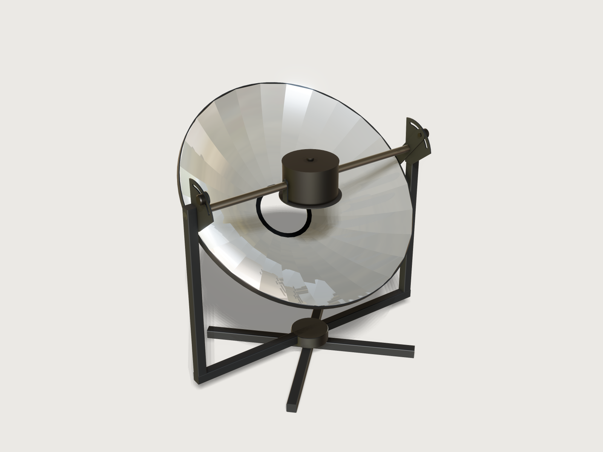

# Parabolic solar cooker

A parabolic dish that cooks with sunlight, made from flat petals of mirror sheet. Give the pot you cook in and how
big the dish should be; the form works out how many petals the dish needs to keep its light on that pot, draws the
petal to cut (exact: the strip a flat sheet becomes when it is bent between two meridians of the paraboloid), the
steel plates to laser cut, and how much sunlight reaches the pot. The dish tilts on an axle through its focus, so the
pot hangs level at the focus at every height of the sun: drag *Sun elevation* and watch the dish follow while the pot
stays put.



## What it shows

- **A developable petal, built exactly.** A flat sheet can only bend into a surface of zero Gaussian curvature; a
  paraboloid's is positive everywhere. The strip between two meridians of the paraboloid, ruled by straight lines across, is
  developable: tangents and rulings are coplanar because the two meridians are mirror images, so it is a parabolic
  cylinder about the petal's middle, z = x² / 4F with F = f cos²(180° / N). The model builds exactly that: one
  `sketch.spline` of degree 2 whose three control points are formulas (a parabola *is* a quadratic B-spline), its
  0.5 mm back face from the offset control polygon, `feature.extrude` across, and one `feature.boolean` with a wedge
  between the two meridian planes.
- **The cut outline from the paraboloid's arc length.** The petal template is a `sketch.curve` of the closed-form
  development: along the petal its arc length u(x) = S_F(x) − S_F(x₀), S_F(x) = x/2 √(1 + (x/2F)²) + F asinh(x/2F),
  across it ±x tan(180° / N). Its cut edges are then exactly as long as the paraboloid's meridian from hub to rim.
  An assertion lays the bent petal and the template side by side: the template's measured area, less its tab, notches
  and rivet hole, equals the measured area of one bent petal in the dish.
- **A drive parameter.** *Sun elevation* turns the dish, hoop, hub, arms and clamp knobs with `feature.transform`
  about the axle line through the focus; the pot, its ring, the hangers and the stand do not move.
- **Proofs as single measures, with few helpers.** A 1 mm sphere at the focus measured to the hoop and the hub
  (`distance` against closed forms) proves that the dish turns about its focus; a 0.5 mm sphere at a seam's rim corner,
  turned with the dish, proves that both petal sets meet there; a 0.2 mm disc where the petals' focal lines lie (each
  bent petal focuses to a line, not a point) is measured by `clearance` to the inside of the thin-walled pot and its
  lid, so the light stays in the pot; the distance between the two ends of the quadrant's slot proves that it spans the
  whole elevation range. These three helpers and a copy of the petal as built (its area is cheap to measure before it
  is patterned) are hidden with `feature.visible`; the pot and holder's box and the sphere the dish never enters need
  no helper at all.
- **Ranges that know the optics.** The fewest petals the form allows follows from the pot and the dish: every focal
  line, with half the sun's image and half a degree of aim round it, must stay inside the pot at every sun height
  (`2 * ceil(90 deg / asin(focal_lines_limit))`, even, where `focal_lines_limit` solves
  (R u)² + (f u²)² = (room in the pot)² for u = sin(180°/N)); the dish diameter's range follows from the pot, the focal
  ratio and the 36-petal limit (`petal_count_max`); the cooking height's minimum is what lets the dish swing clear of
  the stand.
- **Interleaved patterns.** Petals that meet edge to edge in one `feature.pattern` are joined into one body at a cost
  ([J-062](../../findings/J-062-circular-pattern-touching-cost/README.md)), so every
  other petal is one pattern and the petals between are a second, two bodies that never meet in a boolean.
- **Mirrors and weights.** `feature.mirror` makes the far arm, quadrant and hanger; the petal template is hidden too
  (it exports and measures, but stays out of the picture); `body.material` weighs every part, so `centerOfMass` can
  show that the cooker stands, and `volumeBelow` that the dish swings clear of its stand and that the pot sits centred
  on the focus.
- **Cut sheets without picking.** Named sets (`set.define`) *Petal template* and *Plates to laser cut* export as DXF
  or SVG; `cut.list` gives the plates with their thickness and count.

A static model is one dish for one pot. This one is the dish for your pot, with the petal count, the template and the
height of the stand worked out from it.

## The real thing

**What it is.** A tracking concentrator for cooking: a paraboloidal dish of reflective sheet, a pot at its focus, a
stand that turns towards the sun (by hand, azimuth on the turntable, elevation on the axles). Building the dish from
petals needs no mould; the layout (an axle through the focus carrying both the dish and the pot hanger, a slotted
quadrant to hold the tilt) is this Jig's own design, not copied from a product.

**The paraboloid.** From W. B. Stine and M. Geyer, *Power From the Sun* (2001), chapter 8, read online (equations
read from the book's own equation images): z = a² / 4f (8.19), depth h = d² / 16f (8.8), rim angle
tan ψ = 1 / (d/8h − 2h/d) (8.9), and the distance from the focus to the mirror p = 2f / (1 + cos ψ) (8.6).
At the defaults (1 000 mm, f/D 0.3): focal length 300 mm, depth 208 mm, rim angle 79.6°.

**Why petals, and what error is honest.** The paraboloid is curved both ways; flat sheet cannot follow it without
stretching. Each petal is the developable strip between two meridians (the seams), so neighbouring petals share
their seams exactly and the dish closes, but between the seams a petal is straight across where the paraboloid
curves: it stands inside the paraboloid by up to R² sin²(180°/N) / 4f along the axis, at the middle of its rim end
(the output *Petal off the true paraboloid*: 3.0 mm at the defaults, 14 mm with 12 petals). Optically, each petal
focuses sunlight to a line across it through the axis, as long as the petal is wide (its focal length is
f cos²(180°/N), a few mm short of f). The light on the pot is therefore a star of lines about D sin(180°/N) across,
120 mm at the defaults, not a point. The petal count's minimum keeps that star inside the pot body at every sun
elevation down to 20°, with half the sun's image to spare, which an assertion measures. The sun's image is
2p tan(ε/2) (Stine and Geyer 8.40: 4.9 mm from the rim at the defaults), with ε, the sun's angular size, taken as
Stine and Geyer give it in section 8.4.2, "about 33 minutes of arc or 9.6 mrad" (the sun's mean diameter is often
quoted as 32′; the 3 % difference is on the safe side here). The petals' slope errors count twice (Stine and Geyer
8.41): a petal bent 0.5° off moves its light from the rim by p tan 1°, 8.9 mm at the defaults. How true hand-bent
petals are is not modelled.

**Aiming.** A dish turned δ off the sun moves the light from its rim by about p tan δ. The output *Aim within this of
the sun to keep every focal line in the pot* turns the measured margin, less half the sun's image, into that angle:
2.7° at the defaults with the sun at 50°, 0.9° at 20°. That is the strict bound (every ray of a perfect petal ends
inside the pot). The ranges keep it at least half a degree everywhere (the variable `least_aim`): the sun moves up to
a quarter of a degree a minute, so a dish aimed true keeps every focal line in the pot for at least two minutes. That
half degree is a judgement of the least a cook can work with; it raises the least petal count (26 at the
defaults instead of 24) and lowers the largest dish for a narrow pot (1 300 mm for a 140 × 250 mm pot at f/D 0.5).
A ray trace (below; an unpublished check) shows that the pot still catches nearly all of the light well beyond the bound: at the defaults,
3.75° off (15 minutes without re-aiming) puts 99.9 % of it on the pot at 20° and all of it at 50°; for a 140 × 250 mm
pot in its largest dish (1 300 mm, f/D 0.5, 36 petals) at 20° of sun, 2° off gives 99.4 % and 3.75° gives 92 %.

The classic gore (centre line as long as the meridian, width the arc of the parallel) is not this outline: an
independent script (unpublished) finds it 2.8 mm too long at the rim end with 24 petals and 11 mm with 12, so such petals would not
lie along their neighbours' edges without forcing (a reading of that mismatch).

**Sunlight on the pot.** Power = direct sunlight × specular reflectance × the aperture not shaded. The aperture less
the hole in the middle (as wide as the pot's ring, inside the pot's shadow when the sun is high; larger only where the
petal tips would get narrower than 20 mm) and the two axles' 30 mm strips is 0.714 m² at the defaults. At 900 W/m² of
direct sun (the direct-normal reference spectrum of ASTM G173-03 integrates to 900.1 W/m², as the standard's published
scope says; the standard was not read) and 80 % specular reflectance that is 514 W onto the pot. This is sunlight
reaching the pot, not cooking power: the pot's absorptance, its losses to wind and air, and the sky are not modelled.
At low sun the level pot's shadow on the tilted dish reaches beyond the hole (by up to about 2 % of the aperture for a
tall pot, an estimate); the power figure does not subtract that. Averaged over the disc the focal lines span, the light
is about 50 times the direct sun at the defaults (the output *Light at the focal lines*); the range reaches about 120.

**The mirror sheet.** Anodised aluminium mirror sheet of the MIRO-SUN kind: Alanod's *Solar Reflectors* brochure
(06.2025) gives *MIRO-SUN reflective 90 weatherproof* 0.5 mm thick, total solar reflectance 90 ± 2 % and solar
weighted diffuse reflectance 10 ± 3 % (ASTM G173 weighting), up to 1 250 mm wide, bending radius at least 1.5
times the thickness; its data sheet (20901L, 2025) says 91 ± 2 %, 10 ± 4 % and 2.0 times. The light that stays in a
beam is the total less the diffuse part, so 80 %: the form's default. *Reflective 85 weatherproof* (86 %, 6 %
diffuse) gives the same 80 %. Other films: enter their specular reflectance. The petal must fit the coil width, which
an assertion checks (424 mm long at the defaults; the longest the ranges allow is about 791 mm, a 1 600 mm dish
at f/D 0.28 for a 165 mm pot).

**The stand.** The axle line runs through the focus, so the focus does not move when the dish tilts, and the pot
hangs from the axles' inner ends on two hanger plates and a ring, level at every elevation. Each axle is a 30 mm bar
welded through an upright and a quadrant plate; the dish's pivot arm turns on it, bolted to the rim hoop. A clamp
knob on each arm runs in the quadrant's slot (from 90° down to 20° of elevation) and locks the tilt. The fork turns on
a turntable bearing on a ground cross to face the sun. The cooking height is the height of the focus (the middle of
the pot) above the ground: its minimum lets the farthest point of the dish, sqrt(R_hoop² + (f − h + 25 mm)²) from
the axle, pass at least 50 mm over the fork.

**Bolts and pins.** Each axle is a 30 mm round bar; the arm turns on it in a 31 mm hole (0.5 mm play a side, which an
assertion measures), and the arm is 50 mm wide round it. The pot holder is screwed to each axle's end by two M6 screws
15 mm apart along the hanger (6.6 mm holes in the hanger, tapped holes in the axle's end): the 6 mm thread 7.5 mm from
the axle's centre leaves 4.5 mm of bar outside it, and stirring cannot turn the holder on the axles; an assertion
counts the four holes. The arms are bolted to the hoop by two M6 bolts 20 mm apart across the arm, the arm's round end
centred 5 mm below them. Eurocode Applied's summary of EN 1993-1-8 Table 3.3 (read; the standard not read) gives the
least distances for bolts: end and edge e1, e2 ≥ 1.2 d0, spacing p1 ≥ 2.2 d0 and p2 ≥ 2.4 d0. With d0 = 6.6 mm these
are 7.9, 14.5 and 15.8 mm. The arm's bolts are 13.8 mm from their centre to the arm's round end (the output *Arm's
hoop bolts from the arm's round end*), 15 mm from its sides and 20 mm apart; the hanger's screws are 15 mm apart along
it, 15 mm from its sides and 17.5 mm below its rounded top.

**Kerf.** The parts come out right whether the shop compensates its kerf or not, so the Jig has no kerf parameter (and
`cut.export`'s kerf refuses the petal's spline outline anyway). Every laser-cut hole and slot is one of three kinds:
a clearance (0.5 mm a side for the axle in the arm and the clamp bolt in the slot and the arm, 0.3 mm on the M6
bolts and screws), which an uncompensated kerf of up to 0.3 mm only loosens; the axle's weld hole in the quadrant,
drawn 0.25 mm larger a side than the bar (an assertion measures the gap), so a compensated cut still takes the bar
and an uncompensated one leaves a gap of at most 0.4 mm for the weld; and the rivet holes, cut as 3 mm pilots and
drilled out to 4.1 mm at assembly through petal and hub together. 4.1 mm is the drill hole in Gesipa's table for its
4 mm aluminium blind rivets (read; Honsel lists 4.2 mm for its 4.0 mm rivet), which a laser cannot hold to either way.
Outlines come out up to 0.15 mm small without compensation, which no fit depends on.

**Weights.** Steel 7 850 kg/m³, aluminium 2 700 kg/m³ (Alanod's sheet is Al 1085). The tubes are drawn solid and
weighed as 40 × 40 × 2 mm square tube (7 850 × 304 / 1 600 kg/m³), the turntable as a 0.5 kg bearing, the clamp knobs
as steel; the pot is not weighed, the worst case for tipping.

**Making it.**

1. Cut the petals from the template (DXF or SVG), as many as the form's *Petals*: a fibre laser, a waterjet, or tin
   snips round a paper print of the SVG. Leave the protective film on. Lay them nose to tail on the coil.
2. Laser cut the plates: 2 pivot arms (6 mm steel), 2 quadrants (5 mm steel, mirror images), 2 hangers (6 mm steel),
   the pot ring (5 mm steel) and the hub ring (3 mm aluminium, one rivet hole per petal). Saw the tubes and axles to
   the outputs' lengths; roll the rim hoop from 25 × 4 mm flat bar to the hoop's inside diameter (rim + 1 mm) and weld it.
3. Weld the stand: ground cross, fork beam on the turntable bearing, uprights, a quadrant on each upright's inner
   face, an axle through each upright and quadrant. Weld the pot ring to the two hangers (one U-shaped holder); drill
   and tap each axle's inner end for two M6 screws, 15 mm apart, matching the hangers' holes. Powder coat it all
   black.
4. Build the dish face down on a flat floor: rivet each petal's narrow end to the hub ring (the hole 10 mm from the
   end, drilled out from the 3 mm pilot to 4.1 mm through petal and hub together; the hub is flat and the petal's tip
   meets it at the output *Petal tip slope over the flat hub ring*, 11.9° at the defaults, so the rivet pulls the last
   10 mm of the petal down onto the ring, or a tapered washer fills the gap), then lay each petal's tab under the next petal's edge, the next petal's corners on the tab's notches, bend
   the petals into the bowl and drill and rivet through tab and neighbour every 50 mm or so (4 mm aluminium blind
   rivets, Gesipa's 4 × 5 for the two 0.5 mm layers of a seam and 4 × 7 for a petal on the 3 mm hub, by their grip
   ranges of 0.5 to 1.5 and 3.0 to 4.0 mm; the output counts about 286). The tab follows the next petal at a slight crease along the seam.
5. Seat the bowl in the rim hoop and rivet each seam's two rim corners to the hoop through a small angle clip. Slide
   a pivot arm onto each axle from its inner end, then screw the pot holder to the axles' ends. Turn the dish on edge,
   bring it into the fork from the open side so that the pot ring enters the bowl, and bolt the hoop to the arms (two
   M6 each). Fit the clamp knobs (M10) through the arms and the quadrants' slots.
6. Peel the film off the mirror last.

**Using it.** Turn the fork until the dish faces the sun, set the elevation (the pot's shadow falls in the middle of
the dish, through the hole, when it is right) and lock the knobs. Re-aim every 10 minutes or so, more often with a
narrow pot in a large dish (see *Aiming*); a few more petals than the least give more room. A black, thin-walled pot
with a lid cooks best.

## Safety

A concentrator burns skin and eyes and sets things alight. The light at the pot is about 50 times the sun's at the
defaults and up to about 120 times in the form's range (the output *Light at the focal lines* says it for your dish).

- **Never look into the dish or at the pot while the dish faces the sun.** Wear dark sunglasses when you set it up
  and adjust it. Keep your face and hands out of the space between the dish and the pot.
- **The focus burns.** It scorches wood, plastic, cloth and skin in seconds. Use oven gloves on the pot and the lid.
- **Never leave the dish facing the sun without a pot at the focus**, and turn it away from the sun (or cover it)
  before you take the pot off or walk away. The bare focus can set dry grass, paper or a cloth on fire.
- **Children and pets** keep away from it while it faces the sun.
- **Wind.** A 1 m dish is a sail. The model checks that the cooker does not tip under its own weight at any
  elevation (the centre of mass stays well inside the ground cross), not that it stands in wind: weigh the cross
  down or peg it to the ground, and turn the dish face up (elevation 90°) or lay it down when the wind rises.
- **Store it covered**, away from the sun.

## Parameters

| Group | Parameter | Range | What it changes |
|---|---|---|---|
| Dish | Dish diameter | 600 to 1 600 mm, step 10; at least so large that the pot's hole shades at most 15 % and the pot clears the turning dish; at most what 36 petals keep focused inside your pot, with half the sun's image to spare | The aperture, the power, every part of the dish and stand |
| Dish | Focal ratio f/D | 0.28 to 0.5 | 0.28 a deep bowl (rim angle 84°) with the pot down in it, 0.5 a shallow dish (53°) |
| Dish | Petals | even, from what keeps every focal line, with half the sun's image, inside the pot at any sun height down to 20°, up to 36 | The number of petals, their width, how far they stand off the paraboloid, the light's width |
| Dish | Mirror reflectance, specular % | 50 to 95 | The power only |
| Pot | Pot diameter | 140 to 320 mm | The pot ring, the hole in the middle, the hangers, the least dish and the fewest petals |
| Pot | Pot height | 100 to 250 mm | Where the pot sits (the focus at half its height), the fewest petals |
| Use | Sun elevation | 20 to 90° | The drive: the dish tilts about the focus, the pot stays level |
| Use | Cooking height | from what lets the dish swing clear (660 mm at the defaults) to 1 300 mm | The uprights, the hangers' height above the ground |

The form shows 33 outputs, all for the maker. At the defaults (1 000 mm dish, f/D 0.3, 26 petals, 80 %, pot 220 ×
140 mm, sun at 50°, cooking height 800 mm): 514 W of sunlight onto the pot, focal length 300 mm, depth 208 mm, rim
angle 79.6°, aperture 0.785 m², shaded 0.072 m²; the light 120.5 mm wide, about 50 times the sun, with 26.3 mm to
spare inside the pot, so the dish may be 2.7° off the sun; a petal 424.7 mm long and 135.5 mm wide with its tab,
30.1 mm at the tip (meeting the flat hub at 11.9°), its cut edges 427.1 mm, at most 3.0 mm off the paraboloid;
1.018 m² of mirror sheet; about 286 rivets; rim hoop bar 3 157 mm; uprights 2 × 738 mm, fork beam 1 115 mm, ground
cross 2 × 900 mm, axles 2 × 435.5 mm, hangers 2 × 95 mm, the arm's bolts 13.8 mm from its round end; the turning
dish 5.5 kg, the cooker without the pot 25.4 kg, its centre of mass 10.7 mm off the turntable's axis.

## Checks

Twenty-eight assertions, each measured on the model, most of them a single measure:

- **The petal and its template.** The template laid flat is the bent petal: the area of one bent petal (measured on
  the petal as built, before it is patterned and turned) equals the template's measured area less the tab (its width
  times the petal length), plus the rivet pilot and the two notches, within 5 mm² (it agrees to 1e-5 mm²). The same
  area against the closed form (8/3) F² tan(180°/N) [(1 + x₁²/4F²)^1.5 − (1 + x₀²/4F²)^1.5], within a millionth. The
  template's length, measured between its two straight ends, against Simpson's rule (16 panels) on √(1 + (x/2F)²),
  within 0.05 mm. The mirror faces counted against *Petals*; the hub ring's rivet pilots counted against them too.
- **The dish closes and sits where it should.** A 0.5 mm sphere at the rim corner of a seam, turned with the dish,
  touches the first petal of each set (distance 0 within 0.02 mm), so both sets meet at their seams; the petals' rim
  ends stand off the hoop by the closed form (0.18 mm) and never more than 1 mm; their hub ends stand 0.3 mm above the
  hub ring (drawn so, so that the distance can be measured; in the build they are riveted together).
- **The dish turns about its focus.** A 1 mm sphere at the focus is at the closed-form distance from the hoop's top
  inner edge and from the hub ring's inner edge, within 0.02 mm, at every sun elevation.
- **The pot hangs level at the focus.** The thin-walled pot's volume below the focus's height equals the closed form
  of its lower half (walls and floor less the rounded bottom edges, within the volume of a 0.2 mm slice), and its
  volume on either side of the axis is half.
- **The light lands in the pot.** The disc of the petals' focal lines clears the inside of the pot and its lid by at
  least half the sun's image plus half a degree of aim at the rim (26.3 mm at the defaults at 50°, 10.3 mm at 20°,
  against 6.9 mm).
- **Nothing clashes as the dish turns.** The pot, lid, ring and hangers stay within the box whose corners lie 15 mm
  inside the sphere the dish never enters (four box measures: 125 mm across against 125 mm, the top 88 mm above the
  focus against 232 mm); the hoop passes the axles at the closed-form distance (76.7 mm, and at least 10 mm); the arms
  turn on the axles with 0.5 mm of play all round (± 0.02 mm, so the bore is round and centred); the axles sit in the
  quadrants' weld holes with 0.25 mm all round; the clamp knobs clear the quadrants by 0.5 mm; the quadrant's slot
  spans the whole range from 90° to 20° of sun (the distance between its two ends against the closed form); no part
  of the turning dish dips below 50 mm over the fork (`volumeBelow` is 0).
- **It stands and it can be made.** The centre of mass of the cooker without its pot (the worst case) stays within
  the ground cross's half-width less 50 mm; the hangers have two screw holes each; no hole in an arm, quadrant,
  hanger, hub ring or petal is smaller than its plate is thick; the petal is no longer than the mirror sheet is wide
  (1 250 mm).

**Would they notice?** A scratch copy was broken twenty-seven ways, one at a time, and each was caught by a failing
assertion (none only leaves it unproven): the reviews' cases (the quadrant slot ending at 30° instead of 20°, the arm's
bore 0.5 mm under the axle, the second petal set turned 1° on the axis, two hub pilots missing, the hoop rolled 5 mm
too big, the quadrant's weld hole exactly the bar's size), a clamp knob 3 mm into the quadrant, the template drawn
with the dish's focal length or as a classic gore, the petals bent to the dish's focal length, one petal pair missing,
the wedge 1° narrow, one petal set pivoting 10 mm off the focus, one set 2 mm low or 2 mm high along the axis or 2 mm
sideways, the whole dish pivoting 10 mm off the focus, the pot 20 mm low or 5 mm high, the focal-line disc placed at
the dish's focus, the petal count rule halved (14 petals at 20°), the cooking height's floor without the swing, axles
of 85 mm radius, a short ground cross, 2 mm holes for the arms' bolts or the hangers' screws, a lid knob 300 mm tall.

**Range check.** `tools/jigs.py check` runs `check-range`: 97 points (the defaults, 64 of the 256
corners of the box of the ranges and 32 random points from seed 1), all passing, none unproven; the slowest took
0.84 s (`meta.json`). By hand with `param.set`: the sun from 20° to
90° at the defaults (the light's margin from 10.3 mm at 20° to 48.2 mm at 90°), and the extremes that each assertion
lives on, each at 20° of sun with the fewest petals the form allows there, the margin against half the sun's image
plus half a degree of aim: a 140 × 250 mm pot in its largest dish at f/D 0.5 (1 300 mm, 36 petals: 11.6 mm against
11.0 mm), a 165 × 250 mm pot in a 1 600 mm dish at f/D 0.28 (36 petals: 11.2 mm against 10.9 mm, the tightest point
found), the smallest pot (140 × 100 mm) in its largest dish at f/D 0.3 (950 mm, 36 petals: 8.8 mm against 6.5 mm),
a 320 × 110 mm pot in its largest dish at f/D 0.28 (980 mm, 36 petals), the largest pot (320 × 250 mm) in its smallest
dish at f/D 0.28 (1 080 mm, 16 petals), the 600 mm dish at f/D 0.28 (22 petals), and the 1 600 mm dish at f/D 0.5 at
the lowest cooking height (24 petals; centre of mass 128 mm off the turntable against a limit of 459 mm). The form
refused 24 petals for the defaults, 22 for a 240 × 160 mm pot in a 1 080 mm dish (it allows 24 to 36 there), a
cooking height of 650 mm and a pot 320 mm across but only 100 mm high. A scan of the closed-form ranges over every
pot and focal ratio on their steps found none where the dish's range is empty or the fewest petals exceed 36; it found
two before the pot's least height (a third of its diameter) was added.

**Outside the model, by a script written for this Jig** (an unpublished check: the script is not in this
repository): the petal unfolded numerically triangle by triangle from the
3D strip between two meridians agrees with the template's closed form to 0.0000 mm, its area to 2e-9, its cut edge
with the meridian's arc length (427.0745 mm) at four points of the range; the strip is developable to rounding. Rays
from the sun's disc off the bent petals: all of 40 000 reach the pot with 24 petals (the earlier defaults) at 90°, 50°
and 20° of sun, also with a random slope error of 10 mrad; with 12 petals (refused by the form) 97 to 99 %.

Not proven: the strength of the stand and the axles, the stand in wind, how true hand-bent petals are, the pot's
cooking power, the reflectance of your sheet.

## Export

- **Petals:** **File › Export**, **Sheet of set: Petal template**, DXF or SVG: one petal at true size (outline with
  its tab and the two notches that mark the seam, and the hub rivet hole). Cut it as many times as the form's
  *Petals*. The kerf of a fibre laser or waterjet (0.1 to 0.3 mm) is not compensated: the tab overlaps the seam.
- **Steel and aluminium plates:** **Sheet of set: Plates to laser cut**, DXF or SVG: the hub ring (3 mm aluminium), the
  two pivot arms (6 mm steel), the two quadrants (5 mm steel), the two hangers (6 mm steel) and the pot ring (5 mm
  steel), each on its own layer. `cut.list` (csv) with these bodies lists them with thickness and count. No kerf
  compensation is needed (see *Kerf*).
- **Bar and tube:** the outputs give each length to saw and the hoop bar to roll.
- **A STEP of the cooker:** select the real parts (petals, hoop, hub ring, arms, knobs, stand, quadrants, axles,
  hangers, pot ring, pot and lid) and export the selection, or headless `file.export` to a `.step` with those `bodies`,
  as `meta.json`'s `exports/cooker.step` does. A whole-model STEP or 3MF also holds the hidden petal template and the
  four hidden helpers (the petal as built at the origin, the focal-line disc and the focus sphere inside the pot, the
  0.5 mm seam sphere), because the platform exports hidden bodies too. No named set holds a helper.

## Files

`build.json` (the source), `meta.json`, `formtest.md`, `preview.png`, and `solar-cooker.3dcraftjig`,
`thumb.png` from the tool.

## Rebuild

```sh
tools/jigs.py build solar-cooker
tools/jigs.py render solar-cooker
tools/jigs.py check solar-cooker
```

The tool needs the 3DCraft build this repository is pinned to: see
[Building and checking](../../README.md#building-and-checking) in the README.

## Difficulty

8 out of 10: exact developable petals from quadratic splines with a closed-form cut template, optical ranges coupled to the pot, the sun's image and the aiming margin, a drive that tilts the dish about its focus, and single-measure proofs across bodies.

## Platform notes

- A circular pattern of petals that meet edge to edge is joined into one body, and that costs about twice the CPU of
  two interleaved patterns ([J-062](../../findings/J-062-circular-pattern-touching-cost/README.md)):
  the workaround is the two interleaved petal sets, so the petal count is even.
- `sketch.curve` fits a parabola as a cubic of 35 control points ([J-066](../../findings/J-066-formula-curve-fit-size/README.md),
  see the examples' [F-010](https://github.com/johancoppens/3dcraft-examples/blob/main/3DCRAFT-FEEDBACK.md#f-010)): the petals are drawn as exact quadratic splines.
- A box or extent of a freeform body can be "not proven closely enough" (F-122): the template's length is measured
  between its straight ends, the dish's swing over the fork by `volumeBelow`, and whether the petal sets meet at
  their seams by a probe sphere rather than the sets' boxes.
- `measure.ray` is not an assertion and does not follow a reflection (F-123): whether the light lands in the pot is
  proven through the focal-line disc, and checked by rays only outside the model (also how far the dish may be off the
  sun).
- There is no watt (F-106): the power output is a plain number in watts.
- `distance` from a face or body lying wholly inside another body reports the gap to that body's surface, not 0
  ([J-021](../../findings/J-021-distance-inside-body/README.md)): a petal set sunk
  into the hub ring is caught by the seam probe, not by the hub's distance.
- An output used only by assertions cannot be kept off the form
  ([J-058](../../findings/J-058-check-outputs-on-form/README.md)): the checks measure inside the
  assertions instead, so all 32 outputs are for the maker.
- A whole-model STEP or 3MF holds hidden bodies too
  ([J-045](../../findings/J-045-3d-export-set/hidden-body.json); see the examples'
  [F-161](https://github.com/johancoppens/3dcraft-examples/blob/main/3DCRAFT-FEEDBACK.md#f-161)): the four helpers are small or inside the pot except the petal as
  built, and the STEP of the real parts lists its bodies.
- `cut.list` prints the tilted hub ring's thickness as 3.0000000000001705
  ([J-042](../../findings/J-042-cut-list-thickness-noise/README.md)): cosmetic.

## Licence

[CC BY 4.0](../../LICENSE-CC-BY-4.0.md); credit line in the [README](../../README.md#licence).
