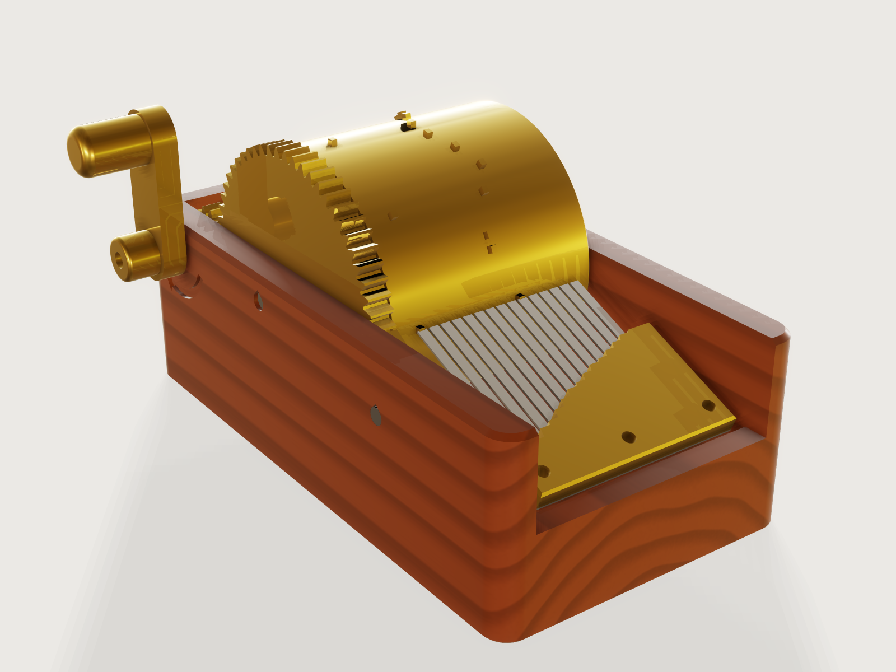

# Music box

A printable cylinder music box. Pick one of three old tunes, the drum, the comb and the tempo: the pins, the comb's tuned
teeth, the gears and the case follow, and dragging the crank turns the drum so you see each pin pass under its tooth. A
spring-steel comb, laser cut from thin strip, is the one that sings; a printed comb is there to try it out, and the page
says plainly what it will and will not do.



## What it shows

- **Data drives pins.** A `table.set` of notes (beat and track, one row per note) drives every pin: one sketch per tune
  with one `sketch.rect` per note, its corners formulas that read the table, wrapped onto the drum with
  `feature.extrude` `wrap` and switched by the tune with `when`. A pattern cannot read a table yet (see Platform notes),
  so the tune's notes are written out step by step by [`make.py`](make.py) from the committed
  [`data/tunes.json`](data/tunes.json): only the notes are data; every position is a formula in the document.
- **The comb is tuned by the cantilever formula, in the document.** Each tooth's length is a formula of its note and the
  comb's material (`variable.set`): equal temperament gives the frequency, the first bending mode of a clamped-free
  rectangular bar gives the length. Change the comb's material and all 15 teeth change.
- **The pluck is worked out.** A pin's tip reaches a little past the tooth tip (the overlap); the comb stands tilted so a
  pin carries the tooth up to the lift you ask for and then lets go, by a closed-form release angle. The form's *Pluck
  strength* moves the comb's tilt.
- **A drive parameter, no assembly.** *Turn the crank* turns the drum by the gear ratio (`feature.transform` by formula),
  the pinion and the crank arm the other way, and the mesh stays clear at every angle. A full sweep of the slider is
  exactly one turn of the drum, one play of the tune.
- **Ranges that are formulas and tables** (`variable.publish`, `choicesFrom`): the smallest drum follows from the tune (two
  pins on one tooth must leave it time to drop back), the most gear teeth from the drum, the tooth spacing from the comb
  material, the largest lift from the comb's strength at its highest note.
- **Materials follow the choice**: `material.preset`, `body.appearance` with a colour from the comb's table row.

A static model of a music box is one tune at one tempo with one comb and no way of checking it. This is three tunes,
any drum from a formula, four combs, and it turns.

## The real thing

**How a cylinder music box works.** A brass drum carries pins; a comb of tuned steel teeth lies against it. As the drum
turns each pin catches its tooth, lifts it a little and lets go; the tooth rings at its own note. The tune is
literally the pattern of pins, one drum turn for one play.

**The comb's tuning.** A tooth is a clamped-free beam, and its first bending mode is the note:

```text
ω₁ = 3.5160 / L² · sqrt(E I / μ)     (first root of the clamped-free bending equation)
f = ω₁ / 2π,  I = w t³ / 12,  μ = ρ w t     ⇒     L = sqrt( 3.5160 / (2π) · t / sqrt(12) · sqrt(E / ρ) / f )
f(note) = 440 Hz · 2^((m − 69) / 12)      (m the MIDI note number)
```

The width of the tooth cancels: every tooth of the comb has the same thickness and the same formula. The constant
3.5160 (β₁L = 0.596864π, so β₁L² = 3.5160) is read from the Euler–Bernoulli beam article on
[Wikipedia](https://en.wikipedia.org/wiki/Euler%E2%80%93Bernoulli_beam_theory). The textbook references for that equation
(Rao, *Mechanical Vibrations*; Fletcher and Rossing) were not read for this Jig. D. Ludwigsen and J. Huizar,
[*Free vibration of a kalimba tine model beam with offset boundary condition*](https://researchprofiles.kettering.edu/en/publications/free-vibration-of-a-kalimba-tine-model-beam-with-offset-boundary-/)
(J. Acoust. Soc. Am. 148, 2020; abstract read) report Euler–Bernoulli mode frequencies for such a tine.

At these numbers the default comb is spring steel 0.5 mm, E 210 GPa and density 7900 kg/m³ (Lamineries Matthey data
sheet for Ck75 / C75E / 1.1248 strip, thicknesses 0.01 to 0.5 mm, read): the two-octave scale from C4 (261.6 Hz) to C6
(1046.5 Hz) gives teeth from 39.9 mm down to 19.9 mm. The form shows the two extremes.

**How true it will ring, and what is not claimed.** The formula is for a perfect clamp and a uniform bar. Real ones
differ, and the same data does not change that:

- The clamp edge sits exactly on the tooth's root in this model; a real comb's root flexes a little and the pitch comes
  out flat (real combs are also tuned by hand). Expect a few percent, a fraction of a semitone to a semitone; tune each
  tooth with a needle file at the tip to sharpen it or at the root to flatten it, with an electronic tuner.
- Steel combs are usually not strictly equal temperament either: practitioners on the Mechanical Music Digest report
  stretched tuning of some 10 to 25 cents per octave and tuning by scraping lead weights on the low teeth
  ([1997](https://mmdigest.com/Archives/Digests/199702/1997.02.18.04.html),
  [2010](https://mmdigest.com/Archives/Digests/201008/2010.08.17.02.html); these are forum accounts, read as such). This
  Jig tunes to the exact equal-tempered pitch and has no weights, no dampers and no resonators; an old Swiss box does.
- Spring steel in the form's thickness rings for about a second at these notes (own judgement from combs; no figure was
  measured for it). A printed comb will not sing. PETG and PLA are very lossy: the rule of thumb in Plastics Technology
  that most rigid polymers have a loss tangent under 0.02 at room temperature (from a search excerpt, not read in full)
  gives a decay of the order of tens of milliseconds, so a printed tooth gives a short, soft, wooden plink at the right
  pitch and does not carry a tune as a steel one does. The printed comb is there because you can make it today and hear
  the rhythm and the notes; for a box that sings, have the steel one laser cut.
- A printed tooth's stiffness depends on how you print it, and a tooth bends, so the numbers used are flexural moduli
  of printed specimens: PETG 1.88 GPa (Ultimaker PETG data sheet, ISO 178, XY) with Prusament's specific gravity 1.27,
  and PLA 3.1 GPa with density 1.24 g/cm³ (Prusament PLA data sheet), printed flat as the layout does. The frequency goes
  as the square root of the modulus: each percent the print's modulus differs moves the pitch by half a percent, so
  file or shorten the teeth to tune it.

**The pins really pluck.** A pin's top sits on radius R + h, the tooth tip's underside corner on radius
R + h − overlap. The overlap (0.4 mm) is a little larger than a printer's error, the bearing's play leaves 0.35 mm of it
(asserted), and the distance from each tooth tip to the drum (the pin's height minus the overlap, 1.2 mm) is measured on
the model. The comb is tilted by an angle β about the drum's axis: the pin's leading face lifts the tooth, the tooth tip
rides onto the pin's top surface at the lift a, and stays there until the pin's trailing corner has passed it, when it
drops off and rings. With β ≈ overlap/a − a/(2(R + h)), the tip sits at θ = acos((R + h − overlap) cos β / (R + h)) − β
past the comb's plane and a = (R + h) sin θ / cos β. These are worked out here from a point on a circle meeting a line
(a derivation made for this Jig, checked against the model's numbers; no reference). The model does not bend the tooth, so at the
angle where a pin is at the comb it passes through the tip: a CAD part does not deflect. *Beat at the comb* in the
form is the number of the beat that the crank has reached.

**What keeps the pins and teeth apart.** Each pin is a rectangle 1.6 mm along the drum's surface and 1.4 mm along the
axis, 1.6 mm tall, on an 8-slot-per-bar grid. A pin stays under its tooth with the drum's 0.2 mm of end float and the comb's
0.1 mm of float in its 3.2 mm screw holes, and clears the neighbouring tooth by at least 0.3 mm with those taken off.
A tooth must fall all the way back before the next pin on the same note reaches it, or that pin takes hold of a tooth that
is still lifted and the pluck loses energy: when the previous pin's trailing corner lets go, the next pin's leading corner
must still be at least 0.3 mm (about a printer's error) short of where it first meets the tooth at rest, so
s − pin − R (θ + θ_touch) ≥ 0.3 mm, where s is the pins' spacing along the drum and θ_touch = β − asin((R + h − overlap)
sin β / (R + h)) is how far before the comb's plane the pin first meets the tooth. That gives the form's smallest drum
(the form uses a + overlap² / a for R (θ + θ_touch), which is at least 6 % larger): for Ode to Joy, whose dotted rhythm
repeats a note after one eighth, 63 mm at 1 mm of pluck and 58 mm at 0.7 mm; Twinkle needs 47 mm and Frere Jacques 40 mm.
The timing is the slot: the beat time is 60 / tempo / 2 s, and one crank turn plays `slots / ratio` beats.

**Turn it clockwise only; the pawl.** The drum runs one way: forward is clockwise as you face the crank (the slider's
values rise in that direction, and an arrow round the crank shaft is engraved in the case's end wall, pointing the way to
turn). Turned backwards, a pin would come down on the top face of a tooth and drive its tip inward, and the tooth would
have to bend many times its safe lift to let the pin past, so it or the pin breaks. A printed gravity pawl on the drum
gear stops that. It hangs on a 4 mm steel pin in the crank-side wall, on the comb's side of the gear, and its tip lies in a
tooth gap 0.6 module deep. Going forward, the teeth lift it up its inclined underside and it drops into the next gap (it
clicks softly; the model lifts it by a formula of the crank angle so it never cuts into the gear, and it is seated at
every 30° of crank). Going backward, the next tooth meets its end face, and the line from the tip to its pivot runs
54° from the gear's tangent. That is steeper than the tooth flank there (at most 31°, the pressure angle at the tip
circle), so the push turns the pawl further into the gap and it locks without any help from friction. This
is the simple ratchet click of the trade, on the gear the box already has.

What it does not do: a pawl on a gear holds only at a tooth, so the drum can still go back by up to one tooth before it
holds, 3.5 mm at the pins at the defaults. In that travel the pin that sounded last can press its tooth back. The PETG pin
then sees at most about 7 N (19 MPa, asserted under 80 % of the 47 MPa the data sheet gives) instead of the 30 N or so that
breaks it without a pawl. But the shortest steel tooth would be bent to about 1 390 MPa, at or past what hardened strip
takes (*Shortest tooth's stress if pressed back that far* in the form), so it may take a set. A printed tooth would see
about 53 MPa, near its yield. The pawl keeps the drum and the pins whole; the teeth still need *clockwise only*. More crank
turns per tune make the gear's teeth finer and the step smaller. The form's least number of turns comes from this (the
pin's limit), so a large drum needs more turns.

**Crank and gears.** A pinion of 12 teeth drives a gear on the drum's left end. The 25° pressure angle (2 / sin²α = 11.2,
so 12 teeth is the fewest without undercut) and the small module follow from the drum: the gear's outside diameter is the drum's plus
3 mm, so the drum prints standing on its gear with no overhang. Flanks are straight segments that follow the true
involute to within 0.04 mm at the defaults (up to 0.11 mm at the largest module; a printer's own error is about that).
The fewest crank turns per tune follow from the pawl's step (above), the most from the gear's module (at least 0.85 mm). The tempo sets how fast you
turn: at the defaults Ode to Joy lasts 20 s and the crank turns 5 times in that, 15 turns a minute. The crank arm clears the
drum axle at every angle: the axle stops 1 mm inside the end wall on the crank side.

**Sources for the tunes.** Ode to Joy is Beethoven's theme from the Ninth Symphony (1824); Twinkle is the French air
*Ah! vous dirai-je, maman*, first published 1761; Frère Jacques is first printed in 1811 and known from a French
manuscript of about 1780 (Wikipedia's pages on those, read). All three are in the public domain; the note lists in
[`data/tunes.json`](data/tunes.json) were written for this Jig (melody on the eighth-note grid, one bass note a bar). The
comb has all 15 notes of two C-major octaves, C4 to C6; these three tunes use 7 to 9 of them, so the other teeth wait for
a tune of your own.

**Printing.** FDM in PETG (drum, pinion, comb clamp, crank arm) and a wood-filled filament or brown PLA for the case;
0.2 mm layers, 4 walls, 20 % infill on the drum and case, slower on the drum. Everything is on the bed in the *Print
layout*: the drum stands on its gear with its axis vertical (the pins print as short horizontal stubs, 1.6 mm wide and
1.6 mm long: small bridges, no supports, a little droop on their undersides that does not matter); the case prints upright
with its floor on the bed; the comb's seat in it is tilted. The pawl prints flat. The axle holes in the end walls are teardrops, so they have a
45° roof instead of a flat overhang. The case has a 0.6 mm first-layer chamfer; the drum and pinion stand on the gear
teeth, so turn on your slicer's elephant-foot compensation there.

**The steel comb.** The comb's flat pattern exports as DXF: slots are 0.6 mm wide in the 0.5 mm sheet, as wide as the
sheet or more, as a laser likes. Buy spring-steel strip hardened and tempered (C75S+QT / 1.1248 in tempered condition, Rm
1200 to 1900 MPa according to material-listing sites, a secondary source); an annealed or merely hard-rolled strip
(Matthey's extra hard is 930 MPa minimum) will set. The limit in the form (450 MPa at the root of the shortest tooth) is
about a third of that, a judgement given the sharp root corners: laser cutting also heats the slot ends and can
soften a small zone there, so round the root corners with a fine file or needle-file and check the first tooth for
cracking. A wire-EDM or water-jet comb would avoid that; a local shop will say what it can do. The slot ends have a
small inner corner the laser's kerf rounds.

**Assembly.** Screw nothing yet. Set the drum between the end walls and slide the 4 mm steel rod in from the side away
from the crank, through the wall and the drum (a push fit in the drum), so that it stops 1 mm inside the crank-side wall.
The walls' holes are 4.1 mm so the drum runs with little play: bring them to size with a 4.1 mm drill or reamer, since the
bearing play comes straight off the pins' overlap. The drum has 0.2 mm of end float at each end: shim or ease it if it
binds. Slide the second rod through the back holes and the pinion (a push fit in the pinion), so the pinion meshes with
the drum gear; press the crank arm onto the outer end, with a drop of glue or a flat filed on the rod so it cannot slip.
Press a third piece of rod, the pawl pin, into its hole in the crank-side wall from outside so it stands about 7 mm into
the case, hang the pawl on it with its tip in a gap of the drum gear, and glue a small washer on the pin's end (the pawl
must swing freely; its bore is 4.2 mm). Turn the crank forward and listen for the click at each tooth.
Then fit the comb: lay the steel comb on its seat in the case, the tips against the pins, and fix it with the clamp bar and three M3 × 12 screws into the pilots (2.5 mm, for
self-tapping into the print). Turn the crank by hand and watch every tooth lift and let go; if a pin only touches a tooth,
the overlap has come out less than the model's and the tooth tip must be shifted with a shim of paper under the comb's
back end. Comb screw holes are 3.2 mm for M3, to leave the comb only 0.1 mm of float along the drum.

## Parameters

| Group | Parameter | Range | What it changes |
|---|---|---|---|
| The tune | Tune | Ode to Joy, Twinkle, Frere Jacques | Which pins, how many beats a turn, the smallest drum |
| The tune | Tempo | 40 to 180 quarter notes a minute | How long the tune lasts and how fast to crank |
| The tune | Turn the crank | 0 to 360° × ratio | Turns the drum and the pins pass the comb |
| The drum | Drum diameter | from the tune's and the pluck's limit (63 mm for Ode to Joy at 1 mm) to 90 mm | Pin spacing, gears, case size |
| The drum | Crank turns per tune | from a least set by the pawl's step to a most set by the gear's module | The gear pair, the crank's speed, the pawl's step |
| The comb | Comb | spring steel 0.5 or 0.3 mm, printed PETG or PLA | Tooth lengths, thickness, colour, whether it exports as DXF or prints |
| The comb | Tooth spacing | from the comb's slot width to 5 mm | Comb width, tooth width, drum length, case width |
| The comb | Pluck strength | 0.7 mm up to the comb's limit | The tooth's lift, the comb's tilt, the root stress |
| View | Show | Assembled, Print layout | The print layout lays out the printed parts on the bed |

Outputs: pins, the tune's length, crank turns and speed, the seconds of a beat, the beat at the comb, the lowest and
highest note, the longest and shortest tooth, the lift, the tilt, the root stress and pin stress, the gear's teeth and
module, the case's size, the drum length, and how far a backward turn can move the pins before the pawl holds, with the
stress that would put in the shortest tooth.

## Checks

The Jig carries 68 assertions; those that do not apply at a point are inactive there. In words:

- **Tuning.** Each of the 15 teeth's side faces (`area`) equals its thickness times the length computed from the note's
  MIDI number, written as a number in the assertion itself, so a tooth a semitone off fails (tried by changing the note's
  table entry and by changing a tooth's length formula).
- **Pins.** The number of pin tips on the model is the tune's note count, and per tune the assertions *Every pin stands on
  its note and beat* (`count`, in groups of up to 26 notes) find a pin tip in the box where each note's slot and track
  say it must be, at this crank angle. The slot and track of every note are written into those boxes as numbers by
  `make.py`, and the turn of the drum comes from the crank and the release geometry, not from the drum's transform, so a
  pin moved a beat, two tracks swapped, a table row changed or the drum turned the wrong way all fail (tried by moving and
  swapping notes in the table and reversing the drum).
- **Timing and gears.** The crank turns are the teeth counted on the two gears, the gears' module is printable, the gear pair
  stays meshed at the crank angle set (`clearance`, 0.02 to 0.5 mm: tried with the drum turned by a wrong ratio; at 333° of
  crank the teeth overlap and it fails), and the crank arm passes the drum axle at every angle (measured: the rod's end
  stands 2 mm clear of the arm's inner face, whatever the crank's angle; clear at the current angle too).
- **The pluck.** Tooth tips stand clear of the drum by the pin's height less the overlap (`distance`), every tooth tip
  stands on its track (`count` of tip faces in the track's band, tried with the comb shifted 1.5 mm), the comb stands
  tilted the right way (its lowest edge at the height the tilt gives, measured), the lift and tilt are within bounds, the
  bearing's play leaves at least 0.3 mm of the overlap, a pin stays under its tooth with the drum's float and the comb's,
  clears the next tooth by at least 0.3 mm, and a tooth falls back to rest before the next pin on its note reaches it,
  with 0.3 mm of the drum's surface to spare (the release and touch angles above, at this drum size).
- **The pawl.** It never touches the gear at the crank angle set (`clearance`, at least 0.02 mm; the lift law was checked
  first on a fine grid of crank angles for every gear the form allows, with at least 0.06 mm), and seated it reaches into a
  tooth gap: its distance to the drum axle is less than the gear's tip radius less 0.4 module (measured, at every
  30° of crank). Its line to the pivot is at least 10° steeper than the tooth flank at the tip circle, so it locks
  (formula). It clears the case and the pinion by 0.5 mm, its pin clears the drum, its walls are at least 1.2 mm, and the
  pin's stress in a backward stop stays under 80 % of the printed PETG's 47 MPa (formula; it sets the form's least crank
  turns per tune).
- **Strength.** Root stress of the shortest tooth under the comb's limit (450 MPa for hardened spring steel, 17 MPa PETG,
  21 MPa PLA: margins chosen for this Jig on the sources in *The real thing*) and the pin's root stress under 25 MPa (a printed PETG
  pin; the data sheet gives 47 MPa in the printed direction, and at the defaults the pin sees 5.5 MPa; these are formulas,
  and the form's limits keep them true: they guard the arithmetic, not the print).
- **Machine and print.** Laser slot at least the sheet (or 0.8 mm printed), walls at least 1.2 mm
  (`measure.thickness`), no overhang steeper than 48° in the case's print orientation (`draft`; the teardrops are
  exactly 45°, and the kernel's proof bound reads 47.7°), teeth at least 8 mm long. Drum, crank arm and crank shaft clear
  of the case and each other; the knob clear of the table at any crank angle; the pawl, as above. In the print layout every part is on the
  bed at z = 0, none overlap, and the parts fit a 250 mm bed.

`tools/jigs.py check` runs `check-range`: 103 points (the defaults, up to 64 corners, every choice and 32 random points
from seed 1), all passing, none unproven; the slowest took 0.39 s (`meta.json`). A grid of drum diameters from 41 to
90 mm in 1 mm steps for all three tunes, with the crank turns the form clamps into range, was tried by hand: every diameter
the form accepts builds and passes, and the 28 it refuses are Ode to Joy below 63 mm and Twinkle below 47 mm. The crank was turned
through a full turn in 30° steps: the arm is clear of the drum axle everywhere, 2.0 mm at its closest (90°). By hand with
`param.set`: Ode to Joy on a 40 mm drum is refused (the minimum for this tune is 63 mm at 1 mm of pluck, 58 mm at
0.7 mm); a 6 mm tooth spacing is refused (range ends at 5 mm); a 1.6 mm pluck on the 0.5 mm steel comb is refused (it
ends at 1.0 mm, the most the highest tooth can take with a margin); three crank turns on a 90 mm drum are refused (the
pawl's step would leave the pin too little margin: four at the least there, seven with 5 mm tooth spacing).

Not checked: how the teeth actually sound (only the static tuning is computed), the pluck force at speed, the fatigue
life of a laser-cut steel root, the printed strength of the pins beyond the bending check, the printer's actual accuracy
on the tuned fits (the float and bearing budget above are design values), the screws' holding in plastic, the pawl's
motion between seats (a formula that keeps it clear, not a simulation of it riding the flank), and the comb's teeth in a
backward turn (above).

## Export

- **To print:** with *Show* on *Print layout*, **File › Export**, **The model**, as 3MF: the case, the drum (with its
  gear and pins), the pinion, the crank arm, the comb clamp and the pawl, each on the bed, and the printed comb if you chose one. The
  steel comb and the rods are not in this layout.
- **To the laser shop:** with *Show* on *Assembled* (the steel comb is only there, not in the print layout) and a
  spring-steel comb, **File › Export**, the set *Comb flat pattern*, as DXF or SVG: the comb's top face at true size with its slots and the three screw holes.
- A STEP of the drum alone, for a CNC or a closer look, comes from **File › Export**, **Selected bodies** (Drum).

## Files

`build.json` (the source), `make.py` and `data/tunes.json` (the tune tables and the per-note steps), `meta.json`,
`formtest.md`, `preview.png`, and `music-box.3dcraftjig`, `thumb.png` from the tool.

## Rebuild

```sh
python3 make.py   # after editing data/tunes.json
tools/jigs.py build music-box
tools/jigs.py render music-box
tools/jigs.py check music-box
```

## Difficulty

8 out of 10. Data-driven wrapped pins, a tuned comb, a closed-form pluck and many coupled formulas across bodies over a wide range.

## Platform notes

- A pattern cannot read a table: one sketch per tune with one `sketch.rect` per note, written by `make.py`
  ([J-011](../../3DCRAFT-FEEDBACK.md#j-011-a-pattern-instance-has-no-index-to-read-a-table-with-see-f-027)), and
  a sketch entity cannot be switched off by a formula ([J-006](../../3DCRAFT-FEEDBACK.md#j-006-a-sketch-entity-cannot-be-switched-off-by-a-formula)),
  so each tune has its own sketch switched by `when`.
- A pin with slanted edges, wrapped onto the drum, is far heavier than a rectangular one (60 diamond pins: 32 s and 2.5 GB,
  against 0.4 s and 30 MB for rectangles, [reproducer](../../findings/J-063-wrap-oblique-edges-heavy/repro.json)), so the pins
  are rectangles and their undersides print as short bridges rather than 45° points. The same wrap with a whole circle can
  fail ([J-013](../../3DCRAFT-FEEDBACK.md#j-013-a-circle-wrapped-onto-a-cylinder-and-joined-can-fail-documentcheck)).
- An assertion's bound finer than the document's tolerance passes silently: the expected value it reports is the one given,
  but the comparison is at the tolerance ([reproducer](../../findings/J-020-assert-bound-below-tolerance/repro.json)), which hid a
  real error in an early check of this Jig, so tight checks here are counts, not bounds on lengths.
- What an assertion measures may not exceed 16 384 bytes ([J-069](../../3DCRAFT-FEEDBACK.md#j-069-expressions-are-capped-at-different-sizes-in-different-places)), so the check that every pin stands on its note
  and beat is split into two or three assertions per tune.
- `feature.extrude`'s tool of a join or cut keeps an automatic name (`Extrude6`): the tool warns about them.

## Licence

[CC BY 4.0](../../LICENSE-CC-BY-4.0.md); credit line in the [README](../../README.md#licence). `make.py` is code, under
MIT ([`LICENSE`](../../LICENSE)).
