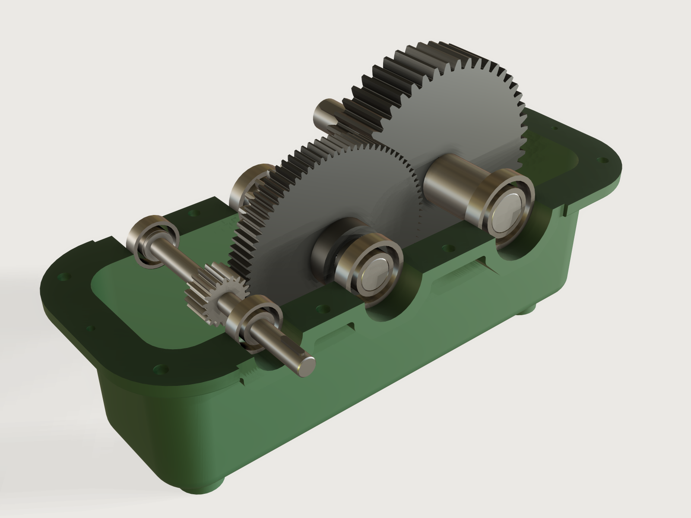

# Two-stage gear reducer

A two-stage spur gear reducer in a split cast iron housing, sized from what the designer knows: the overall ratio, the
input speed, the power, the kind of driven machine and the gear steel. The teeth, modules, face widths, shafts, keys and
bearings follow by formulas from the standards and textbooks named below; the drafted and rounded casting grows around
them, and one slider turns the input so that every gear rolls on its mate. A first sizing for a gear designer to check,
with the files a pattern maker and a machine shop need.



## What it shows

- **A form that asks for the job.** Ratio, input speed (rpm), power (kW), driven machine and gear steel go in; out
  come the tooth counts, modules, centre distances, face widths, bending stresses, contact ratios, backlash, bearings
  and their shortest life, shaft ends, oil level and quantity, and the mass (the outputs). Labels that start "Check:"
  are helpers that feed an assertion.
- **Structure from formulas and tables.** The wheels' tooth counts follow the ratio (`round`, with a hunting-tooth
  step: a wheel never has a multiple of the pinion's 19 teeth). Each stage's module is the first row of the ISO 54 table
  (`table.set`, rows 1.5 to 16 mm) that passes the Lewis bending check, leaves room for the bearings, a bolt and the
  wheel of the other stage, and keeps the pinion's root above its shaft, written as a sum of comparisons over the
  table's rows; the face width is 12 modules. The 62-series bearings are chosen three times: first by the shaft torque
  (`ceil` over the bore codes), then twice from the gear forces and levers of the layout so far, by the basic load
  rating a 20 000 h life needs (a column of the bearing table); the modules and the layout are worked out again round
  each choice. The DIN 6885 key follows the seat diameter, each wheel's hub grows to carry its key, and the bolt size
  follows the cast wall.
- **Ranges that run one way** (`variable.publish`). The power's upper limit is a formula of the ratio, speed, driven
  machine and steel above it: where an 8 mm module in stage 1 or a 10 mm module in stage 2 would fail Lewis, where the
  output shaft would pass 95 mm, where the 62 series runs out of life (see Bearings), or 30 kW. The drive slider runs one full turn of the output, `360 deg * ratio_built`.
- **A drive parameter, no assembly.** *Turn the input* places every gear by `feature.transform`: pinion 1 turns with the
  input, each wheel rolls back by the tooth ratio from a phase where one of its spaces faces the pinion's tooth on the
  line of centres. The flanks are measured to keep their backlash gap at the current angle.
- **Involute gears drawn once.** One tooth (root fillet, radial foot, two flanks, tip and root arcs) is chained round
  by `sketch.pattern` (`chain` and `angle`) and extruded once. Each flank is two circular arcs through five points of
  its involute, evenly spaced along its length, and the faces stay cylinders, which keeps 200 teeth light (see Platform
  notes for why not splines or formula curves). The arcs leave the involute by at most 2.1 µm per millimetre of module
  on the 19-tooth pinions (5.2 µm at 2.5 mm, 20.6 µm at 10 mm, 33 µm at 16 mm; computed along the flank) and by a
  tenth of that on wheels of 87 teeth or more: true enough to see and to check meshes, but the drawing is not the cutting
  data: the gears are hobbed from their module and teeth, thinned for the backlash the outputs give. Each flank arc's
  centre is a formula of five involute points, so the tooth is points and arcs, which unite cleanly. The pinions are
  cut on their shafts: the tooth extrusion is united with the revolved shaft (`feature.boolean`). A wheel is its
  toothed rim, with the bore and keyway in the same sketch, united with a hub ring that runs on beyond the rim; both
  bores are chamfered at their outer ends.
- **A casting built whole and split.** Lower and upper blocks are extruded from one plan and drafted from the split
  plane (`feature.draft`), united, rounded at bottom and top (`feature.fillet`) and shelled (`feature.shell`), so the
  cavity has the same draft and inner rounds of R − e. A split flange ring and octagonal bearing bosses are added in one
  union; the bearing sides are faced flat round the bosses by one `intersect`, the junctions rounded, the bores and bolt holes cut in
  one subtraction, and the body split on z = 0 into two halves by two booleans. Two foot rails, a plug pad (spot faced for
  the drain and level plugs) and a breather boss are added to the halves.
- **Four views from one choice** (`feature.when`). *Open* shows the lower half with the gears, shafts, keys and bearings;
  *Closed* adds the upper half and the end covers; *Castings* and *Machined parts* leave only those bodies, so that
  exporting the model gives the pattern maker or the machine shop just their parts.
- **Assertions that measure the model** (71): counted teeth, the wheels' volume against the involute area integral,
  tooth thickness from the tip faces' area, the mesh gaps on both flanks, the bores' centre distance in the casting,
  every part's fit and axial seat, and the casting's draft, walls and tappings (see Checks). Outputs give the maker the
  bearing life, the oil to fill and the mass of what is shown (`variable.measure`: in *Closed*, the whole reducer).

A static model of a reducer is one ratio for one load at one angle; this is every ratio from 8 to 25, half a kilowatt
to 30, and it turns.

## The real thing

**How it works.** Three shafts lie in the housing's split plane. The input shaft carries pinion 1 (19 teeth), which
drives wheel 2 on the intermediate shaft; pinion 3 (19 teeth) on the same shaft drives wheel 4 on the output shaft.
Stage 1 sits at the input end of the housing, stage 2 at the other. The input leaves at the front, the output at the
back. Each shaft runs in two deep-groove ball bearings, one in each end wall, closed by press-in end covers (the ones
the shafts pass through carry a lip seal, not drawn). The wheels are keyed; both pinions are cut on their shafts. The lower half
holds the oil; the wheels splash it up.

**Sources, what was read.** The *KHK Gear Technical Reference* (printed edition, gear_guide1.pdf) was read for Table
3.1 (basic rack: addendum 1.00 m, dedendum 1.25 m, clearance 0.25 m, root radius 0.38 m; the JIS form of ISO 53),
Table 3.2 (modules, series I, extracted from JIS B 1701-2, the ISO 54 series), eq. 3.7 (no undercut at 20° from 2 /
sin² α = 17.1 teeth), Table 3.5 (top land) and eq. 10.9 (contact ratio). ISO 53, ISO 54 and ISO 6336 themselves were not
read. Shigley's *Mechanical Engineering Design*, chapter 14, was read in lecture slides of King Saud University that
reproduce it (secondary): the Lewis equation σ = Kv Wt / (F m Y) (14-8), the velocity factor for hobbed teeth Kv = (3.56
+ √V) / 3.56 (14-6c), Y = 0.314 at 19 teeth (Table 14-2) and the design factor on yield (Example 14-1). The other
sources are named where they are used; `meta.json` lists them with what was read.

**Teeth and ratio.** Both pinions have 19 teeth: above the undercut limit of 17.1, so no profile shift, and prime, so a
wheel that is not a multiple of 19 (the formula adds one tooth where it would be) wears in with every pinion tooth.
Stage 1 takes 1.3 √i of the ratio and stage 2 the rest. That split is this Jig's own: it makes wheel 2 large enough to
dip in the oil while wheel 4 dips no deeper than a sixth of its pitch diameter (asserted). The ratio built is within
0.3 % of the one asked at the defaults (12.53 for 12.5) and within 3 % everywhere (asserted).

**Tooth form.** Each gear has the ISO 53 rack's proportions: addendum 1 m, dedendum 1.25 m, tip and root clearance
0.25 m (asserted, measured on the model). The involute is drawn from a little above the base circle (t ≥ 0.15) to the
tip; below it a radial foot and a root fillet of 0.3 m, tangent to the root circle, finish the tooth. That root is a
simplification of the trochoid a hob generates: it carries a little less material than the generated root, and the
fillet is smaller than the rack's 0.38 m so that it stays under the mating tip's path.

**Backlash.** ISO/TR 10064-2 gives the minimum normal backlash for industrial gears as jbn,min = 2/3 (0.06 + 0.0005 a +
0.03 m) mm. The formula was found on a vendor's page; it reproduces, within 0.01 mm, the ISO/TR 10064-2 table that Gear
Solutions prints, which is how it was checked. This Jig thins every tooth so that each mesh has 1.25 times that
minimum (0.168 mm in stage 1 and 0.249 mm in stage 2 at the defaults), the rest left for manufacturing tolerances.

**Strength, a first sizing.** The teeth are sized by the Lewis formula with the Barth factor for hobbed teeth, on the
pinion (the weaker tooth, Y = 0.314 at 19 teeth), with the torque times the application factor KA and a face width of 12
modules: a stage's module is the smallest in the table whose stress stays within the steel's yield strength over
three (Shigley's design factor of Example 14-1). KA comes from the driven machine with an electric motor driving: 1.00
uniform, 1.25 light shocks, 1.50 moderate shocks, 1.75 heavy shocks (ISO 6336-1:2019, as Dinner reproduces the table
in Gear Technology, June 2021). Yield strengths are the Saarstahl data sheets' minimum Rp0.2: C45 normalised 305 MPa
(16 to 100 mm) and 42CrMo4 quenched and tempered 650 MPa (40 to 100 mm). At the defaults (4 kW at 1450 rpm, light
shocks, 42CrMo4) stage 1 runs at 90.3 MPa and stage 2 at 45.6 MPa against 216.7 MPa allowed. Stage 2 is the less
stressed: its module is set by the room wheel 2 needs beside the output shaft, not by its load.

**Shafts, keys and hubs.** Each shaft's smallest diameter carries its torque (times KA) in torsion at most 42 MPa, the
ASME code's value for shafts with keyways as Khurmi and Gupta give it (secondary); the bearing seat is at least 5 mm
more, rounded up to the next 62-series bore. The input shaft steps down between its bearings' shoulders to its end
diameter, so pinion 1 is cut above it. Wheels sit on seats 5 mm over the bearing bore, against a collar on one side and
a spacer on the other. The face width is 12 modules, inside the 3 to 5 circular pitches (9.4 to 15.7 modules) Shigley
gives (section 14-1, same slides); b / d1 is then 0.63 on the 19-tooth pinions. Keys are DIN 6885 form A (b × h, t1,
t2 by diameter, as fasten.it tabulates the standard). A key's working length follows its torque from the flank
pressure on the hub, p = 2 T / (d (h − t1) l) at most 150 MPa (steel hub) times 0.8, 0.7 or 0.6 for uniform, light or
heavier shock load (Ettemeyer, as schweizer-fn.de gives it; secondary). The key never sets the face width or the
module: it sits in the wheel's hub, which runs on beyond the rim toward the spacer. The hub is 1.8 bores across and at
least 1.25 bores long, never shorter than the rim (Gopinath and Mayuram, IIT Madras, *Machine Design II*, module 2,
lecture 17, read in a SlideShare copy), here at
least 5 mm longer than the rim, and longer still where the key needs it, to the whole millimetre; Lobben's
*Machinists' and Draftsmen's Handbook* (1910, p. 395, read) puts cast hubs at 1½ to 2½ bores long, and over the
range the longest hub here is 2.2 bores. At the defaults the hubs are 50 and 65 mm on rims of 30 and 60 mm. A wheel
key's pressure is therefore at most the allowed by construction, with only the rounding as margin: the assertion on it
guards the modelling, not the design. The rim under a wheel's keyway is at least 2.7 modules: the AGMA backup ratio of
1.2 (Shigley eq. 14-39 and 14-40, same slides).

**Bearings.** 62-series deep-groove ball bearings, d × D × B and the basic dynamic load rating Cr as the NSK ball
bearing catalogue prints them (6200 series table, page B-11, in lbf, converted at 4.448 N/lbf; read in the copy at
static.chipdip.ru/lib/930/DOC028930011.pdf). Each shaft's pair is first chosen by the bore its torque needs; then the
loads that layout puts on them choose again, twice. A spur gear's force on its shaft is F = 2 T / (m z cos α) along
the line of action (the design torque, with KA); each bearing takes its share by the lever of the gear's place between
the two bearings, and on the intermediate shaft the tangential parts of the two gears' forces add while the radial
parts oppose. The pair is the first whose Cr reaches 1.05 times the load times (L10h · 60 n / 10⁶)^(1/3) for a life of
20 000 h, the basic rating life of ISO 281 (L10 = (C / P)³ million revolutions, P the radial load: spur gears put no
axial load on their bearings). 20 000 h lies in the band Autodesk Inventor's help (*Guiding Values of Basic Bearing
Life Lh*, read) gives for machines designed for 8 to 16 hours of operation, gear drives among them: 15 000 to 30 000 h.
The life a buyer specifies may differ. After each choice the modules, widths, hubs and layout are worked out again,
never with a smaller module than the pass before, so the forces only fall; the 5 % covers the levers, which shift a
little as the widths and hubs settle. The life of each bearing is then computed from the final layout (an output gives
the shortest, 34 415 h at the defaults) and asserted at least 20 000 h. Where even a 6220 would not last, the form
stops the power: the intermediate shaft's design torque times its speed to the power 0.6 stays under 42 000 N·m
(rpm)^0.6, a bound this Jig found by scanning its own rules (it lowers the power limit in about 45 % of the
combinations of ratio, speed, machine and steel, most by a little: from 23.5 to 22.6 kW for the form test's mixer,
from 26.6 to 17.9 kW at ratio 8, 500 rpm, heavy shocks, 42CrMo4). A scan of the same rules in Python over 249 000
points of the form's range (a grid of every choice and wall, and 60 000 random points) found no point under 20 000 h;
the closest, 22 280 h, is at ratio 8, 1250 rpm, light shocks, 42CrMo4, 21 kW. Loads from a coupling or a pulley on the
shaft ends are not included: with a belt drive, add its pull and check again.

**What this Jig does not claim, and who must check it.** This is a first sizing. There is no ISO 6336 (or AGMA 2001)
rating: no tooth root stress by ISO 6336-3, no pitting or contact stress, no scuffing, no dynamic or load-distribution
factors beyond the Barth factor. Shafts are sized for torsion only: no bending from the tooth forces, no deflection, no
fatigue, no critical speed. Bearing life is the basic rating life L10 for the design load, with no modified life
(ISO 281's aISO for lubrication and contamination), no overhung load and no static check. Keys are checked in surface
pressure only. A gear designer must rate the gears to ISO 6336, the shafts for combined bending and torsion and
fatigue, and the bearings to the maker's catalogue for the real duty before anything is made.

**The housing.** Grey cast iron EN-GJL-250 (7.20 g/cm³, Kemptener Eisengiesserei's table after EN 1561), sand cast in
two halves split on the shaft plane. Every cast face is drafted 1.5° from the split, both halves narrowing away from it
(their cavities are formed by the cope sand or a core, which draws the other way: both are asserted). VDG-Merkblatt K
200 (read) gives draft for machine moulding in millimetres by height (2.5 mm up to 180 mm, 3 mm up to 250 mm); 1.5° gives
more at every height of this housing. Walls are the form's *Cast wall* (8 mm up to 10 to 16 mm as the reducer grows; K 200 puts the minimum for hand
moulding at about 10 mm). Outer rounds are R = 2e and the inner ones r = e, K 200's rule for a corner of two walls of
thickness e; the flange's and bosses' junction rounds are 0.5 e, between K 200's 0.3 E at a T-junction and e at a corner
(this Jig's choice). The split flange is 1.5 e thick and carries eight through bolts with nuts, two between each pair
of bearings and four at the corners; bolt size M10 to M20 follows the wall (this Jig's proportion), in clearance holes of
11, 13.5, 17.5 and 22 mm: the medium series of IS 1821:1987, the Indian standard identical with ISO 273-1979 (read,
clause 2, at law.resource.org/pub/in/bis/S01/is.1821.1987.pdf). Two dowels, 8 mm (10 mm from M16 bolts), locate the cover on the base at the two ends of the flange: drilled
through the cover's flange and blind in the base's. The bearing bosses are octagons round the bore whose sides lean in
by the draft, so that every face of a boss draws from the mould; their corners along the shaft are rounded e, or
less where a small boss's chamfer is short. The
machined faces are the split faces, the bearing bores, the bearing sides of the bosses and the flange between them
(faced flat in one pass), the plugs' spot faces and the feet; they are left square.
The lower half stands on two cast foot rails across its ends, each with two blind tappings from below (one bolt size
up from the flange): a thread of 1.5 d, the engagement grey iron needs, and 3 mm of drill run-out, all inside the rail,
which is 3 mm deeper still, so the floor above stays a full wall under the oil (measured). At the defaults the four
foot bolts stand 462 mm apart along the line of shafts and 64 mm across it (two outputs give both). The feet stay
under the floor's flat: a foot reaching beyond the walls would face up into the drag, an undercut in this parting.
Against an overhung belt or chain pull on a shaft end, bolt the reducer to a base frame that takes the pull, or have
the pattern maker add cored feet wider apart. A pad on the output end, standing
0.6 e proud of the drafted wall from the flange to the floor, carries an M16 × 1.5 drain plug just above the floor and
an M16 × 1.5 level plug at the oil line, each on a spot face of 26 mm cut square to its hole; the cover carries an M16 × 1.5 breather. All three are tapped 14.5 mm, d − P. Not drawn: the seal bores of the
end covers (a lip seal to ISO 6194-1 / DIN 3760 sits in the covers the shafts pass through; its housing bore is for
the machine shop to add from the seal maker's table) and the threads themselves (tap drill sizes are modelled).

**Oil.** Splash lubrication: the oil level is set so that wheel 4 dips at least 3 modules (Klüber: 3 to 5 modules up to
5 m/s) and wheel 2 at least 2 modules; wheel 4 then dips at most a sixth of its pitch diameter, and the pitch line speed
of stage 1 is at most 12 m/s (both from Maláková et al., GRANT journal 10(2), and asserted). At the defaults the level is
106 mm below the shaft axes, wheel 4 dips 28.75 mm, and the sump takes about 4.8 litres (an output: the cavity's
plan at the oil's mid-depth times its height, less the floor's inner round; what the wheels displace is not
subtracted). The sump floor lies at least 30 mm (or 4 modules) under the
largest wheel's tips: this Jig's choice, in line with a gearbox maker's page that says 30 to 50 mm.

**Making it.** Patterns from the *Castings* STEP (add the foundry's shrinkage, 1 % for grey iron per K 200, and
machining allowance on the machined faces: the model is the finished part). Machine the split faces, drill the dowel
holes through the cover into the base and bolt the halves together on their dowels, then bore all six bearing seats in one setting and face the bearing sides, so that the bores are
coaxial and the centre distances exact. Turn the shafts between centres, hob both pinions on their shafts and the
wheels on an arbor, mill the keyways. Assemble: press each wheel with its key onto its seat against the collar, slide on
the spacer, press the bearings onto the shafts, lay the three shafts with their bearings into the lower half, close with
the cover, bolt, fit the end covers and seals, fill oil until it runs from the level plug (an output gives about how
much).

## Parameters

| Group | Parameter | Range | What it changes |
|---|---|---|---|
| Drive | Turn the input | 0 to one turn of the output | Turns every gear by its ratio |
| The job | Overall ratio | 8 to 25, step 0.1 | Tooth counts of both wheels, the split between the stages, everything sized from them |
| The job | Input speed (rpm) | 500 to 1500 | Pitch line speeds, the Barth factor, torque for a given power |
| The job | Driven machine | uniform, light, moderate, heavy shocks | KA on the torque the gears and shafts are sized for; the allowed key pressure |
| The job | Gear steel | C45 normalised, 42CrMo4 quenched and tempered | Allowed bending stress, so the modules |
| The job | Power (kW) | 0.5 to a limit from the rows above (30 kW at most; 8.4 kW at ratio 25, 500 rpm, heavy shocks, C45) | Modules, face widths, shafts, bearings (by torque and by life), keys, and with them the whole housing |
| Housing | Cast wall thickness | 8 mm to a limit that grows with the reducer: 10 mm on the smallest, 12 mm at the defaults, 16 mm from an 80 mm output bearing bore (this Jig's proportion) | Walls, rounds, flange, bosses, bolt size, feet |
| View | Show | Open, Closed, Castings, Machined parts | What is built and exported |

## Checks

The Jig carries 71 assertions. Each view proves its own part, so that dragging the drive in *Open* stays light: *Open*
checks the teeth and meshes, *Closed* how every part sits in the assembly, *Castings* the casting, *Machined parts*
the wheels' seats; the formula checks run in every view. The fits are therefore not checked in the default *Open* view;
`check-range` tries every *Show* choice, and the far points below were tried in *Closed* by hand.

- **Teeth and ratio, on the model.** Every gear's teeth counted as faces of one flank family equal the number the ratio
  asks for; the ratio from the counted teeth is the ratio shown; it is within 3 % of the ratio asked; no pinion has
  fewer than 2 / sin² 20° teeth (counted).
- **Tooth form, closed form.** The volume of each wheel equals the face width times the area of its outline by Green's
  theorem (the root and tip arcs, the involute's rb² t² / 2 dt on each flank, the two root fillets, times the teeth, less
  the bore and keyway, plus the hub ring beyond the rim, less the bores' two chamfers), within 0.05 %; at the
  defaults the two agree to 0.4 and 4.5 mm³.
  A wrong module, tooth count or flank fails it.
- **Tooth thickness and backlash, measured.** The area of every gear's tip faces equals the teeth times the face width
  times the top land of KHK Table 3.5 with this Jig's backlash taken off, within 0.3 %, written from the module, teeth
  and backlash alone. A tooth not thinned (tried) fails it.
- **The meshes, measured at the current angle.** For each stage the least distance from the pinion's leading flanks to
  the wheel flanks they face, and separately from its trailing flanks to theirs, is an output ("Check: mesh gap"): at
  least 0.001 mm (crossing flanks measure 0) and at most 1.2 times the design gap. With the tooth thickness above, the
  two sides add up to the design backlash, so the narrower is at least 0.8 of the design gap, the ISO/TR 10064-2
  minimum. Wheel 4 turned 0.05° out of phase (tried) opens one side to 0.232 mm and fails it. At the defaults the gaps
  are 0.081 and 0.084 mm (design 0.084) in stage 1 and 0.125 mm on both sides (design 0.124) in stage 2. The tip clearance is
  measured at least 0.25 module on both stages.
- **The assembly, measured in *Closed*.** Nothing on a shaft overlaps it: wheel, keys, spacer and bearings (a bearing
  seat 0.4 mm large, tried, fails it); the keys and spacers do not overlap the wheels (a keyway 1.5 mm shallow, which
  lifts the key into the hub, tried, fails it), nor the spacers the bearings. Each wheel bears on its shaft's collar
  with its rim and on its spacer with its hub, and each spacer on the bearing's inner ring, with no end play (wheel 4
  moved 3 mm along its shaft, wheel 2's spacer 3 mm short and wheel 4's hub 3 mm short, tried, fail them). Each pair of bearings lies on its shaft
  seats and in its housing bores; the bearing bores lie m (z1 + z2) / 2 apart with the teeth counted, less the
  bearings' radii, within 0.01 mm (a bore moved 0.5 mm, tried, fails it); wheel 2 clears the output shaft and pinion 3
  the input shaft by at least 5 mm; the wheels clear the housing by at least 9 mm (designed for 11 mm at an 8 mm wall;
  the measure's proven bound runs about 1 mm under what it finds on these faces). In *Closed* and *Machined parts* the
  shafts clear the end covers by at least 0.4 mm. In *Machined parts* each wheel's bore lies on its seat with no play
  and does not overlap its shaft (a bore 0.2 mm over, tried, fails it).
- **Strength, life and lubrication, from the formulas.** Lewis stress within yield / 3 on both stages; contact ratio
  at least 1.2 (KHK asks 1; 1.69 and 1.65 at the defaults); each shaft's torsion within 42 MPa; each key's flank
  pressure within the allowed (by construction, see above); the rims under the keyways at least 2.7 modules; both
  pinions' roots above their shaft's shoulder or collar; the shortest bearing life L10h at least 20 000 h; pitch line
  speed at most 12 m/s; wheel 4 dipping at most a sixth of its pitch diameter.
- **The casting, measured in *Castings*.** In each half every cast outside face is drafted at least 1° against its
  mould's pull and every inside face against its core's (planes and cones, proven exactly; a draft of 0.7°, tried,
  fails all four); the walls, floor and top are as thick as the *Cast wall* chosen, measured between the parallel faces
  of each wall (a shell 1 mm thinner, tried, fails both); the foot tappings stay a full wall clear of the oil (tappings
  drilled 3 mm into the floor, tried, fail it). The rounds are left out of the draft check: their normals lie between
  those of the two drafted faces they join, so their draft is at least the smaller of the two; 3DCraft bounds draft on
  rounds only loosely (F-102 in the examples' feedback). Wall thickness is measured between faces because
  `measure.thickness` proves 0 on a drafted shell (F-020).

**Range.** `tools/jigs.py check` runs `check-range` over the defaults, the corners of the box of the ranges, every
choice and 32 random points; the result is in `meta.json` `stats`. By hand (`param.set`), these far points pass every
assertion that applies: ratio 8 at 1500 rpm, uniform, 42CrMo4, 0.5 kW, 8 mm wall, in *Closed* and *Castings*; ratio 8
at 500 rpm, heavy shocks, 42CrMo4, at its limit of 17.9 kW, with an 8 mm wall in *Closed* and a 16 mm wall in
*Castings*; ratio 25 at 500 rpm, heavy shocks, C45, at its limit of 8.4 kW with a 16 mm wall, in *Closed* and
*Castings*; ratio 25 at 1500 rpm, uniform, 42CrMo4, 30 kW, 8 mm wall, in *Closed* and *Castings*; ratio 11 at 500 rpm,
uniform, C45, at its limit of 29.4 kW (stage 2 at a 16 mm module) with a 16 mm wall, in *Closed* and *Castings*; ratio 8
at 500 rpm, uniform, C45, 0.5 kW, 9 mm wall, *Castings*; the 12 mm wall (the limit there) at the defaults, *Castings*;
and ratio 20 at 960 rpm, moderate shocks, 42CrMo4 at 7.5 kW (the form test's mixer) and 20 kW, *Closed*. Their sizes
are a gear designer's, not a key's: at ratio 25, 1500 rpm, uniform, 30 kW the modules are 4 and 8 mm (Lewis 141 and
94 MPa of 217 allowed), the housing 1 184 mm long over its flange and the reducer 603 kg; at ratio 20, 960 rpm,
moderate shocks, 20 kW they are 5 and 10 mm (108 and 66 MPa), 1 326 mm and 820 kg. Across the range at its power
limit stage 1 runs at 35 to 100 % of the allowed stress (median 67 %) and stage 2, whose module the room beside wheel
2 sets, at 22 to 100 % (median 50 %). The form refuses a power above its limit (22.6 kW at ratio 20, 960 rpm,
moderate shocks, 42CrMo4) and a ratio above 25. Found on the way and fixed: feet that collided on a narrow housing; a
flange round that survived the facing as a sliver above a 10 mm wall; the housing's rounded corner coming within
9.9 mm of wheel 4's tip edge; on the first full range check, a facing cut that grazed the flange's corner arc on a
large reducer (now faced only round the bosses), stage 2 running out of modules before wheel 2 cleared the output
shaft at ratio 8 and 22 kW (the table now goes to 16 mm), pinion 1's root falling under its shaft's shoulder at 0.5 kW
and 500 rpm (now a condition on the module), and feet that did not fit a thick wall on the smallest reducer (the
wall's limit now grows with the reducer); in review, foot tappings that broke into the sump (now blind tappings in
solid rails, measured), and a key that set the face width and then the module, which swelled the reducer at high
torque (now the wheels' hubs carry the keys); while revising, a plug pad whose sides drafted to nothing and whose top
stood out of the flange on the largest reducer (now drawn from the side, standing a fixed 0.6 e proud of the wall);
and on the range check, the bosses' corner rounds too large for a small boss at an 11 mm wall (now limited by the
boss's chamfer).

Not checked: anything in *What this Jig does not claim*; the meshes at angles other than the one set (the range check
and the slider try many); the press-in covers and keys, which are bought or simple parts.

## Export

- **Pattern maker:** set *Show* to *Castings: both halves* and export the model as STEP: the two halves, finished size.
- **Machine shop:** set *Show* to *Machined parts* and export STEP: the three shafts (two with their pinions), the two
  wheels, two spacers and three pairs of end covers.
- **The whole reducer:** *Closed*, STEP.

## Files

`build.json` (the source), `meta.json`, `formtest.md`, `preview.png`, and `gear-reducer.3dcraftjig`,
`thumb.png` from the tool. No generator is committed.

## Rebuild

```sh
tools/jigs.py build gear-reducer
tools/jigs.py render gear-reducer
tools/jigs.py check gear-reducer
```

## Difficulty

8 out of 10, the reviewer's score: a sizing in three passes over standard tables, involute gears
drawn by formulas and turned by one drive, a drafted and split casting round them, and fits proven across the range.

## Platform notes

The preview is rendered without reflections (`look.reflections: false`): with them the wheels' flat faces showed ghost
images of the other wheel.

- **Rounds where a boss meets a drafted wall.** A cylindrical boss meets a drafted wall in an ellipse, and rounding it
  together with the flange's junction is refused ("fillets of freeform edges that meet in a vertex are not built yet");
  rounding them one after another is refused too ([finding](../../findings/J-048-rounds-on-drafted-wall/repro.json)).
  The bosses are therefore octagons, whose junctions with the wall are straight; their corners along the shaft are
  rounded, and the rounds where they meet the flange are built, but their junction with the wall itself could not be
  rounded in this housing (refused with "tangent contact of higher order" or a fillet that does not end cleanly, though
  the same round on a plain drafted plate builds). Those edges, and the plug pad's junction with the end wall, are left
  sharp: a pattern maker would add them.
- **A tooth drawn as one `sketch.path` cannot be united.** The same tooth outline drawn as one path (fillets tangent to
  the root circle, flank arcs given by points they pass through) extrudes, but any boolean with a body that crosses or
  touches its end faces failed in this Jig ("two curves leave a point in the same direction and stay together"); a
  minimal reproducer of it does not fail at the pin, so it is not filed. Every gear is therefore drawn with points
  and arcs whose centres are formulas: the pinions are united with their shafts, the wheels with their hubs.
- **Flanks as arcs, not splines or formula curves.** A live spline through five involute points left the mesh gap
  varying by −20 to +9 % over the angle (nine points still ±6 %); an exact `sketch.curve` gave the gap to 0.0001 mm but
  is always fitted with 35 control points whatever the document's tolerance, which made each wheel several seconds of
  load ([finding](../../findings/J-066-formula-curve-fit-size/involute.json)).
- **A round cannot be added while its bodies are switched off.** A `feature.fillet` given a `when` that is false when
  it is added is refused because its faces "are not one body" ([finding](../../findings/J-029-fillet-refused-while-inactive/repro.json)).
  `build.json` therefore builds with *Show* at *Closed* and sets *Open* just before publishing.
- **Proven bounds on gear flanks are loose.** `measure.distance` between the flanks finds the gap but proves only a
  fraction of it on some sizes (0.093 mm found, 0.016 mm proven), the family of the planetary gearbox's finding on
  `clearance` ([finding](../../findings/J-019-assertion-stops-short/clearance.json)).
- **A distance assertion with both bounds stops proving early.** Between a pinion's flanks and the wheel flanks they
  face, a gap opened to 0.232 mm by a tooth 0.05° out of phase comes back unproven against 0.001 to 0.15 mm ("at least
  0.093 mm"), while the same assertion with only the max fails it (at least 0.230 mm), and `measure.distance` proves
  0.230 mm ([finding](../../findings/J-019-assertion-stops-short/repro.json)). The gaps are therefore outputs
  (`variable.measure`, which holds the distance found and is known only when proven to the document's tolerance) and
  the assertions bound those outputs both ways.
- **No chamfers on the teeth.** The wheels' bores are chamfered 1 mm (`feature.chamfer`, cheap here: the wheels' faces
  are arcs and planes), but the teeth's ends are left square: a chamfer along a chain of tooth flanks is refused
  ([finding](../../findings/J-047-chamfer-freeform-rim/tooth-chain.json), from the planetary gearbox). The machine shop
  deburrs them as usual.
