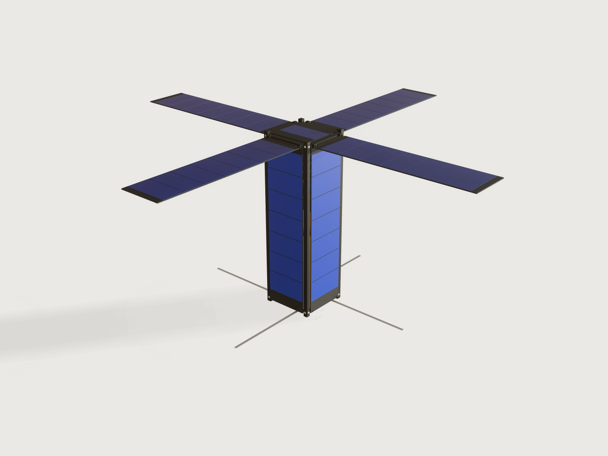

# CubeSat

Choose the form factor (1U, 1.5U, 2U, 3U or 6U) and your payload: its kind, length and mass. Set how many PC/104 boards
you fly, the battery, the downlink frequency and the solar wings. The Jig lays out a CubeSat to the CubeSat Design
Specification around them:

- four hard-anodised rails screwed to two end frames with standoff bosses;
- the PC/104 stack on four rods, and the battery;
- body, +Z and deployable solar panels, the wings on pinned hinges;
- a turnstile antenna a quarter wave long, at the −Z end beside the camera and away from the wings.

Drag the deployment from stowed in the dispenser to open in orbit. The form keeps the payload inside the CDS mass and
centre-of-gravity limits, and proves the mass budget and the centre of gravity against a hand sum of every part.



## What it shows

- **One table drives the satellite** (`table.set`, `choicesFrom`). The table `cds` holds each form factor's width, height
  and rail length (CDS Appendix B), its mass limit (Table 1) and its centre-of-gravity limits (Table 2); `batteries` holds
  the 18650 packs. A choice redraws the rails, frames, panels and cell arrays, and changes the limits the form enforces.
- **The structure changes, not only its size.**
  - A 6U frame gets two more lightening windows (a cut with `when`).
  - The cells per panel and per wing are counted from the face (`sketch.pattern` with counts from `floor`).
  - The board count sets the stack and its spacers (`feature.pattern`); the battery has one or two layers of cells.
  - The payload is a box, a camera with a lens, or nothing.
  - The wings come as none, two or four, each with its hinge (`feature.when` on every wing part).
- **A drive parameter, *Deployment*.** At 0 the satellite sits in the dispenser: RBF pin in, deployment switches and
  separation springs pressed flush with the standoffs. Above 0 it is ejected: the springs stand out by their stroke and
  the switches by their travel. Between 10 and 50 % the wings turn on their hinge pins to 90° (`feature.transform` with a
  pivot, knuckles turning with them). Between 60 and 100 % the four tape antennas unroll at the −Z end. The −Y and −X
  wings are mirrors (`feature.mirror`).
- **Ranges that are formulas.** These limits all come from formulas:
  - the payload length, the board count and the battery (a choice with a `max`), from the bay's length and the stack;
  - the payload mass, from a closed-form mass and centre-of-gravity budget.

  So a stack that does not fit, or a payload that is too heavy or too low, cannot be entered.
- **A mass budget as outputs** (`variable.measure`): the total mass and each subsystem, all measured. Also:
  - the measured centre of gravity, the mass left under the CDS limit and the heaviest payload allowed;
  - the antenna's length, how far the deployed wings are from it in wavelengths, and a flag when they are inside its
    reactive near field;
  - the cell count, the peak power and the battery energy.
- **Assertions that measure the model:**
  - against the CDS: the rail envelope, the rail width on both faces, the edge radius, the standoff contact and height,
    the 6.5 mm protrusion zone on each side, nothing past the standoffs, switches flush when stowed, springs out when
    ejected, mass and centre of gravity;
  - against the build: the PC/104 hole places, every screw hole lined up with its tapped hole and the wall round it, the
    rail's screw heads flush, the hinge pins in their bores and deep enough, the knuckles bonded to the wings, the
    antennas clear of the wings by the distance the form reports.

  Two of them are closed forms: the mass and the centre of gravity of every part, summed by hand.

A drawing of a CubeSat holds one configuration. This one is the satellite you describe, and it refuses one that the
dispenser would refuse.

## The real thing

**The standard.** [CubeSat Design Specification Rev. 14.1](https://www.cubesat.org/) (CP-CDS-R14.1, Cal Poly SLO,
February 2022, public domain), read in full: sections 2.1 to 2.4 and the Appendix B drawings CDS-14-001 to 008.
Credit: the CubeSat Program, Cal Poly SLO. What the Jig takes from it, and where:

| What | Value | Clause |
|---|---|---|
| Envelope across the rails, rail length | 100 × 100 mm for 1U to 3U, rails 113.5, 170.2, 227.0 and 340.5 mm long; 6U 226.3 × 100 mm, 366.0 mm long | 2.2.1, Appendix B drawings |
| Coordinate system | origin at the geometric centre, −Z enters the dispenser first | 2.2.1, 2.2.2 |
| Protrusions | at most 6.5 mm normal to the rail plane, on the faces between the rails | 2.2.3 |
| Deployables | constrained by the CubeSat, not the dispenser | 2.2.4 |
| Rail width | at least 8.5 mm from the rail's edge to the first protrusion on each face | 2.2.5 |
| Rail surface | roughness under 1.6 µm, met by anodising | 2.2.6 |
| Rail edges | rounded to at least 1 mm | 2.2.7 |
| Standoff | the rail end stands 0.5 to 7.0 mm (reference, 0.1 min) proud of the ±Z faces; contact at least 6.5 × 6.5 mm | 2.2.1.2, 2.2.8, Appendix B detail A |
| Rail contact | at least 75 % of the rail in contact with the dispenser rails | 2.2.9 |
| Mass | typical maximum 2.00, 3.00, 4.00, 6.00, 12.00 kg (a note: larger masses by agreement) | 2.2.10, Table 1 |
| Centre of gravity | ±20 mm in x and y (±45 mm in x for 6U); ±20, 30, 45, 70, 70 mm along z | 2.2.11, Table 2 |
| Material | aluminium alloy (7075, 6061, 6082, 5005 or 5052) | 2.2.12 |
| Hard anodise | on rails and standoffs that touch the dispenser | 2.2.13 |
| Separation springs | at the −Z standoffs, force under 6.7 N, stroke over 2.5 mm, not past the standoff when stowed | 2.2.14, Figure 5 |
| Deployment switches | at least one, pressed while in the dispenser, at or below the contact surface | 2.3.2, Figure 5 option A |
| RBF pin | cuts all power; at most 6.5 mm from the rail surface when inserted; in the access port if the dispenser has one, else removed before integration | 2.3.4, 2.3.5 |
| Deployables | wait at least 30 minutes after ejection; three inhibits | 2.4.4, 2.3.8 |

**The PC/104 stack.** [PC/104 Specification Version 2.4](https://pc104.org/) (PC/104 Embedded Consortium, August 2001),
read: section 2 and the module drawings of Appendix A (pages A-2, A-3).

- **Board:** 3.550 × 3.775 in, 1.6 mm thick (the metric drawing).
- **Mounting holes:** four of Ø0.125 in, at (0.200, 0.200), (3.350, 0.200), (0.350, 3.575) and (3.250, 3.575) in from the
  corner. The pattern is not a rectangle, and an assertion holds every hole to its place.
- **Stacking:** the modules stand on 0.6 in spacers (Figure 1). Components on the primary side are at most 0.435 in tall.
- **Bus connectors:** J1/P1 (2 × 32 pins) and J2/P2 (2 × 20) are drawn as blocks over their pin rows, 0.435 in tall.
  - J1 rows lie 0.400 and 0.500 in from the edge, pins 1 to 32 from 0.250 in.
  - J2 rows lie 0.200 and 0.300 in from the edge, pins 0 to 19 from 1.050 in.

Many CubeSat boards use the CubeSat Kit's H1/H2 headers instead (a vendor's bus, not this standard; I have not read its
specification), so the connectors stand for the stack's bus and are not a pin-exact H1/H2.

**The structure.** Everything follows from the PC/104 hole pattern. The two lower holes lie 1.5 mm inside the inner faces
of 8.5 mm rails, so the frames reach into the rails' corners, and the rails stay L-shaped.

- **Rails**: an L section, 8.5 mm on each face, the full length of the CubeSat, its three outer edges rounded to 1 mm.
  - Milled from bar. Over the 11 mm at each end, where the frames sit, the legs are 3 mm thick. In the bay they are cut
    to 1.5 mm by a Ø3 end mill along one leg, its radius left at the step; the 1.5 mm leaves 0.56 mm between a 3.775 in
    board and the rail.
  - At each end two countersunk M2 holes go through the thick legs, one per leg, 4.8 mm in from the corner and at the
    frame plate's mid-plane. The holes are Ø2.2 (close fit), countersunk 90° to Ø4.4 and 1.1 mm deep, which leaves 1.9 mm
    of the 3 mm leg under the head.
  - Ø4.4 is the *theoretical* head diameter of an ISO 7046-1 M2 countersunk screw: the sharp edge of its 90° cone, which
    runs 1.2 mm (k) down to the Ø2 shank. The real head is Ø3.5 to 3.8, its edge flat or rounded, but its cone, extended,
    still reaches Ø4.4 at the top face. A countersink of Ø3.8 would hold the cone 0.3 mm higher, the head proud of the rail
    face. In a Ø4.4 countersink the head sits flush or just below, the rail face stays the sliding surface (CDS 2.2.9),
    and the 100.0 mm across the rails holds. (ISO 7046-1 refers to ISO 7721 for gauging the head, which I have not read.)
  - The countersink's rim stays 0.5 mm clear of the leg's 1 mm tip round and 1.6 mm clear of the corner round.
  - The end edges are broken 0.3 mm.
  - The rails come in two hands, two of each: the step's radius lies on one leg only. Rails (+X, +Y) and (−X, −Y) are
    one hand, (−X, +Y) and (+X, −Y) the other.
- **End frames**: from 11 mm 6082-T6 plate, a 5 mm plate with a 6 mm standoff boss at each corner.
  - **Bosses**: each fills the inside of a rail's L flush to the rail end; the rail end and the boss together are the
    standoff contact. Each has a Ø3 × 6 mm bore for a plunger: at −Z two take the separation springs and two the
    deployment switches (Figure 5, option A); at +Z they stay empty.
  - **Rebates**: the plate is rebated 3 mm along each face where the rails' legs lie. The rebates end in a Ø6 cutter's
    radius, 0.5 mm clear of the rail tips, and meet the faces square.
  - **Openings**: a central opening of 60 × 72 mm (6 mm corners); a 6U frame has two side windows as well.
  - **Tapped holes**:
    - four M3 × 4 for the stack's rods, in the PC/104 pattern, with 1 mm of floor;
    - four M2 × 4 in the outer face, for the +Z panel at the top and the antenna module at the bottom;
    - eight M2 × 4 from the rebates, for the rail screws, each 1 mm from the other leg's rebate;
    - eight M2 × 4 in the faces at the plate's mid-plane, for the body panels' screws.
  - **Edges**: the bosses' tops and the plate's face edges are broken 0.3 mm.
  - **Hands**: the top and the bottom frame are mirror images. Only the M3 pattern breaks the symmetry; in the bottom
    frame those holes fix the payload. Make one of each.
- **Fasteners**: everything holds by M2 screws into tapped 6082.
  - Each rail end takes two ISO 7046-1 countersunk screws into the frame.
  - Each body panel takes four screws, and each hinge bracket shares a panel screw: one countersunk screw goes through
    the bracket and the panel into the frame.
  - The panels' other screws are ISO 7045 pan heads (Ø4.0 × 1.6 mm). A Ø4.4 countersink in 1.6 mm FR4 would leave a
    0.5 mm knife edge, so the boards have plain Ø2.2 holes. The heads sit in the panels' end strips, 0.5 to 4.5 mm from
    the board's end: clear of the cells and, at the −Z end, 6 mm clear of the stowed wing's free end. At the +Z end a
    panel with a wing has all its screws through brackets.
  - The +Z panel takes four pan heads; the antenna module four countersunk screws.

  Assertions prove each screw hole lies on its tapped hole, and keep a wall round each:
  - 1.5 mm from a hole to the rail leg's end;
  - 1 mm of rail leg under each countersink, and 0.5 mm of flat face between its rim and the rounded edges;
  - 1 mm from each side tapped hole to the frame's faces, from each rail tap to the other leg's rebate, and from the M2
    to the M3 holes.

  The rail screws' heads are drawn at their theoretical size, a 90° cone of Ø4.4, flush with the rail face, and an
  assertion proves that they do not cut into the rail: a real head seats flush or lower. The other screws, and the
  shanks, are not drawn.
- **Finish**: hard anodise, black, on rails, frames and hinge brackets (CDS 2.2.13), which also gives the rail surface
  of 2.2.6. The drawings' general note asks to round all edges and corners. Besides the rails' 1 mm edges, the tool radii
  and the 0.3 mm breaks above, the remaining edges get the machinist's usual edge break, which is not drawn.
- **Body panels**: the four are FR4 boards screwed to both frames, and act as the structure's shear panels. A 3U flight
  structure often adds ribs at the U lines. They are not drawn, because a full rib would cut through a long stack.

**Inside**, from the top:

- The +Z panel (FR4, one row of cells) closes the top frame.
- Below the frame hangs the PC/104 stack: the avionics boards at 0.6 in, then the battery board two or three pitches
  lower, on four M3 stainless rods screwed into the frame, with aluminium spacers.
- **The stack is cantilevered from the top frame.** Its lower end is free: 74 mm above the payload at the defaults, and
  a 3U without a payload takes up to 18 boards. A flight unit would tie the stack's lower end to the structure (a bracket to the rails or a
  mid-frame); that is not modelled, and the stack's stiffness under launch loads is not checked.
- The payload stands on the bottom frame, at least 3 mm below the stack.
- A camera's lens looks out through the bottom frame and the antenna module's Ø52 mm aperture, to 1 mm inside the rail
  ends.

With a 6U, everything is centred in the wider bay.

**Solar panels.** The cells are AZUR SPACE 3G30A-Advanced assemblies: cell, interconnectors and coverglass, a CIC
(`cic` in the variables). They are read from the 4×8 datasheet DB 00010891-01 (April 2025): 40.15 × 80.15 mm, 290 µm
thick, 3.6 g, 2411 mV and 499 mA at maximum power. That gives 1.203 W at the beginning of life (AM0, 1367 W/m², 28 °C).

- **Body panels**: each is a 1.6 mm FR4 board between the rails, 0.5 mm clear of each rail's leg, from frame to frame.
  It keeps a 12 mm strip at the −Z end (the RBF pin on +X) and a 7 mm strip at the +Z end (screws and hinge brackets).
  As many rows of cells as fit go between, with 1 mm gaps. The +Z panel carries one row.
- **Wings**: a wing is a board of the same width, hinged at the +Z end and lying 1 mm over the body cells when stowed;
  its free end stops 1 mm above the RBF pin. A 1U wing carries two rows of cells, a 3U wing seven. Deployed at 90°, the
  wings' cells face +Z with the +Z panel's, and their backs are gold Kapton (MLI-style).
- **Hinge**:
  - Two hard-anodised 6082 brackets, 7.8 × 7.5 × 4.6 mm, stand on the body panel. Each has a blind Ø2.1 bore 2.5 mm deep,
    and is held by the panel's own screw, countersunk Ø4.4 into the bracket, with at least 1 mm of wall round the bore,
    the hole and the countersink.
  - One screw alone would let a bracket turn on it. So each bracket has a step, 1.5 mm long and as deep as the panel,
    that hooks over the body panel's end: the step bears on the board's end face and the bracket cannot turn.
  - A Ø2 stainless pin runs 2.4 mm into each bore, more than its diameter, and stops 0.1 mm short of the bore's bottom.
  - The wing's knuckle turns on the pin with 0.05 mm clearance: a Ø3 aluminium tube, and a 0.6 mm leaf along the board's
    outer face over its last 3 mm. A 3 mm overlap is too short for a rivet, so the leaf is bonded (a structural epoxy);
    the bond line is not drawn.
  - The board's hinge end has two 5.5 mm notches round the brackets, with 1 mm router radii at the inside corners.

**Antenna.** Four steel tape elements in a turnstile (pinwheel) at the −Z end. The antenna module (82 × 82 × 4.5 mm,
gold Kapton on its outer face) is screwed under the bottom frame round the camera's aperture.

- Each element leaves a side of the module 25 mm off centre and is a quarter wave long: 299.792458 m divided by four
  times the frequency in MHz. The tapes are drawn 5 × 0.3 mm (real tapes are thinner and curved).
- Stowed, the tapes are wound inside the module. Its mass budget moves the tape's mass out to the elements as they
  unroll, so the radio's mass stays the same.
- **Why −Z.** The camera and the antennas face nadir, and the wings and +Z panel face the sun. The deployed tapes are
  then a whole body length from the wings, instead of running a few millimetres over their cells: a monopole that close
  to a conducting array hardly radiates, and it shades a column of cells.
- **The wings and the near field.** The outputs give the distance from the deployed elements to the nearest wing, in
  wavelengths, and a flag when it is under λ/2π (0.16 wavelength). That is where the reactive near field is commonly
  taken to end ([Wikipedia, *Near and far field*](https://en.wikipedia.org/wiki/Near_and_far_field), read). A conductor
  inside it couples to the antenna and changes the impedance the radio sees: it detunes the elements and shapes the
  pattern. The flag is a warning, not a refusal:
  - the body itself is that close to every CubeSat antenna (2.1 mm here);
  - a 1U to 3U with wings on 145.8 MHz is a common amateur configuration, and it is flagged (1U at 0.05 wavelength, 3U
    at 0.16);
  - a flagged design is tuned and its pattern measured with the wings deployed.

  At the defaults (3U, 437 MHz) the wings are 0.47 wavelength away and nothing is flagged. The only hard assertion is
  that the elements clear the wings, by exactly the distance the form reports.
- **Order.** The wings swing out first and the tapes unroll after, so the tapes never pass a swinging wing.

**Battery.** Panasonic NCR18650B cells, from Panasonic's datasheet (version 13.11 R1): at most Ø18.5 × 65.3 mm and 48.5 g,
rated 3200 mAh at 3.6 V (11.52 Wh). They lie along y on a PC/104 battery board, 4 to a layer, at 19.5 mm. CDS 2.1.5
recommends at most 100 Wh per battery (the FAA carry-on limit); 8 cells give 92.2 Wh.

**Sources of fastener sizes.** I read all three:

- **Optimas' tapping-size table:** M2 close-fit clearance Ø2.2, M2 tap drill Ø1.6 and M3 tap drill Ø2.5.
- **ISO 7046-1:2011 Table 1** (the iTeh preview of the standard), for the M2 countersunk head: dk theoretical max 4.4 mm,
  actual 3.5 to 3.8 mm, k max 1.2 mm. Its footnote refers to ISO 7721 for the gauging, which I have not read.
- **ISO 7045:2011 Table 1** (iTeh preview), for the M2 pan head: dk max 4.0 mm, k max 1.60 mm.

**Materials and masses.**

- **Densities:** 6082-T6 at 2.70 g/cm³ (Smiths Advanced Metals, 6082 bar datasheet); FR4 at 1.85 (Ryertex Grade FR4
  sheet); stainless 304 at 8.00 (Smiths Advanced Metals, 304 sheet datasheet; it prints kg/m³ where g/cm³ is meant).
- **My allowances, not from a source:** 70 g a populated PC/104 board with its connectors, 60 g for the battery board,
  90 g for the antenna module with its tapes.
- **The payload** weighs what the form says.

Each of these bodies gets the density that gives exactly that mass. Replace them with your own boards' datasheet masses
before you trust the budget; the CDS mass and centre-of-gravity limits move with them.

**What is not modelled:**

- the burn-wire hold-downs that constrain the wings and antennas (CDS 2.2.4), and the three inhibits for deployables
  (2.3.8);
- the RF inhibits;
- the dispenser's access port for the RBF pin (2.3.4). The pin is shown in at Deployment 0, as it would be in a
  dispenser with access ports (2.3.5.1); without one it comes out before integration;
- the optional "tuna can" volume (2.2.1.3);
- the hinges' springs and their 90° stops: the drive parameter sets the wings' angle;
- the harness, and the screws apart from the rail screws' heads.

Mass margins are mission policy: the form only keeps the total under the CDS typical maximum.

**Look.** The structure is black hard anodise: a dielectric coating, so metallic 0. The cells are deep blue under
coverglass; the wing backs and the antenna module's face are gold; the PCBs are dark. The hinge pins, the rail screws'
heads and the stack rods are a cool neutral steel. The tapes are drawn as a matt grey (metallic 0), because a metallic
tape this thin picked up the gold around it and read khaki. The preview looks down on the sunlit side, cells and wings,
with the tapes below; the environment is at rotation 0, where the cells read deep blue (at 90° the wings washed out
white). Through the 0.5 mm gaps between the panels and the rails the interior shows: the green boards and, low down,
the camera's gold wrapping.

## Parameters

| Group | Parameter | Range | What it changes |
|---|---|---|---|
| Satellite | CubeSat size | 1U, 1.5U, 2U, 3U, 6U (table `cds`) | Rails, frames (two side windows on a 6U), panels, cell counts, the mass and centre-of-gravity limits |
| Satellite | Deployment, % | 0 to 100, step 5 | 0 stowed in the dispenser; 10 to 50 wings open to 90°; 60 to 100 antennas unroll |
| Satellite | Radio frequency, MHz | 140 to 450, step 0.1, for every size | Antenna element length, a quarter wave; the wings' distance in wavelengths and the near-field flag |
| Payload | Payload | None, Instrument box, Camera | A box on the bottom frame; the camera adds a Ø48 mm lens through the −Z face |
| Payload | Payload length | 20 mm to what the bay leaves beside the smallest stack | The box's length along the rails |
| Payload | Payload mass | the CDS limits' minimum to maximum, step 0.05 kg | The payload's density, the mass budget, the centre of gravity |
| Bus | Avionics boards | 1 to as many as fit | PC/104 boards, spacers and rods |
| Bus | Battery | 2 cells, 4 cells, 8 cells (8 only where two layers fit) | Cells on the battery board, the battery board's place |
| Bus | Solar wings | None, Two, Four | Wings with their hinges on ±Y, and on ±X too |

The limits are formulas:

- **Payload length:** at most the bay (the length between the frames) less the smallest stack: one board, a one-layer
  battery and 3 mm.
- **Battery:** offers 8 cells only where three pitches fit with one board.
- **Avionics boards:** up to what fits above the payload and the battery.
- **Payload mass:** from 0.1 kg (or more, where a top-heavy bus needs a payload to pull its centre of gravity down) to
  the least of two limits: what the CDS typical maximum mass leaves, and what keeps the stowed centre of gravity within
  Table 2 along the rails.

The mass limits come from a hand sum of every part's mass and position (the variables `bus_mass_stowed`,
`bus_moment_stowed`, `payload_z`), which two checks below prove against the model. A 0.1 mm margin stays on the
centre-of-gravity limit and 1 g on the mass.

**Outputs at the defaults** (3U, a 150 mm camera of 1.5 kg, four boards, the 4-cell battery, four wings, 437 MHz,
deployed):

- **Mass:** total 3.26 kg against the 6 kg typical maximum, 2.74 kg left. Structure (rails with their screw heads,
  frames) 0.238 kg, power 1.117 kg, avionics 0.316 kg, radio 0.090 kg, payload 1.5 kg. The heaviest payload allowed here
  is 4.24 kg.
- **Centre of gravity:** (0.10, −1.40, −4.03) mm as shown; −23.7 mm along the rails when stowed, inside ±70 mm.
- **Antenna:** elements 171.5 mm; the deployed wings are 0.47 wavelength from them, outside the reactive near field (not
  flagged).
- **Power:** 29 cells on the body (four sides and one on the +Z end) and 28 on the wings. 8.4 W with the +Y side to the
  sun; 34.9 W with the wings and the +Z end facing it (beginning of life).
- **Battery** 46.1 Wh. 71 mm of the bay is left free. The span across the wings is 736 mm.

## Checks

Sixty-nine assertions, measured on the model at every change of the form. Those marked *stowed* are on at
Deployment 0, as the CDS asks; the others always, or when what they check is there.

- **CDS envelope:**
  - the four rails span the form factor's width, height and length within 0.01 mm (App. B);
  - the rail is at least 8.5 mm wide on its +X face and on its +Y face (2.2.5);
  - it has exactly three rounded edges of 1 mm or more (2.2.7; counted down to 0.999 mm, see Platform notes);
  - the standoff contact at the −Z end (rail end and frame boss, bore and edge breaks taken out) is at least
    6.5 × 6.5 mm (2.2.8);
  - the frame's bosses stand 0.5 to 7.0 mm proud of its end face, the standoff of the drawings (measured as the
    frame's height).
- **Protrusions, stowed:**
  - on each of the four sides, nothing reaches more than 6.5 mm beyond the rail plane (2.2.3);
  - on the ±Y faces nothing that stands out reaches within 8.5 mm of a rail's edge; the same on the ±X faces, the RBF
    pin included (2.2.5);
  - the RBF pin stands at most 6.5 mm out (2.3.5.2);
  - nothing reaches past the standoffs along the rails (2.2.14.2, 2.3.2.3).
- **Switches and springs:** stowed, the deployment switches' plungers stand exactly at the standoff level, pressed
  (2.3.2.2). Ejected, the separation springs stand out at least 2.5 mm (2.2.14.1).
- **Mass and centre of gravity:**
  - the measured mass is at most the Table 1 typical maximum (2.2.10);
  - stowed, the measured centre of gravity is within Table 2 in x, y and along the rails (2.2.11);
  - the stowed centre of gravity from the hand sum is within Table 2 at every point, deployed too.
- **Closed forms:**
  - The measured mass of all bodies equals the hand sum of every part within 0.1 g. The hand sum covers the rails' L
    sections with their thinning and countersunk holes, and their screw heads as cones; the frames' rebates (circular
    segments), bosses, bores and tapped holes; the 0.3 mm edge breaks as perimeter × chamfer area; the brackets with
    their steps; the hinge knuckle's leaf as an integral under its tube; the cells at 3.6 g each; the stack's boards with
    their connectors; and so on.
  - The measured centre of gravity along the rails equals the hand sum of every part's mass times its position within
    0.01 mm, at every deployment. The wings and knuckles turn with cos and sin of their angle.

  All of it is in the variables, none of it read from the model.
- **PC/104:**
  - the boards are stacked at 0.600 in (the stack's height against the typed pitch);
  - they are 3.550 × 3.775 in, with four 0.125 in holes each, at the four places of the specification (typed
    coordinates);
  - the rods pass through every board's holes with the clearance of a centred rod, and stand centred under the top
    frame's M3 tapped holes;
  - the boards clear the rails by 0.5 mm or more, and the battery cells clear the boards and connectors;
  - the payload stands clear of the stack by the 3 mm gap.
- **Fasteners:**
  - the rail's, the side panel's, the +Z panel's and the antenna module's screw holes each lie on the frames' tapped
    holes (0.3 mm between a Ø2.2 hole and a Ø1.6 tap, centred);
  - the rail's screw heads, drawn at the theoretical ISO 7046-1 head (Ø4.4, 90°) flush with the rail face, do not cut
    into the rail, so a real head seats flush or lower and nothing stands proud of the sliding surface;
  - the walls: 1.5 mm from each rail hole to its leg's end, 1 mm of leg under each countersink, 0.5 mm of flat face from
    the countersink to the rail's rounded edges, 1 mm from each side tapped hole to the frame's faces, from each rail tap
    to the other leg's rebate and from the M2 to the M3 holes.
- **Hinges, for each of the +Y and +X wings:**
  - the pin runs in the bore of the one bracket and of the other, 0.05 mm all round, and at least its diameter (2 mm)
    into each;
  - the wing's knuckle turns on the pin;
  - the knuckle's leaf lies on the wing's outer face (0 mm apart) and overlaps the board by at least 3 mm, the bond;
  - the brackets keep at least 1 mm of wall round the bore, the screw hole and its countersink (+Y), and their step
    bears on the body panel's end (+Y), so they cannot turn on their single screw.
- **Antennas and wings:**
  - the elements reach a quarter wave beyond the module, from the typed speed of light;
  - deployed, the elements clear every wing by exactly the distance the form reports (within 0.01 mm), which is the
    near-field output's distance;
  - the wings clear the body by 0.5 mm at every angle shown, and the antennas clear the body by 1 mm;
  - the body cells clear the hinge brackets and the RBF pin.
- **Machining:**
  - no inside corner of the frame is smaller than its 2 mm tool radius, and none of the rail's steps smaller than its
    1.5 mm tool;
  - the only pocket, round the bosses, is the standoff deep: 6 mm, 1.5 times the Ø4 mm tool, within AGENTS.md's 4 × the
    diameter. The standoff check above bounds it.

**Over the range.** `tools/jigs.py check` runs `check-range`: the defaults, 64 corners of the box of the ranges, every
choice and 32 random points from seed 1, 107 points, all passing; the slowest regenerates in 0.22 s. Nine
coupled ranges are seen only in slivers that way, so I also scanned a grid through the form, setting it as a maker would
(clamped into the ranges the form shows):

- every form factor × payload kind × solar wings × Deployment 0, 30 and 100 % × the 2- and the 8-cell battery (clamped
  where 8 cells do not fit);
- each filled two ways, the longest payload first and then as many boards as fit, or as many boards first;
- each at the lightest and the heaviest payload the form allowed, at 140 MHz (longest payload first) or 450 MHz (most
  boards first).

That is 1 080 points. Then the deployment from 0 to 100 % in steps of 5 for every form factor, with two and with four
wings: 210 points. All 1 290 pass, every assertion measured. On this grid the lightest payload the form allowed was
always 0.1 kg: no bus on it needed a payload to pull its centre of gravity down.

**Which limit binds.** With the default bus and a short payload (one board, the 4-cell battery, four wings, a 20 mm
camera, stowed), the centre of gravity along the rails binds, not the mass. The heaviest payload is then:

| Size | Centre-of-gravity limit (Table 2) | Mass limit (Table 1) |
|---|---|---|
| 2U | 1.49 kg | 2.80 kg |
| 3U | 1.78 kg | 4.47 kg |
| 6U | 2.37 kg | 9.55 kg |

A heavy payload low in the bay pulls the centre of gravity out of Table 2 long before the satellite reaches Table 1's
mass. With a long payload under a heavy stack, as in the form test (a 140 mm camera under five boards and eight cells),
the mass binds instead: 3.96 kg.

**Would they notice?** I broke a scratch copy of `build.json` thirty-three ways, built each, and read the assertions
stowed (Deployment 0), with the wings half open (30 %) and deployed. Every break was caught:

| Break | Caught by |
|---|---|
| Rail's +Y face 8.0 mm wide | CDS 2.2.5 rail width on the +Y face, the flush heads, leg under and land round the countersink, mass and centre-of-gravity hand sums |
| Rail edges rounded 0.5 mm | CDS 2.2.7 edge count |
| Rail legs 1.6 mm at the frames | 1 mm of leg under each countersink, the rail taps' wall to the other leg's rebate |
| Rail countersinks Ø3.8 (the old size) | the flush heads (a Ø4.4 head cuts into the rail), mass |
| Rail screw holes back at 5.25 mm | 0.5 mm of face between countersink and rounded edge |
| A rail screw hole 1 mm off | holes lined up with the taps, the flush heads, leg under and land round the countersink, mass |
| Wing 3 mm off the body | CDS 2.2.3, all four sides, stowed |
| Hinge brackets 0.5 mm taller | CDS 2.2.3, all four sides, stowed |
| Bracket step 0.5 mm short of the panel's end | the step bears on the panel's end |
| RBF pin 6 mm tall | CDS 2.3.5.2 and 2.2.3 |
| Lens 1 mm past the rail ends | CDS 2.2.14.2 nothing past the standoffs |
| Standoff 8 mm | the standoff range |
| Bosses 1.5 mm smaller | machining inside corners, mass hand sum |
| Separation spring stroke 2 mm | CDS 2.2.14.1 |
| Switch plunger 0.5 mm short | CDS 2.3.2.2 switches pressed |
| PC/104 pitch 0.620 in | PC/104 pitch |
| One board hole 0.5 mm off | the holes' places, rods centred in the holes |
| PC/104 holes in a rectangle | the holes' places |
| Wing's pivot 5 mm up (knuckle left in place) | the leaf on the wing, the bond length, centre-of-gravity hand sum |
| Hinge axis 4 mm inboard | centre-of-gravity hand sum, the knuckle on the pin, wings clear of the body |
| Hinge pin 3 mm short | the pin in the bore of both brackets, and a diameter deep, both hinges |
| Pin engagement 0.9 mm (pin 1.6 mm short of the bore bottoms) | the pin a diameter deep, both hinges |
| Knuckle leaf reaching 1.55 mm (barely past the tube) | the bond length, both hinges |
| Pin bores Ø2.6 | the brackets' wall round the bore |
| Wing notch 3 mm deep | wings clear of the body (the bracket) |
| Antenna half a wave | quarter-wave length |
| Antennas back at the +Z end | the reported distance to the wings, antennas clear of the body, the module's holes on the taps |
| One more row of cells | cells clear of brackets and RBF pin, wings clear of the body |
| Frame opening corners 1 mm | machining inside corners |
| A panel tap 1 mm off | the side panel's holes lined up with the taps |
| Frame taps 6 mm deep | 1 mm from the M2 to the M3 holes, mass |
| Payload density 5 % high | mass and centre-of-gravity hand sums |
| An extra body without a material | CDS 2.2.10 and 2.2.11, both hand sums (cannot be measured: an error, not a pass) |

**Not proven:**

- strength and stiffness (random vibration, shock and modes per the launch provider, CDS 3.1 to 3.3), the cantilevered
  stack included;
- thermal design, outgassing of the materials chosen (2.1.7), the 0.5 gauss magnet limit (2.1.8) and venting (2.1.9);
- the electrical requirements behind the switches and the RBF pin (2.3);
- the antennas' tuning and radiation pattern: the near-field flag only says where the wings start to matter;
- the bond of the knuckles' leaves, and the hinges' springs and stops.

The allowances for boards, battery board and antenna module are judgement. The CDS limits are the starting point; the
launch provider's requirements supersede them (CDS 1.3, 1.4).

## Export

- **Machined parts, for CNC milling (STEP):** `file.export` to a `.step` file with
  `"bodies": ["Rail (+X, +Y)", "Rail (-X, +Y)", "Top frame", "Bottom frame", "Hinge brackets +Y", "RBF pin"]` at
  Deployment 0, where the RBF pin is in. That is one rail of each hand, both frames, one pair of hinge brackets (left
  and right) and the RBF pin. Make:
  - two rails of each hand;
  - one top frame and one bottom frame;
  - two brackets per wing, one of each hand;
  - one RBF pin.

  Hard anodise the rails, frames and brackets, black. In the window, select the named set *Machined parts*
  (`select.set {"set": "Machined parts"}`) and export the selection as STEP. A named set cannot be given to a STEP
  export itself yet (see Platform notes).
- **Solar panel PCBs (DXF):** `file.export` to a `.dxf` file with `"set": "Panel PCB outlines"`, or **File › Export ›
  Sheet of set: Panel PCB outlines**. It holds each different board outline once, drawn from its inner face with its
  plain Ø2.2 screw holes, for pan-head screws:
  - 1U to 3U, where the ±X and ±Y boards are the same part: the body panel, the +Z panel and the wing. Make four body
    panels, one +Z panel, and two or four wings.
  - A 6U adds the narrower ±X body panel and ±X wing; make two of each.

  Cell layout and copper are the PCB designer's.
- **Everything else** (boards, battery, payload, antenna module, screws) is bought or designed separately: the model
  gives their envelope, place and mass.

## Files

`build.json` (the source, no generator), `meta.json`, `formtest.md`, `preview.png`, and `cubesat.3dcraftjig`,
`thumb.png` from the tool.

## Rebuild

```sh
tools/jigs.py build cubesat
tools/jigs.py render cubesat
tools/jigs.py check cubesat
```

## Difficulty

8 out of 10: a closed-form mass and centre-of-gravity budget of every part through a rotating drive, form
ranges derived from it, and fastener, hinge and CDS process checks across about 40 bodies; no freeform surfaces.

## Platform notes

- **No electrical units** ([J-056](../../3DCRAFT-FEEDBACK.md), [`findings/J-056-frequency-electrical-units`](../../findings/J-056-frequency-electrical-units/repro.json)). V, A, W and h are not known, so the radio frequency is a plain number of MHz. Power
  and energy are plain numbers too, with the unit in the output's label.
- **A sketch arc's radius drifts after re-solves, and a `radius: {min}` filter has no tolerance** ([J-024](../../3DCRAFT-FEEDBACK.md),
  [`findings/J-024-radius-filter-no-tolerance`](../../findings/J-024-radius-filter-no-tolerance/repro.json)). After 6U →
  1U the rail's 1 mm edges measured a few ulps under 1 mm and dropped out of the CDS 2.2.7 count. The bound is
  `1 mm - 0.001 mm`.
- **A named set cannot pick the bodies of a STEP export** ([J-045](../../3DCRAFT-FEEDBACK.md), [`findings/J-045-3d-export-set`](../../findings/J-045-3d-export-set/repro.json),
  found for 3MF in another Jig; it holds for STEP as well: *`set` is for a drawing … the other formats hold every body*).
  The export names the bodies; the set *Machined parts* is there for the window's selection.
- **A measured output cannot have a condition** ([J-057](../../3DCRAFT-FEEDBACK.md), [`findings/J-057-variable-measure-no-when`](../../findings/J-057-variable-measure-no-when/repro.json)):
  the subsystem masses are measured on name queries that always hold a body (the panels, the frames, the antenna
  module), so they stay known when the wings or the payload are off.
- **A face colour is hidden by a body colour given on a later feature**
  ([J-040](../../3DCRAFT-FEEDBACK.md), [`findings/J-040-face-colour-hidden-by-body-colour`](../../findings/J-040-face-colour-hidden-by-body-colour/repro.json)). The gold
  wing backs are given on the turned wing's face (`Wing +Y:copy(0)/Wing +Y stowed:startCap(…)`), and the antenna
  module's on the chamfered body's face.
- **Cut and joined extrusions keep automatic names** (`Extrude1` and on, the examples' F-002): the tools of the holes,
  cuts and the brackets' steps; the build notes them. The countersinks and the hinge holes' faces are named after these
  tools in `build.json`'s chamfers (`F11:copy(1)/F10:side(e2)`), so a step inserted before them renumbers those names.
- **Countersinks are chamfers**: a 90° chamfer of 1.1 mm on a Ø2.2 hole's edge is the Ø4.4 countersink, exact on
  circular edges. No hole feature with a countersink is needed.
- **`extent` measures bodies, not faces** ([J-071](../../3DCRAFT-FEEDBACK.md),
  [`findings/J-071-extent-of-faces`](../../findings/J-071-extent-of-faces/repro.json)). The countersink's diameter and depth
  could not be read from its cone face. The rail's screw heads are drawn instead, and their overlap with the rail is
  measured, which proves more: diameter, depth, angle and position at once.
