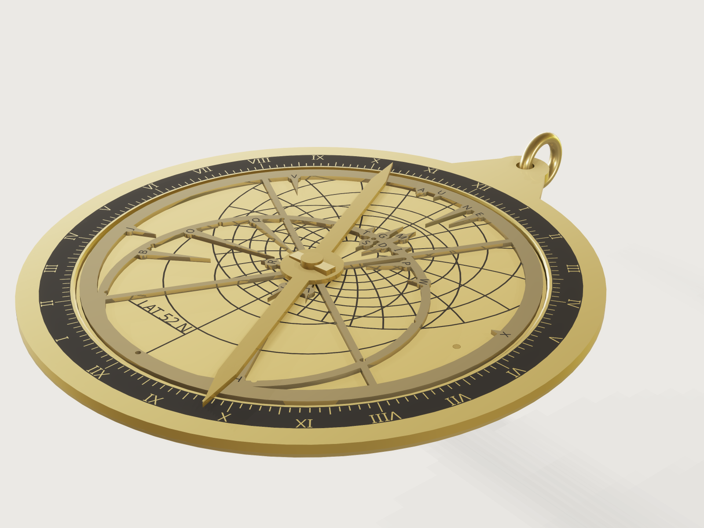

# Planispheric astrolabe

A planispheric astrolabe for a place from 25 to 65 degrees north, in brass: a mater with its limb, degree scale and
hour numerals; a plate drawn for your latitude with its almucantars, azimuths, horizon, equator and tropics in exact
stereographic projection; a rete of lettered star pointers, taken from the Yale Bright Star Catalogue, with the ecliptic
ring; a rule; on the back an altitude scale and an alidade to sight with; a pin with its wedge, and a throne with a ring.
Give a latitude and a size and the whole instrument follows; drag the sidereal time and the sky turns over the plate.
A laser or waterjet file of every outline and engraving files of the plate, the limb and the back export from named
sets, without picking anything. Not for the tropics nearer the equator than 25 degrees (Mumbai,
Singapore) nor for the southern hemisphere (Sydney).



## What it shows

- **Formulas drawing an instrument** (`sketch.circle`, `sketch.path`, `variable.set`). Every almucantar and azimuth circle
  is a closed form of the latitude; the end angles of the azimuth arcs (at the horizon, at the rim, at the 70 degree
  almucantar) are closed forms too, so the lines stop where a real plate's lines stop. Nothing is computed outside the
  document.
- **A real star table** (`table.set`, expressions that read `stars[i].ra`, `.dec`, `.root`, `.boss`, `.key`). The rete
  carries the 12 to 36 brightest stars that fit it, each pointer with a lettered boss; the table comes from the Yale Bright
  Star Catalogue, J2000.0, through a small `make.py`.
- **The plate changes with the place, the rete does not.** Latitude drives the plate's lines only; the rete depends on the
  size alone. Three drive parameters run it: *Local sidereal time* turns the rete (`feature.transform`, and the key letters
  by their own expressions), *Rule* the rule, *Alidade* the sighting bar on the back.
- **Engraving that exports as one drawing.** `file.export` of a named set lays separate faces side by side, so whatever is
  engraved in one go must be one face. The limb's scale and numerals, and the back's scale, are one dark band each, with
  the graduations and the Roman numerals as holes through which the brass shows: one sketch, one extrusion, one face, in
  every mode. The plate's lines cross each other, so for the plate the setting *Engraving in the model* has a slower export
  mode: the lines are cut into the plate as real grooves (`feature.boolean` with `when`), whose floors are one face.
- **A form that refuses what cannot be cut.** The sheet thickness is limited by the diameter, the line width by the closest
  lines at your latitude and step, and holes and notches grow with the sheet, so that no round cut is narrower than the
  sheet is thick; an assertion measures that on the parts.

## The real thing

**The projection.** A planispheric astrolabe projects the sky stereographically from the south celestial pole onto the
plane of the equator; this Jig is **for the northern hemisphere only** (a southern one projects from the north pole and
would need a mirrored plate and a southern star table). The form stops at 25 to 65 degrees north: below about 23.4
degrees the nadir comes inside the plate and the azimuth arcs would all meet there (25 keeps a margin), and above 66.6
degrees the horizon no longer crosses the Capricorn rim. With φ the latitude, ε the obliquity and R the radius of
Capricorn on the plate:

- equator radius r_e = R / tan(45° + ε/2); Cancer r_c = r_e · tan(45° − ε/2); Capricorn R (the rim of the plate, drawn just inside);
- almucantar of altitude h: centre on the meridian at y = r_e·cos φ/(sin φ + sin h), radius r_e·cos h/(sin φ + sin h);
- horizon: h = 0, north point at y = −r_e·tan(φ/2), south point beyond the plate;
- azimuth circle of azimuth A: centre x = r_e·cos A/(cos φ·sin A), y = −r_e·tan φ, radius r_e/(cos φ·sin A); the zenith is at r_e·cos φ/(1 + sin φ);
- the ecliptic on the rete: centre (R − r_c)/2 off the pole, radius (R + r_c)/2; sign boundaries from RA = atan2(cos ε·sin λ, cos λ), δ = asin(sin ε·sin λ).

The plate is drawn with the north point of the horizon at the bottom and the zenith above the pole, as on European
astrolabes; seen from the front, west is to the right (+x), where the locating pin sits.

**Sources read.** D. Abdullah, *The Engineering and Programming Methods Used in Manufacture of Astrolabes and Errors Resulting*,
[arXiv:2511.12088](https://arxiv.org/abs/2511.12088) (2025), eq. 5–9: almucantar centre and radius as the mean and half difference of
2R·cot((φ+h)/2) and −2R·tan((φ−h)/2), and the azimuth circles as X = p_c·tan A, p = p_c / cos A (its 2R is this Jig's r_e and its A is
counted from the prime vertical; the closed forms above are those formulas rearranged). J. E. Morrison's *The Astrolabe* (Janus, 2007) was **not**
available to read; the paper above is the source used. The obliquity 23.4393° is the mean obliquity at J2000.0, 23°26′21.448″, as given in
Wikipedia's *Axial tilt* from the Astronomical Almanac (a secondary source).

**Own check.** A separate script, not committed, projects the points of the celestial sphere directly: it turns altitude and azimuth into
declination and hour angle at the latitude, and maps them with r = r_e·tan(45° − δ/2) and the hour angle to the plane, without using any of the
circle formulas above. Against the sketch circles of the model at latitudes 25, 40, 52 and 65 the worst differences are 0.0000003 mm for almucantars and
0.0006 mm for azimuths, each run for both altitude steps; a second script projects the catalogue's right ascension and declination directly
(cos δ / (1 + sin δ)) and finds every pointer tip of the 36 stars in the sketches within 0.0000005 mm.

**The stars.** From the Yale Bright Star Catalogue, 5th revised edition (Hoffleit & Warren, 1991; CDS V/50, read through the machine-readable file at the
Harvard TDC), positions for epoch and equinox J2000.0. The committed `data/bright-stars.tsv` holds the 36 brightest stars of that catalogue (V from −1.46
to 2.39) that have an IAU-approved proper name (WGSN catalogue), lie between declinations −18.6° and +65° (south of that a pointer would sit in the rete's
rim, north of it in the hub), are clear of the ecliptic band, of a brighter star within 3.5 % of the Capricorn radius, and of the rete's bars: this leaves
out Regulus and Elnath, which lie inside the ecliptic ring, and Castor, Alnitak, Mintaka, Caph, Mizar and Merak, crowded by a brighter neighbour. The
precession since J2000 turns the sky by about 0.36 degree by 2026, less than the width of a pointer tip.

**The star key.** Each pointer has a round boss on its stem; with *Lettering* set to letters the model shows a letter on it, to stamp with a letter punch set
(2 to 3 mm). `make.py` places each boss on its pointer's stem at least 0.19 of the Capricorn radius from the centre, outside
the rule's boss (0.142) and so clear of the pin, clear of every star tip and of every other boss. Stars near the pole (Dubhe,
Alioth, Schedar, Eltanin, Sadr) hang from the ecliptic ring or the rim, since a pointer from the hub would leave no room for a
boss outside the rule's. Brightest first:

| | | | | | |
|---|---|---|---|---|---|
| A Sirius | B Arcturus | C Vega | D Capella | E Rigel | F Procyon |
| G Betelgeuse | H Altair | I Aldebaran | J Spica | K Pollux | L Deneb |
| M Bellatrix | N Alnilam | O Alioth | P Mirfak | Q Dubhe | R Alkaid |
| S Menkalinan | T Alhena | U Mirzam | V Alphard | W Hamal | X Diphda |
| Y Alpheratz | Z Mirach | 1 Saiph | 2 Rasalhague | 3 Algol | 4 Denebola |
| 5 Sadr | 6 Schedar | 7 Alphecca | 8 Eltanin | 9 Almach | 0 Enif |

*Stars on the rete* takes the first 12, 18, 24, 30 or 36 rows. The same key is in the form's description of that parameter.
The names themselves are not written on the rete: a pointer is a few millimetres wide, too little for a name at the sizes of
the range.

**Making it.** Brass sheet (CuZn37, 8500 kg/m³) of the sheet thickness. Cut the plate, the rete, the rule, the back plate, the alidade and its two vanes by
laser or waterjet from the set *Laser cut sheet*; the limb is twice the sheet thick: two rings soldered, or one ring of the double thickness. The pin holes
and the locating holes are drawn smaller by half the *Laser kerf*, so they come out at size; the outlines are not compensated, and finish half a
kerf small, which the clearances allow (plate in its seat 0.25 mm, pin 0.15 mm). Engrave from the engraving files (a fibre laser's fill, or a rotary cutter with the
line width as its cutter), stamp the star letters on the bosses, fill the lines with black wax or paint and rub the face. Solder the vanes upright where the alidade's points begin.

**Assembly.** The pin goes up through the alidade, the back plate, the plate, the rete and the rule, which lie face to face on its
head. A slot across the pin reaches 0.15 sheet thicknesses below the top of the rule; the horse, a wedge with a flat underside
(0.4 to 1.2 sheet thicknesses tall, 2.4 pin diameters long), is pushed in on the rule, thin end first, until its rising top bears
on the top of the slot at the far side of the pin. Its thick end is taller than the slot, so it jams there and presses the whole stack
onto the pin's head: no axial play, and the rete and rule still turn under friction. The small locating pin at the
west point of the plate, through the plate into the back plate, keeps the plate from turning. The ring goes through the throne.

**Using it.** Hang it by the ring, sight the sun or a star through both vanes of the alidade and read its altitude on the back
scale (0 at the horizontal, XC at the top) at the alidade's point, which lies on the line through the pin and the sights and
ends on the outer edge of the scale: a reading to about half a degree on the 2 degree graduation. For a star, turn the rete until that star's pointer lies on the almucantar of that
altitude, on the east or west side as seen; the rule laid over the first point of Aries (the ecliptic's notch on the equator line that stands at the top, on the meridian,
when the sidereal time is 0) then reads the local sidereal time on the limb's hour scale, counted from XII at the top as 0 hours.

**What this Jig leaves out.** The sun cannot be placed by date: there is no calendar scale on the back and no degree scale on the ecliptic ring, only its
twelve sign notches, so the instrument tells time by the stars, not by the sun. Also left out: unequal-hour lines below the horizon, zodiac names, star
names (letters instead, see the key), and altitude numbers on the plate: numbers among the crossing lines made the engraving export several times slower, so the
plate is read by counting from the horizon (every 10 or 5 degrees) and from the 70 degree circle round the zenith. A maker adds them by hand.

## Parameters

**Your place**
- *Latitude (north)*: 25 to 65 degrees. Changes everything on the plate, nothing on the rete.
- *Diameter of the instrument*: 140 to 300 mm.
- *Sheet thickness*: 1 mm up to 1 % of the diameter, in half millimetres (1.5 mm at 180 mm, 3 mm at 300 mm); the limb is twice it.

**The plate**
- *Altitude step*: every 10 or every 5 degrees; azimuth lines are every 15 degrees either way. The highest almucantar is 70°, so the azimuth lines end on a circle round the zenith.
- *Engraved line width*: 0.3 mm up to what the closest lines allow at your latitude, size and step, at most 0.8 mm (a formula range).
- *Engraving in the model*: shown as dark lines (the default, quick), or prepared for the engraving export (slower; needed for the set *Plate engraving*).
- *Laser kerf*: 0 to 0.25 mm, 0.15 mm by default.

**The rete**
- *Stars*: 12 to 36, in steps of 6, brightest first.

**Lettering**
- *Lettering*: star letters on the rete and the latitude on the plate; or the hour numerals only.

**Run it**
- *Local sidereal time*: 0 to 24 hours: the rete.
- *Rule*, *Alidade*: 0 to 360 degrees.

At the defaults (latitude 52 N, 180 mm, 1.5 mm sheet, 10 degree altitude step, 24 stars, letters on): Capricorn radius 69.95 mm, equator 45.91 mm, Tropic of Cancer 30.14 mm, the horizon's north point 22.4 mm below the pole, the closest engraved lines 1.61 mm apart (two azimuth lines where they meet the 70 degree almucantar), 0.87 kg of brass.

## Checks

Forty-seven assertions: 44 active at the defaults, 39 in the export mode with the 5 degree step. Measured on the bodies wherever that is possible:

1. to 4. The equator, the Tropic of Cancer, the Capricorn line and the horizon are drawn at their projected radii: a face of that radius exists (closed forms of R, ε and φ written another way than the model's).
5. In the default mode the horizon crosses the meridian at −r_e·tan(φ/2), within 0.02 mm (the bounding box of the almucantar body).
6., 7. Every almucantar from 10 to 70 degrees, and on the fine plate every one from 5 to 65, has the radius and the centre of the construction by its two meridian points, Y1 and Y2 (Abdullah's eq. 5–7): a face of that radius wholly inside a box round that centre.
8. to 13. Each azimuth line (15 to 90 degrees) ends where an independent closed form (altitude 70 and the azimuth turned into declination and hour angle) puts its crossing with the 70 degree almucantar: a vertex of the model lies there. These are also the points the smallest-gap output is computed from.
14., 15. The 45 degree azimuth circle and the prime vertical have the radii r_e·√2/cos φ and r_e/cos φ.
16. The smallest gap between engraved lines is at least the line width. The gap is the least of the almucantars' spacing along the meridian, both sides of the zenith, and the chords between neighbouring azimuth ends on the 70 degree almucantar; the form's maximum line width is half of it, so this guards the form's range rather than measuring the plate.
17. Every star's tip lies inside the Capricorn rim (the table's largest projected radius).
18., 30., 31. The rete is exactly as wide as its rim, so no pointer sticks out, and fits inside the limb seat; the plate seats in the limb.
19. to 27. **The stack.** The horse cuts into neither the pin nor the rule; it is centred through the pin, reaches past it both ways and stays below its top; its top bears on the slot (distance 0); its thick end is taller than the slot, so it jams; the pin's head bears on the alidade (distance 0); and the alidade, back plate, plate, rete, rule and horse each lie on the part below, measured from their bounding boxes, with no axial play (the sum of the five gaps at most 0.001 mm; in the export mode the grooved plate's bounding box cannot be measured, F-057, and the back and rete are checked to be one sheet thickness apart instead).
28. The ring passes through the throne hole without touching the limb; 29. the pin clears the rule, the rete, the plate, the back plate and the alidade.
32. The pin hole goes through the plate at the nominal radius less half the kerf (a wrong sign of the kerf fails it).
33. The back plate's volume is the closed form: disc less two holes less the chamfer, within 0.05 %.
34. The rete has one top face: a pointer that does not reach its ring would be a face of its own.
35., 36. The tips of the Sirius and Vega pointers lie where their right ascension and declination put them at the sidereal time set (a vertex within 0.05 mm), so a rete turned the wrong way, or pointers drawn mirrored, fails.
37. The ecliptic ring passes through both solstices, computed from the obliquity at the sidereal time set (not from the ring's own centre).
38. No round cut in a laser-cut part (holes, notches, sights) has a radius below half the sheet thickness.
39., 40. Every star's boss lies outside the rule's boss by 0.3 mm at least (so its letter can be read, and it is clear of the pin), and every boss is at least 0.3 mm clear of its nearest neighbour (computed in the document from the table's positions; `make.py` records which boss is nearest).
41. The back's altitude scale reads XC at the top, seen from behind: the glyph's vertices lie there.
42. The two sights lie on one line along the alidade, each hole within its own box round the sight line.
43. The alidade's fiducial point lies on the outer edge of the altitude scale, on the line through the pin.
44. The number of pointer groups built is the number the star count asks for.
45. to 47. Each engraving set is one face: the plate (export mode), the limb and the back.

**Mutation tests.** A scratch copy with each of these faults fails the build or at least one assertion: the 30 and the 40 degree almucantar's centre 3 % off, the 30 degree azimuth's centre 6 % off, the equator 1 degree off in its formula, the horizon 2 % too large, the stars mirrored in right ascension (assertion 34, since 35 and 36 read the same table), the ecliptic flipped, the rete turning backward, the Sirius pointer floating free of its ring, a boss moved under the rule's boss, two bosses on top of each other in one group and in two groups, the horse shifted to one side, the slot's top 0.2 mm too high so the wedge does not bear, the alidade hanging 0.1 mm below the back plate, the back scale turned upside down, one sight hole 2 mm off, the kerf with the wrong sign, a locating hole or ecliptic notches narrower than the sheet, the ring through the limb, the plate larger than its seat, the back plate chamfered more than its closed form: all twenty-three are caught.

**Range.** `tools/jigs.py check` runs 100 points (the defaults, 64 of the 1024 corners, every other choice, 32 random), in both modes: all pass and none is unproven; the slowest took 5.4 s and the mean 2.1 s (the budget for the slowest point is 12 s). The default model opens in 3.4 s (6.1 s of CPU) on a busy machine. Beyond the sampling, the export mode was set by hand at every fifth degree of latitude from 25 to 65, at the largest instrument (300 mm, 3 mm sheet, 0.8 mm lines, 5 degree step, 36 stars) and at the smallest (140 mm, 1 mm sheet, 0.3 mm lines): all 18 passed and each plate engraving exported as one region (before the wedge and boss changes, which do not touch the plate). The mutations above and the far points looked at in renders (25 degrees at 300 mm, 65 degrees at 140 mm in the export mode, the back with the alidade) complete what was tried.

**Not proven.** The azimuth circles' centres other than through the checks above, the spacing of a boss from bosses other than its nearest, the pointer tips of stars other than Sirius and Vega over the range (the independent scripts checked all 36 at the defaults), and the narrowest web of the rete between two pointers or a pointer and a ring: no assertion measures a web. Where a pointer meets a ring at a sharp angle the gap between them narrows to a point, as in any pierced rete: the review measured such V corners narrowing to 0.77 mm at 150 mm in 1.5 mm sheet, less than the sheet is thick; the laser rounds their apex by its kerf, and they can be left so or filed open.

## Export

- **Outlines, for the laser or waterjet:** File > Export, *Sheet of set: Laser cut sheet*, as DXF or SVG: the plate, the limb with its throne, the rete, the back plate, the alidade, its two vanes and the rule side by side at true size, each on a layer named after it (at the defaults a sheet about 927 by 203 mm, 5.3 m of cut). The rete, the back plate and the alidade come from their top faces; the plate from its bottom face, since its top is grooved in the export mode, and the limb and the rule likewise (the drawing of a face seen from below is mirrored about the x axis; these three parts are symmetric, and the plate's locating hole lies on that axis, so each outline is the part's own). The rete, rule and alidade are drawn turned as the drive parameters have turned them (the alidade is at 0 by default; set the rule to 0 too for the most compact sheet).
- **Engraving of the limb and the back:** *Sheet of set: Limb engraving* and *Sheet of set: Back engraving*, in either mode: each one region at true size, the dark field to engrave with the graduations and numerals left bright. The back's is drawn as seen from behind.
- **Engraving of the plate:** set *Engraving in the model* to *Prepared for the engraving export* (a slower rebuild, see Checks), then *Sheet of set: Plate engraving*: one connected region, the grooves' floors, with the latitude. Single-stroke vector engraving would need the sketches themselves, which a named set cannot hold (J-007).
- **The star letters** are not exported: stamp them, or engrave them by hand, as the model shows them.
- **STEP:** File > Export of the bodies, for a 3D check of how the parts sit.

## Files

- `build.json`: the source (a JSON list of 3DCraft commands).
- `make.py`: writes the `stars` table into `build.json` from the committed catalogue extract, with the place of each pointer's root, its boss and its key letter.
- `data/bright-stars.tsv`: the 36 stars from the Yale Bright Star Catalogue: HR number, name (IAU), Bayer designation, V magnitude, J2000 position.
- `meta.json`, `formtest.md`, `preview.png`.
- [`dist/astrolabe.3dcraftjig`](../../dist/astrolabe.3dcraftjig): the published Jig.

## Rebuild

```bash
python3 jigs/astrolabe/make.py       # only when the star table changes
tools/jigs.py build astrolabe
tools/jigs.py render astrolabe
tools/jigs.py check astrolabe
```

## Difficulty

8 out of 10: data-driven exact projection, coupled closed-form clipping, and one-face engraving held over the range.

## Platform notes

- **Engraving as lines or as grooves.** Real grooves in the plate are expensive where the almucantars and azimuths cross, so the default shows the lines as thin dark bodies 0.02 mm proud of the plate; the setting *Engraving in the model* cuts them as grooves, which the plate's engraving export needs. Proposed entry `findings/J-xxx-crossing-grooves-cost/`.
- **A named set of faces is laid out, not placed.** `file.export` of a set puts each face on its own in a row, so marks that are separate faces lose their place. Everything engraved in one go here is therefore one face: the plate's grooves meet each other, the latitude stands on a rail, the scales are one band with holes. The star letters would need a boolean with one blank to become one face, which at 36 letters on a 300 mm instrument cost about 7 s of CPU time per change of the form (measured on a busy machine), so they are stamped by hand. Proposed entry `findings/J-xxx-set-sheet-packs-faces/` (see also F-142). Arabic numerals were dropped from the limb for this reason: their counters (0, 4, 6, 8, 9) come out as islands of their own.
- **The cut sheet's faces.** The grooved plate has no clean top face, so it is drawn from its bottom face.
- **Dark engraving** comes from dark bodies, not from the colour of a cut's faces (F-025).
- **File size.** The font is stored in the document, 332 KB of the file's 977 KB (F-037); with it the limb carries one set of numerals.
- **Engraved lines as closed slots.** A stroke along an open curve is not available (J-017): each azimuth is a closed profile; a named set cannot hold a sketch for single-stroke engraving (J-007).
