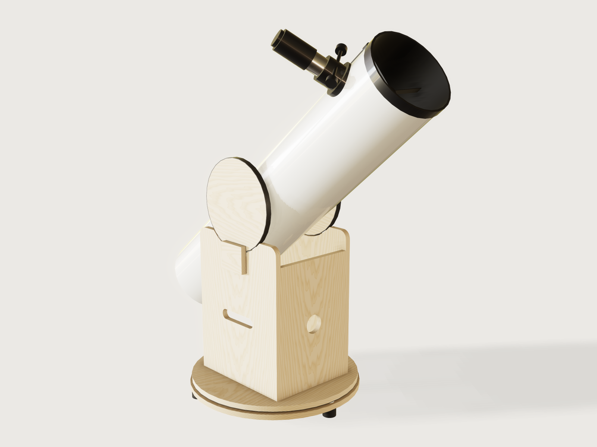

# Dobsonian telescope

Give the form your mirror: its diameter, focal ratio and thickness, and the field you want fully lit. It works out the
tube, the secondary and its offset, the spider, where the focuser goes, the altitude bearings and the rocker box, and it
hands you a cut sheet for the plywood. The altitude axis is not a guess: every body of the tube has a real density and a
closed-form position, the balance point is computed from them, and the model's measured centre of mass is then asserted
against it. Drag the *altitude* slider and the tube swings from the horizon to the zenith on its bearings.

## What it shows

- **Optics driving a mechanical design.** From the focal length, the racked-in height of the focuser and the fully
  illuminated field, the secondary's minor axis and its offset follow by formula; from those the position of the flat, the
  spider and the length of the tube. Change the focuser and the secondary changes size.
- **The balance point computed, then measured.** Every part of the optical tube (paper tube, Pyrex primary, cell, spider,
  secondary, focuser, eyepiece, finder) is a closed-form mass and position in variables, and the altitude axis is placed on
  their centre of mass. An assertion measures the real `centerOfMass` of the optical tube's bodies (21 at the defaults)
  and requires it on the altitude axis within the stated 4 mm, at the altitude shown (the range checks also try 0 and 90 degrees and random angles). Regeneration cannot feed a
  measure back into geometry, so the formula is the design and the measure is the proof.
- **Swept clearance, not a sample.** `feature.revolve` sweeps the rear of the tube, knobs included, through the altitude
  range about the axis; with the tube drawn at the horizon and at the zenith those three hidden bodies form the set
  `Tube swing`, and a `clearance` assertion proves it clears the rocker box, zenith to horizon.
- **A drive parameter.** `altitude` turns every body of the tube about the altitude axis (`feature.transform`), and the eyepiece's
  position, the bearing contact and the measured balance follow.
- **The form changes the structure.** The tube material (paper form tube, rolled aluminium, glass fibre) sets the wall, the
  density, the stock diameter step and the colour (`table.set`, `body.appearance` with expressions). The mirror picks a three-point
  or a nine-point cell, the latter on three triangles that rock on steel balls (`feature.pattern`, `feature.when`). Three or four vanes, three focusers and three
  finders change what is built. Choices depend on each other: the eyepiece list stops at what the focuser takes.
- **Named sets and exports.** The face set `Cut sheet` exports the twelve plywood parts at true size (and the aluminium whiffle plates when the cell has them), `cut.export` adds kerf
  compensation, `cut.list` the saw list. `set.define` also names the optical tube, the rocker box and the swing envelope.

## The real thing

**Optics.** For a fully lit field of diameter `f` at the focal plane, the minor axis of the flat is
`m = f (1 − L/F) + D L/F`, with `D` the mirror, `F` the focal length, and `L` the distance from the flat to the focal plane
along the light path. This reproduces Mike Lockwood's [secondary sizing
tables](https://www.loptics.com/ATM/diagonals.html) (10-inch f/5 at 10 inches out, 0.5-inch field: 2.40 inches; 8-inch f/6
at 8 inches: 1.75 inches). Lockwood recommends a 0.5-inch field for general use and 0.25 inch for strictly planetary work;
the default here is 13 mm. The offset of the flat, away from the focuser and towards the primary, is
`(D − f) m / (4 F)` (Lockwood's formula; for a small field it agrees with Sky & Telescope's `m / (4 N)`). The flat is
modelled as a rod of the minor axis cut at 45 degrees, which is how a real elliptical flat is cut.

The primary is drawn as a sphere with the radius that passes through the mirror's centre and rim (2F, closely), not a
spline: a paraboloid departs from that sphere by `r⁴/(8R³)`, under 1 micron for a 200 mm f/6 and about 9 microns at
400 mm f/3.5, and no mechanical measure here can see that. The volume assertion uses the paraboloid's closed form with a 0.2 % tolerance.

**Tube.** Stellafane's [OTA design page](https://stellafane.org/tm/dob/ota/design.html): the tube about 2 inches over the
mirror (50.8 mm here). A paper form tube only comes in nominal 2-inch steps, so the next step up is taken; a rolled tube is
made to measure. The focal plane sits ½ inch (12.7 mm) above the racked-in drawtube top: Stellafane's "spare focuser in travel"
of ¼ to ½ inch. The tube runs on past the focuser by 0.6 × the inside diameter, rounded up from that page's example
(4½ inches on an 8-inch tube, 0.56). The same page's tube has a wall of 1/8 inch, and the form offers 3.2, 4.5 and 6 mm: choose the nearest to yours, because the wall moves the balance point (3.2 instead of 6 mm moves it about 22 mm at the defaults). The 800 kg/m³ for paper is an estimate: weigh a piece.
A 1.25-inch eyepiece in a 2-inch focuser needs the usual adapter, which is not drawn and not weighed.

**Focuser, eyepieces, finders.** The tables hold typical catalogue figures (racked-in height, travel, mass, field-stop depth
below the shoulder), not one maker's. Measure yours; the focus check depends on them. The list of eyepieces stops at what
the focuser can take: the 2-inch barrels need a 2-inch focuser, and the low-profile focuser lacks the travel for the
deepest-focusing eyepiece.

**The mirror's support.** Three pads at 70 % of the radius for a mirror of 254 mm or less at a thickness of at least 1/9 of the
diameter. Otherwise nine points on three triangles, each triangle rocking on a 6 mm steel ball at the centroid of its three pads (asserted), the ball seated in a 5 mm hole drilled in the cell plate and caught in a matching hole in the triangle. The holes are in the cut file. The seat is deeper than the mirror can lift under its clips, so at the horizon, with no axial load, ball and triangle stay put. A true whiffle tree, not plates on standoffs. The 70 % figure and the 3- and 9-point
practice are the common ones (see Sources). The ring radii of the nine-point cell (0.40 and 0.81 of the radius) are this Jig's own and not PLOP-optimised: for a thin mirror, run PLOP and move them.
Mirrors thinner than diameter / 18, which need 18 or more points on rocker bars, are refused: this Jig does not build that cell.
The triangles are 5 mm aluminium and are in the cut file. The cell plate is the same plywood as the box. It is not fixed to the tube: it hangs from a fixed rear plate
(a plywood ring in the end of the tube, screwed in through the wall) on three collimation bolts with knobs behind, with compression springs (not drawn) in the 12 mm between the plates.

**Edge support.** Three L-shaped posts, screwed to the cell plate, hold the mirror's rim with a 1 mm working gap (shim with cork or felt) and their tongues overlap the front edge. Two of them are at 60 degrees either side of the bottom when the tube is at the horizon, so the mirror rests on two posts, not on one; each is `max(12 mm, 0.06 D)` wide. A 400 mm mirror (about 10 kg) puts about 100 N on each. For a thin or large mirror a sling or whiffle edge support is better; the Jig does not design one.

**Rocker box and bearings.** Stellafane's [rocker box page](https://stellafane.org/tm/dob/mount/rockerbox.html): the side
boards about 1.2 × the tube's outside diameter deep, and a margin of at least 2 inches between the tube and the floor at the
bottom of the swing (50.8 mm here). Where the tube's swing asks for more depth, the side boards grow. The floor grows too on a tall telescope, so the feet stand wide enough for the 10 degrees of tipping margin the Jig asks. The bearing discs are `1.3 D + 40 mm` across, smaller on short tubes so that they stay clear of the focuser: Stellafane asks for "large diameter
bearings" and gives no number, so the factor is this Jig's. Teflon pads sit 35 degrees either side of the bottom of the
bearing ([Reiner Vogel](http://www.reinervogel.net/Planung/5_Rocker_e.html)), with 1 cm² of Teflon per kilogram, which
Vogel attributes to Berry and Kriege, split over the four altitude pads and over the three azimuth pads. The ground board
carries three feet at 120 degrees, at least an inch from the edge, and the three azimuth pads stand **directly over the feet** ([Stellafane](https://stellafane.org/tm/dob/mount/ground.html): "Because the pads are place directly over the feet, there is essentially no vertical load on this part"; its 60-degree lines only space the feet and pads round the rim). The pads run on a speckled black laminate of the Ebony-Star
type ([Stellafane](https://stellafane.org/tm/dob/resources/bearnings.html)), on the bearing rims and under the rocker floor.

A retainer, screwed to the outside of each side board, stands proud of the notch beside the bearing and stops the tube sliding sideways, on the model of Stellafane's retainers ("to prevent them from sliding side-to-side"). Here it is a board-thickness strip, 100 mm wide, set off the side board by a 1.5 mm hardboard shim, with 1 mm felt glued to its face where it rubs on the bearing, leaving a 0.5 mm running gap, as Stellafane's felt faces the bearing (its retainers are 1/4 inch plywood). The side load is real: at the defaults a push at the eyepiece of about 12.9 N turns the telescope in azimuth with the tube at 45 degrees, against about 11.5 N (μ W / cos 35°) of sideways friction on the altitude pads, and the retainer is what holds it.

**What could not be checked.** The Teflon-on-laminate friction coefficient is **assumed 0.1**: I found no published figure I
could verify. The friction torque model (`μ W R / cos θ` with `θ` the pad angle) is the friction of two pads at ±35 degrees
supporting the tube's weight, the same form as Berry's in *Amateur Telescope Making*, vol. 8. The output for how much the
eyepiece may change, and the friction assertion, hang on that assumption. Texereau and Kriege & Berry's book could not be consulted directly; what is
used from them is only what is quoted above.

**Masses.** Pyrex 2230 kg/m³, birch plywood 680 kg/m³ (Handbook of Finnish Plywood, 2002, Table 3-1, as `laser-box` uses),
aluminium 2700, steel 7850, Delrin 1410, PTFE 2200, laminate 1450 (a common figure for high-pressure laminate, not sourced), rubber 1100. Focuser, eyepiece and finder carry
their table mass spread over the modelled shape, so the model weighs what the table says. These closed forms set the
axis; the measured centre of mass checks them.

**Building it, in order.** Cut the plywood from the cut sheet. Tube first: paint it gloss white outside and matt black inside,
cut the focuser port, and screw on the focuser (its flange has the tube's curve). Fit the spider from the open end, with its vanes
bolted through the wall, and the holder and flat on its hub. Build the cell outside the tube: the mirror on its pads, the clips over
its edge, three bolts up through the cell plate into T-nuts. A nine-point cell first drops a steel ball in each of the three drilled seats in the cell plate, lays each aluminium triangle on its ball with the ball in the triangle's centre hole, and sets the pads on the triangles. Slide cell and mirror in from the rear, then screw the rear plate into
the end of the tube, and put the springs and knobs on the bolts. 
The rocker: side boards on the floor (screws from below), front and back boards between the sides, laminate disc under the floor,
Teflon pads in the notches and on the ground board directly over the feet, a pivot bolt through both, and the retainers with their felt on the outside of the side boards. The altitude hubs (they follow the tube's curve; cut
them from scrap, they are not in the cut sheet) bolt through the tube at the balance point the output gives, then the discs with
their laminate rims. The tube lowers in from above: the discs drop onto the pads, the notch never binds because the disc is a
circle sitting in a shallower arc. Then check the balance the real way: balance the finished tube on a broomstick and move the
bearings if your eyepiece load differs. The output says how much the eyepiece may change before the tube would creep.

The boards keep square edges, with rounded corners in the profile, because a chamfered board is misread by `cut.list` (J-004).

**Never point a telescope at the sun without a proper solar filter.** The Jig proves balance and clearance; it does not prove the
strength of your tube or your joints.

## Parameters

| Group | Parameter | Range | What it changes |
|---|---|---|---|
| Your mirror | Mirror diameter | 150 to 400 mm | Everything: tube, secondary, bearing size, box |
| Your mirror | Focal ratio | from 3.5 (higher for small tubes, so the obstruction stays under 33 %) up to what keeps the eyepiece below your reach, at most 10 | Tube length, secondary size, eyepiece height |
| Your mirror | Mirror thickness at the edge | diameter / 18 (10 mm at least) to diameter / 5 | Mass and balance; three or nine support points |
| Your mirror | Fully illuminated field | 4 to 30 mm, capped by the focuser's bore and the obstruction limit | Secondary size |
| The tube | Tube | paper form tube (3.2, 4.5 or 6 mm wall), rolled aluminium, glass fibre | Wall, weight, inside diameters, colour |
| The tube | Focuser | 1.25 in, 2 in Crayford, 2 in low profile | Focal plane height, travel, mass, the eyepiece list |
| The tube | Balance eyepiece | four sizes, 0.12 to 1 kg, limited by the focuser | Moves the balance point |
| The tube | Spider vanes | 3 or 4 | Vanes and their angle to the focuser |
| The tube | Finder | none, red-dot, 8x50 optical | Mass and position in the balance |
| The mount | Plywood thickness | from diameter / 20 (12 mm at least) to 24 mm, in 3 mm steps | All boards, bearing discs, retainers |
| The mount | Highest comfortable eyepiece height | from what the mirror needs (1.0 m at least) to 2.3 m | Limits the focal ratio |
| Point it | Altitude | 0 to 90 degrees | Tips the tube: the drive |

Outputs: focal length, secondary minor axis and obstruction, tube size and length, the altitude axis's distance from the rear
and its height above the ground, bearing diameter, the eyepiece's height at horizon and zenith and its highest position,
measured masses, how far the measured balance point is off the axis, the drawtube's extension at focus, support points,
the eyepiece mass change the friction holds, the push needed at the eyepiece in altitude and in azimuth (with the azimuth
figure at 45 degrees, and the ratio of the two), and the plywood area.

## Checks

79 assertions, of which 69 apply at the defaults and all pass (the other ten are for the nine-point cell and the optical finder, and they pass where they apply). The defaults, as the model gives them: optical tube 9.61 kg, telescope 22.98 kg, balance 1.57 mm off the axis.

**Optics, measured on the model.**
- The light path, from the mirror's vertex to the flat and on to the eyepiece's field stop, is computed from the *measured*
  centres of the primary, the secondary, the front ring and the eyepiece: it equals the focal length within 0.3 mm. The
  focuser axis meets the flat within 0.2 mm, and the focuser port sits where the optics put it.
- The primary's surface curvature, measured at its vertex on an unmoved construction copy, is 1/(2F)² within 1 % (the
  focal length is in the glass, not only in a variable).
- The secondary's volume proves its minor axis. The drawtube, the eyepiece and the finder sit where the stack puts them (y, z).
- Formula checks: the drawtube at focus lies within the focuser's travel; its bore clears the converging light cone; the eyepiece
  barrel fits the focuser; the obstruction is at most 33 %.

**Balance.** The measured centre of mass of the optical tube lies on the altitude axis in world y and z within the stated
±4 mm. Friction holds the residual: the measured offset is below `μ R / cos 35°`. The optical tube's measured mass equals the closed-form sum
within 2 %, and the primary's and the spider's volumes match their closed forms (the spider's proves the vane count, the pads' and pivots' the point counts).

**Swing, zenith to horizon.** A hidden envelope (the rear of the tube and the collimation knobs swept through the whole altitude range,
plus the tube at the horizon and at the zenith) clears the rocker box and the pivot bolt by at least 9 mm (10 mm design margin), and the floor by
about 2 inches (the proof bound is 48 mm; the measure reads 50.8). At the shown altitude, tube, focuser, eyepiece and finder clear the rocker by at least 5 mm.

**Does it go together?** Contact and fit are measured, not assumed. Primary on its pads; pads on the cell plate, or on three triangles whose steel balls sit in drilled seats in the plate and the triangles (the ball touches both seat rims, and the seat is deeper than the mirror can lift); each pivot at the centroid of its three pads (measured to the pads); edge posts round the mirror with a working gap; bearing rim on its Teflon pads (touching, no overlap); bearing centred on the altitude axis (y and z, both sides); a retainer on each side board stopping the bearing sideways (0.5 to 2 mm of play, and rising beside the rim); hub on the tube and disc on the hub; focuser flange on the tube; focuser on its
drawtube (touching, no overlap, so the knob shaft cannot cross the bore); drawtube clear of the tube; spider vanes reaching the wall; finder on the tube; collimation bolts through the clearance holes of the rear plate; rear plate in the tube; cell floating clear of the wall; focuser and eyepiece clear of the bearing discs. The altitude pads sit at 35 degrees. Azimuth pads stand directly over the feet, carry the floor's laminate and sit on the ground board; feet carry the board.

**Use.** The eyepiece stays below your reach at its highest and above 450 mm at its lowest; the centre of mass of the whole telescope is inside
its feet; the tip-over angle is at least 10 degrees; the Teflon meets 1 cm² per kg (0.9 of it for altitude, 0.85 for azimuth, since the pads are sized from a closed form and the mass is measured); the cut sheet holds the twelve parts.

**How far it was tried.** `tools/jigs.py check` runs `check-range` (defaults, up to 64 corners of the box, every choice and 32 random points, 108 points): all 108 pass, none unproven. On the final build I also ran
`check-range` with 256 corners and 220 random points: all 488 passed, none unproven. A grid of 480 combinations at the limits of the ranges (five mirror sizes, four tubes, three focusers, thin and thick mirror, fastest and slowest focal ratio, horizon and zenith) passed before one proof bound, on the clearance of the edge posts, was loosened; the balance offset there was at most 2.9 mm. The last revision (seats and felt) changed only the cell's pivot and the retainer's felt; it was checked with `tools/jigs.py check`. Grids run during the build found what sampling had missed and led to fixes: a tip-over of 9.7 degrees on a tall 300 mm f/7.2 (the floor and ground board now grow with the axis height), the focuser reaching the bearing discs on a short f/3.7 (the bearing now shrinks there), a set that dropped the primary from the whole-telescope mass, and vent holes under the pivot balls. These are samples: the claims hold at the points tried, not provably everywhere.

**Mutation tests.** In scratch copies I broke the geometry (and left the formulas alone) 48 ways: mirror moved or with the wrong curvature; secondary too small or misplaced; eyepiece and drawtube out of focus; focuser off its drawtube or moved along the tube; port moved; the knob shaft through the bore; wrong vane and pad counts; vanes short of the wall; bearing off the axis or oversize; a board too tall; the floor up into the swing; sides too close; pivot too low or off the balance point; wrong densities; a plate off its pads; a bolt hole off its bolt; a disc off its hub; a clip into the glass; pads off the feet or short of the floor; feet short of the board; retainers too far or too low; the felt off its bearing face; pivot balls over a vent hole, missing, off the centroid or in too shallow a seat; inner or outer pads moved off their triangle; a seat not drilled; a part missing from the cut sheet; finder, front ring and tube misplaced. Each one failed at least one assertion.

Tried by hand with `param.set`: a 2-inch eyepiece on the 1.25-inch focuser (refused, the eyepiece list stops at row 2); f/9 for a 1.0 m eye limit (refused, the most is about f/4.5 for the 200 mm mirror); a 1.0 m eye limit for a 400 mm mirror (refused, the limit's minimum is about 1.5 m); a 30 mm field on a fast 150 mm mirror (refused, about 9.5 mm is the most).

## Export

- **Plywood cut sheet:** File, Export, **Sheet of set: Cut sheet**, as DXF or SVG (`file.export` with `set: Cut sheet`): twelve parts at
  true size, in rows within the width you give: two side boards, front board, back board, round rocker floor, round ground board, two
  altitude bearing discs, mirror cell plate, tube rear plate and two retainers. A nine-point cell adds its three 5 mm aluminium triangles to the same file on their own layer (`Whiffle_plates`): cut them from aluminium, not from the plywood sheet; a big telescope needs more than one sheet (the output gives the area).
- `cut.export` of the twelve plywood bodies adds kerf compensation; `cut.list` (CSV) gives the saw list with sizes. Give both the list of
  bodies, because the default also finds the hidden construction bodies.
- The hub blocks are not in the cut sheet: they are cut from scrap to the tube's curve.
- There is no STEP export on purpose: a mesh or STEP export of the whole document would include the three hidden swing bodies and the
  mirror's construction copy (see [J-045](../../3DCRAFT-FEEDBACK.md#j-045-a-3d-export-cannot-be-given-a-named-set-and-without-bodies-it-writes-hidden-bodies-too-see-f-045-f-161)).

## Files

`build.json` (the source), `meta.json`, this README, `formtest.md`, `preview.png`; nothing generated by a script.

## Rebuild

`tools/jigs.py build dobsonian-telescope`, `render`, `check`.

## Difficulty

Open: the reviewer's score goes here.

## Sources: read, secondary, and my own judgement

- **Read directly:** Lockwood's secondary tables and offset formula; Stellafane's OTA design (and its 1/8-inch wall), rocker box (and its retainers), ground board (pads over the feet) and bearing
  materials pages; Reiner Vogel's rocker page (35-degree pads, the 1 cm²/kg rule attributed to Berry and Kriege); Corning's data for
  Pyrex (2.23 g/cm³, read through a search result listing their sheet).
- **Secondary only:** Sky & Telescope's offset `m/(4N)` (a search result; the page refused the fetch); the 70 % three-point rule (Lugt's
  cell notes and a forum citing Stellafane's cell tutorials, through search results; the Lugt page no longer loads); Berry's friction
  model (a forum post quoting *ATM* vol. 8); the 680 kg/m³ of birch plywood (as `laser-box` cites the Handbook of Finnish Plywood; I did not read
  that handbook).
- **Not read:** Texereau, and Kriege & Berry's book itself.
- **My own judgement or assumption:** friction coefficient 0.1; bearing size `1.3 D + 40 mm`; the nine-point ring radii and the retainer's size and 1 mm gap; the plywood thickness limit from the mirror (diameter / 20); PTFE 2200, POM 1410, laminate 1450,
  rubber 1100 kg/m³ (common values, not looked up); the paper tube's 6 mm wall and 800 kg/m³; every row of the focuser, eyepiece and finder tables
  (typical figures, not a maker's); the 12 mm spring gap; the 10 mm swing margin on the sides.

## Platform notes

- `face.appearance` given on an earlier feature's face is hidden in the render once the body's colour is given on a later
  feature ([J-040](../../3DCRAFT-FEEDBACK.md#j-040-a-face-colour-given-on-a-feature-is-hidden-when-the-bodys-colour-is-given-on-a-later-feature); compare F-048 in the examples' feedback). The black
  inside of the tube is given on the transformed feature instead.
- `material.preset`'s `color` takes literals only, so the tube's colour by material is a `body.appearance` after the preset
  (compare [J-053](../../3DCRAFT-FEEDBACK.md#j-053-metallic-roughness-and-transmission-take-numbers-only-so-a-material-look-cannot-follow-a-choice)).
- A chamfer on a plate breaks `cut.list` (J-004): the boards keep square edges.
- A curvature assertion's `at` takes plain numbers only ([J-070](../../3DCRAFT-FEEDBACK.md#j-070-a-curvature-assertions-at-takes-plain-numbers-only-see-f-094)), so the mirror's curvature is measured on an
  unmoved construction copy at the origin.
