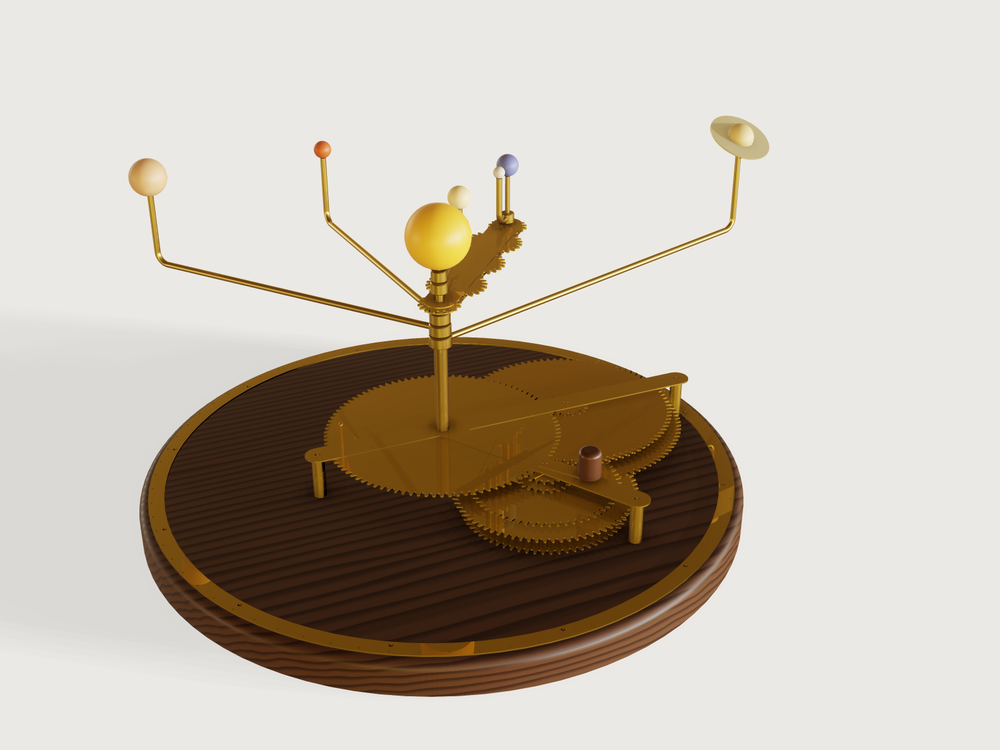

# Geared orrery

A hand-cranked brass orrery for a desk or a shelf: the Sun, Mercury out to Saturn and the Moon, each on its own tube,
each driven from one crank through two gear stages whose tooth counts were searched so that its period is within the
error you choose of the real sidereal period. Set the date and every bead stands where its gears put it: at its body's
real mean longitude on the day you set the arms, and off it after that only by its train's small drift. The form
chooses the planets, the Moon, the accuracy, the module, the span and the beads; the result is a cut file of every brass
part for a fibre laser, the lengths of tube and rod to cut, where to drill the plinth and where to set each arm.



## What it shows

- **A search as data.** `make.py` searches the gear trains offline (standard library, deterministic) and writes them
  into `build.json` as the table `trains`: one row for each choice of planets, Moon and largest period error, 112 rows,
  with both stage sums, the largest gear and the four tooth counts of every body. The model looks its row up
  (`trains[train_row]`) and never searches. `train_limits` gives the least error that has a train, the minimum of the
  error parameter, so a combination with no train cannot be entered. `make.py` also writes `bodies`, each body's mean
  longitude at J2000 and its mean motion, from `data/elements.json`, after checking those values against the cited
  table typed in a second time and against NASA's fact sheets; it writes tables only, no geometry.
- **Involute gears from formulas.** Each gear is one tooth drawn by `sketch.path` (root arc, flank, tip arc, flank),
  repeated round in a chain by `sketch.pattern`, with its bore, extruded once (`feature.extrude`) and turned into mesh by
  `feature.transform`. Each flank is the circular arc through three points of the true involute (where it starts, two
  thirds up and at the tip); its centre is worked out in the gear's variables from the tooth count and the module.
- **The date drives everything.** The year and the day become days since J2000; the crank turns once per sidereal
  year; every gear turns by the mesh formula from the one that drives it; each arm is fixed to its gear D as it was set
  on 1 January of the year the arms were set, when every bead stood at its body's real mean longitude. Dragging the day
  turns the crank; dragging the year runs the orrery through the centuries and shows each train's drift.
- **Structure from the form.** The planets choose how many trains, tubes, arms and beads are built (`when`); the Moon
  adds its train, its tube and a parallel motion of five gears between two carrier plates; the accuracy picks other tooth
  counts and so another gearbox; the module scales every gear and the frame around them; the span spaces the orbits.
- **Bent arms in turned bosses.** Each arm is a `feature.sweep` of a 5/32 in rod section along a line, a bend and an
  upright; its end is soldered into a socket in a boss on its tube: the boss is drilled by the arm itself
  (`feature.boolean` subtract with `keepTool`) and turned with it.
- **Ranges that know their limits.** The span's least takes the outermost bead round outside the plinth and keeps
  neighbouring beads apart at every date; its most keeps the outermost arm and the Earth's carrier drooping under 3 mm.
  The error's least comes from the table; the module's most keeps the largest gear within 160 sheet thicknesses; the day
  of the year stops at 365 in a common year.
- **For the maker, in outputs.** The tube and rod lengths, where to drill the plinth, and the angle at which to set
  each arm on the degree ring.
- **A cut file with the form's kerf.** `cut.export` with `"kerf": "laser_kerf / 2"`: every 1 mm brass part, each once, on
  its own layer, moved off by half the kerf.

A static model cannot do this: a change of planets or accuracy is another set of gears, and the date is a position of
every one of them.

## The real thing

**The astronomy.** Each planet's mean longitude at J2000.0 (1 January 2000, 12:00 TT) and its rate come from E. M.
Standish's *Keplerian Elements for Approximate Positions of the Major Planets*, Table 1 (JPL Solar System Dynamics,
J2000 ecliptic and equinox, valid 1800 to 2050), copied into `data/elements.json`; the Earth's row is that of the
Earth-Moon barycentre. The sidereal period is 360 degrees over the rate: Mercury 87.969 d, Venus 224.701 d, the Earth
365.256 d, Mars 686.980 d, Jupiter 4332.817 d, Saturn 10 755.884 d. The Moon's mean longitude is F + Omega of the IERS
Conventions 2003 (Simon et al. 1994, as coded in ERFA `faf03.c` and `faom03.c`): 218.31665 degrees at J2000; its rate
is taken less the general precession (`fapa03.c`), so that, like the planets, it is measured against the fixed J2000
equinox: a sidereal month of 27.321662 d. Cross-checks read, and run by `make.py`: the NASA fact sheets' sidereal periods
(Mercury 87.969, Venus 224.701, Earth 365.256, Moon 27.3217, Mars 686.980, Jupiter 4332.589, Saturn 10 755.699 d) all
within 100 ppm of these, and NASA's Saturn sheet's J2000 mean longitude (49.94432 degrees) within 0.05 degrees. The
table the old version of this Jig used had Saturn at 10 759.22 d, 327 ppm off.

The gears give *mean* longitudes: each bead goes round at an even rate on a circle. The real planets run faster near
the Sun; the difference is up to about twice the eccentricity in radians (Table 1): 23.6 degrees for Mercury, 10.7 for
Mars, 5.5 for Jupiter, 6.2 for Saturn, 1.9 for the Earth. The distances and sizes are not to scale; the order of the
orbits and of the bead sizes is. The Moon is geared to its sidereal month; its phases come of themselves as it laps the
Earth's arm (new when its bead lies between the Earth and the Sun). Saturn's ring is brass, its outer edge at the A
ring's 2.27 Saturn radii (136 780 km over 60 268 km, NASA ring and planet fact sheets), tilted 26.73 degrees; it turns
with the arm rather than keeping its direction in space.

**The trains.** Three arbors: the centre post (fixed) carries the nested tubes; the lay arbor (fixed) carries a
compound per body, gears B and C soldered to a bush that turns on it; the input arbor turns with the crank and carries
every gear A. For each body stage one is A driving B, stage two C driving D, which is soldered to the body's tube: two
meshes, so every tube turns the way the crank does. All stage-one pairs share one centre distance and all stage-two pairs
another, so each stage has one tooth sum. The search tries the sums from the smallest gearbox up and keeps the first
whose every train is within the error, with 12 to 104 teeth (the largest gear within 160 sheet thicknesses at the least
module), a contact ratio of at least 1.2 and no involute interference in every mesh, 1.5 mm of brass from every bore to
its roots, and every gear 1 mm clear of the tubes and the arbor it passes. The default (all planets and the Moon, 0.06 %,
the least for them) has sums 108 and 117:

| Body | A | B | C | D | Period built | Real | Error | Drift |
|---|---|---|---|---|---|---|---|---|
| Mercury | 68 | 40 | 83 | 34 | 88.0136 d | 87.9693 d | -0.0504 % | -75.28 degrees per century |
| Venus | 41 | 67 | 85 | 32 | 224.7087 d | 224.7008 d | -0.0035 % | -2.04 |
| Earth | 24 | 84 | 91 | 26 | 365.2564 d | 365.2564 d | exact | 0 |
| Moon | 75 | 33 | 100 | 17 | 27.3212 d | 27.3217 d | +0.0018 % | +8.55 |
| Mars | 61 | 47 | 34 | 83 | 687.0131 d | 686.9797 d | -0.0049 % | -0.93 |
| Jupiter | 22 | 86 | 29 | 88 | 4332.6962 d | 4332.8171 d | +0.0028 % | +0.08 |
| Saturn | 17 | 91 | 18 | 99 | 10 753.5772 d | 10 755.8843 d | +0.0215 % | +0.26 |

(The error is the train's turns per year against the real body's; the drift is how far the bead runs ahead of the real
mean longitude in a century, the outputs *gear drift*.) Mercury, which goes round 415 times a century, drifts most; the
outer planets hardly at all. A looser error gives smaller gears (0.10 %: sums 104 and 108).

**The Moon's parallel motion.** The Moon's train turns a tube that ends in the Moon wheel between the Earth carrier's
two plates. Three equal idlers on pins between the plates carry its turn out to the Earth wheel, which has as many teeth
as the Moon wheel and is fixed to the Earth's spindle: with an odd number of idlers the spindle keeps the Moon tube's own
turn as the carrier goes round, and the Moon's arm on it points at the Moon's mean longitude. These five gears have their
own module, 1.5 mm, at least 16 teeth each (a 14-tooth wheel interferes with a 30-tooth idler: the interference check
found it), and the Earth's orbit is what they span: module times (Moon wheel + 3 idlers) teeth. The carrier is one frame:
the three idler pins are soldered in both plates and the upper plate to the Earth tube's top, so the lower plate hangs at
its height. Each idler, and the Earth wheel (soldered to the spindle), stands on a 1 mm brass washer on the lower plate,
which sets it level with the Moon wheel on the Moon tube; the spindle's boss for the Moon's arm is 1 mm clear above the
upper plate.

**The gears.** Teeth of the standard basic rack: 20 degrees, addendum 1.00 module, dedendum 1.25 modules (KHK Gear
Technical Reference, Table 3.1, the JIS B 1701-2 form of the ISO 53 rack; ISO 53 itself was not read). Each flank is
the circular arc through three points of the involute; the reviewer worked out, outside the model, that the arcs lie
within 0.025 mm (module 1.5) to 0.044 mm (module 2.5) of the involute, inside a laser's +/-0.13 mm. The gears are cut by
laser, not generated, so there is no undercut, and every mesh is checked instead for interference (no tip passes the
point where the line of action touches the other gear's base circle) and for its contact ratio, the path of contact
between the tip circles over the base pitch (IIT Kharagpur, *Design of Machine Elements*, ch. 8, which asks at least
1.2). Backlash 0.1 module. The module is at least 1.5 mm so that the narrowest tooth space (at the root) is at least the
1 mm sheet thickness (the AGENTS.md rule for slots; SendCutSend's study guide for fibre lasers asks half the thickness for
holes and bridges, and every tip land is kept at least that). By our own rule a gear's tip diameter is at most 160 times
the sheet it is cut from (160 mm in 1 mm brass), so that it stays flat and true: the module's most follows from the
largest gear of the trains (1.5 mm for all the planets; up to 2.5 mm for small trains).

**The stock.** K&S Precision Metals telescopic brass tube (#3400 assortment: 1/16 to 13/32 in in 1/32 in steps, wall
0.014 in, so each slides in the next with about 0.04 mm on the radius): Mercury's tube is 5/32 in, each next body's the
next size, up to 11/32 in for Saturn with the Moon. The centre post and both arbors are 1/8 in brass rod (K&S 8164 or
1162), the arms 5/32 in rod (K&S 1163, 36 in; the 36 in rods were read from retailer listings). The lay arbor's
compounds turn on 4 mm pieces of 5/32 in tube; the input arbor turns in a 5/32 in tube bush in the plinth. The arm
bosses are turned from brass bar: 3 mm of wall round the tube, 7 mm high, cross-drilled 5/32 in and 2.5 mm deep. Gears,
bridge, crank, carrier plates, the Moon train's four washers, Saturn's ring and the degree ring are fibre-laser cut from
1 mm brass, C260 (SendCutSend
lists 0.040 in, laser cut to +/-0.005 in). Beads are wooden, painted. The plinth is 22 mm walnut with a 6 mm round on
its top edge.

**The frame and the axial stacks.** The gears sit in layers 1 mm apart, from the plinth up: A and B of Mercury, then C
and D of Mercury, then Venus, and so on out. Every part that floats is located by what it stands on: each compound's
bush stands on the bush below it (the first on the plinth), and each tube stands on the gear D of the tube inside it
(Mercury's on the plinth); the gears A are soldered to the input arbor at heights set by their own spacer stack. So B and
A are set by two different stacks, and their errors add, as do C's and D's: keep the two gears of each mesh within 0.2 mm
of level (a straight edge across both faces; our own limit, a fifth of the 1 mm face), shimming with a thin washer where
they are not. A brass bridge on three pillars just outside the gears holds the tops of the arbors and the outermost tube:
a bar west to east over the centre post and the lay arbor, and an arm out over the input arbor. The crank sits on the
bridge; the lowest arm or carrier is 40 mm above the crank knob's top. Every arm is lower than the arms inside it, so no
arm meets another at any angle. A brass degree ring on the plinth's edge has a dot every 5 degrees, a larger one every 30
(the signs of the zodiac) and a third dot at 0, the vernal equinox, which points from the centre post through the lay
arbor; the Earth's arm against it gives the date (the Sun stands opposite).

**Strength.** The outermost arm is a cantilever of 5/32 in rod with the bead, its upright and Saturn's ring at its end;
its droop is worked out from C26000 brass (8.53 g/cm3, 110 GPa; Wieland Concast datasheet) as q L^4 / 8 E I + P L^3 / 3
E I. The Earth's carrier is worked out the same way, each idler's weight where it hangs (P a^2 (3 L - a) / 6 E I) and the
plates taken as if they were not joined (they are, by the three idler pins, so it droops less). Both are kept under 3 mm
by the span's most. These are estimates of the model's numbers; who builds a large one should hold an arm out and look.

**Making it.** Every number below is an output of the form.
1. Cut the brass sheet (the export, below) and deburr; cut the tubes, rods, bushes and pillars to the output lengths
   (each arm 6 mm longer than the model shows, for the socket in its bead); bend each arm round a former 15/32 in across
   (a centre-line radius of two rod diameters); turn the bosses.
2. Drill the plinth: the bridge, laid on it with its middle hole over the centre, is the template (the outputs
   *Drill: ...* give the same places as distances). Glue in the centre post, the lay arbor and the input bush; the input
   arbor turns in the bush. Glue the degree ring on, centred, its 0 dot on the line from the centre post through the lay
   arbor.
3. Build the gearbox layer by layer, from Mercury out, with nothing above the part you lower:
   - gear A of the body: slide it down the input arbor and solder it at its layer (a 1 mm spacer under the first, a 3 mm
     piece of 5/32 in tube under each next sets the heights);
   - its compound (bush with B and C soldered to it): slide it down the lay arbor onto the bush below; B meshes with A;
   - its tube with D soldered at its layer: slide it down over the tube inside it onto that tube's gear D; D meshes
     with C. Turn the crank: it must run freely.
   Each part comes down from above onto parts that are all lower than it, so nothing is in its way; the gears already
   in place are at or below its layer, and it clears the tubes and arbors it passes by at least 1 mm (assertion).
4. Screw the bridge to the pillars over the arbors and the outermost tube; put the crank and its knob on top.
5. From the outermost tube in, slide each boss down onto its tube's top, not yet soldered (an inner boss would block an
   outer one, so the outer first). With the Moon, after Mars's boss: the lower carrier plate over the Moon tube (held up
   for now at its height: on a 2.5 mm spacer on Mars's boss, or, without Mars, held there by a clamp or a block), the
   Moon wheel soldered to the Moon tube's top, the three idler pins soldered square in the lower plate, a washer and an
   idler on each, the Earth's spindle with its wheel soldered on and a washer under it through the plate's end hole, then
   the upper plate over the pins, the spindle and the Earth tube's top, not yet soldered, and only then the spindle's boss
   on the spindle (the plate's hole cannot pass it); then Venus's and Mercury's bosses, likewise.
6. Set *Arms set in* to this year: the outputs *Set ...* give each arm's angle on 1 January, anticlockwise from the
   degree ring's 0 dot, seen from above. Turn each boss so its socket points that way and solder it to its tube, and
   solder its arm in. With the Moon: turn the carrier to the Earth's angle, solder the upper plate to the Earth tube and
   the three pins to the upper plate (now the carrier hangs as one frame: take the spacer out), and solder the Moon's arm
   into the spindle's boss at the Moon's angle. Drill each bead 6 mm deep and glue it on its upright; the Sun on the post.
   From then on turn the crank one turn a year.

## Parameters

| Parameter | Group | Default | Range | What it changes |
|---|---|---|---|---|
| Year | Date | 2026 | 1800 to 2050 (the span of Standish's Table 1) | every gear's angle, every bead's place |
| Day of the year | Date | 313 (9 November) | 1 to 365, or 366 in a leap year; at noon | the same; one year is one crank turn |
| Arms set in | Date | 2026 | 1800 to 2050 | the year (1 January, noon) on which the arms are set at the real mean longitudes; the drift counts from then |
| Planets | What it shows | Mercury to Saturn | to Earth, Mars, Jupiter or Saturn | the number of trains (4 gears each), tubes, arms and beads; the gearbox and the frame around it |
| Moon | What it shows | on | on or off | the Moon's train and tube, the carrier with five more gears, the Moon's arm and bead; every tube outside it one size up |
| Largest period error (%) | Gear trains | 0.06 | from the table's least for these planets (0.02 to 0.06) to 0.15, step 0.01 | the trains (another row of `trains`): tooth counts, stage sums, gear sizes, where the input arbor stands |
| Module | Gear trains | 1.5 mm | 1.5 mm to what keeps the largest gear within 160 mm (2.5 mm at most), step 0.5 mm | every train gear and the frame; the Moon's five gears stay at 1.5 mm |
| Laser kerf | Gear trains | 0.1 mm | 0 to 0.3 mm | the cut file only (`cut.export` moves each cut half of it off the part) |
| Span of the orbits | Size and beads | 600 mm | least: neighbouring beads apart and the outermost bead outside the plinth (450 mm at the defaults); most: the outermost arm and the carrier droop under 3 mm (670 mm) | the orbit radii, the arms' lengths, the Moon's idlers |
| Beads | Size and beads | Medium | Small (Sun 30 mm), Medium (40 mm), Large (50 mm) | the beads, the ring, the spacing's least, the heights |

The span is shared out so: each orbit is the one inside it plus what the two bodies reach (bead, ring, the Earth's Moon)
plus 6 mm, and the span left over is shared equally between the gaps. The Earth's orbit with the Moon is rounded to what
its gears span.

## Checks

69 assertions, at every change of the form (those of a planet or of the Moon only when it is built):

- **Where the planets are (measured, closed form).** For each bead, x and y of its measured centre against the closed
  form worked out from the astronomy alone: the real mean longitude that day (Standish's L + rate x T; the Moon's F +
  Omega less precession) plus exactly what the train's error has added up to since the arms were set, to 0.002 mm (14
  assertions). The model places each arm by its gear D's angle, through the mesh formulas and phases of both stages
  from the crank; the closed form knows nothing of them. And *every train's period is within the largest period error*:
  each train's turns per year against the real body's.
- **The gears mesh (measured).** No two stage-one gears overlap, nor two stage-two or Moon gears, nor a stage-one gear a
  stage-two gear: each mesh has its teeth in the other's spaces and every gear keeps to its layer. Each pair of a mesh is
  measured to lie in one layer (the two gears together one sheet thick: 14 pairs and the Moon's five). The distance
  between the input and lay arbors, and between the lay arbor and the centre post, is measured and must be the module
  times half of Mercury's tooth sums (less a rod); *every pair of a stage has that stage's tooth sum*; for the Moon's
  gears the Earth's spindle and the first idler pin are measured from the centre post against their tooth sums. Gear A of
  Mercury and gear D of the Earth are measured against the closed-form area of their tooth outline (Green's theorem over
  the root, flank and tip arcs). The gears are counted (33 at the defaults).
- **The Moon's train stands on something (measured).** Each idler and the Earth wheel stands on its washer, the washers
  on the lower plate, and no washer overlaps what is round it; the idler pins are fitted in both carrier plates and the
  upper plate on the Earth tube's top (the soldered joints that make the carrier one frame).
- **Gear rules (worked out from the gears' variables).** Every mesh has a contact ratio of at least 1.2 (1.55 at the
  defaults) and no involute interference; every gear has 1.5 mm of brass from its bore to its roots; every gear clears the
  arbors and tubes it passes by at least 1 mm; every gear's tip diameter is at most 160 sheet thicknesses (153 mm at the
  defaults).
- **The laser.** The narrowest tooth space is at least the 1 mm sheet thickness (1.18 mm at the defaults); every tip land
  is at least half of it (0.91 mm). The export proves the kerf: `cut.export` refuses a kerf the beam cannot cut.
- **The tubes and the frame (measured).** The tubes nest with a running clearance of 0.02 to 0.06 mm (0.041 mm, the K&S
  sizes); the bridge holds the outermost tube and the input arbor within their clearance.
- **The upper works.** Arms, beads, ring, carrier and crank do not overlap at this date (measured); the crank knob's top
  and the lowest arm or Moon part are measured: 40 mm apart; the arms are stacked at least 3 mm apart, the outer ones
  lower; neighbouring orbits are at least 6 mm apart, every bead's reach included, so nothing of one orbit meets another
  at any date.
- **The arms.** The arms' measured volume is the rod section times their lengths (Pappus), so the lengths in the outputs
  are the model's; the outermost arm is bent from one 36 in rod; it droops at most 3 mm (1.53 mm at the defaults), and
  so does the Earth's carrier (0.87 mm).

**Over the range.** `tools/jigs.py check` runs `check-range` (the defaults, 64 corners of the box of the
ranges, every choice, 32 random points from seed 1): 102 points pass, none unproven, the slowest in 0.64 s (0.35 s on
average). Because ten parameters give 1 024 corners, a grid was also run by hand (`param.set`, then `document.check`):
every choice of planets and the Moon, the module at the least and the most the form then allows, small and large beads,
each with the error and the span at both ends of their ranges (set in that order, as the ranges depend on each other),
and the date and the arms' year at opposite ends of 1800 to 2050 (250 years of drift): 64 points, all pass, and no
combination leaves the span an empty range. The grids found, on the way: a span whose least was more than its most
(orbits now spaced by need plus an equal share; the Earth's carrier allowed to 175 mm), a Moon 0.004 mm out after 250
years (the table's periods were rounded; now exact), a 14-tooth Moon wheel interfering with a 30-tooth idler (now at
least 16 teeth), and the carrier drooping 3.04 mm at a 180 mm length with large beads (now 175 mm). The interference
check also found an idler variable overwritten by another of the same name, which had drawn the idlers twice their size.

**Mutation tests** (a copy of the model broken on purpose, every assertion run): one more tooth on Mercury's gear A and
one fewer on B (same tooth sum) fails *every train's period is within the largest period error*; gear B of Mercury
without its half-tooth turn fails the stage-one overlap and Mercury's position; the lay arbor 0.3 mm out fails the
measured centre distance; tube walls of 0.016 in fail the tubes' clearance; Mercury's arm set 1 degree off fails
Mercury's position; negative backlash fails both overlaps; the second Moon idler turned the wrong way fails the stage-two
overlap and the Moon's position; the Moon's arm 2 degrees off fails the Moon's position; the Earth wheel 0.5 mm out of
mesh fails the spindle's measured distance; the first idler 0.05 mm out fails its pin's; Venus's gears A and B moved
onto the C and D layer fail *stage-one gears clear the stage-two gears*; Venus's gear B 0.5 mm low (an axial float)
fails *Venus stage one: both gears in one layer*; a missing washer under idler 2, or under the Earth wheel, fails *... stands
on its washer*; the lower carrier plate 1 mm low fails the washers' and the pins' checks; the Moon's gears sunk 1 mm onto
the plate fail the washers' overlap; Jupiter's arm 4 mm lower fails the stacking and the tubes' clearance.
A wrong mean longitude in the `bodies` table, which both the model and its check read, is not caught by the model; it
is caught by `make.py`, which stops when `data/elements.json` differs from the table typed in again.

**What is not proven.** The gears' overlap is measured at the date shown, not at every angle; that the teeth stay in mesh
at every angle follows from the involute (and the contact ratio and interference checks), not from a measure. How close
the flank arcs lie to the involute is not measured by the model. The droop is a beam estimate, not a measure. Where a
real planet is (rather than its mean longitude) is not modelled.

## Export

Send the brass to a fibre laser (or a cutting service) as one file:

```json
["cut.export", {"path": "orrery.dxf", "kerf": "laser_kerf / 2", "copies": true, "width": "600 mm"}]
```

with `width` your laser's bed. It holds every part cut from the 1 mm brass sheet, each once at true size on a layer of
its own named after it (`Gear A Mercury`, ..., `Moon idler 1`, `Bridge`, `Crank`, `Earth carrier`, `Earth carrier
lower`, `Moon washer 1`, ..., `Earth wheel washer`, `Saturn ring`, `Degree ring`): 43 parts at the defaults (33 gears),
in 8 rows on a sheet about 590 by 1330 mm with `width` 600 mm (the degree ring alone is 387 mm across), every cut moved off its part by half the form's kerf (0 if your
service compensates the kerf). The rods, tubes, bosses, pillars, beads and the plinth are not in it: `cut.list` calls them
not plates. In the window the same parts, without kerf, are **File > Export > Sheet of set: Laser cut sheet** (DXF or
SVG). The tubes and rods to cut, the plinth's holes and the arms' angles are outputs.

## Files

- `build.json`: the source, hand-written but for the tables `bodies`, `trains` and `train_limits`, which `make.py` writes.
- `make.py`: the search, offline: `python3 make.py` (about 10 s) checks the data and rewrites those tables in place;
  `--print` lists them.
- `data/elements.json`: the source values, copied from Standish's Table 1 and the ERFA code.
- `meta.json`, `formtest.md`, `preview.png`.

## Rebuild

```sh
python3 jigs/orrery/make.py            # only when the elements or the search change
python3 tools/jigs.py build orrery
python3 tools/jigs.py render orrery
python3 tools/jigs.py check orrery
```

## Difficulty

8 out of 10 (the reviewer): a data-driven search, involute geometry from formulas, a drive parameter through two stages
and a parallel motion, and coupled ranges proven over the range.

## Platform notes

- [J-065](../../3DCRAFT-FEEDBACK.md#j-065-measuring-a-flat-gear-costs-about-14-ms-of-cpu-per-tooth-far-more-than-building-it) (performance, [repro](../../findings/J-065-gear-measure-cost/repro.json)): measuring a flat
  gear costs about 1.5 ms of CPU per tooth; `info` spends most of this Jig's load measuring its 35 gears. Workaround: the
  closed-form area check is kept to two gears, a mesh's engagement is shown by a box extent rather than a face distance
  (18 face distances cost about 10 s of CPU), no mass output.
- [J-046](../../3DCRAFT-FEEDBACK.md#j-046-cutlist-and-cutexport-cannot-be-limited-to-the-parts-to-cut-see-f-161-j-003) (missing capability, [repro](../../findings/J-046-cut-list-set/repro.json)):
  `cut.export` exports every plate, and a rod or tube is a plate of its length. Workaround: every rod, tube, pillar, bush
  and boss has chamfered ends (real deburring), so that only the 1 mm brass parts are plates.
- J-011 (a pattern instance has no index) and [J-054](../../3DCRAFT-FEEDBACK.md#j-054-an-expression-cannot-define-a-function-or-a-local-name) (an expression cannot define a function): each gear has its own
  sketch and about 25 variables of the same formulas with its own tooth count (12 to 33 gears, about 750 variables);
  the three idlers are one drawing placed three times (`feature.transform` with `keep`).
