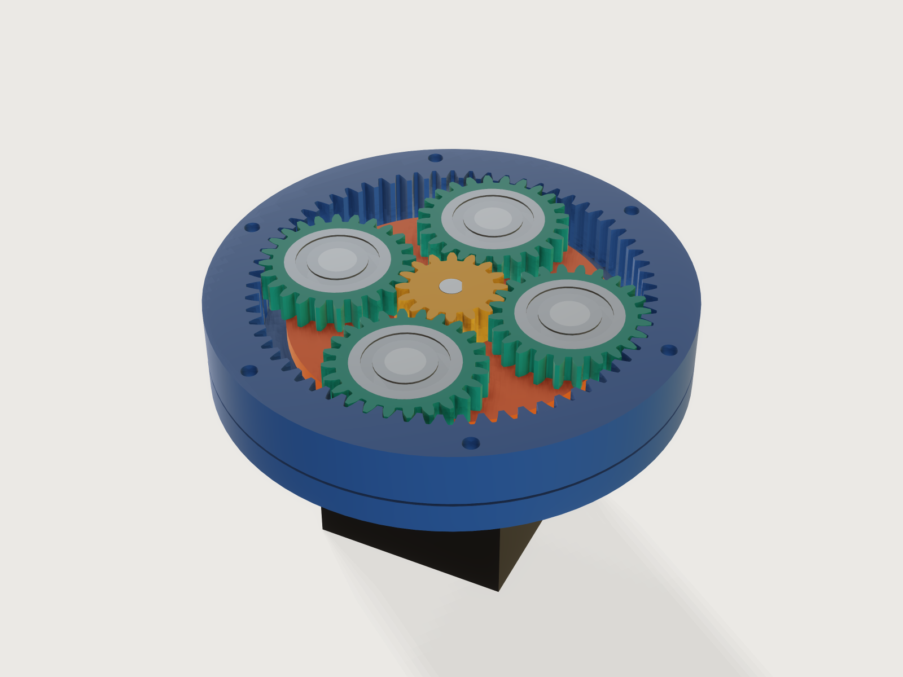

# Planetary gearbox

A printable single-stage planetary reducer for a NEMA stepper. Say which motor, how big the teeth may be, what reduction
you want and how much room there is; the Jig picks the teeth so that the planets you ask for really assemble, gives every
gear an involute tooth with the profile shift that keeps it free of undercut, keeps the ring's teeth clear of the
planets, and carries the planets on ball bearings on steel pins between two carrier plates and the output on a pair of
bearings in the cover. One slider turns the input, and sun, planets and carrier follow by the true kinematics: the flanks
mesh at every angle, not only at zero.



## What it shows

- **A form that asks for the job, not the teeth.** You give the motor, a tooth size, a reduction, a housing diameter and a
  planet count; `sun_teeth`, `planet_teeth` and `ring_teeth` come out of formulas. The tooth total is a whole multiple of
  the planet count (and even, so the planet teeth are whole), so (sun + ring) / planets is whole by construction: only
  what can be assembled can be entered.
- **Ranges that run one way** (`variable.publish` with formula limits). Each range uses only the parameters above it in
  the form: the reduction's range follows from the module and the motor, the smallest housing from the reduction, the
  module and the motor (the sun must hold the motor shaft, the planet a bearing, the motor plate's spigot must clear the
  motor's screw heads), and the most planets from all of these (where neighbouring planets would come closer than 1 mm,
  worked out for 4, 5 and 6 planets with their own tooth counts). The reduction and housing limits are worked out for the
  worst tooth step of any planet count, so a planet count the form offers never makes them invalid. A sweep of 168 272
  combinations of the form (motor, module, reduction on its 0.1 grid, housing in 1 mm steps, every planet count offered,
  the extremes of backlash and clearance) found no empty range and no wall, fit or plate below its limit.
- **Involute gears drawn once, as arcs.** Each gear is one tooth repeated by `sketch.pattern` with `chain` and `angle`
  into one closed profile and extruded once: each flank is three circular arcs through seven points of its involute,
  evenly spaced in roll angle, each arc's centre the circle through its three points worked out by formula; then a
  short radial foot, a root fillet arc and the tip and root arcs. The arcs leave the involute by at most 1.8 µm anywhere
  in the form's range (our own calculation; the worst is a 14-tooth sun at module 2), far less than a printer holds,
  and the faces stay cylinders, which keeps the Jig light (Platform notes). Bores, pockets and bolt holes are circles
  in the same sketches. The Jig is created at a linear tolerance of 0.01 mm (`file.new`, `meta.json` `new`).
- **Profile shift and ring-tip limits from the books.** Sun, planet and ring are shifted together (`sun_shift`, planet and
  ring the opposite, a V-0 pair that keeps the standard centre distance) so no gear is undercut; the ring's tips are
  shortened where the involute-interference limit needs it (`ring_interference_limit`).
- **A drive parameter, no assembly.** *Turn the input* drives `feature.transform` formulas: the sun by the input, the
  carrier by the input times sun over (sun + ring), each planet by the rolling it does on the sun. The slider runs to one
  full turn of the output.
- **Eight views from one choice** (`feature.when`, formula heights). *Cutaway* sections the reducer through the middle of
  the gears by making the gears' extrusions, the pins, the bearings and the motor shaft end there, so the involutes show
  without a single boolean; the parts above the cut are left out. *Closed* is the reducer as it is used. *Print plates 1
  to 6* each lay one group of printed parts flat in print orientation, inside a 220 × 220 mm bed, and nothing else: the
  model exports as a 3MF of that plate without picking.
- **Tables of bought parts** (`table.set`, `choicesFrom`): ISO 54 modules, NEMA motors, planet bearings chosen by
  formula from the room inside the planet, output bearings from the housing and the motor shaft.

A static model of a planetary set is one set of teeth at one angle. Here every reduction from 3.2 to 9.5, every planet
count that fits and four modules give a real, meshing reducer that you can turn, and its print plates.

## The real thing

**How it works.** The motor turns the sun (the input); the ring gear is held between the motor plate and the cover, each
of which registers on its tooth tips with a spigot; the planets roll between sun and ring and carry the carrier round; the
carrier, through the output hub and flange, is the output. With the ring held, one turn of the sun gives Zs / (Zs + Zr) of
a turn of the carrier, the same way round: the reduction is 1 + Zr / Zs (KHK §17.1, Table 17.2, the planetary type, from
Willis' relation).

**Sources, what was read.** The *KHK Gear Technical Reference*, printed edition (KHK Gears,
[gear_guide1.pdf](https://khkgears.us/media/izojpong/gear_guide1.pdf)), read for: Table 1.1 (efficiency of parallel-axis
gears, 98.0 to 99.5 % per mesh, without bearing and lubricant losses), Table 3.1 and Fig. 3.1 (basic rack: addendum
1.00 m, dedendum 1.25 m, tooth depth 2.25 m, tip and root clearance 0.25 m, dedendum fillet radius 0.38 m), Table 3.2
(standard modules, extracted from JIS B 1701-2:1999, series I), eq. 3.4 and 3.5 (base pitch, contact ratio), eq. 3.7 to
3.10 (undercut and the profile shift that avoids it), Table 3.5 (tip land), Table 4.6 and eq. 4.4 to 4.9 (internal gears:
tip and root, the shift convention, involute and trochoid interference), Table 6.1 and §6.3 (backlash), eq. 10.9 (contact
ratio) and §17.1 (the three planetary conditions and the transmission ratio). The contact ratio of an internal pair and
the involute-interference conditions were checked against eq. 3 to 6 of M. Savage, J. J. Coy and D. P. Townsend, *Optimal
Tooth Numbers for Compact Standard Spur Gear Sets*, NASA TM-82614 (1981), [NTRS](https://ntrs.nasa.gov/citations/19810018986);
its scan is partly illegible, so it confirms the KHK forms rather than standing alone. ISO 53, ISO 21771 and Dudley's
handbook were not read (paywalled or not to hand); KHK's rack and module tables are the JIS versions of ISO 53 and ISO 54.
The NEMA 14, 17 and 23 bolt spacing (26, 31, 47.14 mm), pilot (22, 22, 38.1 mm, 2, 2, 1.6 mm deep) and shaft (5, 5,
6.35 mm) were read in the [NEMA size table at hallikainen.org](https://pic.hallikainen.org/techref/io/stepper/nemasizes.htm),
which says of itself that its values "may or may not be right"; the screws are those most makers fit (M3, M3, M5). Shaft
lengths vary with the maker: the 17HS4401 NEMA 17 is listed with a 5 mm shaft 21 mm long and a 40 N cm holding torque by
[Bits & Parts](https://www.bitsandparts.nl/en/stepper-motor-nema-17-17hs4401-p1910324); other listings of the same type
give 21 to 25 mm (search results, not read), so the Jig fits any shaft from 20 to 25 mm and tells you the longest. The
bearing sizes (624, 625, 626, 608 of the 60 series; 61804, 61805, 61807) are from distributor listings and DIN 625-1
tabulations found by search, not a maker's datasheet: check the part you buy. The 220 × 220 mm bed is the build area
Creality gives for the Ender-3, Ender-3 Pro, V2, Neo, V2 Neo, V3 SE and V3 (220 × 220 × 250 mm; 235 to 270 mm high for
the V4, KE and S1) in its own [Ender series parameter comparison](https://store.creality.com/blogs/all/ender-series-3d-printers-parameter-comparison),
read 2026-11-09.

**Tooth geometry.**

```text
module m, pressure angle α = 20°, addendum 1 m, dedendum 1.25 m        (KHK Table 3.1)
reference radius  r = m z / 2,  base radius rb = r cos α
tip radius        ra = r + m (1 + x)        root radius  rf = r − m (1.25 − x)
tooth half angle  ψ = (π/2 + 2 x tan α) / z − (backlash / 2) / (2 r)
```

Backlash is taken off the tooth thickness (KHK §6.3): each tooth is thinner by half the published backlash on its
reference circle, so each mesh has that backlash in total and, centred, a normal gap of backlash · cos α / 2 on each
flank. Below the involute each tooth has a short radial foot and a fillet of 0.3 m (0.25 m on the ring) tangent to the
root circle: smaller than the rack's 0.38 m, so it stays below the mating tip's path. A real generated tooth has a
trochoidal fillet instead; this one is simpler and printable. Each involute flank is drawn as three circular arcs, each
through three of seven points of the involute taken at even steps of the roll angle t (x = rb (cos(φ + t) + t sin(φ + t)),
y = rb (sin(φ + t) − t cos(φ + t))): by our own calculation over all 1 312 tooth sets the form can make, they stay
within 1.8 µm of the involute on the sun (a 14-tooth sun at module 2), 1.6 µm on a planet and 0.2 µm on the ring.

**Undercut and shift.** The limit is z = 2 / sin²α = 17.1 teeth (KHK eq. 3.7). A sun with fewer teeth takes the shift x_s
= 1 − z_s sin²α / 2 + 0.02 (eq. 3.10 with 0.02 of margin), the planet and the ring take −x_s so the centre distance
stays standard (KHK Table 4.6 for the ring's sign); a planet with fewer than 17 teeth makes the planet's own limit the one
that counts. The form keeps sun + planet to at least 35 teeth, so both limits can be met at once.

**Internal gear.** Ring tip radius r_r − m (1 − x_r), root radius r_r + m (1.25 + x_r) (KHK Table 4.6). The ring keeps to
its involute: its tip is above its base circle (eq. 4.7), and its tip circle meets the line of action no nearer the ring's
base point than the planet's base point, rb_r² + (a sin α)² ≤ ra_r² (the involute-interference condition of eq. 4.4; NASA
eq. 5), so the Jig shortens the ring's tips where the standard addendum is too long (`ring_interference_limit`, by up to
0.28 mm in the form's range, at module 2, reduction 3.5, 138 mm). Trochoid interference (eq. 4.8 and 4.9) is computed and
asserted.

**Assembly and kinematics.** Coaxial condition Zr = Zs + 2 Zp (KHK eq. 17.1), assembly condition (Zs + Zr) / N whole
(eq. 17.3), adjacency: the planets' tip circles clear each other (eq. 17.6). The Jig chooses the total T = Zs + Zr as the
largest multiple of lcm(2, N) for which the ring still fits the housing, Zs = round(T / i), and the rest follows. Planet k
sits at φk = (k − 1) 360° / N plus the carrier angle and is turned past φk by 180° − 180° / Zp − (θs − φk) Zs / Zp, θs the
sun's angle; the ring is turned half a ring pitch when Zp is even. Planets 2 to 6 are five copies of planet 1, each placed
by its own copy of that formula with k written in (a pattern cannot read its instance number: J-011); planet 1 is
measured on both flanks against sun and ring, planets 2 to 6 together on both flanks against the ring. An independent
program (exact outlines as dense polygons, placed by these formulas, boundaries compared) found the normal flank gap
equal to backlash · cos α / 2 within ±0.003 mm at 73 drive angles for 6 tooth sets and at 12 random angles for 14
random points of the form; on the model the gaps measure 0.0688 to 0.0698 mm in the Closed view at the defaults,
against the 0.0705 mm designed.

**Further limits, from the books' conditions, the numbers this Jig's own** (the sweep above): at least 12 sun teeth and
2 mm of plastic round the motor's D bore at the sun's root; enough planet teeth for a 624 bearing and 1.6 mm of plastic
round it; 1 mm between neighbouring planets; a tip land of at least 0.4 mm (a 0.4 mm nozzle), which limits the backlash
on a small sun; contact ratios of at least 1.2 (1.54 and 2.02 at the defaults; KHK asks for 1 or more, NASA TM-82614 for
more than 1.4 on standard gears); a housing of at most 160 mm, so that every plate fits a 220 mm bed.

**Printing.** PETG or ABS, 0.2 mm layers, four walls, 40 % infill or more on the gears. The six print plates, each in its
own *Show* setting, each centred on a 220 × 220 mm bed with at least 5 mm free at every edge for a skirt or a brim (5.6
mm at the least, on plate 4 with the largest carriers; 15 mm or more on the others):

1. **Motor plate**, on its floor (0.6 mm first-layer chamfer); the spigot and the screw recesses face up.
2. **Ring gear**, upside down: its first layer lies at the cover joint, where nothing fits against its teeth, so the
   motor plate's spigot enters the clean end. Its teeth are vertical; no support. Both outer rims carry a 0.6 mm
   chamfer; the one at the cover joint is its first-layer chamfer.
3. **Cover**, on its top face (0.6 mm chamfer): the bearing seat is vertical, and the lip that holds the output bearings
   is a 2.5 mm ring overhanging at the top of the print, which prints without support on most printers (support it if
   yours sags).
4. **Both carrier plates**, bosses up (0.6 mm chamfer), side by side along the bed's diagonal, 6 mm apart.
5. **Output hub** on its plate (0.6 mm chamfer), and the **flange** on its top face (0.8 mm chamfer; the screw recesses
   become a short bridge), side by side along the diagonal, 6 mm apart.
6. **Sun and planets**, flat, the sun in the middle and the planets round it 6 mm clear of it and at least 9.5 mm from
   each other, the planets' bearing pockets up, with a 0.4 mm tip chamfer on the planets' bed side (a cone cut, built in
   the print plate only; see Platform notes). The sun needs none: its bottom 4.5 mm sit in the lower
   carrier's opening, below the planets, so its first layer never meshes.

Teeth print best from 1.25 mm modules up; at 1 mm they are small for a 0.4 mm nozzle (the tip lands stay above 0.4 mm but
the flanks are only a few lines).

**Assembly.**
1. Bolt the motor to the motor plate from inside (the screw heads sink into it); press the sun onto the D-shaft, slip fit
   0.1 mm, with retaining compound, its bottom on the lower carrier's level (a 0.5 mm shim under it while it sets).
2. Press a bearing into each planet from the top; the ledge underneath carries its outer ring and stays clear of the
   inner ring.
3. Press the pins through the upper carrier plate into the hub's plate. Put the planets on the pins, set the lower
   carrier plate on the free ends (bosses towards the planets): the bosses of both plates hold the bearing inner rings.
4. Set the ring gear on the motor plate (the spigot centres it). Lower the carrier with the hub into the ring, turning it
   until the planets mesh with ring and sun.
5. Press the two output bearings into the cover from the top, down onto its lip, and lower the cover over the hub (its
   spigot centres it on the ring's tips; the hub's shoulder takes the lower inner ring). Bolt the flange onto the hub with
   three M3 screws into heat-set inserts (it clamps both inner rings), and the cover through the ring gear into M3
   heat-set inserts in the motor plate, with screws in the length window the form gives (48.5 to 50 mm at the defaults:
   an M3 × 50). Grease the teeth.

A load pressing the output down (a turntable) goes from the inner rings through the balls into the outer rings and the
cover's lip; a pull upward is held only by the bearings' press fit in the cover.

**Bought parts.** One ball bearing per planet and a dowel pin per planet (sizes are outputs: 608, 8 × 22 × 7 mm, and 8 mm
pins of 26 mm at the defaults); two 618-series output bearings (61804 20 × 32 × 7, 61805 25 × 37 × 7 or 61807
35 × 47 × 7 mm); M3 screws and inserts; the motor's own screws.

**What this Jig does not claim.** No strength or life: tooth root stress, contact stress and wear of printed gears are
not calculated, and the strength of PLA or PETG teeth is not proven; what a printed gear carries is a matter for a test on
your own print. The form gives the output torque per N m of motor torque at most: the reduction times 0.98² (two meshes
at the low end of KHK Table 1.1, which leaves out bearing and lubricant losses and assumes accurately made gears); with the
17HS4401's 40 N cm holding torque that is at most 1.9 N m at the defaults, and a printed set will lose more. Nor are the
D-shaft joint, the press fits of the pins or the bearings' load in printed seats calculated. Press fits are modelled at
nominal size and usually need reaming or a test print; printed plastic on steel creeps. The backlash is what you set, plus
your printer's error.

## Parameters

| Group | Parameter | Range | What it changes |
|---|---|---|---|
| The reducer | Motor | NEMA 14, 17, 23 | Mounting screws, pilot, shaft, the sun's bore and the smallest housing |
| The reducer | Tooth size (module) | 1, 1.25, 1.5, 2 mm | Tooth size, strength and printability; a bigger module needs a bigger housing |
| The reducer | Reduction | from 3.2 to 9.5 at module 1 (8.9 on a NEMA 23), 9.2 at 1.25, 7.7 at 1.5, 5.8 at 2 | The tooth counts; the output *Reduction you get* shows the true ratio, within 6 % |
| The reducer | Housing outer diameter | a minimum from the reduction, module and motor (98 mm at the defaults) to 160 mm (142 mm at module 1, where the ring has its most teeth, 125) | How many teeth fit, every radial size, the output bearings |
| The reducer | Planets | 3 to the most that keep 1 mm between them (4 at the defaults) | How many planets; the tooth total follows so they assemble |
| Motion | Turn the input | 0 to one turn of the output | Runs the reducer: sun, planets, carrier and output turn by the true kinematics |
| Gears | Gear width | from the planet bearing's width + 3 mm to 30 mm | Face width of the teeth and the height of the stack |
| Gears | Backlash | 0.1 mm to 0.4 mm, less where a small sun's tip land would fall under 0.4 mm (0.14 mm at the least) | Thins every tooth so each mesh has that total play |
| Gears | Print clearance | 0.05 to 0.5 mm | Running and register fits: the spigots in the ring's tips, the sun in the lower carrier, the planet's ledge round the boss |
| View | Show | Cutaway, Closed, Print plate 1 to 6 | See *What it shows* |

Outputs: the teeth (sun, planet, ring, and counted on the model), the reduction you get and the one computed from the
counted teeth, the output's turn at this input, both contact ratios, the sun's profile shift, the gap between planets, the
planet bearing and pin size and the pin length, the output bearings, the shortest and longest cover screw, the output
torque per N m of motor torque at most, the longest motor shaft that fits, and the reducer's height above the motor face.

## Checks

The Jig carries 72 assertions; each is active in the views where the parts it measures exist. In words:

- **Counts and ratio, on the model** (Cutaway and Closed). As many planet bodies as asked; sun, planet and ring teeth
  counted as flank faces of the bodies equal the numbers drawn; ring = sun + 2 planets (counted); (sun + ring) / planets
  whole (counted: the assembly condition); the reduction from the counted teeth equals the one the form shows, and that is
  within 6 % of the one asked for.
- **Tooth outlines, closed form.** The volumes of sun, planet and ring gear against the closed form of the outline (the
  involute's area, foot, fillet, tip and root arcs, less the bore, pocket, holes and the ring's rim chamfers), within
  0.3 %, wherever the gear is shown; the formula was compared with the polygon areas of the independent program to five
  digits.
- **Tooth thickness and tip circles, measured.** The area of each gear's tip faces (exact cylinders) against the tip land
  of KHK Table 3.5 with this Jig's backlash, written apart from the sketches' own variables, times the face width, within
  0.3 %: a tooth drawn too thick or too thin, a backlash left out, or a ring tip on the wrong circle fails it.
- **The meshes, measured (Closed view).** For planet 1, the least distance (`measure.distance`) from its leading flanks
  (all three arcs of every tooth) to the sun's flanks that face them, and from its trailing flanks likewise, and the same
  against the ring; for planets 2 to the last together, from their leading flanks and from their trailing flanks to the
  whole ring gear: each between 0.6 and 1.45 times the design gap backlash · cos α / 2. A planet turned off its phase
  narrows one of its gaps below the bound, which the least gap of planets 2 to the last then shows; a planet run into the
  ring's teeth gives 0 (measured to the whole ring, so that the other planets' good gaps cannot hide it). The lower
  bound is proven: the measure refines its proof until the bound clears 0.6 times the gap and stops there, so the bound
  it reports sits just above that. Planet 1 is measured to the sun's facing flanks because to the whole sun, with its end
  faces, the proof could not be refined to the bound at three points of the range (0.024 mm proven of 0.097 mm found).
- **Kinematics and centre distance, measured** (Cutaway and Closed). Planet 1's centre of mass is where the carrier must be
  at this input, at the centre distance m (Zs + Zp) / 2 computed from the counted teeth (x and y, within 0.02 mm); in the
  Closed view an index mark on the flange is checked the same way. The common centre of mass of all the planets lies on
  the axis (x and y, within 0.01 mm), so a planet copy off its place by a quarter of a millimetre (towards the sun, say)
  is caught; the planet copies are each placed by their own copy of the formula.
- **Gear conditions.** Contact ratios at least 1.2; no undercut on sun or planet; the ring's tip above its base circle and
  outside the involute-interference limit; trochoid interference at or above zero; tip lands of at least 0.4 mm;
  neighbouring planets at least 1 mm apart (measured, Closed view).
- **Registers and running fits, measured** (Closed view). The motor plate's spigot and the cover's spigot each stand
  between 0.5 and 1.5 times the print clearance from the ring's tooth tips, and a section through each measures twice
  the ring's tip radius less the print clearance across (`sectionExtent`), so the spigot is inside the tips, not in the
  teeth; the planet pins stand on the planets' axes (the gap to planet 1's ledge is the same all round); the planet's
  ledge runs clear of the carrier boss and at least 0.1 mm (0.3 mm designed) off the bearing's inner ring; the cover's
  lip stays at least 0.15 mm off the output bearing's inner ring; the sun's tips clear the lower carrier's opening by 0.9
  times the print clearance or more; the output hub clears the ring gear.
- **Walls.** Every wall of motor plate, lower carrier, cover, output hub and flange at least 1.2 mm (`measure.thickness`),
  measured on the part's own print plate (a wall does not depend on the view); ring wall at least 7 mm, planet wall round
  its bearing at least 1.2 mm, sun wall round the shaft at least 1.5 mm (by formula); a 20 mm motor shaft reaches 8 mm
  into the sun and a 25 mm one still fits; the housing is the diameter asked (measured).
- **Nothing overlaps when closed** (Closed view): the carrier plates, hub, cover, motor plate, output bearings, planet
  bearings and planet pins, in pairs (`overlap`). The gears are left out of this set: they are covered by the mesh
  distances.
- **Print plates.** Every printed part lies on the bed; the plate's parts stay at least 5 mm (`bed_margin`) inside every
  edge of the 220 × 220 mm bed, room for a skirt or a brim (four `boxMin`/`boxMax` assertions; a sweep of the layout
  formulas over 84 136 combinations of motor, module, reduction, housing, planets and clearance found 5.6 mm the least);
  no two parts on a plate overlap.

**Mutation tests**, on scratch copies of the build, 18 of them, each failing at least one assertion cleanly (status
failed, not only an error or notProven; Closed view, 35° input): planet 3 turned half a tooth (both mesh checks of
planets 2 to the last); a planet pin moved 0.4 mm (the pins-on-axes check; the overlap check cannot be measured there);
the carrier's pin holes 0.5 mm small (the overlap check); the motor plate's spigot 0.3 mm into the ring's teeth and the
cover's likewise (their register checks and section diameters); the planet's ledge pushed into the boss (both ledge
checks); the cover's lip pushed onto the inner ring (the lip check); planet 1 turned by +0.6 and by −0.6 of its backlash
angle and planet 2 by half a tooth (mesh checks); the centre distance 0.05 mm short (planet 1's centre of mass); tooth
totals that do not divide by three planets (the counted assembly condition and the mesh of planets 2 to the last); a
wrong carrier angle (the meshes and both turn checks); the ring's half-pitch phase left out (every ring mesh); a planet
drawn without its share of backlash (its tip-land area; its meshes narrow to half the gap, within the document's 0.01 mm
tolerance of the bound, so they are notProven); the ring tip left unshortened where the limit binds (module 2, reduction
3.5, 138 mm: the ring's tip-land area and the interference condition); the sun's teeth 0.004 rad thinner (the sun's
tip-land area); planet 4 moved 0.25 mm towards the sun (the planets' common centre of mass, x). Planet 4 moved 0.06 mm
stays inside every bound (its gaps change by 0.02 mm).

**By hand** (`param.set`), what the form refuses at the defaults (NEMA 17, module 1.25, reduction 5, 100 mm, 4 planets): a
housing of 90 mm (98 mm is the least for this reduction) and one of 170 mm (160 mm is the most), five planets (four is the
most that keep 1 mm between them), and a reduction of 6 in this housing (it would need at least 109 mm). Points tried by
hand, each passing every assertion active in its view: NEMA 23 at module 1.25, reduction 5, 114 mm, four planets; NEMA 17
at module 1, reduction 3.2, 99 mm; NEMA 23 at module 1, reduction 3.2, 110 mm; NEMA 23 at module 2, reduction 5.8, 160 mm, three planets;
module 1.5 at reduction 3.2 in 160 mm with four planets, 30 mm gears and 0.5 mm clearance, closed and on each of the six
print plates; module 1 at reduction 3.2 in 125 mm with six planets, closed and on plate 6.

`tools/jigs.py check` runs `check-range` (defaults, the corners of the ranges, every choice, 32 random points from seed 1):
the result is in `meta.json` `stats`. Beyond it, the Closed view was run at 220 points with the backlash at its least
(0.1 to 0.11 mm, where the mesh bounds have the least room): every mesh assertion proven at every point. Not checked: the
strength of anything (above), the printed fits, and planets 2 to the last against the sun: they are placed by copies of
planet 1's formula, whose sun mesh is measured; their ring meshes and their common centre are measured.

## Export

- **To print:** set *Show* to *Print plate 1*, then **File › Export**, **The model**, as 3MF: the plate's parts in print
  orientation, within 220 × 220 mm, with no bought part and no helper body. Do the same for plates 2 to 6. Plate 6 holds
  the sun and every planet.
- **Assembly for CAD:** set *Show* to *Closed* and export STEP.

## Files

`build.json` (the source), `meta.json`, `formtest.md`, `preview.png`, and `dist/planetary-gearbox.3dcraftjig`,
`dist/thumbs/planetary-gearbox.png` from the tool. No generator is committed.

## Rebuild

```sh
tools/jigs.py build planetary-gearbox
tools/jigs.py render planetary-gearbox
tools/jigs.py check planetary-gearbox
```

## Difficulty

Not yet scored (the reviewer gives it).

## Platform notes

The preview is the Cutaway at the defaults, rendered with the Workshop look turned 90° (`look.rotation`), where the
steel pins and bearings read neutral grey; the renderer's reflections are on and leave no smears on the cut faces.

- **Flanks as arcs, not splines or formula curves.** The flanks were live `sketch.spline`s through eight points of the
  involute; such a spline strays from the curve between its points far more than a cubic interpolant would (0.009 mm on
  a 14-tooth sun at module 2 with eight points, 0.031 mm with five, against 0.003 mm for a cubic interpolant of five:
  [finding](../../findings/J-034-spline-through-strays/README.md)), and opening a Jig measures every body, which on
  spline faces is slow ([finding](../../findings/J-065-gear-measure-cost/README.md), from the orrery): with splines the
  Jig took about 10 s of CPU to open, 13 to 15 s in the Closed view. `sketch.curve` is exact but fits 35 control points
  per flank (the gear-reducer's [finding](../../findings/J-066-formula-curve-fit-size/involute.json)). Three arcs per flank
  keep the faces cylinders: about 3 s of CPU to open.
- A chamfer could not follow a chain of tooth flanks when they were splines: `feature.chamfer` with `chain` on the
  bed-side edge of a gear was refused ("the distance does not fit on a face somewhere along it") even at 0.2 mm
  ([finding](../../findings/J-047-chamfer-freeform-rim/tooth-chain.json); the family of F-075 and F-158 in
  `~/code/3dcraft-examples/3DCRAFT-FEEDBACK.md`). The planets' tip chamfer is therefore a revolved cone cut
  ([finding](../../findings/J-064-cone-cut-across-teeth-cost/repro.json) on its cost with spline flanks), built on print
  plate 6 only, and on the planets only: the assembled views show the gears without it.
- `measure.clearance` between meshing gears proves a lower bound that depends on where the body stands
  ([finding](../../findings/J-019-assertion-stops-short/clearance.json)) and costs seconds per set of pairs (F-098): the
  meshes are checked with `measure.distance` from one flank family at a time, and the gears are left out of the overlap
  set.
- A planet pin moved off its axis makes the overlap assertion an error ("boolean does not support this: a curve that
  is partly on and partly off" a face, of the family of J-002), not a failure; the pins-on-axes distance fails cleanly
  instead.
- A pattern instance has no index to read its own placement with (J-011), so planets 2 to 6 are five `feature.transform`
  copies, each with the planet formula for its k.
- `variable.measure` takes no `when`, so an output measured only in one view would be measured in every view
  ([finding](../../findings/J-057-variable-measure-no-when/repro.json)); the measured gaps are assertions, not outputs.
