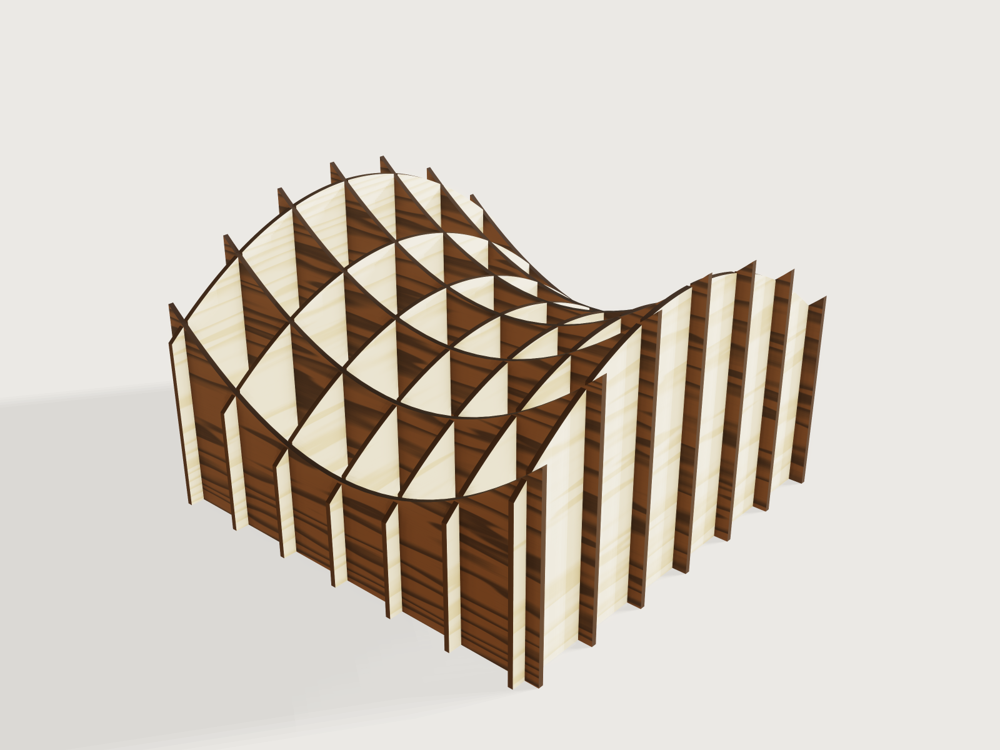

# Sliceform sculpture

A sculpture of two families of laser-cut plywood slices, birch one way and walnut the other, that slide into each
other with half-lap slots and together show a surface from a formula: a saddle, a ripple or a ball. Give the size,
the number of slices each way, your two sheets as you measured them, your laser's kerf and how loose the slots
should be; the form writes one cut sheet per wood, each slice on a layer of its own in the DXF (the SVG names each slice only by its path id).



## What it shows

- **Every section from one solid.** The shape is built once: a two-rail translation sweep (`feature.sweep` with
  two rails and `up: z`) for the saddle and the ripple, a `feature.sphere` for the ball; `feature.when` keeps one
  and a union passes it on as *Shape*. One sheet per family (`feature.fill`), repeated once per slice by
  `feature.pattern` (`count` = the slice count), is intersected with it (`feature.boolean`): every section of the
  family in one step, each exactly where its slice will be.
- **Half way up every crossing, with flat slot ends.** Each family's slots are one comb: a single `sketch.path` of
  twelve teeth, one per slice of the other family (the teeth a smaller count does not use are parked beyond the
  shape, where they cut nothing). For the saddle and the ripple, whose surface is a sum z = F(x) + G(y), each
  tooth's end is set to G at its slice and the comb is swept along a polyline rail with a corner on F at every
  slice of the other family (corners of the unused teeth parked too): the slot of every crossing ends at exactly
  half the height of that crossing, and square across the slot, so the birch slot end and
  the walnut slot end of a crossing meet face to face. For the ball the comb is extruded flat (`feature.extrude`)
  at the middle level. One `feature.boolean` per family cuts all the slots.
- **Square-edged slices, as a laser cuts them.** `feature.plate` (`side: mid`) gives each slotted section the
  thickness of its sheet with square rims: the prism a laser cuts from that outline. 3DCraft plates one connected
  face per feature, so there is one plate per slice, switched off by `feature.when` beyond the count: 62 features
  in all, against 245 for the old Jig.
- **Two woods, burnt edges.** The sheets carry the materials and the dark brown of a laser-cut edge, which the
  plates take over for their rims; `face.appearance` lays a birch or a walnut veneer on both faces of every slice.
- **What the form does that a static model cannot.** The shape choice switches the solid and the comb; the counts
  add or remove slices, teeth and crossings; the two measured thicknesses size the slots of the other family; the
  kerf and the play move every slot wall; the limits of the counts, the height and the relief follow the other
  parameters. The last slider lifts the walnut slices off the birch ones, to show how they slide together; the cut
  sheets do not change.

## The real thing

- **The principle.** A sliceform is two families of parallel sections, slotted at each intersection, "the x slices
  slotted from below and the y slices slotted from above", where "the points at the middle of each line of
  intersection marks the extent of these slots" (Stephen Luecking, *Creating Sliceforms with 3D Modelers*, Bridges
  London 2006, pp. 631-638, read). Here the birch slices are slotted from the top and the walnut slices from the
  foot. For the saddle and the ripple the slots of every crossing meet at exactly the middle of that crossing. For
  the ball the slots meet at the sphere's centre, the middle of every crossing that does not reach the flat foot;
  over the foot the birch part is the shorter one.
- **It does not fold flat, and why.** A paper sliceform collapses "like an accordion" (Luecking, as above): its
  slots are knife cuts and thin slices twist a little at each crossing, so the crossings act as hinges (Timothy
  Watson, *Sliceforms: deployable structures from interlocking slices*, PhD thesis, University of Cambridge, 2021,
  abstract read). A slot as wide as plywood holds the other slice square: two sheets of thickness t crossing at an
  angle a need a slot t / sin a wide, so a slot that fits at 90 degrees locks the angle. This Jig therefore makes
  a rigid sculpture and offers no fold.
- **No lamp.** The old Jig offered a lamp shade; this one does not. A bulb stands in a room cut out of the slices
  round it; a birch slice crossing the room then holds together only by the wood between the room's top and its
  slot ends, so the room must stay two sheets below the middle of the sculpture: an 8 W LED bulb, 60 mm across and
  110 mm tall (Signify data sheet for EAN 8718696823125, read), with its holder fits only under a tall sculpture.
  More to the point, the model could prove the clearance to the bulb but not how hot the wood beside it gets, and
  no limit for wood was found that the Jig could assert: a lamp it cannot show to be safe is left out.
- **Material.** Birch plywood one way, walnut-faced plywood the other, 1.5 to 6.5 mm. Plywood sold as 4 mm may be
  3.5 to 4.3 mm thick (EN 315, as tabled in the *Handbook of Finnish Plywood*, Finnish Forest Industries
  Federation, 2002, Table 2-3, read): measure each sheet with calipers and enter both. The birch slots are sized
  for the walnut sheet and the walnut slots for the birch sheet. The walnut sheet must be within 1.5 times the birch
  sheet either way, so no slot is narrower than two thirds of the sheet it is cut through (the laser rule asks a
  slot at least as wide as its sheet; two thirds for two woods of different thickness is this Jig's judgement).
- **Slots and kerf.** The bodies are what the beam follows: every slot is drawn the other sheet + the play - the
  kerf wide, and comes out the other sheet + the play. The outlines and the slot ends are not offset: each comes
  out half a kerf smaller or deeper (0.075 mm at the default), so a crossing has one kerf of play in height, which
  nothing shows. Laser inside corners are rounded only by the beam's radius, so the slots need no reliefs. Play: 0
  mm is a press fit to tap together, 0.1 mm snug, 0.2 mm slides (starting values from practice, not a standard:
  cut a test pair first).
- **Wood round every slot (this Jig's judgement, not a standard).** Two sheets of wood remain beyond the end of
  every slot (below a birch slot, above a walnut slot, beside the outermost ones). A finger between two slots (and
  the end beyond the outermost slot) is at least two sheets wide and at least a tenth as wide as the deepest slot
  is long: the fingers above a birch slot end are held only at their root, and a long thin finger wobbles. These
  rules set the most slices and the largest relief the form allows.
- **Sizes.** Saddle and ripple 0.3 to 1 times as high as wide (relief 10 to 45 % of the height, less where it
  would leave less than two sheets of wood round a slot end, as at the dipping ends of a steep saddle); ball from 0.6
  times as high as wide up to as high as keeps every slice standing on the flat foot (about 0.87 times; a sphere as
  wide as the sculpture, cut flat by the floor: a low dome to most of a ball). The crossings of the ball lie inside the sphere with a finger's width of wood beyond the outermost
  slots. On the ball that end piece narrows to a point where the outermost slot meets the curved outline: sand the
  tip.
- **Mass.** All slices at 680 kg/m3, the mean density of birch plywood in the *Handbook of Finnish Plywood*, Table
  3-1 (read); walnut-faced plywood on a birch core is taken the same.
- **Assembly.** Sort the slices by their layer names. Stand the birch slices, slots up, in order Birch slice 1 to
  n along the width; lower Walnut slice 1 over them from above, its slots down over the birch slots, then the last
  walnut slice, and the frame stands; then the others in order. Push each walnut slice down evenly along its
  length; if a slot binds, sand its walls lightly. No glue is needed; a drop of PVA at the crossings of the foot
  makes it rigid.

At the defaults (saddle, 340 mm wide, 220 mm high, relief 35 %, 7 birch and 7 walnut slices of 4 mm plywood, kerf
0.15 mm, play 0.1 mm): 14 slices and 49 crossings; the slots are drawn 3.95 mm wide and come out 4.1 mm; the
narrowest finger, the end beyond the outermost slots, is 10.9 mm as cut; 3 348 cm² of birch and 3 182 cm² of walnut
in the parts; about 1.78 kg.

## Parameters

| Group | Parameter | Default | Range | What it changes |
|---|---|---|---|---|
| Shape | Shape | Saddle | Saddle, Ripple, Ball (table `shapes`) | The solid, the comb (swept or flat) |
| Shape | Width | 340 mm | 150 to 600 mm | Across the sculpture, both ways |
| Shape | Height | 220 mm | by shape: saddle and ripple 0.3 to 1, ball 0.6 times the width to about 0.87 (every slice on the foot); 100 to 600 mm | Overall height; the ball's centre and foot |
| Shape | Relief | 35 % | 10 % to 45 %, less on a low sculpture of thick sheet (34 % at 150 × 150 mm of 6.5 mm sheet) | Saddle and ripple: how far the top rises and falls (the ball ignores it) |
| Slices | Birch slices | 7 | 3 to as many as the finger rule allows, at most 12 | Slices across the width, slotted from the top |
| Slices | Walnut slices | 7 | likewise | Slices the other way, slotted from the foot |
| Sheet and laser | Birch sheet, measured | 4 mm | 1.5 to 6.5 mm | Birch slice thickness; the walnut slots |
| Sheet and laser | Walnut sheet, measured | 4 mm | 1.5 to 6.5 mm, within 1.5 times the birch sheet either way | Walnut slice thickness; the birch slots |
| Sheet and laser | Laser kerf | 0.15 mm | 0 to 0.3 mm | How much narrower every slot is drawn |
| Sheet and laser | Slot play | 0.1 mm | 0 to 0.4 mm | How much wider than the other sheet a slot comes out |
| View | Lift the walnut slices (view only) | 0 | 0 to 100 % of the height | Shows the two families sliding together |

Outputs: slices to cut, crossings, the slot width in the file for each wood (measured on the model), the narrowest
finger as cut (the half kerf the outline loses included), the birch and
walnut area in the parts, the mass.

## Checks

19 assertions run at every change of the form, 18 of them for any one shape (the closed form of the shape differs).
Most are measured on the slices and fire on a modelling error; what the form must not allow is kept out by the
ranges above.

- **Counts.** One body for every birch slice and one for every walnut slice.
- **Each slot fits the slice it takes.** The first birch slot is measured wall to wall on the model; with the
  kerf added it is the walnut slice's thickness, measured between its two faces, plus the play; the same for the
  walnut slots and a birch slice. And every slot as cut is at least two thirds as wide as the sheet it is cut
  through (the walnut sheet's range keeps it within 1.5 times the birch sheet).
- **Every crossing has its slot.** The slot ends of all birch slots together have the area crossings × the
  measured slot width × birch thickness, and the walnut ones likewise.
- **Square slots.** The birch slices have two walls square to the slice for every crossing, and so have the walnut
  slices: no slot is tapered or skewed (a wall leaning 0.3 mm over its height is caught).
- **Every slot sits at its slice and ends half way up its crossing.** A strip as wide as the slot less 0.1 mm is
  cut out of the birch sections where every walnut slice stands (placed by the walnut slices' own pattern, not by
  the comb). For the saddle and the ripple, what it holds (the birch below each slot end) has the area strip width
  × the sum of half the heights of all crossings, from the formula in closed form; for the ball the strip starts 1
  mm below the middle level and holds exactly a 1 mm band at every crossing. The same for the walnut sections
  above their slot ends (with the integral of the top across the strip). A slot that sits 0.05 mm off its slice,
  or ends too high or too low, at any one crossing puts wood into a strip or takes it out.
- **Wood round every slot end.** From every slot end, the nearest other edge of its slice (the foot, the top, the
  end, a rim) is at least two sheets away: no slot runs into a thin neck, and the slices stay one piece.
- **Fingers.** Between the first two slots of birch slice 1 and of walnut slice 1 the finger is at least the
  finger rule plus the kerf as drawn, so at least the rule as cut (all slots of a family are equally spaced).
- **Closed form of the shape.** The birch sections, before slotting, have the area of the saddle's or the ripple's
  sections summed in closed form; the outermost birch section of the ball has the area of its circle cut by the
  floor.
- **It stands.** Every birch slice has a foot on the floor.
- **One piece.** A slice that fell apart could not be plated (`feature.plate` refuses separate pieces), so the
  regeneration fails: tried below.

Tried by hand with `param.set`, each point rebuilt and checked: the saddle at 150 × 150 mm with 6.5 mm sheets, 0.4
mm play, no kerf and the largest relief the form allows (34 %), 6 × 6 slices; the ripple at 150 × 150 mm with 6.5
mm birch and 1.5 mm walnut at its largest relief (39 %); both at 150 × 100 mm and 6.5 mm (30 % and 33 %, 5 × 5);
the saddle at 600 × 600 mm, relief 45 %, 12 × 12; saddle and ripple at 600 × 180 mm, relief 45 %, 1.5 mm sheets,
12 × 12; the ball at 150 × 100 mm with 6.5 mm sheets (4 × 4), and, under an earlier and higher height limit, at 600 × 570 mm
(12 × 12), 340 × 323 mm (3 × 3) and 300 × 285 mm (11 × 11); the ball at 600 × 520 mm with 12 birch slices of 1.5 mm and
3 walnut of 6.5 mm (the corner that failed before, at its new height limit) and the form test's 300 × 260 mm (11 × 11); the walnut slices lifted fully off. All passed. Refused by the form:
12 slices each way on that ball (11 at most). These probes found two holes that the first ranges let through, both
now closed: at the largest relief the end of a saddle's slice dips so close to the outermost slot end that only
12.2 mm of 6.5 mm sheet was left beside it (the relief range now keeps the end of every slice two sheets above the
outermost slot ends), and the ripple left 12.9 mm (its range keeps a quarter more than two sheets under the lowest
crossing).

Deliberate errors in scratch copies of `build.json`, each caught. Against the present checks: the walnut slot for
birch slice 4 moved 0.8 mm at the defaults (*Walnut slots sit at their birch slices …*: 13 788 against 13 489
mm²); the walnut slot for birch slice 3 moved 1.5 mm on a ball (1 407 against 189 mm²); the birch slot for walnut
slice 2 moved 0.3 mm on a ball (420 against 189 mm²); the birch slots drawn 0.2 mm too narrow (*Birch slots take
the walnut slices with the play*: the walnut slice 4 mm against 3.8 mm). Against the earlier, weaker checks
(which these replace and which still catch them): one birch slot end 1 mm too high (6 933 against 6 919 mm²); one tooth's wall leaning 0.3 mm (*Birch slot walls are
square to the slice*: 91 of 98); the ends of the slices 8 mm short (both *Two sheets … round the end of every
slot*: 3.1 mm); birch slice 1 plated 2 % too thick; a relief of 49
% (*Two sheets …*: 3.5 mm); nine birch slices where the form allows six (*Fingers*: 8.2 and 13.1 mm against 13.2
mm); the ball's walnut slot ends 0.5 mm above the middle; a
walnut tooth reaching through the slices (the slices fall apart, their plates fail and so does the regeneration);
the walnut comb's rail 2 % off its formula (*Walnut slots end half way up every crossing*: 6 873 against 6 919
mm²); a bump of 0.5 mm in the saddle's profile (*Birch sections are the saddle's or the ripple's*: 349 471 against
348 677 mm²). The reviewer found that half-slot-wide strips let a slot moved 0.8 to 1.5 mm pass, and that the
ball had no position check; both are what the full-width strips now catch.

`tools/jigs.py check` runs `check-range` (the defaults, 64 corners, every choice, 32 random points): 99 points, all passed, none unproven (after the fixes in Platform notes; slowest point 5.3 s). That is a sample of the range, not every value. It does not
check the fit of a real sheet in a real slot (cut two test slices first) nor the strength of the sculpture.

## Export

- **File › Export…, SVG or DXF, Sheet of set *Cut sheet, birch***, with your laser bed's width as the sheet width;
  then again with *Cut sheet, walnut*. Every slice is drawn once, at true size, in order from left to right in rows.
  In the DXF each slice is on a layer named after it (Birch_slice_1 … , Walnut_slice_1 …); the SVG carries the name
  only as the path's id, which laser software ignores, so take the DXF when you want the labels; the curves stay curves
  (cubic Béziers in SVG, splines in DXF). The slots are already narrowed by the kerf: turn the laser software's
  own kerf compensation off.
- The sheet grows as tall as it needs (3DCraft's layout has a row width but no sheet height, F-162): at the
  defaults each family is one slice per row on a 600 mm bed, 340 mm wide and 1 235 mm (birch) or 1 366 mm (walnut)
  tall. Move the rows onto your beds in the laser software.
- 3DCraft cannot yet put an engraved number on each part in the same file (F-142), so the layer name is the
  slice's label: write it on each slice with a pencil as it comes off the bed. Slice 1 and slice n of a family
  (and 2 and n − 1, …) have the same outline, so they may be swapped.

```sh
craft3d-cli run dist/sliceform.3dcraftjig \
  --cmd file.export --params '{"path": "birch.svg", "set": "Cut sheet, birch", "width": "600 mm"}' \
  --cmd file.export --params '{"path": "walnut.svg", "set": "Cut sheet, walnut", "width": "600 mm"}'
```

## Files

| File | |
|---|---|
| [`build.json`](build.json) | the source: 233 steps (109 of them variables, 48 of those the place and depth of every slot) |
| [`meta.json`](meta.json) | title, process, framing, exports |
| [`formtest.md`](formtest.md) | a maker's job and its acceptance |
| [`preview.png`](preview.png) | the picture |

## Rebuild

```sh
tools/jigs.py build sliceform
tools/jigs.py render sliceform
tools/jigs.py check sliceform
```

## Difficulty

Not scored yet (the reviewer gives it).

## Platform notes

- `feature.plate` plates one connected face per feature, so the slices of a family, which are one body of
  sections, need one plate each, switched by their count: proposed J-xxx,
  [`findings/J-xxx-plate-separate-faces/`](../../findings/J-xxx-plate-separate-faces/). A layer from a section by
  `feature.plate` (`side: mid`) is the route F-139 in 3DCraft Examples' list describes.
- A pattern's copies cannot differ (J-011, F-027): each comb's twelve teeth, each with its own depth, are written
  out in one `sketch.path`, the unused ones parked beyond the shape.
- No engraved labels in a cut sheet (F-142): the slices are named by their layers.
- `face.appearance` takes literal face names only (F-025): the veneer is given to the faces of all twelve possible
  sections, and at a smaller count `document.check` lists the unused ones as lost faces (a warning, their colour
  waits for them).
- The box of a slice with spline edges is not proven closely enough to assert the width (F-122); the slices are
  sections of a shape that fits the width by construction.
- `feature.plate` refuses some valid sections of a twisted loft ("the edge across a corner could not be traced"):
  proposed J-xxx, [`findings/J-xxx-plate-corner-not-traced/`](../../findings/J-xxx-plate-corner-not-traced/). The
  first draft had a fourth shape, a tower lofted through turning rounded squares; check-range and probes found
  such refusals at several points of its range (twists of −120 and ±180 deg, sheets of 1.5 and 6.5 mm), no change
  of its construction cured them all, so the tower was left out rather than offered with holes in its range. The
  old Jig's twisted vase did build: it drew every slice as its own sketch from `sketch.curve` and extruded it,
  which this build's plate-from-section method (one shape, sliced) cannot match for a twisted loft.
- `feature.plate` could not mesh one slice of a large ball whose section was a whole circle clear of the floor
  ("face 0 cannot be tessellated: its loops do not bound a region"), at two corners of the range (600 × 570 mm,
  12 birch slices of 1.5 mm, slice 11). The ball's height is now limited so that every slice reaches the flat
  foot (a sounder sculpture too: every slice stands); the kerf also ends at 0.3 mm (this Jig's judgement of the
  most a CO2 laser burns away in plywood). Proposed J-xxx,
  [`findings/J-xxx-plate-cannot-be-meshed/`](../../findings/J-xxx-plate-cannot-be-meshed/).
