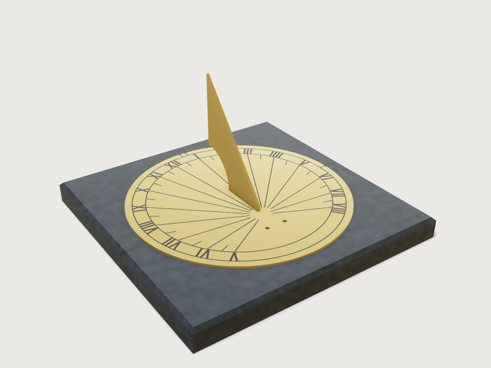

# Sundial for your place

A brass sundial on slate, drawn for the place where it will stand: a horizontal dial for a pedestal in the garden, or
a vertical dial for a wall, also a wall that does not face due south. Pick a city or give your latitude, longitude and
time zone, and the hour lines are laid out so that the dial reads the clock time of your zone: the longitude
correction is in the lines, the equation of time is in the form's description. The gnomon's thickness is handled as
a real dialist does it, with two styles and a noon gap. The brass plate and gnomon go to a laser or waterjet from one
named set, drawn as the beam's path for your kerf, the engraving (lines, ticks, numerals and the chapter ring) from
another, placed by a measure on the form or by three notches in the plate's edge that it fits one way only; the slate is
a stone supplier's slab or plaque.



## What it shows

- **Formulas that draw an instrument** (`variable.set`, `sketch.polyline`). Each hour line's angle is the textbook
  construction of a plane dial: a horizontal dial for the latitude SH (the style height), turned by the substyle angle
  SD, with its hours counted from the substyle's own hour angle. One family of formulas covers the horizontal dial, the
  south wall and every declining wall.
- **The form changes what is built.** The hours that get a line follow the place: 13 or 14 lines at 25° N on a pedestal,
  18 or 19 at 65° N (by the longitude), 9 to 13 on a wall depending on where it faces; the time zone moves them by the
  longitude correction, and when an hour falls exactly on the substyle the noon line is doubled, one on each side of the
  gnomon. The wall dial stands
  upright on its slate plaque and the plaque gets four fixing holes; the pedestal dial lies on a slab.
- **Datum planes from formulas** (`datum.plane` through three points). The plane of the dial is set horizontal or
  upright, and the gnomon's plane stands on the substyle, by expressions; every sketch of the dial is drawn in one frame
  whose y axis is the substyle.
- **An engraving that exports as one drawing** (`set.define`, `file.export` of a set). The chapter ring, the hour lines,
  the half-hour ticks and the numerals touch each other, so the engraving is one region, which a named set exports as one
  drawing; the cut sheet is the plate's face and the gnomon's side. The output *Engraving inset* places one on the other,
  and three notches with three index marks let a cut plate take the engraving one way only.
- **The beam's path in the bodies** (`feature.offsetProfile`). The plate's and the gnomon's sketches are the parts as they
  come out; each is offset by half the kerf before it is extruded, outlines out and slots and holes in, so the named set
  *Cut sheet* is what the laser follows, and the form's *Laser kerf* changes the file the maker exports.
- **Numerals drawn letter by letter** (`sketch.polyline`): each letter of a Roman numeral is a polygon set upright on the
  chapter ring, sized so that the widest numeral, VIII, fits between the two closest hour lines.
- **Assertions that rebuild the dial another way** (`assert.add`): the shadow of the gnomon's edges is constructed with
  vectors from the latitude, the wall's direction and the sun's hour angle, and the model's style, lines and noon lines
  must lie where that shadow falls.

A static model of a sundial is right for one place and one wall. This one is right for any place from 25 to 65 degrees
north and any wall up to 50 degrees from south, and says which hours the sun can reach.

## The real thing

**The hour lines.** With φ the latitude, d the wall's declination from south (west positive), h the hour angle (15° per
hour from local noon, afternoon positive):

| | Style height SH | Substyle angle SD (from the noon line) | Hour line angle X (from the noon line) |
|---|---|---|---|
| Horizontal | φ | 0 | tan X = sin φ · tan h |
| Vertical, declining | sin SH = cos d · cos φ | tan SD = sin d / tan φ | tan X = cos φ · tan h / (cos d + sin d · sin φ · tan h) |

These are the formulas of Carl Sabanski's *The Sundial Primer* (mysundial.ca), pages *Horizontal Sundial* and *Vertical
Declining Sundial*, which were read; Wikipedia's *Sundial* gives the same three for the declining dial in another form.
The model draws a declining dial differently, as the classical construction does: every line makes the angle ψ with the
substyle, tan ψ = sin SH · tan (h − DL), where DL is the substyle's hour angle, the "difference in longitude", cot DL =
cot d · sin φ (Wikipedia, *Schema for vertical declining dials*, after Waugh, *Sundials: Their Theory and Construction*,
pp. 78–79; the Wikipedia page was read, Waugh was not). The independent check below holds the model to the Primer's
formula.

**Which hours.** A line is drawn for every clock hour at which the sun shines on the dial on some day of the year: for some
declination of the sun between −23.44° and +23.44° (the mean obliquity at J2000.0, 23°26′21″, Wikipedia *Axial tilt*) it
is above the horizon and in front of the dial. Each of the two conditions holds on half a turn of the declination, so the
test is closed: the largest lower end of the two half-turns and of the year against the smallest upper end. On a pedestal
it is the sunrise and sunset of midsummer. Lines stop 9 hours from local noon (3 a.m. to 9 p.m. solar time): north of
58.5° the midsummer sun is up longer, and those hours have no line. On a declining wall some of the first or last lines
are reached only for some weeks of the year, at a low sun or a grazing angle; they are drawn, since the sun does reach
them. On a wall facing due south in solar time the 6 and 18 o'clock lines, along the horizontal through the root, are
reached only at a grazing angle at the equinoxes; they are drawn, as on most south dials, where they close the hours.

**A thick gnomon.** The gnomon is cut from the dial's sheet, so it is as thick as the plate, and both of its top edges are
styles. From 6 a.m. to noon the shadow's edge is cast by the western style, from noon to 6 p.m. by the eastern one; before
6 a.m. and after 6 p.m. by the other one (British Sundial Society, *How sundials work*, part 4: "after 6 in the afternoon,
and before 6 in the morning, the shadow will be coming from the other style"). So the morning lines start on one side of
the gnomon's root and the afternoon lines on the other, a gnomon's thickness apart (the noon gap), and the early and late
lines change side. On a declining wall the change is at the substyle's hour DL and 6 hours either side of it,
not at noon and 6. When an hour falls exactly on the substyle (noon on a pedestal or a south wall in solar time, or with
your longitude on the zone's meridian), both styles cast it: it gets a line along each face of the gnomon.

**The layout.** The root sits behind the centre of the disc: on a wall 45 % of the radius, on a pedestal 28 % in the north,
where lines run all round, up to 45 % in the south, where few hours lie behind the root. Lines are 0.4 % of the diameter
wide (0.6 to 1.2 mm); they start where neighbours are two line widths apart (at least 5 % of the diameter from the root),
and a line that would run along the gnomon's foot starts where it has left a band of the slot's width and a line width
either side of it, or beyond the foot's end, so that nothing engraved runs under the gnomon and no line is cut lengthwise;
they end on the inner ring of the chapter band, the half-hour ticks 4.5 % of the diameter long. The numerals stand between
the two rings, upright on the outside of a pedestal dial and hanging from the outer ring on a wall, so that noon reads
the right way up. The gnomon reaches 70 % of the way from the root to the ring, but no higher than half the diameter (a
high style is shorter), with its front cut square at 6 % of its length but never lower than the sheet is thick, and a
quarter-round hollow under its back; two tabs under its foot sit in slots through the plate. Three notches are cut in the
plate's edge: a pair at the top (north on a pedestal, up on a wall) and one at the right (east). As cut, each is a circle
of 2 mm radius about a point of the rim (half the sheet plus 0.5 mm in sheet over 3 mm), so it is wider than the sheet. The pair's centres
are four notch radii apart. The engraving has three index marks, which point at the notches. Two notches 180° apart, as
an earlier version had, also fit a plate turned half a turn or turned over. These three fit no turn of the plate and no
turning over but the right one; on a declining wall either mistake would put the lines' root away from the slots.

**Clock time.** In clock time the lines are moved by the longitude correction, 4 minutes for every degree between your
longitude and your zone's meridian (15° times its hours from UTC); the output *Longitude correction* gives it. The sun
also runs ahead of and behind the clock over the year, the equation of time: add these minutes to the dial's reading to
get standard time (from NOAA's *General Solar Position Calculations*, read; within about a minute in any year), and an
hour in summer time.

| | Jan | Feb | Mar | Apr | May | Jun | Jul | Aug | Sep | Oct | Nov | Dec |
|---|---|---|---|---|---|---|---|---|---|---|---|---|
| 1st | +3 | +13 | +13 | +4 | −3 | −3 | +4 | +7 | 0 | −10 | −16 | −11 |
| 15th | +9 | +14 | +10 | 0 | −4 | 0 | +6 | +5 | −5 | −14 | −15 | −5 |

The table is not engraved on the dial: a table of numbers would be separate regions of the engraving, which a named set
cannot export in place (see Platform notes). It is in the description of *Time shown*, on the form.

**Making it.**
1. *Brass.* CuZn37 (CW508L) sheet of the thickness on the form; at least 1 % of the diameter, a rule of thumb of this Jig
   so that the gnomon stays stiff, not a calculation. On a laser, set *Laser kerf* to the laser's kerf (at most 0.2 mm, a
   fibre laser's) and cut the dial plate and the gnomon from the set *Cut sheet* with the laser's own kerf compensation
   off: the file is the beam's path. A waterjet cuts wider than the form's range: set *Laser kerf* to 0, so the file is the
   parts' true outline, and switch the machine's own kerf compensation on. As cut, the slots are 0.2 mm wider and 0.5 mm longer than the tabs, so a slot is never narrower
   than the sheet, and the tabs stop 0.2 mm short of the plate's back. The plate's two holes take M4 screws (4.5 mm, ISO 273
   normal series), M5 (5.5 mm) in 5 mm sheet, so that no hole is narrower than the sheet. Break every cut edge with a file
   or a deburring tool, but keep the gnomon's two top edges sharp: they are the styles. The edges are not chamfered in the
   model, since the cut sheet is the parts' faces and a chamfer would move their outlines.
2. *Engraving.* Engrave the set *Engraving* into the plate's face, 0.2 to 0.3 mm deep with a fibre laser or a rotary
   cutter of the line width, fill it with black engraving wax or paint and rub the face back; lacquer it if it should stay
   bright. Place it in one engrave-and-cut job by the output *Engraving inset*, or on a cut plate by the three index marks
   and notches (see Export).
3. *Gnomon.* Push the tabs through the slots, square the gnomon to the plate with a set square on both sides (the slots
   leave 0.2 mm of play), and solder the tabs from behind: silver solder outdoors, soft solder only for a dial under
   cover.
4. *Slate.* A slab of 25 mm (pedestal) or a plaque of 20 mm (wall), square, 12 % of the diameter plus 20 mm larger than
   the dial, with a 4 mm bevel on the face. Drill and plug two holes for the brass screws through the dial; a wall plaque
   hangs on four M6 screws (6.6 mm holes, 20 mm in from the corners). Bed the plate on a flexible adhesive: CuZn37 expands
   by 19 × 10⁻⁶ per kelvin (Deutsches Kupferinstitut), 0.3 mm over 50 K on a 300 mm plate, which a rigid bed would fight.
5. *Setting it up.* Bed the plate square on the slate: the pair of notches at the middle of the slate's top (north) edge,
   the single notch at the middle of its right (east) edge. A pedestal dial: level the slab in two directions, and turn it
   so that the gnomon lies on the meridian, its high end and the pair of notches to true north (the Pole Star), not
   magnetic north; or turn it until the gnomon casts no shadow to either side at solar noon, which on the clock is 12:00
   plus the output *Longitude correction*, plus the equation of time above, plus an hour in summer. A wall dial: measure
   the wall's direction first (a compass corrected for the magnetic declination, or the shadow of a plumb line at solar
   noon), and hang the plaque level, with a spirit level on its top edge; the gnomon points down and out, towards the south
   celestial pole.

## Parameters

| Group | Parameter | Range | What it changes |
|---|---|---|---|
| Your place | Place | 12 cities or Custom | latitude, longitude, time zone (coordinates read from Wikidata; the standard UTC offsets, CET +1, GMT 0, EST −5, JST +9, are common knowledge) |
| Your place | Latitude (Custom) | 25° to 65° N | every line, the style height, the hours the sun reaches |
| Your place | Longitude (Custom) | within 30° of the zone's meridian | the longitude correction |
| Your place | Time zone (Custom) | UTC −10 to +12 h | the zone's meridian |
| The dial | Dial | horizontal / vertical | pedestal or wall: the line family, the gnomon, the slate |
| The dial | Wall direction | ±50° from south, less north of 55° | the substyle, the style height, which hours |
| The dial | Time shown | clock time / local solar time | the longitude correction in or out of the lines |
| The dial | Dial diameter | 180 to 400 mm | everything in proportion; numeral size |
| Making it | Brass sheet | 1 % of the diameter (at least 1.5 mm) to 5 mm | plate and gnomon thickness, slots, noon gap |
| Making it | Laser kerf | 0 to 0.2 mm | the beam's path: outlines half a kerf out, slots, holes and notches half a kerf in (0 for a waterjet, which compensates itself) |

The wall direction's limit keeps sin SH ≥ 0.35: further round, the style lies so flat and the noon lines crowd so much
that the numerals would no longer fit between them.

Outputs: longitude correction (minutes after 12:00 that the sun is due south), style height, gnomon height, number of hour
lines with the first and the last, numeral height, slate size, the engraving inset (how far the engraving's box lies
inside the plate's, from the left and the bottom), brass volume and mass (CuZn37, 8.44 g/cm³, Deutsches Kupferinstitut
data sheet). At the defaults (Brussels, pedestal, clock time, 250 mm, 3 mm): 42.6 minutes, 50.8°, a gnomon 125 mm high,
16 lines from 5 to 20 o'clock, numerals 13.75 mm, a slate 300 mm square, an inset of 7.55 mm, 1.37 kg of brass; the cut
sheet (beam path for a 0.1 mm kerf) is 351 by 250 mm and the engraving 239.5 by 239.5 mm, the index marks reaching
beyond the ring at the top and the right.

## Checks

Twenty-one assertions, measured on the model at every change of the form. The first seven build the dial a second way: the
shadow of the gnomon worked out with vectors in the world (east, north, up), from the latitude, the wall's direction, the
sun's hour angle at the clock hour (from the longitude and the time zone again, not from the model's longitude shift)
and the gnomon's thickness, without the style height, substyle angle, substyle hour angle or any frame the model is
drawn in. The style g points to the celestial pole (on a wall, the south pole); the sun's equatorial direction is
E = (−sin h, −cos h sin φ, cos h cos φ); on the dial plane with normal n the shadow of the style runs along
(E·n) g − (g·n) E, the same at every date; of the two styles, the one between a lit and an unlit face of the gnomon casts
the shadow's edge (the top face is lit when E·n > 0, a side face when E points to its side).

1. **The style lies on the polar axis through the root**: the four ends of the gnomon's two top edges lie, within 0.02 mm,
   where the polar axis through the root puts them, at the mitres of the beam's path half a kerf outside the style.
2. to 5. **The 5, 7, 10 and 15 o'clock lines lie where the shadow of the gnomon falls**: the two outer corners of each line,
   where its edges meet the chapter ring, lie within 0.02 mm of the shadow construction's (top and bottom of the wax, four
   vertices); or the line is absent when the sun does not reach that hour. A line turned by 0.01° to 0.03° (by its length)
   or moved sideways by 0.03 mm fails. The 5 o'clock line, before 6 a.m., checks that the other style casts it.
6. **The half-hour ticks at 9:30 and 13:30 lie where the shadow falls**, the same way.
7. **The numerals V, VII and X stand at their hour lines**: the crotch of the V of V and of VII and the upper crotch of X,
   corners that lie inside the chapter band, are where the construction's line end, seen from the centre, and the letter's
   place in its numeral put them. A numeral turned along the ring or standing at another hour fails.
8. **With an hour on the substyle, a noon line along each side of the gnomon** (only then): eight vertices at the
   construction's places.
9. **One line for every hour the sun reaches the dial**: the wax has four long straight edges per hour line (the edges a
   tick, a numeral, an index mark or a ring makes are shorter, or circular), as many as the hours the form's rule switches
   on, plus the twin noon line. Lines that should not be there are moved off the dial by their formulas and cut away by the
   engraving's mask; this proves that none stays and none is lost.
10. **Lines 0.4 % of the diameter wide, 0.6 to 1.2 mm**: the distance between the two long faces of the 10 o'clock line.
11. **The engraving is one region**, so that its named set exports as one drawing.
12. **The engraving's box starts at the outer ring**: its left edge is the outer ring's outside edge (the bottom edge is
   the same circle's). With assertion 14 this is what the output *Engraving inset* rests on.
13. **The index marks point at the three notches**: the twelve corners of the marks' ends (top and bottom of the wax)
   lie, within 0.02 mm, a millimetre short of the notches, on the lines from the centre to the notches' centres.
14. **The plate is drawn half a kerf outside the dial**: its box's left edge lies at the radius plus half the kerf.
15., 16. **The slots are drawn as the sheet plus 0.2 mm, and the tab plus 0.5 mm, less the kerf**: the distances between
   the slot's walls, so they come out at the sheet plus 0.2 mm and the tab plus 0.5 mm; since the kerf is at most 0.2 mm
   (its range), a slot never comes out narrower than the sheet, and the gnomon's tabs, drawn a kerf longer, keep at least
   0.1 mm free.
17. **The screw holes are drawn as their clearance hole less the kerf**, and never narrower than the sheet as cut (M5 in
   5 mm sheet).
18. **Three notches, a pair at the top and one at the right, each wider than the sheet**: three faces of the plate's
   edge with the notch radius less half the kerf, each inside a box around its own place on the rim, and each, as cut,
   at least half the sheet plus 0.25 mm in radius (the notch's width at the rim is then more than the sheet).
19. **The gnomon's tabs reach to 0.2 mm short of the plate's back**: eight tab corners there, half a kerf lower as drawn.
20. **No part overlaps another**: the gnomon and the plate against the wax and the slate. The gnomon's beam path along its
   foot lies half a kerf into the plate, as the beam's path does, and is left out.
21. **Numerals at least 4.5 mm high.**

What holds the form to the dial: the latitude stops at 25 and 65° N; the wall's direction at the angle where sin SH falls
to 0.35 (50°, but 45.6° at 60° N and 34° at 65° N); the brass sheet at 1 % of the diameter; the longitude within 30° of the
zone's meridian. The numerals take the largest size at which the widest one fits between the two closest lines with two
line widths to spare, at most 5.5 % of the diameter: a replica of the layout run over latitude, wall direction, longitude
and size found the narrowest gap between numerals 1.10 times the widest numeral plus a line width (on a 400 mm wall dial
at 51° N turned 50° east, the clock 1.8 hours off the sun).

**Range.** `tools/jigs.py check` runs `check-range`: 111 points (the defaults, 64 corners of the box of the ranges, every
choice, 32 random from seed 1), all passing and none unproven; the slowest took 1.7 s and the mean 0.7 s, on a busy
machine (budget for the slowest point 12 s). The opening time is the tool's, `stats.load_s` in `meta.json` (budget 4 s;
measured on a busy machine, to be measured again at a quiet moment). The file is 879 KB.
Beyond it, during the build:

- *A scan of the form*, 300 points set with `param.set` in one session and checked with `document.check`: 84 at the corners
  that matter (latitude 25, 40, 52, 60 and 65°, pedestal and wall, the wall at both limits and at south, the longitude 30°
  either side of the zone's meridian and on it, 180 and 400 mm, the thinnest and thickest sheet) and 216 random; and 198
  points where an hour falls exactly on the substyle (every 5° of latitude, longitudes a whole number of hours off the
  meridian, both dials, both sizes). All passed on the model before the notches changed; on the model as it stands the 84
  corners and 60 more random points were scanned again, and all pass. An earlier scan found 5 mm sheet with 4.5 mm
  holes (now M5 holes) and a miscount where the gnomon's keep-out cut a line lengthwise (lines now start clear of it);
  `check-range` found a twin noon line drawn onto its own hour line when the substyle's hour came out a rounding error
  below zero (the twin now takes the side opposite its hour line's); the review found the kerf-compensated cut file of
  `cut.export` mirrored on every wall dial (the kerf is now in the bodies); and `check-range` then found the style and
  tab checks counting both ends of a rounded beam-path corner at kerfs of 0.03 mm (the corners are now mitred). The
  scans now draw the kerf at random from 0 to 0.2 mm.
- *An independent check of the exported files*, by a script not committed: at 24 points (all twelve cities, the corners of
  latitude and longitude, walls at ±50° and at the northern limit, 180 to 400 mm, both kinds of time) it exports the sets
  *Engraving* and *Cut sheet* and matches every straight edge of the engraving against the shadow construction above,
  computed again in the script with a dense sweep of the sun's declination through the year, and against the Sundial
  Primer's hour line angles. It also places the two files the way Export below says: the plate's rim lies on a circle
  about the point R + k/2 in from its box's left and bottom edges, and the outer ring on one about the point (outer ring
  plus half a line) in from the engraving's (to 10⁻¹³ mm), so the *Engraving inset* puts the two centres together. It
  finds the three notch centres on the rim and the three marks' ends, and tries every turn of the plate, face up and
  turned over: the marks point at the notches at one turn only, face up, at all 24 points.
  Every hour line and half-hour tick lies within 0.0001 mm and 0.00001° of the shadow of the right style, with both its
  edges; no edge is left unexplained, so no line stands where the sun never shines; the Primer's angles agree with the
  vectors to 10⁻¹³ degree; the only hours the sun reaches without a line are those more than 9 hours from noon at 64 and
  65° N. An earlier version of the hour rule (the sun up at midsummer and, on a wall, in front of it at the equinox) drew a
  5 a.m. line on a wall in Leuven turned 25° east, which the sun never reaches; the rule is now the closed test above.
- *Mutation tests*: twenty-six faults in a scratch copy, each caught by at least one assertion, at the defaults or at one
  of four other points (solar time; a wall 30° west with a 0.2 mm kerf; Madrid on a wall 40° east; 180 mm in 5 mm sheet
  with a 0.2 mm kerf): the hour angle with
  cos SH for one line, with sin² SH for all; the style for a line from the sign of sin x instead of the BSS rule; the
  substyle angle, its hour angle and the longitude correction each the wrong way; the style height 1° off; the gnomon's
  plane 1 mm off the root; the tabs 0.5 mm short; slots 0.2 mm narrower than the sheet; the engraving mask too large, so
  the parked marks stay; no twin noon line; the outer ring line 1 mm too wide; the screw holes drawn 10 % small; the hours
  the sun does not reach left on the dial; numerals that do not reach the outer ring; lines that start under the gnomon;
  the numeral VII turned 4° along the ring; the 13:30 tick drawn at 13:36; lines 20 % thin; no kerf in the plate; a whole
  kerf instead of half on the gnomon; the notch radius a fixed 2 mm (caught in 5 mm sheet, where the notch would be
  narrower than the sheet); the single notch 10° off the right; its index mark at the left; the index marks 1 mm short.
  The reviewer's own twelve mutations were run again on the model before the notches changed (they touch none of the
  notch geometry): the numeral VII
  turned 4°, VII and VIII swapped, the 13:30 tick at 13:36 and lines 20 % thin, which survived before, are now caught
  (the numeral faults at the three points where 7 o'clock has a line). Two of them still survive by design: an obliquity
  of 20° and the 9-hour limit cut to 8 hours change which hours get a line, and that rule is checked by the script, not by an
  assertion (the count follows the rule it is given).

**Not proven on the model:** the hour lines other than 5, 7, 10 and 15 o'clock, the ticks other than 9:30 and 13:30, and
the numerals other than V, VII and X (the count proves how many lines there are, assertion 11 that every numeral touches
both rings, and the script where every line and tick lies, at its 24 points); which hours get a line (the model's rule is
checked by the script, not by an assertion); the stiffness of the gnomon, the solder joint and the screws.

## Export

- **Laser or waterjet:** File › Export, *Sheet of set: Cut sheet*, as DXF or SVG: the dial plate (its outline with the
  three notches, the two slots for the gnomon and the two screw holes) and the gnomon with its two tabs, side by side,
  each on a layer of its own. The file is the beam's path for the form's *Laser kerf*: outlines half a kerf out, slots,
  holes and notches half a kerf in, outside corners carried on to a sharp mitre. On a laser, cut it with the laser's own
  kerf compensation off; on a waterjet, export it with the kerf at 0 and let the machine compensate.
- **Engraver:** File › Export, *Sheet of set: Engraving*: one region, the area to engrave (the two rings of the chapter
  band, the hour lines, the half-hour ticks, the numerals and three index marks), at true size. Both files are drawn the
  same way up and from the front (north up for a pedestal dial, up the wall for a wall dial), so the engraving sits on
  the plate by a shift alone. Two ways to make it:
  - *One job, engrave then cut*, on a laser that does both: import both files, and move the engraving so that its box's
    left and bottom edges lie the output *Engraving inset* inside the left and bottom edges of the plate's outline (the
    layer *Dial plate*), for example with the laser software's numeric position. The left and bottom edges of both boxes
    are the rim and the outer ring, circles about the dial's centre, with no notch or mark there (assertions 12 and 14).
    Engrave, then cut.
  - *A plate already cut*, under a galvo head or on an engraver's table: lay the plate face up and frame the job so
    that the three index marks point at the three notches, the pair at the pair. They fit at one place and one turn only,
    and not at all on a plate turned over.
- **3D:** File › Export of the bodies as STEP, for a check of how the parts sit.

## Files

- `build.json`: the source (a JSON list of 3DCraft commands).
- `meta.json`, `formtest.md`, `preview.png`.
- [`dist/sundial.3dcraftjig`](../../dist/sundial.3dcraftjig): the published Jig.

## Rebuild

```bash
tools/jigs.py build sundial
tools/jigs.py render sundial
tools/jigs.py check sundial
```

## Difficulty

Not scored yet: the reviewer gives the score.

## Platform notes

- **One formula per hour, written out per hour.** A pattern has no index to read a table or a formula with (J-011, see
  F-027), and an expression cannot define a function or a local name
  ([J-054](../../3DCRAFT-FEEDBACK.md#j-054-an-expression-cannot-define-a-function-or-a-local-name)): each of the 23 hour lines
  and 22 half-hour ticks has its own variables and its own polyline, and each of the numerals' 53 letters its own polyline.
- **Hours the sun does not reach.** A sketch entity cannot be switched off by a formula (J-006): an hour line, tick or
  numeral that should not be there is moved by its own formula three diameters times its hour away from the dial, where no
  two of them meet, and the intersection with the engraving's mask removes it. Assertion 9 proves none is left.
- **A named set is laid out, not placed** ([J-044](../../3DCRAFT-FEEDBACK.md#j-044-a-named-set-exports-each-face-in-its-own-place-on-the-sheet-not-where-it-lies-see-f-142), from the astrolabe; see
  F-142): `file.export` of a set draws each face from its own bounding box. So everything engraved is one region (the
  numerals reach across the chapter band and touch both rings), and the engraving file is placed on the plate by the
  output *Engraving inset* or by its index marks and the plate's notches, not by a shared origin (one file with a cut
  layer and an engrave layer at one origin is not available, see F-142). For the same reason the equation of time is not engraved: a table's numbers would be islands
  of their own.
- **Text is costly to join** (F-034) and carries the whole font (F-037), and the bundled sans mixes serifs in its Roman
  numerals (F-038): the numerals are drawn as polygons instead. Joined as Noto Sans text, the 21 numerals cost 1.3 s of a
  2.0 s regeneration (measured on a busy machine at the pin); as polygons the whole Jig regenerates in about 1 s.
- **The kerf in the bodies, not in `cut.export`.** `cut.export` with a kerf would compensate the outlines, but it cannot be
  told which face of a plate is the front: a wall dial's plate, facing −y, came out mirrored against the named set and the
  engraving ([J-043](../../3DCRAFT-FEEDBACK.md#j-043-a-flat-face-or-a-plate-cannot-be-exported-as-seen-from-a-chosen-side-see-f-086)). The bodies
  are therefore the beam's path (`feature.offsetProfile`), and the cut sheet is a named set of faces drawn from the front.
  The model then shows the gnomon half a kerf into the plate along its foot, where the two beam paths meet.
- **Edges left square.** The plate's and the gnomon's edges are not chamfered: the cut sheet is their front faces, which
  a chamfer would shrink, and their back faces, which keep the outline, export mirrored
  ([J-043](../../3DCRAFT-FEEDBACK.md#j-043-a-flat-face-or-a-plate-cannot-be-exported-as-seen-from-a-chosen-side-see-f-086)). The maker
  breaks the edges by hand.
- **Preview light.** The preview raises the key light to 70° (`look.light` [200, 70]): at the default light the slate's
  far edge showed stepped shadow bands (see F-026).
- **Face names in queries need globs or feature ids** (F-134): the assertions find the slot walls as `*side(*offset(e18))`
  and the lines as `*:side(e77)` made by *Line marks*; the slate's bevel names `Slate slab:startCap(...)`, which feature
  parameters accept.
