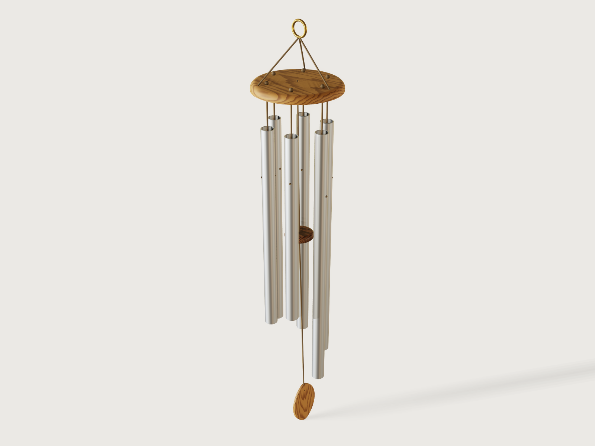

# Tuned chimes

A wind chime of metal tubes, or a glockenspiel of flat bars, that is in tune before you cut it. Pick a scale and the
stock you have bought, and every tube or bar gets its length from the free-free beam formula, corrected for shear and
rotary inertia, with its hole at the node where it hangs still. It exports a full-size cut-and-drill sheet, says how
far a tube cut to the millimetre is off its note in cents, and takes your tuner's reading of a test piece so that the
rest of the set comes out right.



## What it shows

- **A physics formula is the design** (`variable.set`, `table.set`): every length is the free-free beam (Euler-Bernoulli
  plus the Timoshenko correction) worked out from the note's frequency, the metal's table row and the section; a
  second, independent computation sits in every length assertion. Change the tube and every length, the disc, the
  striker and the sail follow.
- **A scale from a table** (`choicesFrom`, `variable.publish` with formula ranges): the number of notes stops at two
  octaves, the octave range follows the tube, so a tube too short to drill or too long to handle cannot be asked for.
- **Which notes exist is the form's choice**, tubes or bars, and how they hang: each piece is a feature with a `when`
  condition, the striker's height and the tube's cord length change with the hanging style.
- **A drive parameter**: the *gust* slider swings the striker and the sail on their cord, each part at its own angle,
  up to the one that brings the striker just up to a tube (`feature.transform`).
- **A cut-and-drill sheet that exports without picking** (`sketch.text`, `set.define`, `file.export`): hidden full-size
  strips, one per note, with their frequency, cut length and hole distance, and the outlines of the disc and sail, as
  a named set of faces.
- A static drawing of a chime is one set of numbers; this one is any scale in five metals, a wind you pick, and a
  correction from a real tube.

## The real thing

**The formula.** A tube or bar hanging free at both ends is a free-free beam. Its first bending mode has the
frequency (Tom Irvine, *Bending Frequencies of Bernoulli-Euler Beams*, rev. W, 2026, Table 1 and Appendix H, read):

    f = 22.373 / (2 pi L^2) * sqrt(E I / (rho A))

with E the Young's modulus, rho the density, A the section and I its second moment. Only the radius of gyration
r = sqrt(I / A) matters: for a tube of outside and inside diameter D, d it is sqrt(D^2 + d^2) / 4; for a bar of
thickness t, t / sqrt(12) (it bends through its thickness; the width falls out). The first mode's nodes lie
22.4 % of the length in from each end: the root of the free-free mode shape, computed for this Jig as 0.22416,
and the 22.4 % Lee Hite uses (below). A tube hangs from a cord through a hole at the top node; a bar
rests on felt over two rails at both nodes with a pin through its holes.

**Shear and rotary inertia.** The Euler-Bernoulli formula alone is too high for a short, stiff tube: for the default
tubes it comes out 22.7 cents sharp at 533.5 mm and 45.0 cents sharp at 375 mm against a Timoshenko solution. The
Jig uses a closed-form correction fitted to Timoshenko's beam
(the same as the old Jig's, reviewed again here), `(f_EB / f_T)^2 = 1 + C (r / L)^2`, `C = 47.7 + 11.7 E / (kappa G)`
with the shear coefficient kappa from Cowper's formulas for a thin-walled tube and a rectangle (read from the table on
Wikipedia's *Timoshenko-Ehrenfest beam theory*; G from the table below). Solved for the length that sounds f:
`L = sqrt((sqrt(C^2 r^4 + 4 L_EB^4) - C r^2) / 2)`.

**Independent recomputation.** A shooting-method solver of the Timoshenko free-free beam (the two coupled equations
with their free-end conditions; written for this Jig, not committed, `verify.py` in the builder's scratch folder), at
the Jig's cut lengths, for the default 25 x 1.5 mm aluminium chime:

| Note | Target Hz | Cut mm | Solver Hz | Error (cents) |
|---|---|---|---|---|
| C5 | 523.25 | 533.5 | 523.44 | +0.6 |
| D5 | 587.33 | 503.5 | 586.75 | -1.7 |
| E5 | 659.26 | 474.5 | 659.48 | +0.6 |
| G5 | 783.99 | 434.5 | 784.07 | +0.2 |
| A5 | 880.00 | 410.0 | 878.53 | -2.9 |
| C6 | 1046.50 | 375.0 | 1045.86 | -1.1 |

These differences are the closed form against the solver plus the rounding of the cut length to 0.5 mm. A sweep over all five metals, three tube and three bar sizes at L / r from 30 to 150 (the same solver) found the closed
form within 1.7 cents of it; the form's shortest length keeps every note at L / r of 30 or more. Below that the
correction fails fast (-12 cents at L / r = 15 for a 50 x 2 mm tube), so the form does not offer it.

**How far theory is from a real cut tube.** The calculation assumes a perfectly uniform tube of the table's stiffness
and density. A real tube differs:

- **Stiffness and density.** The published Young's modulus of a metal group spreads (the `Stiffness band` column below
  is half of that spread); the pitch follows the square root of E, so the band becomes cents as the form's output
  *Pitch spread*: about 13 cents for aluminium, 21 for mild steel, 28 for stainless, 43 for brass and 76 for copper
  (where the sources disagree most, 110 to 132 GPa). Density adds a little.
- **Wall tolerance.** A 0.1 mm thicker wall on 25 x 1.5 mm changes the radius of gyration by 0.4 %, 7 cents (my
  estimate of a normal tolerance, not from a standard).
- **The tube's section** is not circular everywhere; Hite warns of tubes that beat between two close frequencies, and
  of a tuner that may not hear the note a chime sounds because of its non-harmonic overtones (Compendium, pp. 21, 24 to 25).
- **A cut end and a drilled hole** shift the pitch a little more, which is not modelled.

So before trimming a good aluminium tube is likely within about 10 to 20 cents of its note, copper perhaps 80
(my estimate from the spread of published moduli, not a measurement: I have no measured comparison of a real tube
to this calculation). The rounding error shown for each note on the form is only the error of rounding the cut to 0.5 mm, against the
Jig's closed form; the solver above adds up to 2.9 cents (A5).

**Correction by trimming.** Shortening a tube raises its pitch: cents = 3462 x (amount cut) / L, so 6.5 cents per mm
on the longest default tube and 9.2 on the shortest (both form outputs). A tube cannot be made longer, so the Jig works
from one test piece, the same procedure on the form and here:

1. Leave *Test piece reads* at 0 and cut one tube to the output *Test piece* (the first note's length), square and
   deburred, **not drilled**.
2. Hang it in a loop of string at 22.4 % of its length and tap it, as Hite does with a string slipknot at the node
   (Compendium, *Tuning the Chime*, p. 24). Read a chromatic tuner against note 1 and enter the cents (minus when
   flat), -100 to +100. A tuner names the nearest note: when the piece is more than 50 cents off (copper can be, see
   *Pitch spread*), it names the note above or below note 1; add 100 to its reading for the note above, subtract 100
   for the note below. The reading gives the true speed of sound of your stock, and every length,
   hole and the sheet correct themselves; the test piece's own length stays on the form.
3. **Flat** (minus): every length gets shorter; trim the test piece to note 1's new length. **Sharp** (plus): every
   length gets longer and the piece is now too short for note 1; trim it to note 2's new length, which it always reaches
   (in every scale of the table note 2 is at least two semitones, 200 cents, above note 1, and the reading at most 100;
   an assertion checks it), and cut note 1 again from the stock.
   The output *Stock to buy* is the lengths plus 3 mm a cut; a sharp reading costs one more cut.
4. Cut the rest to their corrected lengths with about 1 mm to spare (Hite cuts about 1/8 inch long to smooth the ends,
   p. 8), deburr, hang each one the same way, read it and file the bottom end until it is in tune. What is left is the
   tube-to-tube spread of wall and section, a few cents.
5. Drill each node hole last, at the sheet's distance from the top end, measured on the finished tube.

At 0, the reading means the test piece rings exactly on its note; the formula predicts that to within the rounding of
its length to 0.5 mm (+1.5 cents for the default), so leaving it at 0 when nothing was measured changes nothing that
matters.

**Making it.** Steel, brass or copper tubes and flat bars come from any metal supplier, the aluminium tube (default) from a DIY
store. The cord is waxed linen or kite line through the node hole, up the bore and through the disc, knotted on top.
The top is an oak disc turned or routed with a rounded rim; three cords lift it to a brass ring over its balance point. The striker is a
turned walnut disc with a rounded edge on the line from the disc's centre, the sail an almond of 5 mm oak board with the
rounded face towards the tubes. On the glockenspiel the bars rest on a felt strip on two oak rails running straight
through the nodes of the first and last bar; a brass pin stands in a hole through the rail at each node (on the cut sheet)
and through the bar's node hole, keeping the bar in place, and a sleeve of felt or rubber on the pin stops it buzzing.

## Parameters

**The notes**
- *Instrument*: wind chime or glockenspiel.
- *Scale*: major or minor pentatonic, major, natural minor, chords, Westminster quarters.
- *Lowest note* and *Octave*: the octave's range follows the tube or bar so no piece is too short to drill or too long
  to handle (for 25 x 1.5 mm aluminium, six notes of major pentatonic: octave 3 to 6).
- *Number of notes*: 3 up to two octaves of the scale, at most 12.

**The metal**
- *Metal*: aluminium EN AW-6060 T6, mild steel, stainless 1.4301, brass CuZn37, copper Cu-DHP (table below).
- *Tube size*: 14 common sizes (wind chime). *Flat bar size*: 9 common sizes (glockenspiel).
- *Test piece reads*: -100 to +100 cents, the tuner's reading of the test piece against note 1 (procedure above).

**Hanging** (wind chime only)
- *How the tubes hang*: bottoms level, tops level or middles level. Hite calls bottom aligned best, because the striker
  reaches the end edge of every tube, and notes top aligned may look better and that all three work when the striker
  avoids the exact centre (Compendium, Step 13, p. 11). The striker hits near the bottom end with bottoms level, 0.03 to
  0.06 of the length below the middle with middles level, and with tops level at the height where the longest and the
  shortest tube are struck equally far from their nodes (the longest at 0.413 of its length, the shortest at 0.587 at
  the defaults, where the first mode moves 0.54 times as much as at the end; at least 0.37 over two octaves). An
  assertion holds every tube's strike point, measured on the model, a tenth of its length or more from a node. The
  centre is not avoided with tops level: one striker height cannot keep a whole set of lengths off it, and at the
  defaults G5 is struck at 0.507 of its length, 3 mm from its centre, where the first overtone is barely excited. Hite
  calls that dead zone very narrow and easily overcome by a slightly off-centre strike (Step 17, p. 11); the 14 mm
  striker spans it. Choose bottoms level, his preferred hanging, to stay well clear of the centre.
- *Wind that makes it ring*: 1 to 6 m/s, 2.5 by default; the sail is sized for it (see *Sail*).
- *Gust*: the slider, 0 to 100 %, with the striker touching a tube at 100 %.

At the defaults (C major pentatonic, six aluminium tubes 25 x 1.5 mm, tops level, 2.5 m/s): test piece 533.5 mm; tubes
533.5, 503, 474.5, 434.5, 409.5 and 375 mm long (523.3 to 1046.5 Hz), holes 119.5, 113, 106.5, 97.5, 92 and 84 mm from
the top end, rounding errors at most 1.2 cents, 2 748 mm of stock, 0.82 kg of metal, an oak disc of radius 82 mm, a
sail 67 x 93 mm, a 56 mm walnut striker. A test piece that reads 13 cents flat shortens them to 531.5 ... 373.5 mm; one
that reads 13 cents sharp lengthens them to 535.5 ... 376.5 mm, and the 533.5 mm piece becomes note 2 (505 mm).

A glockenspiel of 30 x 6 mm aluminium flat bar in C major from C5: eight bars, 244.5 to 172.5 mm long, node holes 55 to
38.5 mm from the ends, rounding errors at most 4.1 cents (the 0.5 mm cut step is a larger share of a short bar), 1 667 mm
of stock.

**The materials** (value used, source read):

| Metal | E (GPa) | G (GPa) | Density | Stiffness band | Source |
|---|---|---|---|---|---|
| Aluminium EN AW-6060 T6 | 70 | 27 | 2700 | +/-1.5 % | EN 1999-1-1 section 3.2.5 (read: E 70 000, G 27 000 N/mm2, 2 700 kg/m3) |
| Mild steel (S235, conduit) | 210 | 81 | 7850 | +/-2.4 % | EN 1993-1-1 section 3.2.6 via eurocodeapplied.com (read) |
| Stainless steel 1.4301 | 197 | 77 | 7950 | +/-3.3 % | AZoM, Grade 304 properties page (read: E 190 to 203, G 74 to 81 GPa, density 7.85 to 8.06) |
| Brass CuZn37 | 110 | 41 | 8440 | +/-5 % | CW508L data sheet (read: 8.44 g/cm3, E 110 000 N/mm2); G from nu = 0.34 |
| Copper Cu-DHP | 121 | 45 | 8930 | +/-9 % | Hite's table 16 Msi; KME TECU 132 GPa (from a search listing): my midpoint; G from nu = 0.34 |

The bands are my reading of the published spread for each group, not tolerances from a standard.

**Sail.** A flat plate in a wind: drag F = 1/2 rho v^2 Cd A, Cd 1.17 (the figure Wikipedia's drag coefficient article
gives for a square plate; it marks it "citation needed", and an alternative of 1.28 is listed: an estimate). Striker and
sail hang on one cord from the disc's centre, so the cord bends at the striker: its upper part leans by
atan(F / (W_striker + W_sail)), its lower part by atan(F / W_sail). The striker reaches a tube when the upper part leans by
the angle that brings its rim to the tube, so the sail is sized for F = (W_striker + W_sail) tan(that angle) at the wind
you ask, statically. The model shows both parts at their own angles as the *Gust* slider moves. It is a starting point,
not a prediction: gusts are not steady, and the sail's own lean, which lowers its drag by the cosine of the angle, is
left out. That lean is large for a light sail under a heavy striker (tens of degrees at full gust), so such a chime needs
more wind than the output says. The sail stays
in proportion: between 12 cm2 and an almond 1.1 times the disc's radius wide; at those limits the output *Rings in a
wind of* gives the wind it really takes, which then differs from the wind asked.

**Balance.** The tubes go round the ring in pitch order, so the longest side is heavier and a disc hung from its centre
would hang about 2 degrees off level. The bridle meets at the ring over the centre of mass of tubes and disc (3.1 mm off
centre at the defaults); tie the three cords so the ring sits there. The light striker and sail hang at the centre and are
left out (they move the balance point by about a tenth of a millimetre).

**Sources, and what each is.** Read in full or at the place cited: Irvine's beam notes, EN 1999-1-1 (a copy of the
2007 text, clause 3.2.5), Hite's compendium (PDF updated 5/9/2022: support at 22.4 %, pp. 20 and 24; cut about 1/8 inch long and
chamfer, p. 8; alignment and striker, Steps 13 and 17, p. 11; beating and tuner caution, pp. 21, 24 to 25), the CW508L
brass sheet, AZoM's stainless data, eurocodeapplied.com for EN 1993-1-1. Read through a search listing only: KME's TECU
copper figure. From Wikipedia (the Timoshenko table, 1.17 and 1.28 for a plate): secondary, as the text says. My own: the
stiffness bands, the wall tolerance, the sail sizing, the three numbers for hanging, and the Jig's closed form, which was
checked against a solver written for this Jig (not against a published solution).

## Checks

The Jig measures itself at every change of the form (79 assertions, those of the other instrument and of absent notes
inactive):

- **Every length is the beam formula's, recomputed.** Each tube's or bar's measured extent equals a second computation
  of the length, written from the table values, the note's own frequency and the test piece's reading (the test piece
  worked out again too), not through the variables of the model, within 0.26 mm (half the 0.5 mm cut step).
- **Node holes, on the model against the formula.** Each tube has one wall of a hole of the drill diameter within 0.31 mm of
  22.416 % of its length from its top end, at the tube's place; each bar has two, from each end.
- **The strips of the cut sheet** are exactly the cut lengths, and the sheet holds one face per note plus the flat parts.
- **Volumes in closed form.** The tubes' or bars' volume equals section times the lengths, less the holes (and corners
  for bars), the disc's underside and the frame's underside (less a pin hole at every node) are their closed-form
  areas, and the sail's face is the area the wind calculation asked for, within 2 %.
- **Balance.** The measured centre of mass of the tubes and the disc (x and y) is the closed-form balance point within
  0.2 mm, and the ring's measured box puts it there.
- **Tubes do not touch.** Neighbouring tubes stand the planned gap apart; the striker's clearance to the tube it swings to
  is the gap less the gust's share (within 8 % and 0.3 mm), the striker stands within every tube's length, and its measured
  centre meets each tube at least a tenth of its length from a node.
- **A bar is the stock chosen**: width and thickness of the first bar equal the table row; pins stand clear in the bar holes.
- Every note present, and a sharp test piece always long enough to become note 2.

Mutation tests in a scratch copy, each noticed by the assertions named: the node fraction changed (hole check), the beam
constant or the wave speed changed (all lengths), the wall of the tube changed (lengths), one tube 1 % long or cut to another note's length (that tube's
length), a bar's width off its stock (the stock check), a drilled hole moved (its node check), the strike height changed (node margin), the ring radius shrunk (tube gap,
striker clearance), the sail's shape factor changed (sail area), the swing angle doubled (striker clearance), the old
striker height of 0.7 of the shortest tube (node margin: 0.076), the reading applied without the test piece (lengths),
the balance point or the ring moved (balance, ring), a frame pin hole left out (frame underside).

`tools/jigs.py check` runs `check-range`: 144 points (the defaults, up to 64 corners of the box of the ranges, every other
choice and 32 random points from seed 1), all pass, none unproven, the slowest 7.8 s on a busy machine (budget 12 s). By hand with `param.set`: flat and sharp readings of 13 cents, the
glockenspiel with 8 and 12 bars, and three 12 mm stainless tubes at 1 m/s (the sail at its cap, 70 x 99 mm, ringing at
2.2 m/s). The closed form holds to 1.7 cents for L / r at 30 and above, as far as the sweep covers; the independent solver
differs from the model by at most 3 cents for the default chime (closed form plus 0.5 mm rounding). The assertions prove the geometry is the formula's, not that the metal obeys it;
the *Pitch spread* output and the tuning procedure above are the honest answer to that.

Not checked: the strength of cord and knots, how a real gust behaves, the sound of any tube beyond the first mode (see
Hite on overtones).

## Export

- **The cut-and-drill sheet:** File, Export, *Sheet of set: Cut sheet*, as SVG or DXF, at true size: one strip per note with its
  Roman number, frequency, cut length and hole distance; the disc (underside, with its holes) and the sail, or the
  glockenspiel's frame with its pin holes. Print it at 100 % or send it to a laser. In SVG give a stroke width
  (0.25 mm): the default 0.01 mm lines are too thin to see on screen. The strips' lengths are the cut lengths; the holes are at
  the node distance from each end. Digits with enclosed counters (0, 4, 6, 8, 9) show as outlines without their inner
  shape, because of how the set exports (see Platform notes).
- The form's outputs give the test piece, the stock to buy, and for every note its frequency (to tell the tubes apart
  with a tuner), cut length, hole distance and rounding error; notes beyond the set read 0.

## Files

`build.json` (the source), `meta.json`, `formtest.md`, `preview.png`, and `dist/tuned-chimes.3dcraftjig`,
`dist/thumbs/tuned-chimes.png` from the tool. The Python scratch files are not committed (AGENTS.md section 3).

## Rebuild

```sh
tools/jigs.py build tuned-chimes
tools/jigs.py render tuned-chimes
tools/jigs.py check tuned-chimes
```

## Difficulty

7 out of 10: coupled per-note beam physics with a fitted Timoshenko closed form, two instruments, a drive slider, a cut
sheet and kernel limits over the range.

## Platform notes

- **The cut sheet's lettering.** `file.export` of a named set of faces packs every face on its own (`findings/J-xxx-set-sheet-packs-faces/`), so the strips are one face each with the letters as holes in it, and the digits lose their inner counters (0, 4, 6, 8, 9). Engraving the numbers as pockets ran into the kernel: thirteen rows of text cut at once are refused for "more memory for their indexes", and cutting them row by row takes a minute ([repro](../../findings/J-xxx-many-glyph-boolean/repro.json), to be proposed).
- **File size.** The file is 978 kB against a budget of 1 MB: 332 kB of it is the bundled sans font, embedded whole
  because the strips carry text (F-037), and the rest is pretty-printed JSON in an uncompressed ZIP (F-138).
- **Twelve copies of every per-note step.** A pattern instance has no index to read a table with (J-011, see F-027), so
  each tube, bar, strip, length variable, assertion and output is written twelve times and switched by `when`; most of
  `build.json`'s 900 steps are these copies.
- **Note names on the sheet.** A sketch text cannot print a table's text column (F-035), so the strips carry a Roman number and the frequency instead of "C5".
- **No Hz or cents unit** in outputs (`findings/J-xxx-no-frequency-unit/`): frequencies and cents are plain numbers named in their label.
- **Cut list of a tube.** A drilled tube with chamfered ends is not a plate to `cut.list`, so the Jig has no saw list of tubes; its hidden full-size strips carry the cut lengths and hole positions instead. A plain extruded tube would be listed as a plate whose thickness is the tube's length, which is `J-004`'s reading.
- **Frame chamfer.** The chamfer stops at the frame's outer edge: `feature.chamfer` refuses the four top edges around the frame's opening, and the same on a plain rectangular hole ([repro](../../findings/J-xxx-chamfer-inner-loop/repro.json), to be proposed). The opening stays square-edged.
- STEP or mesh export of the whole document also carries the hidden strips, far above the chime (the mesh side is `findings/J-xxx-hidden-body-in-mesh-export/`), so the Jig offers the sheet, not a 3D file.
- **The sail is built at the origin and then placed.** Its edge round was refused at some heights when drawn in place (a boolean "partly on and partly off a face boundary"), at 5 of the first 46 points of the range check; drawn around the origin and moved by `feature.transform` it never failed. A literal copy of the same outline at the same height passed, so no reproducer was found.
- The feature `Extrude1` is the tool of the disc's hole cut and keeps its automatic name. The frame's pin holes are cut by
  the pins themselves (`feature.boolean` with `keepTool`), so they have no tool of their own.
