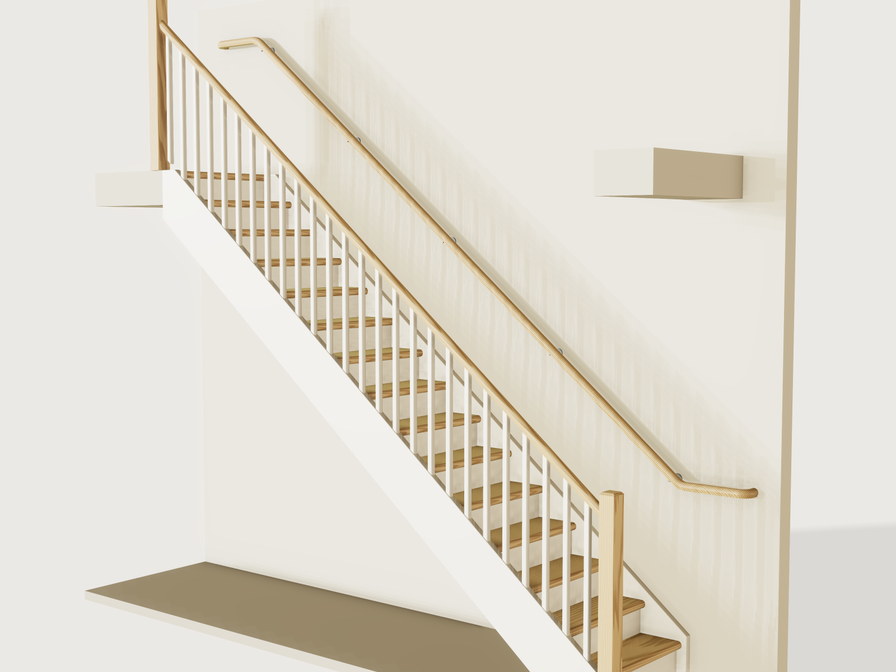

# Wooden stair

Measure your stairwell and set the form: floor to floor, the run you have, the width, the opening in the upper floor. The
Jig decides how many treads you get and what the rise and going are, and keeps them within the dimensions of the rule you
pick; a run, width, opening or height outside them cannot be set. Oak treads and painted risers are housed in two
stringers and wedged from behind, the stringer ends are cut to meet both floors, and wall rails or a balustrade follow your
choice. The stringers and treads export for a CNC. It checks dimensions only: strength figures are an orientation that a
structural engineer must verify.



## What it shows

- **The step count from a formula.** Blondel's step rule is solved for the number of risers: with height H and usable run
  L, 2 H / N + L / (N - 1) = 620 mm gives N, rounded down and kept between the lawful minimum and a maximum (rise down to
  150 mm, and the rule's longest flight). All of it is `variable.set` formulas.
- **The tread count changes the topology.** `sketch.pattern` repeats the housing outlines up the stringer and
  `feature.pattern` repeats treads, risers, wedges and balusters from the formula's counts; `feature.mirror` makes the
  opposite stringer; `feature.when` switches risers, the balustrade and the wall rails.
- **A table of building rules** (`table.set`, `choicesFrom`): each row gives rise, going, step-rule range, width, head
  height, longest flight, flight height and which handrails are allowed, and the whole form follows the row.
- **Ranges that are formulas of other parameters** (`variable.publish` with `min` and `max` formulas): the run may not go
  below what the rule needs, the opening below what the head height needs, the floor height above what the rule's flight
  allows, the floor thickness above what leaves the head height in the room below, the tread and the stringer below their
  orientation minimums.
- **Sweeps** (`feature.sweep`, `sketch.path` with tangent arcs): a wall rail with level extensions at both ends and
  ends that return to the wall, and a balustrade rail on a pitched datum plane (`datum.plane` through three points).
- **A layout on a datum plane along the pitch**: the sketch *CNC stringer layout* holds the stringer flat along x with all
  its housings.

## The real thing

**Sources.** What was read in the text itself, and what was not:

| Value | Bbl (NL, new dwelling) | Flanders (accessible building, art. 20) | Comfort stair (this Jig's own) |
|---|---|---|---|
| Rise | at most 188 mm | at most 180 mm | at most 180 mm |
| Going | at least 220 mm at the climbing line | at least 230 mm | at least 250 mm |
| 2 x rise + going | none in Bbl; Flemish 57 to 63 cm used as comfort band | 570 to 630 mm | 600 to 630 mm |
| Width | at least 800 mm (stringers count) | at least 1 250 mm between walls, 1 000 mm between rails | at least 800 mm |
| Head height | at least 2 300 mm | none in art. 20; Bbl's value used | Bbl's value |
| Longest flight | 4 m height difference | at most 17 treads, so 3 240 mm at 180 mm | 4 m |
| Handrail | one side, top 0.8 to 1 m above the tread front | both sides, 40 cm level at each end, returned to the wall | one side |
| Tread surface | at least 230 mm at the climbing line | none | none |

- **Read in the legal text** (Inview copy of the Bbl; `wetten.overheid.nl` could not be fetched): Bbl art. 4.26 and table
  4.26 ([text](https://www.inview.nl/openCitation/idb6c6ab0bf71f44e9ac0785bee4237858/besluit-bouwwerken-leefomgeving-artikel-4-26)),
  art. 4.28 ([text](https://www.inview.nl/openCitation/id9ad0567bc6a54b8ebfc050c3ab169e0a/besluit-bouwwerken-leefomgeving-artikel-4-28)),
  art. 4.20 ([text](https://inview.nl/openCitation/idf94aba0d5fda4135bd0c03bfdc0e5a7b/besluit-bouwwerken-leefomgeving-artikel-4-20)).
  IPLO ([Trappen Bbl](https://iplo.nl/regelgeving/regels-voor-activiteiten/technische-bouwactiviteit/rijksregels-bouwactiviteit/trappen-bbl/))
  says the stringers count in the width. Flemish *Gewestelijke stedenbouwkundige verordening toegankelijkheid* (Besluit
  Vlaamse Regering of 5 June 2009, amended 18 February 2011), art. 20: for buildings open to the public. We found no
  statutory stair dimensions for a private Belgian home, hence the third row, which has no legal force.
- **Secondary sources only:** Blondel's rule (*Cours d'architecture*, 1675) is known here from web summaries, and the
  620 mm target is this Jig's choice inside the Flemish band. Bbl has no step rule; the band is applied to its row as a
  comfort limit, not a legal one.
- **Orientation only, not a structural calculation:** the imposed loads come from a
  [Buildwise summary sheet](https://www.buildwise.be/media/td4ltgij/nbn-en-1991-1-1.pdf) of NBN EN 1991-1-1 + ANB
  (dwelling stairs q_k = 3 kN/m²; Q_k = 2 kN). The Dutch annex could not be read; a secondary source gives 3 kN for Dutch
  dwellings, so the Jig uses 3 kN. C24 values (f_m,k 24 N/mm², E 11 000 N/mm²) from a published table of EN 338:2016;
  k_mod 0.8 and gamma_M 1.3 are the commonly quoted EN 1995-1-1 values, and national annexes differ. **A structural
  engineer must verify the strength.**

**What "within the rule" means here.** Only the dimensions in the table are checked. Fire safety, the barrier along an
open side, slip resistance, the fixing of stringers and newels, and everything else in those regulations are not.

**Joinery.** Each tread and riser sits 12 mm deep in a housing routed in the inside face of each stringer (11 mm of
timber goes in, 1 mm clearance). Between the bottom and top risers each riser housing is 8 mm wider at the back and a wedge
driven from behind locks it; the tread housings have the same taper underneath. The bottom and top risers have plain
open-ended housings without wedges: the bottom one runs off the foot of the board, the top one off its end against the
trimmer, and the top riser is screwed to the trimmer. Each riser's tongue goes 10 mm into a groove in the tread above; the
last goes into the landing nosing. The stringer stands on the lower floor with a level foot, ends in a plumb cut against
the trimmer and has a level cut flush with the upper floor. The balustrade has a foot and a top newel post, chamfered, a
pitched rail with a 50 x 45 mm section and square balusters (gap at most 100 mm along the floor). The wall rail stands on
steel rosettes at most 900 mm apart along the floor, runs on level past both ends of the flight and returns to the wall.

**Materials and finish.** Oak treads and handrails, painted pine stringers (C24), painted plywood risers, oak wedges, steel
brackets.

**Making it.** Cut the stringers from a board of *Stringer board width* and *Stringer board length*; route the housings
with the bit you set (corners take its radius, depth 12 mm). Rip the treads to *Tread length* by *Tread depth*, round the
nose and cut the groove as in the section drawing. Glue and wedge from behind, screw the risers into the tread ends and
the top riser into the trimmer, then fix the stringers, the newels and balusters or the rail brackets.

## Parameters

| Group | Parameter | Range | What it changes |
|---|---|---|---|
| Your stairwell | Floor to floor height | head height + 120 mm up to the rule's flight (4 000 or 3 240 mm) | Count, rise and going |
| Your stairwell | Run you have | from the rule's minimum up to 1 500 mm more | The going; the stair takes what it needs |
| Your stairwell | Stair width | rule's minimum to 1 400 mm | Treads, risers, stringer spacing |
| Your stairwell | Upper floor thickness | 120 mm up to 450 mm or what leaves the head height below | Head height |
| Your stairwell | Opening in the upper floor | from what the head height needs, +1 200 mm | The opening in the floor |
| Stair | Building rule | three rows | Everything in the table |
| Stair | Tread thickness | orientation minimum to 60 mm | Treads, nosing, housing, stringer depth |
| Stair | Closed risers | yes or no | Risers, riser housings, wedges |
| Stair | Stringer thickness | orientation minimum to 60 mm | Web behind the housings, board width |
| Handrail and machining | Handrail | wall rail, two wall rails, balustrade with wall rail (as the rule allows) | Rails, brackets, newels, balusters |
| Handrail and machining | Router bit diameter | 6 to 16 mm | Housing corner radius |

The run is measured on the floor. The wall rail runs on past the foot at hand height (300 mm, 400 mm under the Flemish
rule), which is not in the run. A wall rail assumes a solid wall, and *Wall rail on the left* a wall or your own barrier on
the right (Bbl art. 4.20 requires a fixed barrier where the side drops more than 1 m); the right wall is not drawn so that
the stair stays visible. Under the Flemish rule only rails on both walls can be chosen: its rails must continue 40 cm and
end in the wall, which a balustrade between newels does not. **Open risers** leave a gap between the treads (the output
shows it, 142 mm at the defaults): check that this suits the users, children especially; no rule is applied to it here.

Outputs: risers, treads, the step rule, pitch, length on the floor, stringer board width and length, tread length and
depth, head height at the edge of the opening, the smallest opening, rise and going measured on the model, tread stress
and deflection, stringer deflection (orientation), the open-riser gap, the mass of stringers, treads and risers.

At the defaults (2 800 mm, run 3 400 mm, width 900 mm, floor 220 mm, opening 3 250 mm, Bbl, 45 mm treads): 15 risers, 14
treads, rise 186.67 mm, going 230.71 mm, step rule 604.0 mm, pitch 39.0 degrees, stair 3 400 mm long on the floor,
stringer board 317 mm wide, head height 2 369 mm, stair timber 165.8 kg.

## Checks

Twenty-nine assertions. Measured on the model:

- Tread count; top tread plus one rise meets the upper floor exactly; rise and going (from the box of the treads) against
  the rule, the comfort floor and the step rule; the number of treads against the rule's longest flight; the tread surface
  against Bbl's 230 mm.
- The stair's extent on the floor (stringer and foot newel) against the run you have.
- Width at the rule's minimum; the stringer stands on the floor and reaches the top; the landing nosing flush.
- Head height at the edge of the opening: the underside of the floor is measured directly; the edge comes from the
  measured end of the stringer and the opening derived from the measured volume of the floor (asserted equal to the
  opening asked for); the nose line comes from the measured rise and going. Where no floor hangs over the stair (the
  opening reaches the first nose) the rule holds and the output shows the rule's value.
- Tread volume against the closed form with bullnose and groove; treads reach into the housings; treads, risers and wedges
  clear of the stringers and the upper floor; housing corners at least the router radius.
- Wall rail top 0.8 to 1 m above the noses at mid-flight (from section centroids and the box of the rail, with the measured
  rise and going); balustrade rail top 0.8 to 1 m above the noses (its box); the wall rail runs on past both ends by the
  extension; both ends return to the wall; 1 m between the rails under the Flemish rule.

Formula bounds, orientation only: tread stress and stringer deflection, and the stringer board under 480 mm.

What refuses what: the count formula and the run minimum hold the rise, going, step rule and longest flight; the range of
the floor height holds the flight height and the head height in the room below; the minimum opening holds the head height
on the stair; the rule's minimum holds the width; the handrail choice is limited by the rule; formula minimums hold tread
and stringer thickness. Tried by hand with `param.set`, each refused with the range that holds: a run of 2 500 mm, an
opening of 1 500 mm, a width of 700 mm, a 30 mm tread at 1 300 mm wide, a thin stringer on a long wide flight, floor to
floor 2 200 mm, a 500 mm floor, and under the Flemish rule 3 300 mm floor to floor, a balustrade and a single rail.

`tools/jigs.py check` runs `check-range`: 101 points (the defaults, the corners of the box of the ranges, every choice, 32
random points from seed 1), all passing, none unproven; slowest point 0.41 s, mean 0.15 s, load 1.18 s, measured while the
machine was busy (budget for a difficult Jig: load 2 s, slowest point 6 s).

Not checked, by assertion or otherwise: anything beyond the dimensions in the table above, the strength of the joints and
fixings, the stair's vibration, and the fire rules.

## Export

- **CNC stringer layout:** select the sketch *CNC stringer layout* in the Features tab and **File › Export** as DXF or SVG
  (a sketch cannot be in a named set: J-007). It is the left stringer lying along x, in the frame of a plane along the
  pitch, so the board is straight: its outline and every tread and riser housing (14 and 15 at the defaults). Cut the
  outline, pocket the housings 12 mm deep; mirror it for the right stringer. The bottom riser housing runs off the foot and
  the top one off the end of the board. On an open stair the riser outlines remain in the drawing and must be ignored
  (J-006).
- **CNC tread sections** (**Sheet of set**, no selecting): the true end section of a tread and of the landing nosing, with
  bullnose and groove (going + nosing deep, the tread's thickness high). Cut the blank to *Tread length* by *Tread depth*.
- **CNC stringers** (**Sheet of set**): each stringer's inside face pieces and its housing floor at true size. They are
  separate pieces laid side by side, not registered to each other; use the layout sketch for the machine.
- **STEP** of *Stringer left*, *Stringer right* and *Treads* for CAM.

Cut the risers from a plain list: *Tread length* by the rise plus tread thickness plus tongue, in plywood.

## Files

`build.json` (the source), `meta.json`, `formtest.md`, `preview.png`, and `dist/wooden-stair.3dcraftjig`,
`dist/thumbs/wooden-stair.png` from the tool.

## Rebuild

```sh
tools/jigs.py build wooden-stair
tools/jigs.py render wooden-stair
tools/jigs.py check wooden-stair
```

## Difficulty

6 out of 10. Formula-driven topology, coupled housings and a rule table, sweeps, no freeform.

## Platform notes

Entries in `3DCRAFT-FEEDBACK.md`, each with a reproducer in `findings/`:

- A set of faces exported as a sheet puts every face in its own place, so one part's outline and its pocket outlines cannot
  be registered ([repro](../../findings/J-044-set-export-keeps-places/registered.json)); hence the layout sketch, which must be
  selected (J-007).
- `overlap` errors on an inactive body instead of skipping it, like J-003 for `cut.list`
  ([repro](../../findings/J-026-overlap-inactive-body/repro.json)): two assertions, one with `when`.
- Joining a sweep to another that starts from the same section sketch fails at the shared end
  ([repro](../../findings/J-032-sweep-join-shared-section/repro.json)): the rail's returned ends are separate bodies (the same
  edge-of-tolerance refusal as in F-113, which kept no reproducer for it).
- `body.appearance` `pattern.axis` takes only literals, like the colours in J-009: the rail's grain axis does not follow
  the pitch.
- `cut.list` reads the bullnosed landing nosing as an 820 mm-thick plate (J-004) and treads in a pattern as no plates (J-010),
  so the outputs give the sizes instead of a saw list. A sketch entity cannot be switched off by a formula (J-006).
